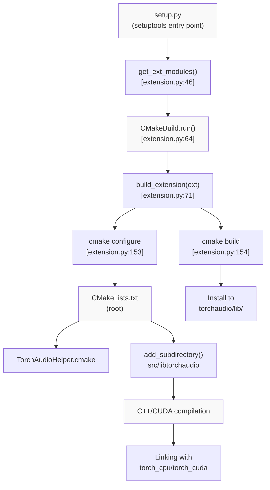
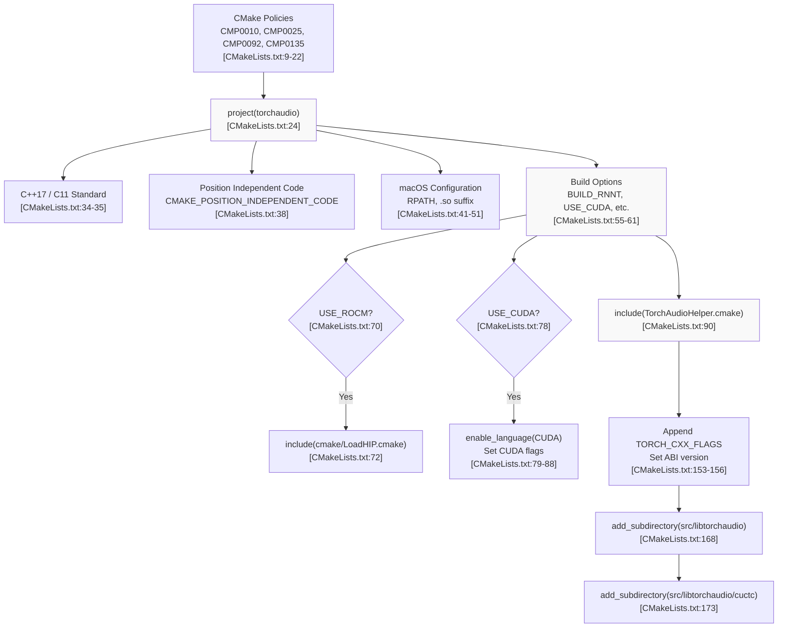
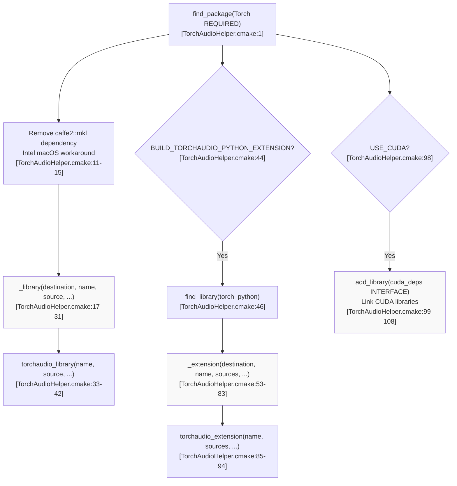
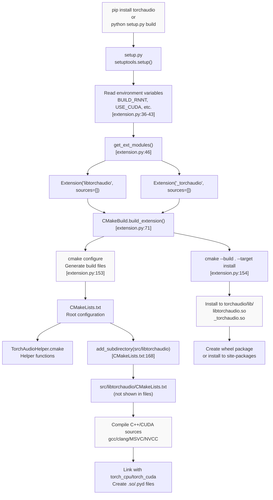

<!-- source: DeepWiki mcp.deepwiki.com · repo pytorch/audio · page 5.2 CMake Build System · fetched 2026-10-21 -->

# CMake Build System

<details>
<summary>Relevant source files</summary>

The following files were used as context for generating this wiki page:

- [CMakeLists.txt](CMakeLists.txt)
- [cmake/TorchAudioHelper.cmake](cmake/TorchAudioHelper.cmake)
- [tools/setup_helpers/extension.py](tools/setup_helpers/extension.py)

</details>


## Purpose and Scope

This document details the CMake-based build system that compiles TorchAudio's native C++ and CUDA extensions. The CMake build system is invoked by setuptools during package installation and handles platform-specific compilation, CUDA/ROCm support, and the creation of shared libraries that are loaded by Python at runtime.

For information about the higher-level build orchestration and packaging configuration, see [Build Configuration](#5.1). For details on the continuous integration workflows that invoke this build system, see [CI/CD Pipeline](#5.3).

**Sources:** [CMakeLists.txt:1-175](), [tools/setup_helpers/extension.py:1-162]()

---

## Build System Overview

The CMake build system operates as a two-stage process: setuptools invokes CMake via a custom `CMakeBuild` command class, which then executes the CMake configuration and build phases to produce native extensions.

### Build Flow Diagram



The `CMakeBuild` class in [tools/setup_helpers/extension.py:63-161]() extends setuptools' `build_ext` to invoke CMake instead of using Python's default C extension compiler. When `build_extension()` is called, it executes CMake with project-specific arguments derived from environment variables and PyTorch's configuration.

**Sources:** [tools/setup_helpers/extension.py:63-154](), [CMakeLists.txt:1-175]()

---

## Build Options and Configuration

The build system exposes several compile-time options that control which features are enabled. These options are set via environment variables read by [tools/setup_helpers/extension.py:22-43]() and passed as CMake definitions.

### Primary Build Options

| CMake Option | Environment Variable | Default | Purpose |
|--------------|---------------------|---------|---------|
| `BUILD_RNNT` | `BUILD_RNNT` | `ON` | Build RNN transducer implementation |
| `BUILD_ALIGN` | `BUILD_ALIGN` | `ON` | Build forced alignment functionality |
| `BUILD_CUDA_CTC_DECODER` | `BUILD_CUDA_CTC_DECODER` | `OFF` (or auto-detect) | Build CUDA CTC decoder |
| `USE_CUDA` | `USE_CUDA` | Auto-detect from PyTorch | Enable CUDA support |
| `USE_ROCM` | `USE_ROCM` | Auto-detect from PyTorch | Enable ROCm/HIP support |
| `USE_OPENMP` | `USE_OPENMP` | Auto-detect from PyTorch | Enable OpenMP parallelization |
| `BUILD_TORCHAUDIO_PYTHON_EXTENSION` | N/A | `OFF` (set by CMakeBuild) | Build Python bindings |

The auto-detection logic in [tools/setup_helpers/extension.py:36-42]() checks PyTorch's configuration to determine hardware support:

```python
_USE_ROCM = _get_build("USE_ROCM", torch.backends.cuda.is_built() and torch.version.hip is not None)
_USE_CUDA = _get_build("USE_CUDA", torch.backends.cuda.is_built() and torch.version.hip is None)
```

These options are passed to CMake as `-D` flags in [tools/setup_helpers/extension.py:95-110]().

**Sources:** [tools/setup_helpers/extension.py:36-43](), [tools/setup_helpers/extension.py:95-110](), [CMakeLists.txt:55-61]()

---

## Root CMakeLists.txt Structure

The root [CMakeLists.txt:1-175]() establishes the build environment and delegates to subdirectories for actual library compilation.

### Project Configuration Diagram



**Sources:** [CMakeLists.txt:1-175]()

### Key Configuration Steps

1. **CMake Policies** [CMakeLists.txt:9-22](): Sets modern CMake behavior including compiler ID detection and warning suppression for MSVC.

2. **Language Standards** [CMakeLists.txt:34-35](): Enforces C++17 (required by PyTorch) and C11. A warning is issued if the environment already defines a C++ standard [CMakeLists.txt:28-33]().

3. **Platform-Specific Configuration**:
   - **macOS** [CMakeLists.txt:41-51](): Detects Apple Clang version, enables RPATH, and forces `.so` suffix instead of `.dylib` for Python compatibility.
   - **MSVC** [CMakeLists.txt:103-138](): Suppresses warning 4819 and adds extensive CUDA diagnostic suppressions for NVCC.

4. **PyTorch Integration** [CMakeLists.txt:153-156](): Appends `TORCH_CXX_FLAGS` to inherit PyTorch's ABI settings and sets `TORCH_TARGET_VERSION` for ABI stability with PyTorch 2.10+.

5. **Compiler Caching** [CMakeLists.txt:158-166](): Detects and enables ccache if available to accelerate incremental builds.

**Sources:** [CMakeLists.txt:9-166]()

---

## CUDA and ROCm Support

The build system supports both NVIDIA CUDA and AMD ROCm platforms, but not simultaneously [CMakeLists.txt:66-68]().

### CUDA Configuration

When `USE_CUDA=ON`, the build enables CUDA language support and configures compiler flags:

```cmake
enable_language(CUDA)
set(CMAKE_CUDA_FLAGS "${CMAKE_CUDA_FLAGS} \
    -DCUDA_HAS_FP16=1 \
    -D__CUDA_NO_HALF_OPERATORS__ \
    -D__CUDA_NO_HALF_CONVERSIONS__ \
    -D__CUDA_NO_HALF2_OPERATORS__")
```

These flags [CMakeLists.txt:78-88]() disable half-precision operators that conflict with PyTorch's custom implementations.

On MSVC, additional NVCC diagnostic suppressions are applied [CMakeLists.txt:107-126]() to reduce compiler noise. The `CUDA_CONVERT_FLAGS` function [CMakeLists.txt:93-101]() adapts C++ compiler flags to CUDA by wrapping them with `-Xcompiler=`.

The Python build script passes CUDA architecture list via `CMAKE_CUDA_ARCHITECTURES` [tools/setup_helpers/extension.py:113-118](), converting from PyTorch's format (e.g., "7.5+PTX") to CMake's format (e.g., "75-real").

**Sources:** [CMakeLists.txt:78-138](), [tools/setup_helpers/extension.py:113-122]()

### ROCm/HIP Configuration

For AMD GPUs, `USE_ROCM=ON` triggers loading of HIP paths via [cmake/LoadHIP.cmake]() [CMakeLists.txt:72](). If HIP is not found, ROCm support is automatically disabled [CMakeLists.txt:73-75]().

**Sources:** [CMakeLists.txt:70-76]()

---

## TorchAudioHelper.cmake Utilities

The [cmake/TorchAudioHelper.cmake:1-109]() module provides helper functions for building libraries and Python extensions with consistent configuration.

### Helper Function Architecture



**Sources:** [cmake/TorchAudioHelper.cmake:1-109]()

### Core Functions

#### `torchaudio_library()`

Defined at [cmake/TorchAudioHelper.cmake:33-42](), this function builds shared libraries (`.so`, `.dylib`, `.pyd`) that do not contain Python bindings. It wraps the internal `_library()` function [cmake/TorchAudioHelper.cmake:17-31](), which:
- Creates a shared library with `add_library()`
- Sets include directories to `${PROJECT_SOURCE_DIR}/src` and additional specified paths
- Links against specified libraries (typically `torch_cpu`)
- Removes the `lib` prefix via `set_target_properties()`
- Sets `.pyd` suffix on Windows
- Installs to `torchaudio/lib/`

#### `torchaudio_extension()`

Defined at [cmake/TorchAudioHelper.cmake:85-94](), this function builds Python extension modules by wrapping `_extension()` [cmake/TorchAudioHelper.cmake:53-83](). Key differences from `torchaudio_library()`:
- Links against `torch_python` library [cmake/TorchAudioHelper.cmake:66]()
- Includes Python headers via `${Python_INCLUDE_DIR}` [cmake/TorchAudioHelper.cmake:60]()
- On macOS, sets `-undefined dynamic_lookup` link flag [cmake/TorchAudioHelper.cmake:76]() for delayed symbol resolution
- On Windows, links against Python development libraries [cmake/TorchAudioHelper.cmake:48-52]()

#### `cuda_deps` Interface Target

When `USE_CUDA=ON`, an interface target is created [cmake/TorchAudioHelper.cmake:99-108]() that bundles CUDA dependencies:
- Includes CUDA toolkit headers
- Defines `USE_CUDA` preprocessor macro
- Links against `c10_cuda` and `cudart` libraries

This target can be added to `target_link_libraries()` to enable CUDA support in any extension.

**Sources:** [cmake/TorchAudioHelper.cmake:17-108]()

---

## CMake Integration with setuptools

The integration between setuptools and CMake is implemented in [tools/setup_helpers/extension.py:63-161]() via the `CMakeBuild` class.

### Extension Module Specification

The `get_ext_modules()` function [tools/setup_helpers/extension.py:46-58]() returns `Extension` objects with empty source lists. This is necessary because setuptools requires `Extension` objects, but the actual compilation is handled by CMake:

```python
modules = [
    Extension(name="torchaudio.lib.libtorchaudio", sources=[]),
    Extension(name="torchaudio.lib._torchaudio", sources=[]),
]
```

When `BUILD_CUDA_CTC_DECODER=1`, additional CTC decoder extensions are included [tools/setup_helpers/extension.py:51-56]().

**Sources:** [tools/setup_helpers/extension.py:46-58]()

### CMake Invocation Process

```mermaid
graph LR
    BUILDEXT["build_extension(ext)<br/>[extension.py:71]"]
    
    CHECK{"ext.name ==<br/>libtorchaudio?<br/>[extension.py:78]"}
    
    GETDIR["self.get_ext_fullpath('foo')<br/>[extension.py:87]"]
    EXTDIR["extdir (install prefix)"]
    
    ARGS["Build cmake_args list<br/>[extension.py:95-127]"]
    CFGARG["-DCMAKE_BUILD_TYPE=Release<br/>-DCMAKE_PREFIX_PATH=torch.utils.cmake_prefix_path<br/>-DCMAKE_INSTALL_PREFIX=extdir<br/>-DBUILD_RNNT:BOOL=ON<br/>-DUSE_CUDA:BOOL=ON<br/>etc."]
    
    BLDARGS["Build build_args<br/>[extension.py:111]"]
    INSTALL["--target install"]
    
    CMAKECFG["subprocess.check_call()<br/>cmake configure<br/>[extension.py:153]"]
    CMAKEBLD["subprocess.check_call()<br/>cmake build<br/>[extension.py:154]"]
    
    BUILDEXT --> CHECK
    CHECK -->|Yes| GETDIR
    CHECK -->|No| RETURN["return (skip)"]
    GETDIR --> EXTDIR
    EXTDIR --> ARGS
    ARGS --> CFGARG
    CFGARG --> BLDARGS
    BLDARGS --> INSTALL
    INSTALL --> CMAKECFG
    CMAKECFG --> CMAKEBLD
    
    style BUILDEXT fill:#f9f9f9
    style CMAKECFG fill:#f9f9f9
    style CMAKEBLD fill:#f9f9f9
```



The `build_extension()` method executes two subprocess calls:
1. **Configure phase** [tools/setup_helpers/extension.py:153](): Runs `cmake <root_dir> <args>` to generate build files
2. **Build phase** [tools/setup_helpers/extension.py:154](): Runs `cmake --build . --target install` to compile and install

Key arguments passed to CMake include:
- `CMAKE_PREFIX_PATH`: Set to `torch.utils.cmake_prefix_path` [tools/setup_helpers/extension.py:97]() to locate PyTorch's CMake configuration
- `CMAKE_INSTALL_PREFIX`: Set to the extension directory [tools/setup_helpers/extension.py:98]() where libraries are installed
- `Python_INCLUDE_DIR`: Python header location [tools/setup_helpers/extension.py:100]()
- Build options: All `BUILD_*` and `USE_*` flags [tools/setup_helpers/extension.py:101-109]()

**Sources:** [tools/setup_helpers/extension.py:71-154]()

---

## Platform-Specific Build Configurations

### Windows (MSVC)

Windows builds have several special requirements:

1. **Compiler Selection** [tools/setup_helpers/extension.py:132-139](): Explicitly sets `CMAKE_C_COMPILER` and `CMAKE_CXX_COMPILER` to handle MSVC.

2. **Generator Override** [tools/setup_helpers/extension.py:125-126](): Forces Ninja generator on Windows for better build performance.

3. **Python Version** [tools/setup_helpers/extension.py:138](): Passes Python version to CMake for proper library detection.

4. **Extension Suffix** [cmake/TorchAudioHelper.cmake:24-25](): Sets `.pyd` suffix for shared libraries.

5. **Export All Symbols** [CMakeLists.txt:149](): Enables `CMAKE_WINDOWS_EXPORT_ALL_SYMBOLS` to avoid manual DLL export annotations.

**Sources:** [tools/setup_helpers/extension.py:127-139](), [CMakeLists.txt:103-149](), [cmake/TorchAudioHelper.cmake:23-25]()

### macOS

macOS builds handle universal binaries and dynamic linking:

1. **Shared Library Suffix** [CMakeLists.txt:50](): Forces `.so` extension instead of `.dylib` for Python module compatibility.

2. **RPATH** [CMakeLists.txt:48](): Enables `CMAKE_MACOSX_RPATH` for relocatable binaries.

3. **Dynamic Lookup** [cmake/TorchAudioHelper.cmake:76](): Python extensions use `-undefined dynamic_lookup` to resolve symbols at runtime rather than link time.

4. **MKL Dependency Removal** [cmake/TorchAudioHelper.cmake:11-15](): Removes the `caffe2::mkl` dependency from `torch_cpu` on Intel Macs to prevent unnecessary MKL linking.

**Sources:** [CMakeLists.txt:41-51](), [cmake/TorchAudioHelper.cmake:11-15](), [cmake/TorchAudioHelper.cmake:73-77]()

### Linux

Linux builds use standard configurations with optional CUDA support:

1. **CUDA Compiler Path** [tools/setup_helpers/extension.py:120-122](): When `CUDA_HOME` is set, explicitly passes NVCC path and toolkit directory to CMake.

2. **Generator** [tools/setup_helpers/extension.py:125-126](): Uses Ninja if `CMAKE_GENERATOR` is not set in environment.

3. **Position Independent Code** [CMakeLists.txt:38](): Required for shared libraries on Linux.

**Sources:** [tools/setup_helpers/extension.py:120-126](), [CMakeLists.txt:38]()

---

## Parallel Build Configuration

The build system supports parallel compilation to reduce build times:

1. **CMake Parallel Level** [tools/setup_helpers/extension.py:143-148](): Checks for `CMAKE_BUILD_PARALLEL_LEVEL` environment variable or `self.parallel` attribute (set via `-j` flag to `setup.py build_ext`).

2. **CCache Integration** [CMakeLists.txt:158-166](): Automatically detects and enables ccache for C/C++/CUDA compilation to cache compiler outputs across builds.

**Sources:** [tools/setup_helpers/extension.py:141-148](), [CMakeLists.txt:158-166]()

---

## Extension Filename Handling

The `get_ext_filename()` method [tools/setup_helpers/extension.py:156-161]() strips ABI tags from extension filenames. Standard Python extensions include the Python version and ABI in their names (e.g., `module.cpython-38-x86_64-linux-gnu.so`), but TorchAudio extensions omit these tags for simpler naming (e.g., `module.so`).

This is achieved by removing the middle components of the filename:

```python
ext_filename_parts = ext_filename.split(".")
without_abi = ext_filename_parts[:-2] + ext_filename_parts[-1:]
ext_filename = ".".join(without_abi)
```

**Sources:** [tools/setup_helpers/extension.py:156-161]()

---

## Build System Execution Flow

The complete build process from user invocation to installed extensions:



**Sources:** [tools/setup_helpers/extension.py:1-162](), [CMakeLists.txt:1-175](), [cmake/TorchAudioHelper.cmake:1-109]()

---

## Summary

The CMake build system provides a cross-platform compilation infrastructure that:

1. **Integrates with setuptools** via the `CMakeBuild` class to enable standard Python packaging workflows
2. **Supports multiple hardware backends** (CPU, NVIDIA CUDA, AMD ROCm) with conditional compilation
3. **Enforces ABI compatibility** with PyTorch through compiler flags and version targeting
4. **Provides helper functions** (`torchaudio_library`, `torchaudio_extension`) for consistent library and extension building
5. **Handles platform-specific requirements** for Windows, macOS, and Linux
6. **Enables parallel builds** through CMake parallel level configuration and ccache integration

The build system is invoked automatically during `pip install` or can be triggered manually via `python setup.py build_ext` for development workflows.

**Sources:** [CMakeLists.txt:1-175](), [tools/setup_helpers/extension.py:1-162](), [cmake/TorchAudioHelper.cmake:1-109]()

---

