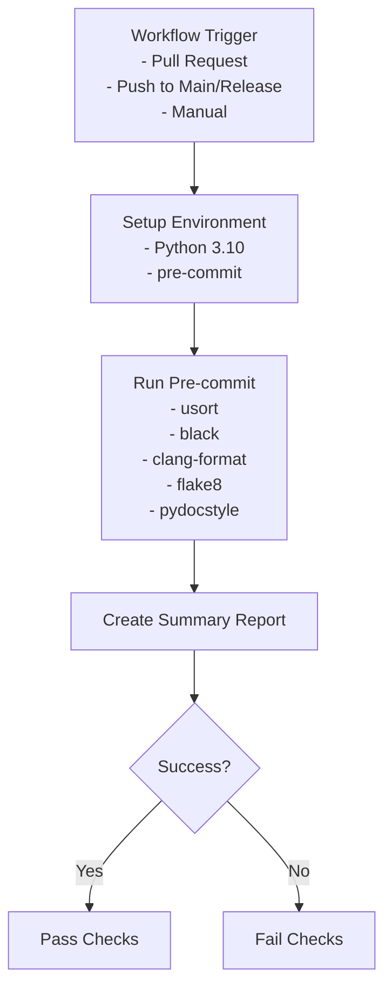
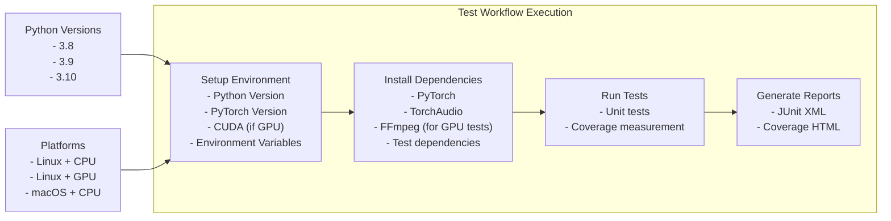
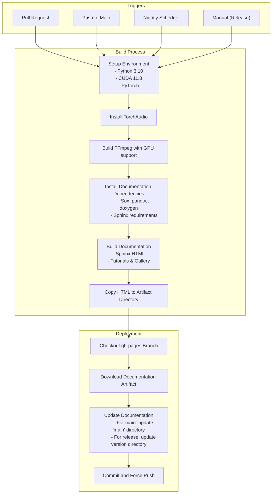
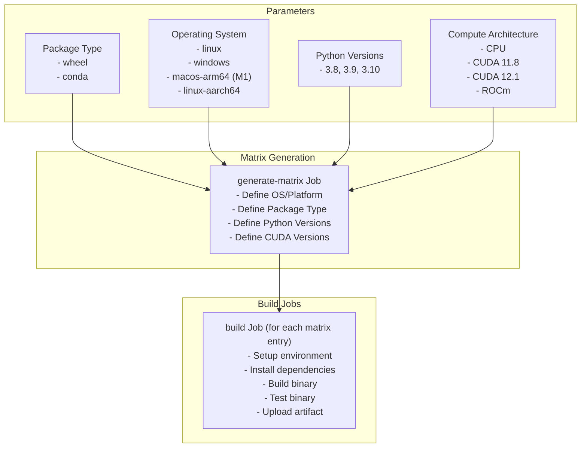
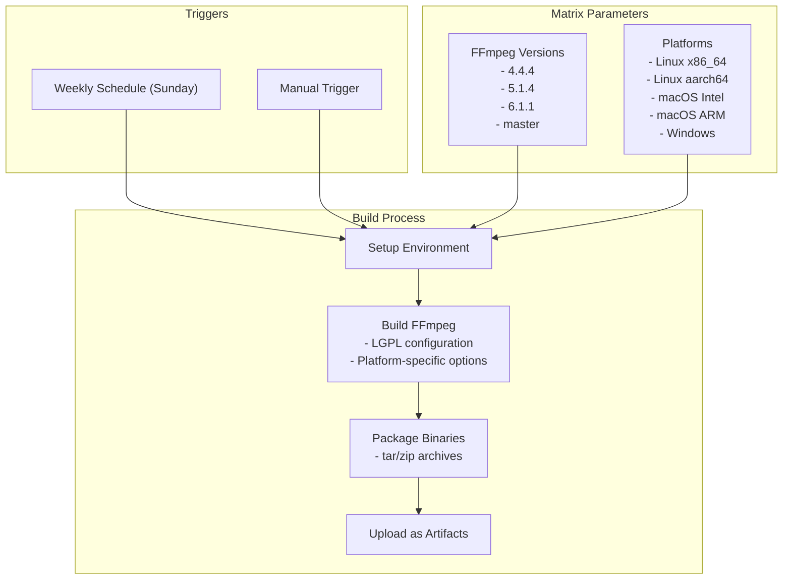

<!-- source: DeepWiki mcp.deepwiki.com · repo pytorch/audio · page 5.3 CI/CD Pipeline · fetched 2026-10-21 -->

# CI/CD Pipeline

Relevant source files

The following files were used as context for generating this wiki page:

- [.github/scripts/unittest-linux/install.sh](.github/scripts/unittest-linux/install.sh)
- [.github/scripts/unittest-linux/run_test.sh](.github/scripts/unittest-linux/run_test.sh)
- [.github/scripts/unittest-windows/environment.yml](.github/scripts/unittest-windows/environment.yml)
- [.github/scripts/unittest-windows/install.sh](.github/scripts/unittest-windows/install.sh)
- [.github/scripts/unittest-windows/run_test.sh](.github/scripts/unittest-windows/run_test.sh)
- [.github/scripts/unittest-windows/setup_env.sh](.github/scripts/unittest-windows/setup_env.sh)
- [.github/workflows/build-wheels-m1.yml](.github/workflows/build-wheels-m1.yml)
- [.github/workflows/build_wheels_aarch64_linux.yml](.github/workflows/build_wheels_aarch64_linux.yml)
- [.github/workflows/build_wheels_linux.yml](.github/workflows/build_wheels_linux.yml)
- [.github/workflows/build_wheels_windows.yml](.github/workflows/build_wheels_windows.yml)
- [.github/workflows/docs.yaml](.github/workflows/docs.yaml)
- [.github/workflows/unittest-linux-cpu.yml](.github/workflows/unittest-linux-cpu.yml)
- [.github/workflows/unittest-linux-gpu.yml](.github/workflows/unittest-linux-gpu.yml)
- [.github/workflows/unittest-macos-cpu.yml](.github/workflows/unittest-macos-cpu.yml)
- [.github/workflows/unittest-windows-cpu.yml](.github/workflows/unittest-windows-cpu.yml)
- [.github/workflows/unittest-windows-gpu.yml](.github/workflows/unittest-windows-gpu.yml)
- [src/torchaudio/_extension/__init__.py](src/torchaudio/_extension/__init__.py)
- [src/torchaudio/_extension/utils.py](src/torchaudio/_extension/utils.py)
- [test/torchaudio_unittest/common_utils/__init__.py](test/torchaudio_unittest/common_utils/__init__.py)
- [test/torchaudio_unittest/common_utils/case_utils.py](test/torchaudio_unittest/common_utils/case_utils.py)

This document describes the Continuous Integration and Continuous Deployment (CI/CD) pipeline used in the TorchAudio project. The pipeline automates code quality checks, testing, building, and deployment processes across multiple platforms and configurations.

For information about the CMake build system used for C++ components, see [CMake Build System](#5.1). For information about the packaging and distribution process, see [Packaging and Distribution](#5.3).

## Overview

The TorchAudio CI/CD pipeline uses GitHub Actions workflows to automate various tasks in the development lifecycle, ensuring code quality, compatibility across platforms, and reliable releases.

```mermaid
flowchart TD
    subgraph "Triggers"
        PR["Pull Request"]
        Push["Push to Main/Release Branch"]
        Schedule["Scheduled (Nightly)"]
        Manual["Manual (Workflow Dispatch)"]
        Tag["Tag (Release)"]
    end

    subgraph "Quality"
        Lint["Lint Checks
        - Python style
        - C++ format
        - Documentation"]
    end

    subgraph "Testing"
        UnitTestLinuxCPU["Unit Tests (Linux CPU)"]
        UnitTestLinuxGPU["Unit Tests (Linux GPU)"]
        UnitTestMacOS["Unit Tests (macOS)"]
        IntegrationTest["Integration Tests"]
    end

    subgraph "Building"
        Docs["Documentation Build"]
        WheelsLinux["Wheels (Linux)"]
        WheelsWindows["Wheels (Windows)"]
        WheelsM1["Wheels (macOS ARM)"]
        WheelsAarch64["Wheels (Linux ARM)"]
        CondaLinux["Conda Packages (Linux)"]
        CondaWindows["Conda Packages (Windows)"]
        CondaM1["Conda Packages (macOS ARM)"]
        FFmpeg["FFmpeg Binaries"]
    end

    subgraph "Deployment"
        DeployDocs["Deploy Documentation"]
        DeployBinaries["Deploy Binaries"]
    end

    PR --> Lint
    PR --> UnitTestLinuxCPU
    PR --> UnitTestLinuxGPU
    PR --> UnitTestMacOS
    PR --> IntegrationTest
    PR --> Docs
    PR --> WheelsLinux
    PR --> WheelsWindows
    PR --> WheelsM1
    PR --> WheelsAarch64
    PR --> CondaLinux
    PR --> CondaWindows
    PR --> CondaM1

    Push --> Lint
    Push --> UnitTestLinuxCPU
    Push --> UnitTestLinuxGPU
    Push --> UnitTestMacOS
    Push --> Docs
    Push --> WheelsLinux
    Push --> WheelsWindows
    Push --> WheelsM1
    Push --> WheelsAarch64
    Push --> CondaLinux
    Push --> CondaWindows
    Push --> CondaM1
    Push --> DeployDocs

    Schedule --> Docs
    Schedule --> DeployDocs
    Schedule --> FFmpeg

    Manual --> Docs
    Manual --> WheelsLinux
    Manual --> WheelsWindows
    Manual --> WheelsM1
    Manual --> WheelsAarch64
    Manual --> CondaLinux
    Manual --> CondaWindows
    Manual --> CondaM1
    Manual --> DeployDocs
    Manual --> DeployBinaries
    Manual --> FFmpeg

    Tag --> WheelsLinux
    Tag --> WheelsWindows
    Tag --> WheelsM1
    Tag --> WheelsAarch64
    Tag --> CondaLinux
    Tag --> CondaWindows
    Tag --> CondaM1
    Tag --> DeployBinaries
```

Sources: [.github/workflows/lint.yml](), [.github/workflows/unittest-linux-cpu.yml](), [.github/workflows/unittest-linux-gpu.yml](), [.github/workflows/unittest-macos-cpu.yml](), [.github/workflows/integration-test.yml](), [.github/workflows/build_docs.yml](), [.github/workflows/build_wheels_linux.yml](), [.github/workflows/build_wheels_windows.yml](), [.github/workflows/build-wheels-m1.yml](), [.github/workflows/build_wheels_aarch64_linux.yml](), [.github/workflows/build_conda_linux.yml](), [.github/workflows/build-conda-windows.yml](), [.github/workflows/build-conda-m1.yml](), [.github/workflows/ffmpeg.yml]()

## Code Quality Checks

The codebase uses pre-commit hooks and GitHub Actions to enforce code quality standards.

### Pre-commit Hooks

Pre-commit hooks run automatically when a developer attempts to commit code, providing immediate feedback:

| Hook Type | Tool | Purpose |
|-----------|------|---------|
| Formatting | Black | Python code formatting |
| Sorting | usort | Python import sorting |
| Linting | Flake8 | Python code quality |
| Formatting | clang-format | C++ code formatting |
| Documentation | pydocstyle | Python docstring style |
| General | Various | End-of-file fixing, YAML checking, etc. |

### Lint Workflow

The lint workflow runs on pull requests and pushes to main/release branches, checking for code style and formatting issues:

Sources: [.github/workflows/lint.yml](), [.pre-commit-config.yaml](), [.flake8](), [pyproject.toml]()

## Testing Strategy

TorchAudio employs a comprehensive testing strategy across different platforms, Python versions, and hardware configurations.

### Unit Tests

Unit tests run on multiple platforms with different Python versions:

| Platform | Python Versions | Hardware |
|----------|-----------------|----------|
| Linux | 3.8, 3.9, 3.10 | CPU |
| Linux | 3.8, 3.9, 3.10 | NVIDIA GPU (CUDA 11.8) |
| macOS | 3.8 | CPU |

The tests use various environment variables to control test behavior (e.g., skipping tests that require specific hardware).

### Integration Tests

Integration tests verify that TorchAudio works correctly with other PyTorch ecosystem components and external dependencies. These tests run on Ubuntu with Python 3.9.

Sources: [.github/workflows/unittest-linux-cpu.yml](), [.github/workflows/unittest-linux-gpu.yml](), [.github/workflows/unittest-macos-cpu.yml](), [.github/workflows/integration-test.yml]()

## Documentation Building and Deployment

Documentation is built and deployed in three scenarios:
1. Each time a commit is pushed to the main branch
2. Nightly (to ensure documentation is updated even without commits)
3. Manual triggers for releases

Sources: [.github/workflows/build_docs.yml]()

## Binary Building

TorchAudio builds binary packages (wheels and conda packages) for multiple platforms, Python versions, and compute architectures.

### Matrix Generation

Binary builds use a matrix-based approach, where each combination of Python version, platform, and compute architecture is built separately:

### Wheel Building Process

The wheel building process includes:

1. Setting up the build environment with appropriate Python version and compute libraries
2. Installing dependencies (CMake, Ninja, etc.)
3. Building the TorchAudio wheel
4. Running smoke tests to verify the wheel works
5. Uploading the wheel as an artifact

### Conda Package Building Process

The conda package building process is similar but uses conda-specific tools:

1. Setting up the conda build environment
2. Using conda-build with the `meta.yaml` specification
3. Building the package
4. Testing the package
5. Uploading the package as an artifact

Sources: [.github/workflows/build_wheels_linux.yml](), [.github/workflows/build_wheels_windows.yml](), [.github/workflows/build-wheels-m1.yml](), [.github/workflows/build_wheels_aarch64_linux.yml](), [.github/workflows/build_conda_linux.yml](), [.github/workflows/build-conda-windows.yml](), [.github/workflows/build-conda-m1.yml](), [packaging/torchaudio/meta.yaml](), [packaging/torchaudio/build.sh]()

## FFmpeg Binary Building

TorchAudio depends on FFmpeg for audio I/O functionality. The project maintains a workflow to build FFmpeg binaries for different platforms.

Sources: [.github/workflows/ffmpeg.yml](), [.github/scripts/ffmpeg/build_gpu.sh]()

## Deployment Strategy

TorchAudio uses different deployment strategies for documentation and binary packages.

### Documentation Deployment

Documentation is deployed to GitHub Pages:

1. For pushes to main: The "main" directory is updated
2. For releases: A version-specific directory is created

### Binary Deployment

Binary packages are deployed to different channels:

1. For nightly builds: Packages are uploaded to the "nightly" channel
2. For release candidates: Packages are uploaded to the "test" channel
3. For final releases: Packages are uploaded to the main channel

The actual upload process happens outside of the CI/CD pipeline using AWS S3 (for wheels) and Anaconda.org (for conda packages).

Sources: [.github/workflows/build_docs.yml]()

## CI/CD Environment Variables

The CI/CD pipeline uses various environment variables to control behavior:

| Variable | Purpose | Used In |
|----------|---------|---------|
| `PYTHON_VERSION` | Python version for testing/building | All workflows |
| `CU_VERSION` | CUDA version for GPU support | GPU-related workflows |
| `CUDATOOLKIT` | CUDA toolkit package for conda | GPU-related workflows |
| `CHANNEL` | Channel for PyTorch dependencies (nightly/test) | All workflows |
| `BUILD_VERSION` | Version for built packages | Build workflows |
| `USE_CUDA` | Enable CUDA support in building | Build workflows |
| `FFMPEG_VERSION` | FFmpeg version to build | FFmpeg workflow |
| Various `TORCHAUDIO_TEST_*` | Control test skipping behavior | Test workflows |

Sources: [.github/workflows/build_docs.yml](), [.github/workflows/unittest-linux-cpu.yml](), [.github/workflows/unittest-linux-gpu.yml](), [.github/workflows/build_wheels_linux.yml]()

---

