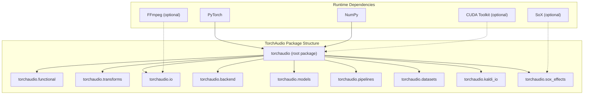
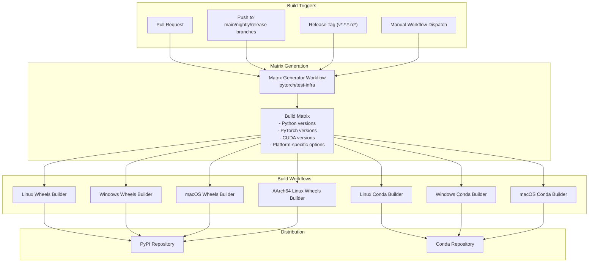
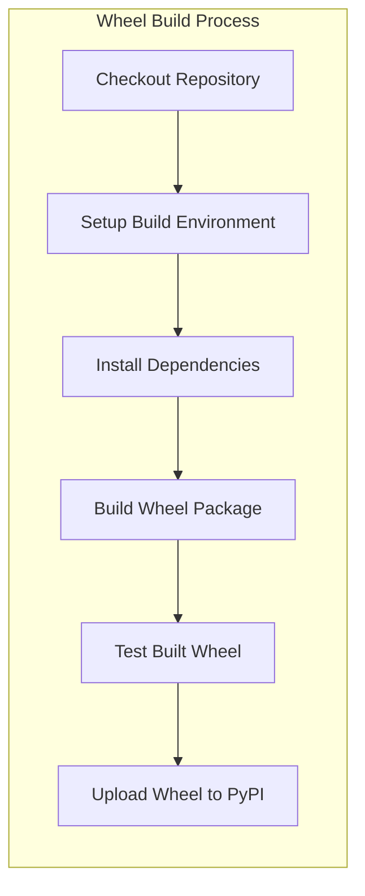

<!-- source: DeepWiki mcp.deepwiki.com · repo pytorch/audio · page 5.4 Packaging and Distribution · fetched 2026-10-21 -->

# Packaging and Distribution

<details>
<summary>Relevant source files</summary>

The following files were used as context for generating this wiki page:

- [.github/workflows/build-wheels-m1.yml](.github/workflows/build-wheels-m1.yml)
- [.github/workflows/build_wheels_aarch64_linux.yml](.github/workflows/build_wheels_aarch64_linux.yml)
- [.github/workflows/build_wheels_linux.yml](.github/workflows/build_wheels_linux.yml)
- [.github/workflows/build_wheels_windows.yml](.github/workflows/build_wheels_windows.yml)
- [packaging/torchaudio/meta.yaml](packaging/torchaudio/meta.yaml)
- [setup.py](setup.py)

</details>


This document provides a detailed overview of how torchaudio is packaged and distributed across different platforms, architectures, and package formats. It covers the build system configurations, CI/CD workflows, package variants, and distribution channels for torchaudio.

For information about the CMake build system for C++ components, see [CMake Build System](#5.1).
For details on the continuous integration pipeline, see [CI/CD Pipeline](#5.2).

## Package Types and Platforms

TorchAudio is distributed in two primary package formats:

1. **Python wheels**: For installation via pip
2. **Conda packages**: For installation via conda

These packages are built for multiple platforms and architectures:

| Platform | Architectures | Variants |
|----------|--------------|----------|
| Linux | x86_64, aarch64 (ARM64) | CPU, CUDA, ROCm, XPU |
| Windows | x86_64 | CPU, CUDA, XPU |
| macOS | x86_64, arm64 (M1/Apple Silicon) | CPU only |

Each package is built to be compatible with different Python versions (typically 3.8-3.11) and PyTorch versions.

Sources: [.github/workflows/build_wheels_linux.yml](), [.github/workflows/build_wheels_windows.yml](), [.github/workflows/build-wheels-m1.yml](), [.github/workflows/build_wheels_aarch64_linux.yml]()

## Package Structure and Dependencies



The TorchAudio package has several key dependencies:

1. **Required Dependencies**:
   - PyTorch: The core dependency
   - NumPy: For numerical operations

2. **Optional Dependencies**:
   - CUDA Toolkit: For GPU acceleration
   - FFmpeg: For advanced audio I/O capabilities
   - SoX: For audio processing effects

The conda package configuration defines both build and runtime dependencies:

Sources: [packaging/torchaudio/meta.yaml:9-37](), [packaging/torchaudio/build.sh]()

## Build System and Workflow

TorchAudio's build and distribution system leverages GitHub Actions workflows to automate the process of building packages for different platforms, Python versions, and PyTorch configurations.



Sources: [.github/workflows/build_wheels_linux.yml](), [.github/workflows/build_wheels_windows.yml](), [.github/workflows/build-wheels-m1.yml](), [.github/workflows/build_wheels_aarch64_linux.yml](), [.github/workflows/build_conda_linux.yml](), [.github/workflows/build-conda-windows.yml](), [.github/workflows/build-conda-m1.yml]()

## Build Matrix Generation

The build process begins with generating a build matrix that defines the combinations of Python versions, PyTorch versions, and CUDA versions to build for. This is handled by reusable workflows from the PyTorch test-infra repository.

For example, a typical matrix might include:

| Python Version | PyTorch Version | CUDA Version | Platform |
|----------------|----------------|-------------|----------|
| 3.8            | 2.0.0          | cpu         | Linux    |
| 3.8            | 2.0.0          | cu117       | Linux    |
| 3.9            | 2.0.0          | cpu         | Linux    |
| 3.9            | 2.0.0          | cu117       | Linux    |
| 3.10           | 2.0.0          | cpu         | Linux    |
| 3.10           | 2.0.0          | cu117       | Linux    |
| 3.11           | 2.0.0          | cpu         | Linux    |
| 3.11           | 2.0.0          | cu117       | Linux    |

This matrix generation is dynamic and adapts to the current PyTorch release schedule.

Sources: [.github/workflows/build_wheels_linux.yml:25-32](), [.github/workflows/build_conda_linux.yml:21-27]()

## Conda Package Configuration

The Conda package is configured using a meta.yaml file that defines package metadata, dependencies, and build settings.

Key aspects of the Conda package configuration:

1. **Package Metadata**:
   - Name: torchaudio
   - Version: Derived from environment variable `BUILD_VERSION`

2. **Dependencies**:
   - Build dependencies: Python, setuptools, CMake, Ninja, PyTorch
   - Runtime dependencies: Python, NumPy, PyTorch

3. **Build Configuration**:
   - Build string includes Python version and CUDA version
   - Environment variables control build options:
     - `USE_CUDA`: Enable CUDA support
     - `USE_FFMPEG`: Enable FFmpeg support
     - `USE_OPENMP`: Enable OpenMP support

4. **Variant handling**:
   - CPU-only builds include a constraint to the `cpuonly` package
   - GPU builds include constraints to prevent installation with `cpuonly`

Sources: [packaging/torchaudio/meta.yaml](), [packaging/torchaudio/build.sh]()

## Wheel Building Process



The wheel building process involves:

1. **Checkout**: Getting the source code from the repository
2. **Environment Setup**: Setting up build tools and compiler environment
3. **Dependencies**: Installing PyTorch and other build dependencies
4. **Build**: Running `setup.py bdist_wheel` to build the wheel
5. **Test**: Running smoke tests to ensure the wheel works correctly
6. **Upload**: Publishing the wheel to PyPI (for release builds)

For Windows builds, a custom environment script (`packaging/vc_env_helper.bat`) is used to set up the Visual C++ compiler environment.

Sources: [.github/workflows/build_wheels_linux.yml](), [.github/workflows/build_wheels_windows.yml:36-37]()

## Package Variants and Feature Support

TorchAudio packages come in several variants with different feature support:

| Variant | CUDA Support | FFmpeg Support | SoX Support | Platform Availability |
|---------|-------------|---------------|-------------|------------------------|
| CPU | No | Optional | Optional | All platforms |
| CUDA | Yes | Optional | Optional | Linux, Windows |
| ROCm | Yes (AMD) | Optional | Optional | Linux only |
| XPU | Yes (Intel) | Optional | Optional | Linux, Windows |

Build options control which features are included:

1. **CUDA Support**: Controlled by `USE_CUDA` and `CUDA_HOME` environment variables
2. **FFmpeg Support**: Controlled by `USE_FFMPEG` environment variable
3. **OpenMP Support**: Controlled by `USE_OPENMP` environment variable

Sources: [packaging/torchaudio/meta.yaml:39-48](), [packaging/torchaudio/build.sh:7-16]()

## Distribution Channels and Versioning

TorchAudio packages are distributed through two main channels:

1. **PyPI**: For pip installation
   - Release versions: `pip install torchaudio`
   - Nightly builds: `pip install --pre torchaudio -f https://download.pytorch.org/whl/nightly/cpu/torch_nightly.html`

2. **Conda**: For conda installation
   - Release versions: `conda install torchaudio -c pytorch`
   - Nightly builds: `conda install torchaudio -c pytorch-nightly`

The versioning scheme follows PyTorch's versioning:
- Release versions: v1.x.y (e.g., v1.13.1)
- Release candidates: v1.x.y-rc1 (e.g., v1.13.0-rc1)
- Nightly builds: Date-based versioning

Binary packages are typically built only for release candidates and nightly builds, as triggered by the workflow configurations.

Sources: [.github/workflows/build_wheels_linux.yml:3-14](), [.github/workflows/build_conda_linux.yml:3-14]()

## Installation Recommendations

For most users, installing torchaudio via pip or conda is recommended:

```bash
# Pip installation (CPU-only)
pip install torchaudio

# Pip installation (with CUDA support)
pip install torchaudio -f https://download.pytorch.org/whl/cu118/torch_stable.html

# Conda installation (CPU-only)
conda install torchaudio -c pytorch

# Conda installation (with CUDA support)
conda install torchaudio cudatoolkit=11.8 -c pytorch
```

For developers or users with custom requirements, building from source may be necessary. This is covered in the [Installation and Getting Started](#1.1) section.

Sources: [packaging/torchaudio/meta.yaml:24-37]()

---

