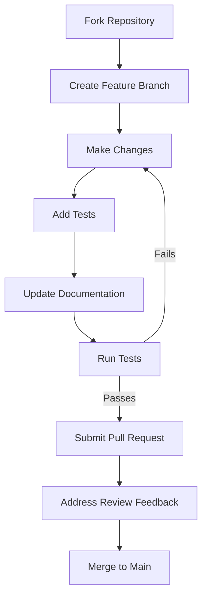
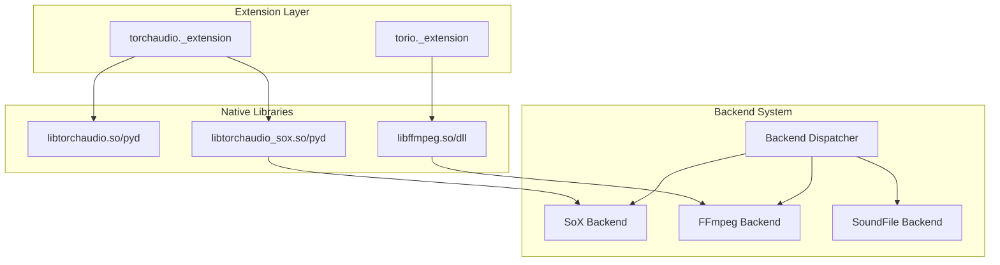
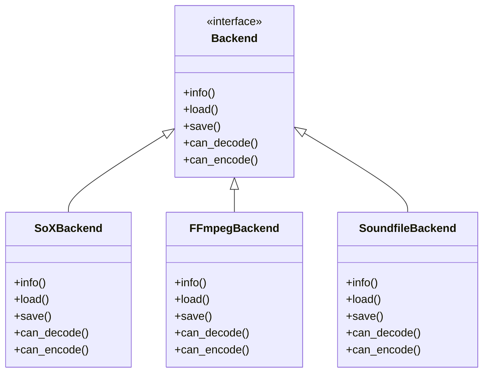

<!-- source: DeepWiki mcp.deepwiki.com · repo pytorch/audio · page 6 Development Guide · fetched 2026-10-21 -->

# Development Guide

<details>
<summary>Relevant source files</summary>

The following files were used as context for generating this wiki page:

- [.github/scripts/unittest-linux/install.sh](.github/scripts/unittest-linux/install.sh)
- [.github/scripts/unittest-linux/run_test.sh](.github/scripts/unittest-linux/run_test.sh)
- [.github/scripts/unittest-windows/environment.yml](.github/scripts/unittest-windows/environment.yml)
- [.github/scripts/unittest-windows/install.sh](.github/scripts/unittest-windows/install.sh)
- [.github/scripts/unittest-windows/run_test.sh](.github/scripts/unittest-windows/run_test.sh)
- [.github/scripts/unittest-windows/setup_env.sh](.github/scripts/unittest-windows/setup_env.sh)
- [.github/workflows/docs.yaml](.github/workflows/docs.yaml)
- [.github/workflows/unittest-linux-cpu.yml](.github/workflows/unittest-linux-cpu.yml)
- [.github/workflows/unittest-linux-gpu.yml](.github/workflows/unittest-linux-gpu.yml)
- [.github/workflows/unittest-macos-cpu.yml](.github/workflows/unittest-macos-cpu.yml)
- [.github/workflows/unittest-windows-cpu.yml](.github/workflows/unittest-windows-cpu.yml)
- [.github/workflows/unittest-windows-gpu.yml](.github/workflows/unittest-windows-gpu.yml)
- [CONTRIBUTING.md](CONTRIBUTING.md)
- [README.md](README.md)
- [docs/source/compliance.kaldi.rst](docs/source/compliance.kaldi.rst)
- [docs/source/index.rst](docs/source/index.rst)
- [docs/source/torchaudio.rst](docs/source/torchaudio.rst)
- [src/torchaudio/_extension/__init__.py](src/torchaudio/_extension/__init__.py)
- [src/torchaudio/_extension/utils.py](src/torchaudio/_extension/utils.py)
- [test/torchaudio_unittest/README.md](test/torchaudio_unittest/README.md)
- [test/torchaudio_unittest/common_utils/__init__.py](test/torchaudio_unittest/common_utils/__init__.py)
- [test/torchaudio_unittest/common_utils/case_utils.py](test/torchaudio_unittest/common_utils/case_utils.py)

</details>


This document provides guidelines and instructions for developers who want to contribute to the PyTorch Audio library. It covers the development setup, contribution workflow, testing framework, and documentation system. For information about the build system and deployment, see [Build System and Deployment](#5).

## 1. Development Environment Setup

### 1.1 Prerequisites

Before contributing to torchaudio, you'll need the following:

- Python 3.7 or newer
- PyTorch (latest stable version recommended)
- Git

Depending on which components you're working with, you may also need:

- FFmpeg (for I/O functionality)
- SoX (for audio processing functionality)
- CMake (for building C++ extensions)
- CUDA toolkit (for GPU acceleration)

### 1.2 Building from Source

The recommended approach to develop torchaudio is to build it from source:

```bash
# Clone the repository
git clone https://github.com/pytorch/audio.git
cd audio

# Install dependencies
pip install -r requirements.txt

# Build and install in development mode
python setup.py develop
```

For detailed instructions, refer to the online documentation at https://pytorch.org/audio/main/build.html

Sources: [CONTRIBUTING.md:41-43]()

## 2. Contribution Workflow



### 2.1 Getting Started

1. Fork the [torchaudio repository](https://github.com/pytorch/audio)
2. Create your feature branch from `main`:
   ```bash
   git checkout main
   git checkout -b my_cool_feature
   ```
3. Make your changes
4. Add tests to verify your changes
5. Update documentation if you've changed APIs
6. Run tests to ensure everything works
7. Submit a pull request

Sources: [CONTRIBUTING.md:72-83]()

### 2.2 Contribution Guidelines

- For bug fixes, submit a PR without further discussion
- For new features, first open an issue to discuss the feature
- Help by reporting problems or giving a thumbs-up on relevant issues
- Improve documentation - this is as important as code improvements
- You can pick issues labeled as "help wanted" to get started

Sources: [CONTRIBUTING.md:4-35]()

## 3. Testing Framework

```mermaid
classDiagram
    class TempDirMixin {
        +get_base_temp_dir()
        +get_temp_path()
        +tearDownClass()
    }
    class TestBaseMixin {
        +setUp()
        +complex_dtype
    }
    class PytorchTestCase {
        (from torch.testing)
    }
    class TorchaudioTestCase {
        (combines TestBaseMixin & PytorchTestCase)
    }
    
    TestBaseMixin <|-- TorchaudioTestCase
    PytorchTestCase <|-- TorchaudioTestCase
    TempDirMixin <|-- HttpServerMixin
    
    class skipIfNoSox {
        (decorator)
    }
    class skipIfNoFFmpeg {
        (decorator)
    }
    class skipIfNoCuda {
        (decorator)
    }
```

Torchaudio provides a robust testing framework with utilities for creating tests with different backends and environments.

### 3.1 Running Tests

To run tests, you'll need additional dependencies:

```bash
pip install typing pytest scipy numpy parameterized
```

Optional dependencies for specific test groups:
- `librosa`, `requests`, `soundfile`, `kaldi_io`
- `transformers`, `fairseq`, `unidecode`, `inflect`, `Pillow`

To run tests:

```bash
# Set PATH if you built Sox
export PATH="<path_to_torchaudio>/third_party/install/bin:${PATH}"

# Run tests
pytest test/torchaudio_unittest/
```

Sources: [CONTRIBUTING.md:45-70]()

### 3.2 Test Case Classes

The main test case classes are:

- `TorchaudioTestCase`: Base class for most audio tests, combines PyTorch testing utilities with audio-specific ones
- `TempDirMixin`: Provides temporary directory utilities for tests that need file I/O
- `HttpServerMixin`: Sets up a temporary HTTP server for tests that require network access

Sources: [test/torchaudio_unittest/common_utils/case_utils.py:19-86]()

### 3.3 Skip Decorators

The testing framework provides several decorators to skip tests when specific dependencies are unavailable:

| Decorator | Purpose |
|-----------|---------|
| `skipIfNoSox` | Skip when SoX is not available |
| `skipIfNoFFmpeg` | Skip when FFmpeg is not available |
| `skipIfNoCuda` | Skip when CUDA is not available |
| `skipIfNoModule(name)` | Skip when a specific module cannot be imported |
| `skipIfNoExec(cmd)` | Skip when a specific command is not in PATH |

Sources: [test/torchaudio_unittest/common_utils/case_utils.py:181-297]()

### 3.4 Writing Tests

When writing tests:

1. Subclass from `TorchaudioTestCase` for most functionality tests
2. Use `TempDirMixin` when you need to work with files
3. Use appropriate skip decorators to handle optional dependencies
4. Set random seed in `setUp` for deterministic testing
5. Follow PyTorch's test assertion methods

Example test class structure:

```python
class MyFeatureTest(TorchaudioTestCase):
    def setUp(self):
        super().setUp()  # Sets random seed
        self.waveform = torch.randn(2, 1000)
        
    def test_my_feature(self):
        result = my_feature(self.waveform)
        self.assertEqual(result.shape, expected_shape)
```

Sources: [test/torchaudio_unittest/common_utils/case_utils.py:88-106](), [test/torchaudio_unittest/common_utils/__init__.py:1-75]()

## 4. Documentation System

### 4.1 Documentation Style

Torchaudio follows the Google style for docstrings. Key guidelines:

- Line length inside docstring blocks must be limited to 120 characters
- Use single backticks for parameter names, tensor dimensions, and variable types
- Use type annotations in the format `(type, optional)` for parameters with defaults
- For tensor dimensions, use the convention `(..., channel, time)`

Example:

```python
def my_function(waveform, sample_rate, normalize=True):
    """Process audio waveform.
    
    Args:
        waveform (Tensor): Tensor of audio of dimension `(..., channel, time)`
        sample_rate (int): Sample rate of the audio
        normalize (bool, optional): Whether to normalize the output. Default: ``True``
        
    Returns:
        Tensor: Processed audio of dimension `(..., channel, time)`
    """
    ...
```

Sources: [CONTRIBUTING.md:92-198]()

### 4.2 Building Documentation

To build the documentation:

```bash
cd docs
pip install -r requirements.txt
make html
```

The built documentation will be available in `docs/build/html`. To build tutorials as well:

```bash
pip install -r requirements-tutorials.txt
BUILD_GALLERY=1 make html
```

To build a specific tutorial:

```bash
GALLERY_PATTERN=forced_alignment_tutorial.py make html
```

Sources: [CONTRIBUTING.md:99-141](), [docs/Makefile:1-36]()

### 4.3 Adding Tutorials

Tutorials are created using Sphinx-Gallery. Guidelines for adding tutorials:

- Use the suffix `_tutorial.py` to be recognized by the build process
- Put one audio object per cell when using `IPython.display.Audio`
- Put one plot per code cell for proper rendering
- Use `-` or `~` for section headers, not `=`

Sources: [CONTRIBUTING.md:143-155]()

## 5. Extension System



Torchaudio uses a flexible extension system that lazy-loads native libraries as needed.

### 5.1 Extension Architecture

The extension system follows these key patterns:

1. **Lazy Loading**: Extensions are loaded only when needed using the `_LazyImporter` class
2. **Backend Dispatcher**: The I/O system uses a dispatcher to select the appropriate backend
3. **Availability Checks**: Each extension checks for availability of dependencies

Sources: [src/torchaudio/_extension/utils.py:1-180](), [src/torchaudio/_extension/__init__.py:1-74]()

### 5.2 Building Extensions

Extensions are built using CMake. The `TorchAudioHelper.cmake` provides utility functions:

- `torchaudio_library`: Builds a shared library for torchaudio
- `torchaudio_extension`: Builds a Python extension for torchaudio
- `torio_library` and `torio_extension`: Similar functions for the torio package

Sources: [cmake/TorchAudioHelper.cmake:1-129]()

### 5.3 Backend System



The backend system provides a consistent interface for audio I/O operations. Key components:

1. **Backend Interface**: Defines methods for info, load, save, and format checking
2. **Backend Implementations**: SoX, FFmpeg, and SoundFile backends
3. **Dispatcher Functions**: Select the appropriate backend based on the input format

Sources: [src/torchaudio/_backend/utils.py:1-317]()

## 6. Coding Conventions

### 6.1 Tensor Conventions

When working with tensors in torchaudio:

- Use ellipsis `...` as a placeholder for optional dimensions
- Batch dimension should come first when present
- Channel dimension comes before time dimension
- Use `n_` prefix for size names (e.g., `n_freq`, `n_mels`)
- Do not use `n_` prefix for dimension names (e.g., "channel", "time")

### 6.2 Common Variable Names and Shapes

| Variable Name | Meaning | Shape/Units |
|---------------|---------|-------------|
| `waveform` | Audio samples | `(..., channel, time)` |
| `sample_rate` | Rate of audio | samples per second |
| `specgram` | Spectrogram | `(..., channel, freq, time)` |
| `mel_specgram` | Mel spectrogram | `(..., channel, mel, time)` |
| `hop_length` | Frame advance | samples |
| `n_fft` | FFT size | bins |
| `n_mels`, `n_mfcc` | Mel/MFCC bins | count |
| `f_min`, `f_max` | Frequency range | Hz |
| `win_length` | STFT window length | samples |

Sources: [CONTRIBUTING.md:156-199]()

### 6.3 Security Considerations

Torchaudio employs static security analysis using Bandit in the CI pipeline to identify potential security issues in the codebase.

Sources: [.github/workflows/bandit.yml:1-24]()

## 7. Common Development Tasks

### 7.1 Adding a New Audio Backend

To add a new audio backend:

1. Create a new class that implements the `Backend` interface
2. Add detection code to `get_available_backends()` in [src/torchaudio/_backend/utils.py]()
3. Implement the required methods: `info()`, `load()`, `save()`, `can_decode()`, and `can_encode()`
4. Add appropriate tests using the testing framework

### 7.2 Adding a New Transform

To add a new audio transform:

1. Implement the core functionality in `torchaudio.functional`
2. Create a wrapper class in `torchaudio.transforms` that extends `nn.Module`
3. Follow the tensor and naming conventions
4. Add comprehensive tests for different input shapes and edge cases
5. Update documentation with examples

### 7.3 Adding a New Model

When contributing a new model:

1. Implement the model in the appropriate module under `torchaudio.models`
2. Provide pre-trained weights if applicable
3. Create examples showing how to use the model
4. Add tests including expected outputs for specific inputs
5. Document the model architecture and usage

---

