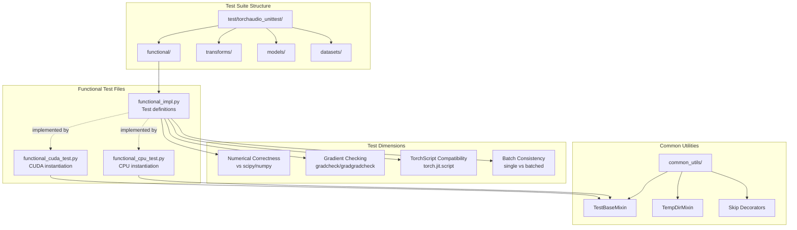
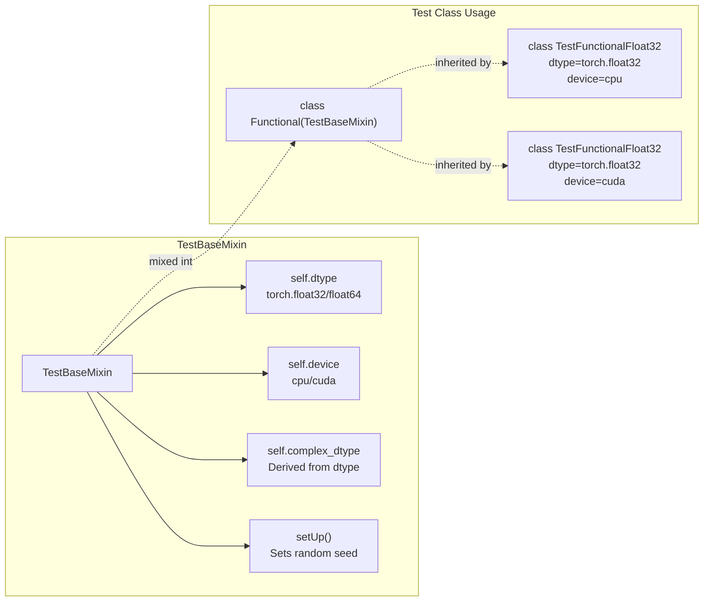
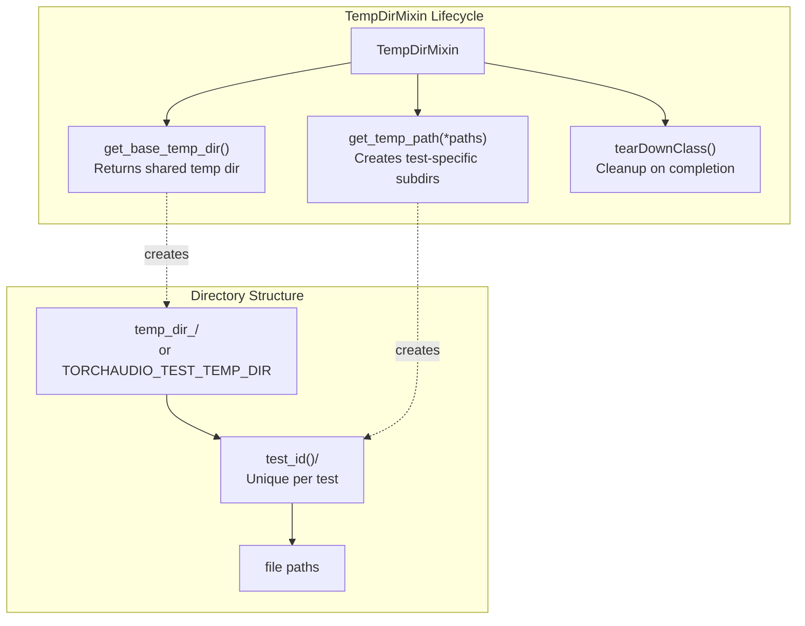
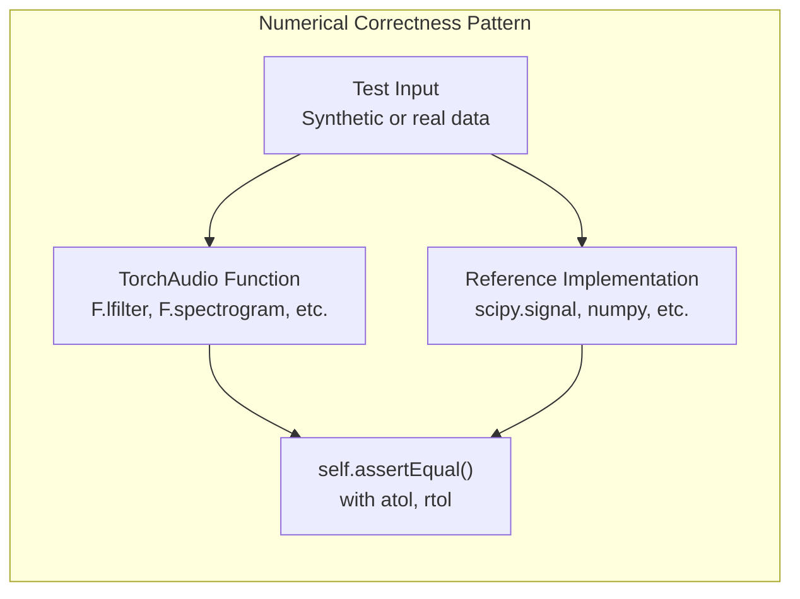
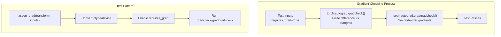
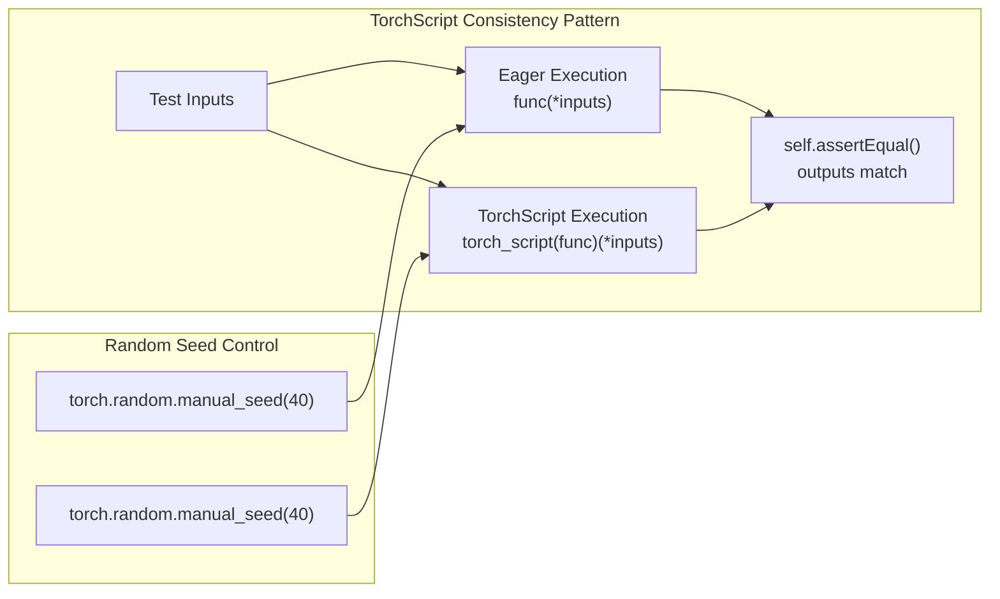
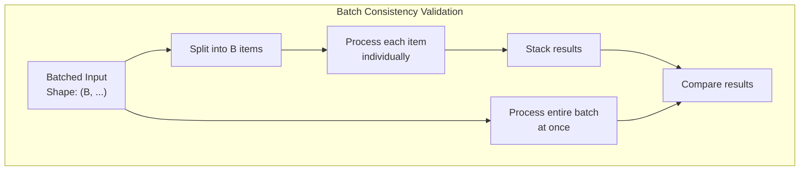
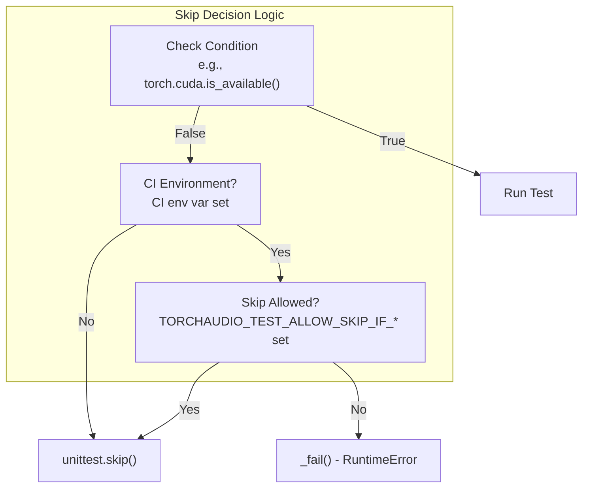
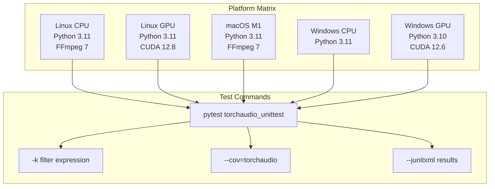
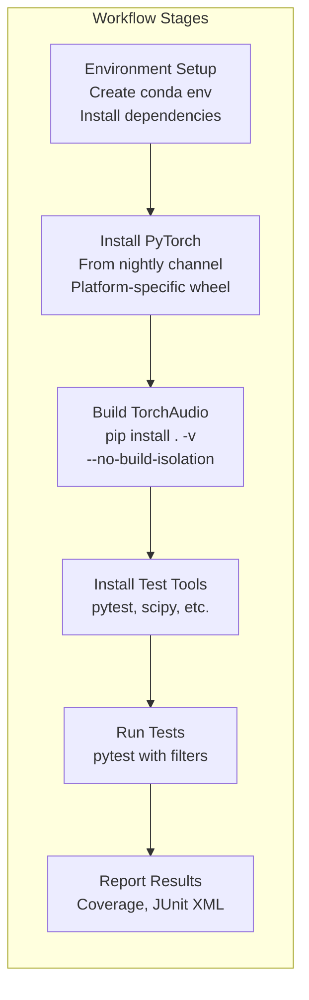

<!-- source: DeepWiki mcp.deepwiki.com · repo pytorch/audio · page 6.2 Testing Framework · fetched 2026-10-21 -->

# Testing Framework

<details>
<summary>Relevant source files</summary>

The following files were used as context for generating this wiki page:

- [.github/scripts/unittest-linux/install.sh](.github/scripts/unittest-linux/install.sh)
- [.github/scripts/unittest-linux/run_test.sh](.github/scripts/unittest-linux/run_test.sh)
- [.github/scripts/unittest-windows/environment.yml](.github/scripts/unittest-windows/environment.yml)
- [.github/scripts/unittest-windows/install.sh](.github/scripts/unittest-windows/install.sh)
- [.github/scripts/unittest-windows/run_test.sh](.github/scripts/unittest-windows/run_test.sh)
- [.github/scripts/unittest-windows/setup_env.sh](.github/scripts/unittest-windows/setup_env.sh)
- [.github/workflows/docs.yaml](.github/workflows/docs.yaml)
- [.github/workflows/unittest-linux-cpu.yml](.github/workflows/unittest-linux-cpu.yml)
- [.github/workflows/unittest-linux-gpu.yml](.github/workflows/unittest-linux-gpu.yml)
- [.github/workflows/unittest-macos-cpu.yml](.github/workflows/unittest-macos-cpu.yml)
- [.github/workflows/unittest-windows-cpu.yml](.github/workflows/unittest-windows-cpu.yml)
- [.github/workflows/unittest-windows-gpu.yml](.github/workflows/unittest-windows-gpu.yml)
- [docs/source/functional.rst](docs/source/functional.rst)
- [src/torchaudio/_extension/__init__.py](src/torchaudio/_extension/__init__.py)
- [src/torchaudio/_extension/utils.py](src/torchaudio/_extension/utils.py)
- [test/torchaudio_unittest/common_utils/__init__.py](test/torchaudio_unittest/common_utils/__init__.py)
- [test/torchaudio_unittest/common_utils/beamform_utils.py](test/torchaudio_unittest/common_utils/beamform_utils.py)
- [test/torchaudio_unittest/common_utils/case_utils.py](test/torchaudio_unittest/common_utils/case_utils.py)
- [test/torchaudio_unittest/functional/autograd_impl.py](test/torchaudio_unittest/functional/autograd_impl.py)
- [test/torchaudio_unittest/functional/batch_consistency_test.py](test/torchaudio_unittest/functional/batch_consistency_test.py)
- [test/torchaudio_unittest/functional/functional_cpu_test.py](test/torchaudio_unittest/functional/functional_cpu_test.py)
- [test/torchaudio_unittest/functional/functional_cuda_test.py](test/torchaudio_unittest/functional/functional_cuda_test.py)
- [test/torchaudio_unittest/functional/functional_impl.py](test/torchaudio_unittest/functional/functional_impl.py)
- [test/torchaudio_unittest/functional/torchscript_consistency_impl.py](test/torchaudio_unittest/functional/torchscript_consistency_impl.py)

</details>


The testing framework validates TorchAudio's correctness, compatibility, and consistency across multiple dimensions: numerical accuracy against reference implementations, differentiability for training, TorchScript compatibility for deployment, and behavior consistency across execution modes and platforms. This framework ensures that all audio processing operations in [torchaudio.functional](#2.1) and [torchaudio.transforms](#2.2) work correctly across CPU, CUDA, different data types, and deployment scenarios.

For information about the build system that compiles the code being tested, see [Build Configuration](#5.1). For information about CI/CD workflows that orchestrate test execution, see [CI/CD Pipeline](#5.3).

## Test Organization

Tests are organized by module and execution environment, following a multi-dimensional structure that separates test logic from environment-specific configurations.



**Test File Organization Pattern**: Test logic is defined in `*_impl.py` files (e.g., [test/torchaudio_unittest/functional/functional_impl.py]()), which contain device-agnostic test classes. These are then instantiated for specific devices in `*_cpu_test.py` and `*_cuda_test.py` files ([test/torchaudio_unittest/functional/functional_cpu_test.py](), [test/torchaudio_unittest/functional/functional_cuda_test.py]()). This separation allows the same test logic to execute on different devices with appropriate dtype and device configurations.

**Sources**: [test/torchaudio_unittest/functional/functional_impl.py:1-900](), [test/torchaudio_unittest/functional/functional_cpu_test.py:1-21](), [test/torchaudio_unittest/functional/functional_cuda_test.py:1-41]()

## Test Infrastructure

The test infrastructure provides base classes and utilities that enable consistent test patterns across the codebase.

### TestBaseMixin

`TestBaseMixin` provides device and dtype awareness to test classes:



Key attributes defined by `TestBaseMixin`:
- **`dtype`**: Set to `torch.float32` or `torch.float64` by the concrete test class
- **`device`**: Set to `torch.device("cpu")` or `torch.device("cuda")` 
- **`complex_dtype`**: Automatically derived property that returns `torch.cfloat` or `torch.cdouble` based on `dtype`
- **`setUp()`**: Sets random seed to 2434 for reproducibility

**Sources**: [test/torchaudio_unittest/common_utils/case_utils.py:85-102]()

### TempDirMixin

`TempDirMixin` manages temporary directories for tests that require file I/O:



**Directory Creation**: `get_temp_path(*paths)` creates directories under `<base_temp_dir>/<test_id>/<paths>` where `test_id()` uniquely identifies each test. The base temporary directory is either a system temp directory or the value of environment variable `TORCHAUDIO_TEST_TEMP_DIR` if set (useful for debugging).

**Cleanup Handling**: On Windows, the cleanup may fail with `PermissionError` due to a known `shutil.rmtree` issue ([test/torchaudio_unittest/common_utils/case_utils.py:38-48]()). The framework silently ignores these errors to prevent test failures.

**Sources**: [test/torchaudio_unittest/common_utils/case_utils.py:16-56]()

### Test Utilities

Common test utilities provide reusable data generation and assertion patterns:

| Utility Function | Purpose | Location |
|-----------------|---------|----------|
| `get_whitenoise()` | Generate random noise waveforms | [test/torchaudio_unittest/common_utils/data_utils.py]() |
| `get_sinusoid()` | Generate sinusoidal test signals | [test/torchaudio_unittest/common_utils/data_utils.py]() |
| `get_spectrogram()` | Generate spectrograms from waveforms | [test/torchaudio_unittest/common_utils/data_utils.py]() |
| `torch_script()` | Helper to script functions for TorchScript tests | [test/torchaudio_unittest/common_utils/func_utils.py]() |
| `beamform_utils.*` | NumPy reference implementations for beamforming | [test/torchaudio_unittest/common_utils/beamform_utils.py]() |
| `rnnt_utils.*` | RNN-T loss test data and reference implementations | [test/torchaudio_unittest/common_utils/rnnt_utils.py]() |

**Sources**: [test/torchaudio_unittest/common_utils/__init__.py:1-81](), [test/torchaudio_unittest/common_utils/beamform_utils.py:1-85]()

## Test Categories

Tests are organized into distinct categories that validate different properties of the audio processing operations.

### Numerical Correctness Tests

**File**: [test/torchaudio_unittest/functional/functional_impl.py:1-900]()

These tests validate that TorchAudio operations produce numerically correct results by comparing against reference implementations from scipy, numpy, or librosa.



**Example Test Pattern** ([test/torchaudio_unittest/functional/functional_impl.py:125-144]()):
```python
def test_lfilter_9th_order_filter_stability(self):
    # Create impulse signal
    x = torch.zeros(1024, dtype=self.dtype, device=self.device)
    x[0] = 1
    
    # Get scipy reference
    sos = signal.butter(9, 850, "hp", fs=22050, output="sos")
    y = torch.from_numpy(signal.sosfilt(sos, x.cpu().numpy()))
    
    # Get TorchAudio result
    b, a = signal.butter(9, 850, "hp", fs=22050, output="ba")
    yhat = F.lfilter(x, a, b, False)
    
    # Compare
    self.assertEqual(yhat, y, atol=1e-4, rtol=1e-5)
```

**Key Tests**:
- `test_lfilter_*`: Validates filtering operations against `scipy.signal`
- `test_spectrogram_*`: Validates spectrograms with various normalization modes
- `test_psd()`, `test_mvdr_weights_*()`: Validates beamforming operations against NumPy implementations
- `test_resample_waveform_*_accuracy()`: Validates resampling against ground truth sinusoids

**Sources**: [test/torchaudio_unittest/functional/functional_impl.py:59-873]()

### Autograd Tests

**File**: [test/torchaudio_unittest/functional/autograd_impl.py:1-437]()

These tests validate that operations are differentiable and that gradients are computed correctly using PyTorch's `gradcheck` and `gradgradcheck` utilities.



**Example Test Pattern** ([test/torchaudio_unittest/functional/autograd_impl.py:37-62]()):
```python
def test_lfilter_all_inputs(self):
    x = get_whitenoise(sample_rate=22050, duration=0.01, n_channels=2)
    a = torch.tensor([0.7, 0.2, 0.6])
    b = torch.tensor([0.4, 0.2, 0.9])
    self.assert_grad(F.lfilter, (x, a, b))  # All inputs get requires_grad=True
```

**Operations Tested**:
- Filtering: `lfilter`, `filtfilt`, `biquad`, all biquad variants
- Effects: `phaser`, `flanger`, `gain`, `overdrive`
- Beamforming: `psd`, `mvdr_weights_souden`, `mvdr_weights_rtf`, `rtf_power`, `apply_beamforming`
- Utilities: `convolve`, `fftconvolve`, `add_noise`, `speed`, `preemphasis`, `deemphasis`

**Special Cases**: RNN-T loss tests use float32-only validation with relaxed tolerances ([test/torchaudio_unittest/functional/autograd_impl.py:395-437]()) due to numerical precision requirements.

**Sources**: [test/torchaudio_unittest/functional/autograd_impl.py:19-437]()

### TorchScript Consistency Tests

**File**: [test/torchaudio_unittest/functional/torchscript_consistency_impl.py:1-810]()

These tests validate that operations can be scripted with `torch.jit.script` and produce identical results to eager mode.



**Example Test Pattern** ([test/torchaudio_unittest/functional/torchscript_consistency_impl.py:14-31]()):
```python
def _assert_consistency(self, func, inputs, shape_only=False):
    # Convert to device/dtype
    inputs_ = [i.to(device=self.device, dtype=self.dtype) if torch.is_tensor(i) else i 
               for i in inputs]
    ts_func = torch_script(func)
    
    # Eager mode
    torch.random.manual_seed(40)
    output = func(*inputs_)
    
    # Scripted mode
    torch.random.manual_seed(40)
    ts_output = ts_func(*inputs_)
    
    self.assertEqual(ts_output, output)
```

**Coverage**: Tests cover virtually all functional operations including:
- Feature extraction: `spectrogram`, `inverse_spectrogram`, `griffinlim`, `melscale_fbanks`
- Filtering: `lfilter`, `filtfilt`, all biquad filters
- Effects: `dither`, `gain`, `contrast`, `dcshift`, `overdrive`, `phaser`, `flanger`
- Beamforming: `psd`, `mvdr_weights_souden`, `mvdr_weights_rtf`, `rtf_evd`, `rtf_power`
- Resampling: `resample` with both `sinc_interp_hann` and `sinc_interp_kaiser` methods

**Sources**: [test/torchaudio_unittest/functional/torchscript_consistency_impl.py:11-796]()

### Batch Consistency Tests

**File**: [test/torchaudio_unittest/functional/batch_consistency_test.py:1-483]()

These tests validate that operations produce identical results whether processing items individually or as a batch.



**Example Test Pattern** ([test/torchaudio_unittest/functional/batch_consistency_test.py:28-42]()):
```python
def assert_batch_consistency(self, functional, inputs, atol=1e-6, rtol=1e-5, seed=42):
    n = inputs[0].size(0)  # Batch size
    
    # Process items separately
    torch.random.manual_seed(seed)
    items_result = torch.stack([functional(*[ele[i] for ele in inputs]) 
                                for i in range(n)])
    
    # Process batch
    torch.random.manual_seed(seed)
    batch_result = functional(*inputs)
    
    self.assertEqual(items_result, batch_result, rtol=rtol, atol=atol)
```

**Parameterized Batch Sizes**: Tests run with `batch_size=1` (isolates dimension issues) and `batch_size=3` (tests multi-item batching) using `@parameterized_class` ([test/torchaudio_unittest/functional/batch_consistency_test.py:17-24]()).

**Special Case Testing**: Includes tests for itemwise vs batchwise clamping in `amplitude_to_DB` ([test/torchaudio_unittest/functional/batch_consistency_test.py:118-166]()) to ensure clamps are applied per-item, not per-batch.

**Sources**: [test/torchaudio_unittest/functional/batch_consistency_test.py:1-483]()

## Conditional Test Skipping System

The conditional skipping system allows tests to be skipped based on environment capabilities while preventing accidental skips in CI.

### Skip Decorator Architecture



**Core Implementation** ([test/torchaudio_unittest/common_utils/case_utils.py:163-174]()):
```python
def _skipIf(condition, reason, key):
    if not condition:
        return _pass
    
    var = f"TORCHAUDIO_TEST_ALLOW_SKIP_IF_{key}"
    skip_allowed = eval_env(var, default=not _IN_CI)
    if skip_allowed:
        return unittest.skip(reason)
    return _fail(f"{reason} But the test cannot be skipped. (CI={_IN_CI}, {var}={skip_allowed}.)")
```

### Available Skip Decorators

| Decorator | Condition | Environment Variable |
|-----------|-----------|---------------------|
| `skipIfNoCuda` | No CUDA available | `TORCHAUDIO_TEST_ALLOW_SKIP_IF_NO_CUDA` |
| `skipIfCudaSmallMemory` | Insufficient CUDA memory | `TORCHAUDIO_TEST_ALLOW_SKIP_IF_CUDA_SMALL_MEMORY` |
| `skipIfNoModule(module)` | Python module not available | `TORCHAUDIO_TEST_ALLOW_SKIP_IF_NO_MOD_{module}` |
| `skipIfNoExec(cmd)` | Command not found in PATH | `TORCHAUDIO_TEST_ALLOW_SKIP_IF_NO_CMD_{cmd}` |
| `skipIfNoCtcDecoder` | CTC decoder not built | `TORCHAUDIO_TEST_ALLOW_SKIP_IF_NO_CTC_DECODER` |
| `skipIfRocm` | Running on ROCm | `TORCHAUDIO_TEST_ALLOW_SKIP_IF_ON_ROCM` |
| `skipIfPy310` | Python 3.10+ | `TORCHAUDIO_TEST_ALLOW_SKIP_IF_ON_PYTHON_310` |
| `skipIfSingleCuda` | Less than 2 CUDA devices | `TORCHAUDIO_TEST_ALLOW_SKIP_IF_NO_MULTIGPU_CUDA` |
| `disabledInCI` | Running in CI | `TORCHAUDIO_TEST_ALLOW_SKIP_IF_TEMPORARY_DISABLED` |

**Sources**: [test/torchaudio_unittest/common_utils/case_utils.py:163-265](), [test/torchaudio_unittest/common_utils/__init__.py:4-80]()

### CI Environment Variable Configuration

CI workflows set skip environment variables to control which tests run on each platform:

**Linux CPU** ([.github/workflows/unittest-linux-cpu.yml:75-95]()):
```bash
export TORCHAUDIO_TEST_ALLOW_SKIP_IF_NO_CTC_DECODER=true
export TORCHAUDIO_TEST_ALLOW_SKIP_IF_NO_CUDA=true
export TORCHAUDIO_TEST_ALLOW_SKIP_IF_NO_AUDIO_OUT_DEVICE=true
export TORCHAUDIO_TEST_ALLOW_SKIP_IF_NO_MACOS=true
export TORCHAUDIO_TEST_ALLOW_SKIP_IF_NO_MULTIGPU_CUDA=true
# ... more skip variables
```

**Linux GPU** ([.github/workflows/unittest-linux-gpu.yml:40-47]()):
```bash
export TORCHAUDIO_TEST_ALLOW_SKIP_IF_CUDA_SMALL_MEMORY=true
export TORCHAUDIO_TEST_ALLOW_SKIP_IF_NO_SOX_DECODER=true
export TORCHAUDIO_TEST_ALLOW_SKIP_IF_NO_SOX_ENCODER=true
export TORCHAUDIO_TEST_ALLOW_SKIP_IF_NO_MULTIGPU_CUDA=true
# Allows CUDA tests, but skips if memory insufficient
```

**Sources**: [.github/workflows/unittest-linux-cpu.yml:75-95](), [.github/workflows/unittest-linux-gpu.yml:40-47](), [.github/workflows/unittest-macos-cpu.yml:74-92](), [.github/workflows/unittest-windows-cpu.yml:36-57]()

## CI/CD Integration

The testing framework integrates with GitHub Actions to execute tests across multiple platforms and configurations.

### Test Execution Matrix



### Platform-Specific Test Filters

Each platform uses pytest's `-k` option to filter tests appropriately:

**Linux CPU** ([.github/workflows/unittest-linux-cpu.yml:97]()):
```bash
pytest test/torchaudio_unittest -k "not torchscript and not fairseq and not demucs" -x
```

**Linux GPU** ([.github/workflows/unittest-linux-gpu.yml:89]()):
```bash
pytest -k '(cuda or gpu) and not (torchscript and rnnt) and not torchscript_consistency' -x
```

**macOS** ([.github/workflows/unittest-macos-cpu.yml:94]()):
```bash
pytest test/torchaudio_unittest -k "not torchscript and not fairseq and not demucs and not librosa" -x
```

**Windows CPU** ([.github/scripts/unittest-windows/run_test.sh:16]()):
```bash
pytest --cov=torchaudio -k "not fairseq and not demucs and not librosa"
```

**Windows GPU** ([.github/scripts/unittest-windows/run_test.sh:18]()):
```bash
pytest --cov=torchaudio -k "not cpu and (cuda or gpu) and not fairseq and not demucs and not librosa"
```

**Rationale**: TorchScript tests are often skipped on CPU to reduce CI time since they are fully tested on GPU platforms. Fairseq and demucs tests are skipped when optional dependencies are not available.

**Sources**: [.github/workflows/unittest-linux-cpu.yml:97](), [.github/workflows/unittest-linux-gpu.yml:89](), [.github/workflows/unittest-macos-cpu.yml:94](), [.github/scripts/unittest-windows/run_test.sh:16-18]()

### Test Workflow Structure



**Setup Pattern**: All workflows follow a similar pattern:
1. Create conda environment with Python and FFmpeg
2. Install PyTorch from nightly channel (or test channel for releases)
3. Install TorchCodec for I/O functionality
4. Build and install TorchAudio from source
5. Install test dependencies (parameterized, pytest, scipy, etc.)
6. Set skip environment variables for the platform
7. Run pytest with platform-specific filters
8. Generate coverage and JUnit reports

**Sources**: [.github/workflows/unittest-linux-cpu.yml:31-98](), [.github/workflows/unittest-linux-gpu.yml:32-97](), [.github/scripts/unittest-linux/run_test.sh:1-34]()

## Test Execution Examples

### Running Tests Locally

**All tests**:
```bash
cd test
pytest torchaudio_unittest
```

**Specific module**:
```bash
pytest torchaudio_unittest/functional
```

**CUDA tests only**:
```bash
pytest torchaudio_unittest -k "cuda or gpu"
```

**With coverage**:
```bash
pytest torchaudio_unittest --cov=torchaudio --cov-report=html
```

**Specific test**:
```bash
pytest torchaudio_unittest/functional/functional_cpu_test.py::TestFunctionalFloat32::test_lfilter_simple
```

### Debugging Test Failures

**Set temporary directory** (to inspect test artifacts):
```bash
export TORCHAUDIO_TEST_TEMP_DIR=/tmp/torchaudio_test
pytest torchaudio_unittest/functional
```

**Allow skipping in local environment**:
```bash
export TORCHAUDIO_TEST_ALLOW_SKIP_IF_NO_CUDA=true
pytest torchaudio_unittest
```

**Verbose output**:
```bash
pytest torchaudio_unittest -v --tb=long
```

**Sources**: [test/torchaudio_unittest/common_utils/case_utils.py:22-30](), [.github/scripts/unittest-linux/run_test.sh:13-33]()

## Test Property Validation Summary

| Test Property | Implementation | Validation Method | Key Files |
|--------------|----------------|-------------------|-----------|
| **Numerical Correctness** | Compare against scipy/numpy | `self.assertEqual(output, reference, atol=, rtol=)` | [functional_impl.py]() |
| **Autograd Compatibility** | First and second-order gradients | `gradcheck()`, `gradgradcheck()` | [autograd_impl.py]() |
| **TorchScript Compatibility** | Script and compare outputs | `torch_script(func)`, compare eager vs scripted | [torchscript_consistency_impl.py]() |
| **Batch Consistency** | Compare batched vs individual | Process separately then stack, compare to batch | [batch_consistency_test.py]() |
| **Cross-platform** | CI execution matrix | Run on Linux/macOS/Windows, CPU/GPU | [.github/workflows/]() |
| **Cross-dtype** | Test instantiation | Separate test classes for float32/float64 | [functional_cpu_test.py]() |

**Sources**: All files referenced in the document above.

---

