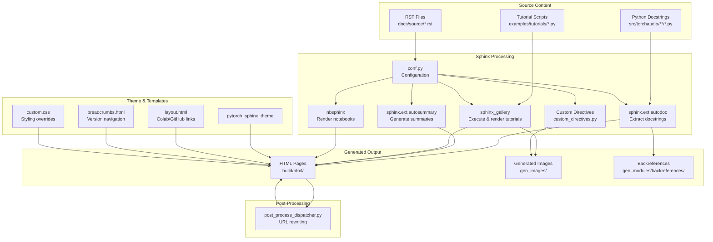
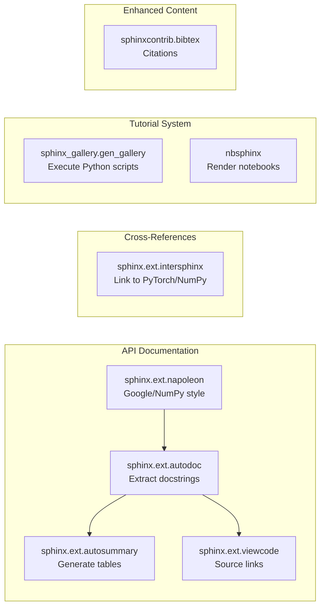
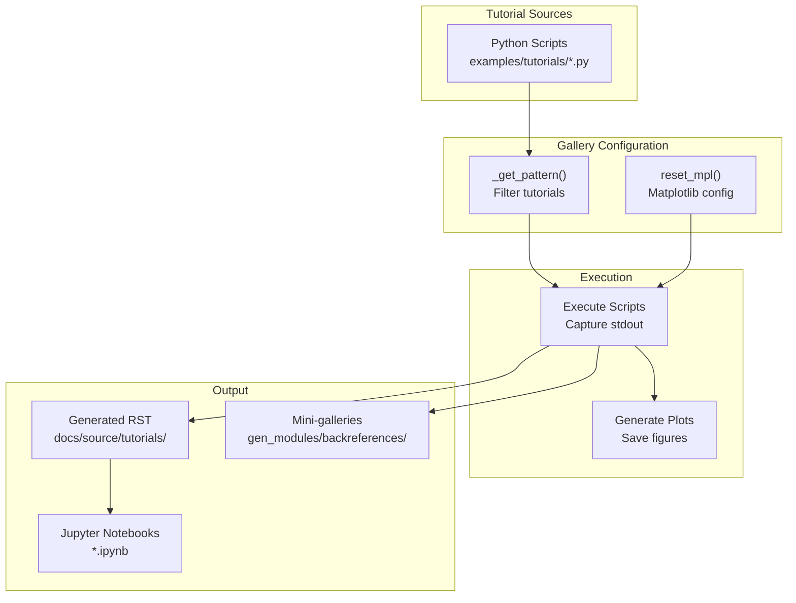
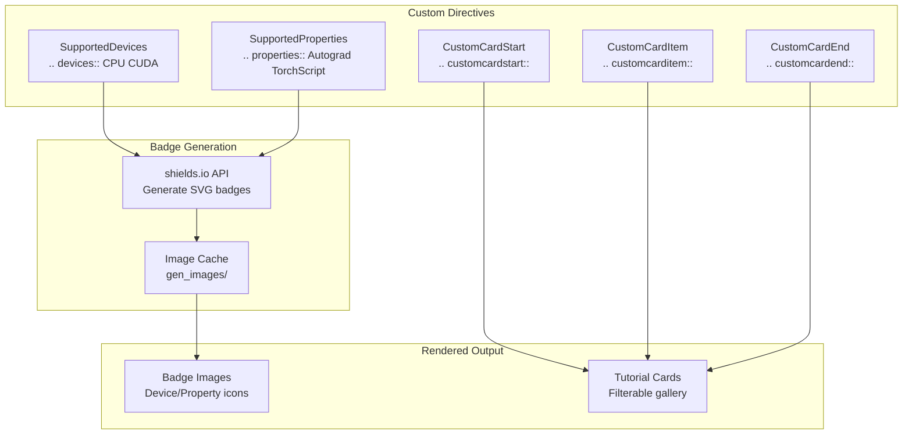
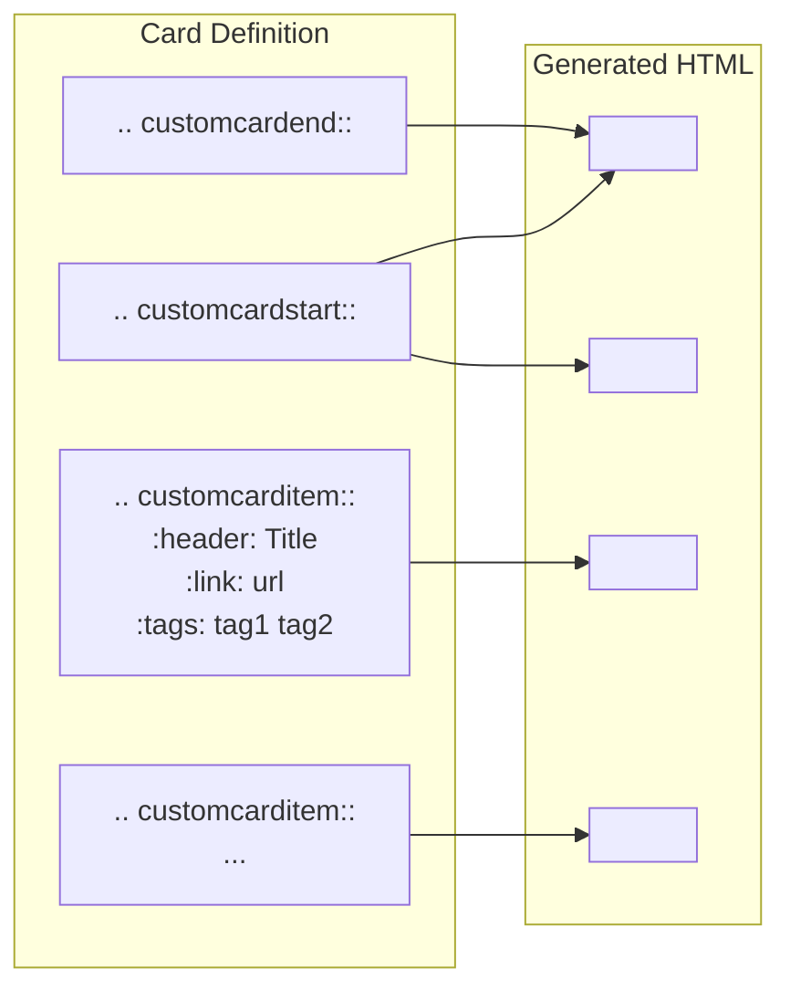
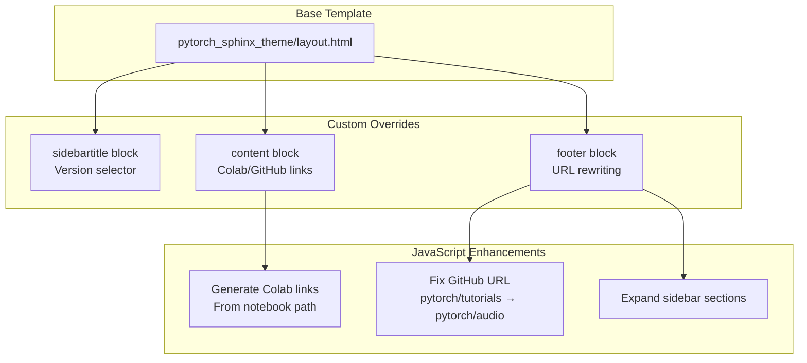
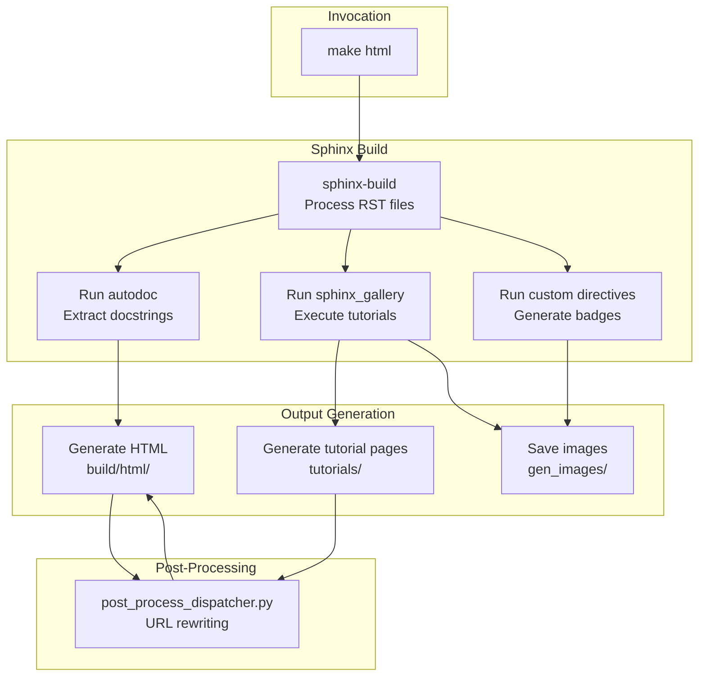

<!-- source: DeepWiki mcp.deepwiki.com · repo pytorch/audio · page 6.3 Documentation System · fetched 2026-10-21 -->

# Documentation System

<details>
<summary>Relevant source files</summary>

The following files were used as context for generating this wiki page:

- [docs/Makefile](docs/Makefile)
- [docs/post_process_dispatcher.py](docs/post_process_dispatcher.py)
- [docs/requirements-tutorials.txt](docs/requirements-tutorials.txt)
- [docs/requirements.txt](docs/requirements.txt)
- [docs/source/_static/css/custom.css](docs/source/_static/css/custom.css)
- [docs/source/_templates/breadcrumbs.html](docs/source/_templates/breadcrumbs.html)
- [docs/source/_templates/layout.html](docs/source/_templates/layout.html)
- [docs/source/conf.py](docs/source/conf.py)
- [docs/source/custom_directives.py](docs/source/custom_directives.py)
- [docs/source/feature_classifications.rst](docs/source/feature_classifications.rst)
- [docs/source/supported_features.rst](docs/source/supported_features.rst)
- [src/torchaudio/pipelines/_tts/utils.py](src/torchaudio/pipelines/_tts/utils.py)

</details>


This document describes TorchAudio's Sphinx-based documentation system, including API reference generation, tutorial rendering, custom directives for feature badges, and the build process. For information about contributing to documentation content, see [Contributing Guidelines](#6.1). For details on CI/CD workflows that build and deploy documentation, see [CI/CD Pipeline](#5.3).

## Purpose and Scope

TorchAudio uses Sphinx as its documentation framework, enhanced with custom directives, sphinx-gallery for tutorials, and the pytorch_sphinx_theme for consistent PyTorch ecosystem branding. The system generates both API reference documentation from Python docstrings and rendered tutorials from example scripts. Key capabilities include:

- Automatic API documentation via `autodoc` and `autosummary`
- Tutorial generation from Python scripts via `sphinx-gallery`
- Custom badge directives for supported devices and properties
- Cross-references to PyTorch and NumPy documentation
- Custom theme modifications for TorchAudio-specific features

## Documentation Build Architecture

The documentation system consists of three main layers: source content (reStructuredText and Python), Sphinx processing with extensions, and generated HTML output.



**Build Flow**: RST source files and Python docstrings are processed by Sphinx with extensions. `autodoc` extracts API documentation, `autosummary` generates summary tables, `sphinx_gallery` executes tutorial scripts and captures output, and custom directives generate feature badges. The pytorch_sphinx_theme with custom templates provides layout and styling. Post-processing adjusts URLs in the final HTML.

Sources: [docs/source/conf.py:1-394](), [docs/Makefile:1-35](), [docs/post_process_dispatcher.py:1-17]()

## Sphinx Configuration

The primary configuration file [docs/source/conf.py]() controls all aspects of documentation generation.

### Core Configuration

| Configuration | Value | Purpose |
|--------------|-------|---------|
| `needs_sphinx` | `"4.0.0"` | Minimum Sphinx version required |
| `source_suffix` | `".rst"` | Source file format |
| `master_doc` | `"index"` | Root documentation file |
| `html_theme` | `"pytorch_sphinx_theme"` | PyTorch-consistent theme |
| `project` | `"Torchaudio"` | Project name |

Sources: [docs/source/conf.py:38-223]()

### Enabled Extensions

The system uses multiple Sphinx extensions to provide comprehensive documentation capabilities:



**Extension Roles**:
- `autodoc`: Automatically extracts documentation from Python docstrings
- `autosummary`: Generates summary tables of modules, classes, and functions with `autosummary_generate = True`
- `napoleon`: Parses Google-style docstrings (preferred) over NumPy style
- `sphinx_gallery`: Executes tutorial scripts, captures output and plots
- `intersphinx`: Creates cross-references to external documentation (PyTorch, NumPy, Python stdlib)

Sources: [docs/source/conf.py:43-56](), [docs/source/conf.py:154-158]()

### Version Management

Documentation versions are controlled through environment variables and displayed in templates:

```python
# Version displayed to users and in metadata
if os.getenv("BUILD_VERSION"):
    version = release = os.environ["BUILD_VERSION"]  # e.g., "2.2.0"
else:
    version = f"Nightly Build ({torchaudio.__version__})"
    release = "nightly"

# Stable version reference for breadcrumbs
html_context = {"version_stable": "2.2.0"}
```

The breadcrumb template uses this to indicate version status (Nightly/Current/Old).

Sources: [docs/source/conf.py:183-198](), [docs/source/_templates/breadcrumbs.html:45-51]()

## Tutorial Generation System

Tutorials are authored as Python scripts in [examples/tutorials/]() and converted to documentation pages with executed code and rendered outputs.

### Sphinx-Gallery Configuration

The `sphinx_gallery_conf` dictionary controls tutorial generation:



**Configuration Details**:

| Option | Value | Purpose |
|--------|-------|---------|
| `examples_dirs` | `["../../examples/tutorials"]` | Source directory for tutorial scripts |
| `gallery_dirs` | `["tutorials"]` | Output directory in documentation |
| `filename_pattern` | `"tutorial.py"` | Only process files matching pattern |
| `doc_module` | `("torchaudio",)` | Module for generating backreferences |
| `reset_modules` | `(reset_mpl, "seaborn")` | Reset state between tutorials |
| `promote_jupyter_magic` | `True` | Convert Jupyter magic commands |

Sources: [docs/source/conf.py:96-153]()

### Tutorial Pattern Filtering

The `_get_pattern()` function controls which tutorials are built based on environment variables:

```python
def _get_pattern():
    pattern = os.getenv("GALLERY_PATTERN")
    # BUILD_GALLERY controls overall building
    if not _get_var("BUILD_GALLERY", default=False if pattern is None else True):
        return {"ignore_pattern": r"\.py"}  # Ignore all
    
    # GALLERY_PATTERN filters specific tutorials
    ret = {"filename_pattern": "tutorial.py"}
    no_build = r".*ctc_decoder_tutorial.py"  # Always skip
    if os.getenv("GALLERY_PATTERN"):
        # Build only matching tutorials
        ret["ignore_pattern"] = r"(/(?!" + re.escape(os.getenv("GALLERY_PATTERN")) + r")[^/]+$)"
        ret["ignore_pattern"] += "|(" + no_build + ")"
    else:
        ret["ignore_pattern"] = no_build
    return ret
```

This allows selective tutorial building during development to speed up iteration.

Sources: [docs/source/conf.py:96-122]()

### Matplotlib Customization

The `reset_mpl()` function configures matplotlib for consistent tutorial output:

```python
def reset_mpl(gallery_conf, fname):
    from sphinx_gallery.scrapers import _reset_matplotlib
    _reset_matplotlib(gallery_conf, fname)
    import matplotlib
    matplotlib.rcParams.update({
        "image.interpolation": "none",
        "figure.figsize": (9.6, 4.8),
        "font.size": 8.0,
        "axes.axisbelow": True,
    })
```

Sources: [docs/source/conf.py:124-138]()

## Custom Directives System

TorchAudio implements custom reStructuredText directives to enhance API documentation with device support and property badges.

### Directive Architecture



**Directive Types**:
- `SupportedDevices`: Displays supported execution devices (CPU, CUDA)
- `SupportedProperties`: Displays supported properties (Autograd, TorchScript)
- `CustomCard*`: Creates tutorial gallery cards with tags and filtering

Sources: [docs/source/custom_directives.py:1-228]()

### Device and Property Badges

The badge directives inherit from `BaseShield` which generates badges via shields.io:

**SupportedDevices Directive**:
```python
class SupportedDevices(BaseShield):
    required_arguments = 1
    final_argument_whitespace = True
    
    def run(self):
        devices = _parse_devices(self.arguments[0])  # e.g., "CPU, CUDA"
        params = {
            "label": "Devices",
            "message": devices,
            "labelColor": GRAY,
            "color": BLUE,
            "style": "flat-square",
        }
        # Generates URL: https://img.shields.io/static/v1?label=Devices&message=CPU%2C%20CUDA&...
        return super().run(params, alt, "devices")
```

**SupportedProperties Directive**:
```python
class SupportedProperties(BaseShield):
    def run(self):
        properties = _parse_properties(self.arguments[0])  # e.g., "Autograd, TorchScript"
        params = {
            "label": "Properties",
            "message": properties,
            "labelColor": GRAY,
            "color": GREEN,
            "style": "flat-square",
        }
        return super().run(params, alt, "properties")
```

**Usage in Documentation**:
```rst
.. devices:: CPU CUDA

.. properties:: Autograd TorchScript
```

Sources: [docs/source/custom_directives.py:56-130](), [docs/source/supported_features.rst:8-10]()

### Image Caching

Badge images are cached to avoid repeated downloads:

```python
def _get_cache_path(key, ext):
    filename = f"{hashlib.sha256(key).hexdigest()}{ext}"
    cache_dir = _THIS_DIR / "gen_images"
    cache_dir.mkdir(parents=True, exist_ok=True)
    return cache_dir / filename

def _fetch_image(url):
    path = _get_cache_path(url.encode("utf-8"), ext=".svg")
    if not path.exists():
        _download(url, path)
    return os.sep + str(path.relative_to(_THIS_DIR))
```

Cached images are stored in [docs/source/gen_images/]() and cleaned with `make clean`.

Sources: [docs/source/custom_directives.py:27-45]()

### Tutorial Card Gallery

The `CustomCard*` directives create interactive tutorial galleries:



**Card Template**:
```python
_CARD_TEMPLATE = """
.. raw:: html

   <div class="col-md-12 tutorials-card-container" data-tags={tags}>
     <div class="card tutorials-card">
       <a href="{link}">
         <div class="card-body">
           <div class="card-title-container">
             <h4>{header}</h4>
           </div>
           <p>Topics: <span class="tags">{tags}</span></p>
           <p class="card-summary">{card_description}</p>
           <div class="tutorials-image">{image}</div>
         </div>
       </a>
     </div>
   </div>
"""
```

Sources: [docs/source/custom_directives.py:132-227]()

## Theme Customization

TorchAudio uses `pytorch_sphinx_theme` with custom templates and CSS for branding and functionality.

### Custom Templates

**layout.html Modifications**:
The custom layout template adds tutorial-specific features:



**Key Customizations**:

1. **Version Dropdown** ([docs/source/_templates/layout.html:3-8]()):
```jinja2

    <div class="version">
      <a href="{{ pathto('../versions.html', 1) }}"><span style="font-size:110%">{{ version }} &#x25BC</span></a>
    </div>
    

```

2. **Tutorial Action Links** ([docs/source/_templates/layout.html:19-42]()):
```jinja2

<div class="pytorch-call-to-action-links">
  <div id="google-colab-link">...</div>
  <div id="download-notebook-link">...</div>
  <div id="github-view-link">...</div>
</div>

```

3. **GitHub URL Rewriting** ([docs/source/_templates/layout.html:66-84]()):
```javascript
var githubLink = "https://github.com/pytorch/audio/blob/main/examples/" + tutorialUrl + ".py"
var colabLink = "https://colab.research.google.com/github/pytorch/audio/blob/gh-pages/main/_downloads" + notebookDownloadPath
```

Sources: [docs/source/_templates/layout.html:1-136]()

**breadcrumbs.html Modifications**:
Custom breadcrumb navigation shows version status:

```jinja2

<li>Nightly (unstable)</li>

<li>Current (stable)</li>

<li>Old version (stable)</li>

```

Sources: [docs/source/_templates/breadcrumbs.html:45-51]()

### Custom CSS Styling

The custom stylesheet [docs/source/_static/css/custom.css]() provides visual enhancements:

**Function Signature Formatting**:
```css
/* Newlines and spaces before each parameter */
dt > em.sig-param:before {
    content: "\a\20\20\20\20";
    white-space: pre;
}
/* Newline after the last parameter */
dt > em.sig-param:last-of-type::after {
    content: "\a";
    white-space: pre;
}
```

**Shield Badge Styling**:
```css
article.pytorch-article img.shield-badge {
    width: unset;
    margin-top: -18px;
    margin-bottom: 9px;
}
```

**C++ Documentation**:
```css
/* Keywords like const and explicit, class */
dt.sig.sig-object.cpp > span.k > span.pre {
    color: #c95362;
}
/* Type names */
dt.sig.sig-object.cpp > span.n:not(.sig-param) > span.pre {
    color: #9257c6;
}
```

Sources: [docs/source/_static/css/custom.css:1-78]()

## API Documentation Generation

API documentation is automatically generated from Python docstrings using `autodoc` and `autosummary`.

### Autodoc Configuration

```python
autodoc_member_order = "bysource"  # Document members in source order
autodoc_mock_imports = ["torchaudio.models.decoder"]  # Mock unavailable modules
```

### Napoleon Docstring Style

Napoleon parses Google-style docstrings (preferred):

```python
napoleon_use_ivar = True
napoleon_numpy_docstring = False  # Disable NumPy style
napoleon_google_docstring = True  # Enable Google style
```

**Example Google-style Docstring**:
```python
def my_function(arg1: int, arg2: str) -> bool:
    """Short description.
    
    Longer description with more details.
    
    Args:
        arg1 (int): Description of arg1
        arg2 (str): Description of arg2
        
    Returns:
        bool: Description of return value
        
    .. devices:: CPU CUDA
    
    .. properties:: Autograd TorchScript
    """
```

Sources: [docs/source/conf.py:61-158]()

### Intersphinx Cross-References

Intersphinx enables linking to external documentation:

```python
intersphinx_mapping = {
    "python": ("https://docs.python.org/3/", None),
    "numpy": ("https://numpy.org/doc/stable/", None),
    "torch": ("https://pytorch.org/docs/stable/", None),
}
```

This allows references like `` :py:func:`torch.nn.Module` `` to link to PyTorch documentation.

Sources: [docs/source/conf.py:303-307]()

### Mini-Gallery Injection

The system automatically injects mini-galleries showing which tutorials use each API:

```python
def inject_minigalleries(app, what, name, obj, options, lines):
    if what in ("class", "function") and _has_backref(name):
        lines.append(f"Tutorials using ``{name.split('.')[-1]}``:")
        lines.append(f"    .. minigallery:: {name}")
        lines.append("\n")
```

Backreference files are generated in [docs/source/gen_modules/backreferences/]() by sphinx-gallery.

Sources: [docs/source/conf.py:362-380]()

## Build Process

The documentation build process is orchestrated by the Makefile and involves multiple stages.

### Build Workflow



**Build Command**:
```bash
make html
# Equivalent to:
sphinx-build -M html docs/source docs/build
python docs/post_process_dispatcher.py docs/build
```

Sources: [docs/Makefile:26-28]()

### Clean Target

The clean target removes all generated files:

```bash
make clean
# Removes:
# - build/* (all built documentation)
# - source/generated/ (autosummary outputs)
# - source/aen_images/ (audio enhancement images)
# - source/gen_modules/ (backreferences)
```

Sources: [docs/Makefile:30-34]()

### Post-Processing

The `post_process_dispatcher.py` script modifies generated HTML:

```python
"""Replaces every instance of 'torchaudio._backend' with 'torchaudio' in torchaudio.html.
Temporary hack while we maintain both the existing set of info/load/save functions and the
new ones backed by the backend dispatcher in torchaudio._backend.
"""
filepath = f"{build_dir}/html/torchaudio.html"
with open(filepath, "r") as f:
    text = f.read()
    text = text.replace("torchaudio._backend", "torchaudio")
with open(filepath, "w") as f:
    f.write(text)
```

This ensures internal backend references are hidden from users.

Sources: [docs/post_process_dispatcher.py:1-17]()

## Dependencies

The documentation system requires specific package versions:

| Package | Version | Purpose |
|---------|---------|---------|
| `sphinx` | `5.1.1` | Core documentation engine |
| `sphinx_gallery` | `0.11.1` | Tutorial generation |
| `nbsphinx` | `0.8.8` | Jupyter notebook rendering |
| `sphinxcontrib.katex` | `0.8.6` | Math rendering |
| `sphinxcontrib.bibtex` | Latest | Citation support |
| `pytorch_sphinx_theme` | Git `32a6550` | PyTorch theme |
| `matplotlib` | `<=3.8` | Plot generation |
| `Jinja2` | `<3.1.0` | Template engine compatibility |

**Installation**:
```bash
pip install -r docs/requirements.txt
pip install -r docs/requirements-tutorials.txt  # For IPython in tutorials
```

Sources: [docs/requirements.txt:1-17](), [docs/requirements-tutorials.txt:1-2]()

## Feature Documentation Standards

TorchAudio enforces documentation standards for API features through custom directives and testing.

### Feature Classifications

Documentation uses standardized classifications ([docs/source/feature_classifications.rst]()):

- **Stable**: Long-term maintenance, backwards compatibility guaranteed
- **Beta**: API may change based on feedback, no backwards compatibility guarantee
- **Prototype**: Early stage, may not be in binary distributions

### Supported Features Documentation

All APIs should document their supported devices and properties using custom directives:

```rst
.. devices:: CPU CUDA

.. properties:: Autograd TorchScript
```

These badges indicate automated test coverage. Missing badges mean either:
1. The feature works but is not tested
2. The feature is not compatible

Users should verify untested features before relying on them.

Sources: [docs/source/supported_features.rst:1-99](), [docs/source/feature_classifications.rst:1-21]()