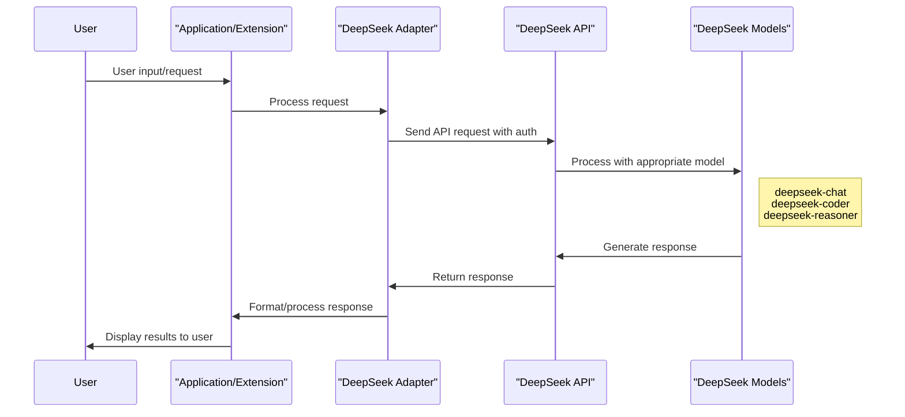
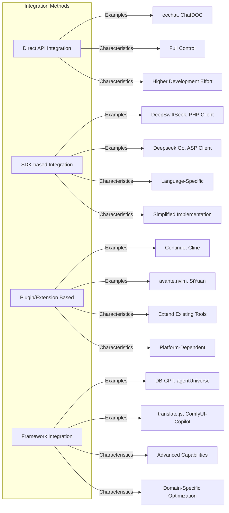
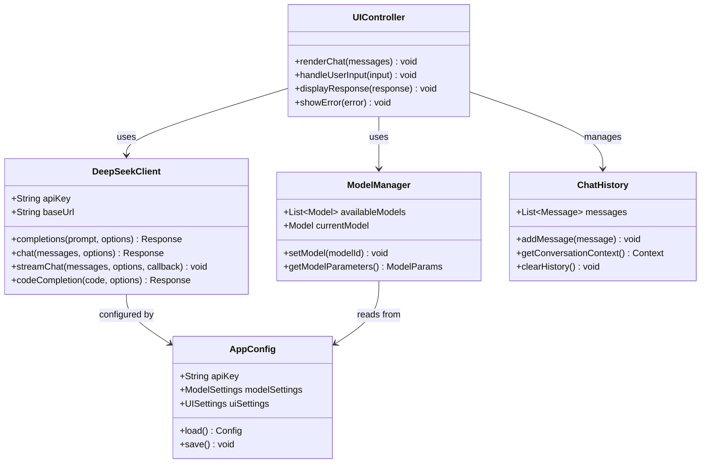
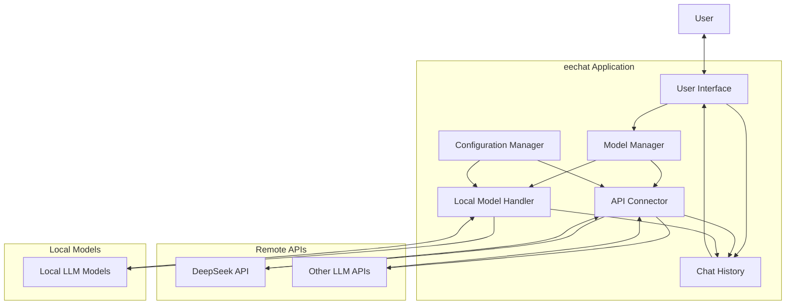
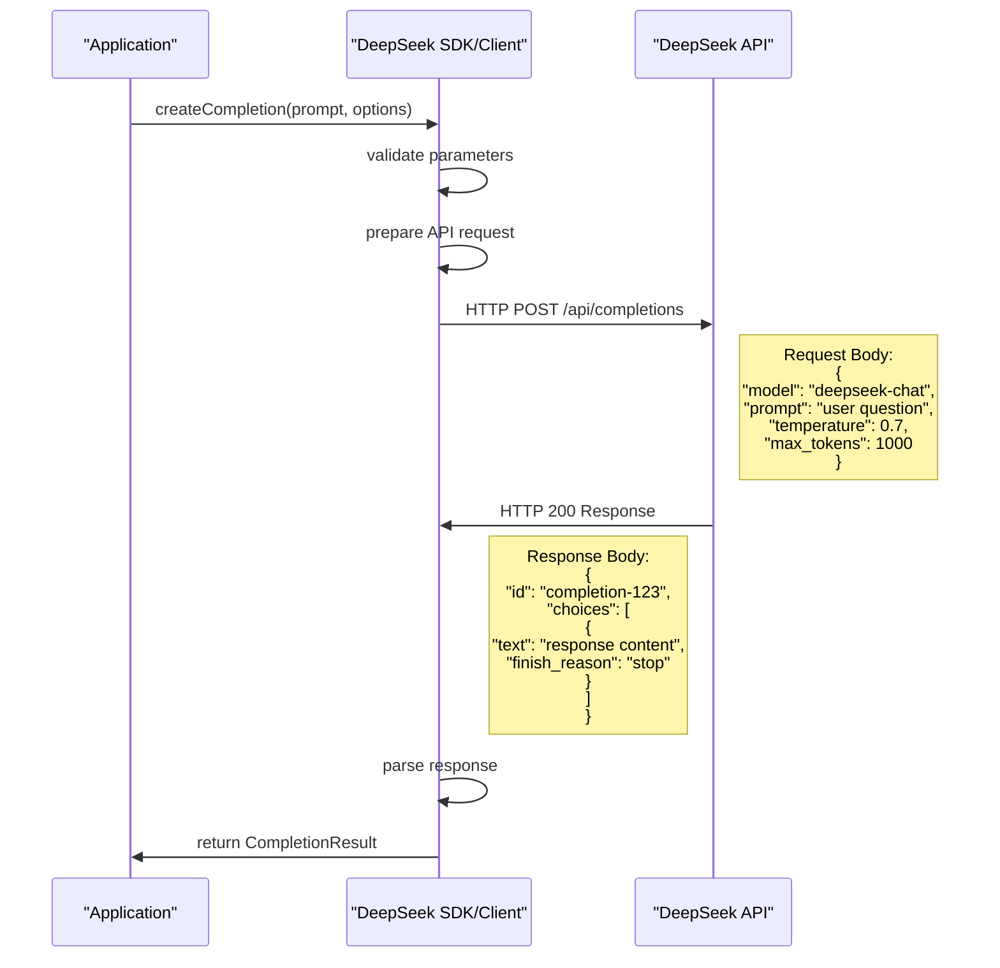
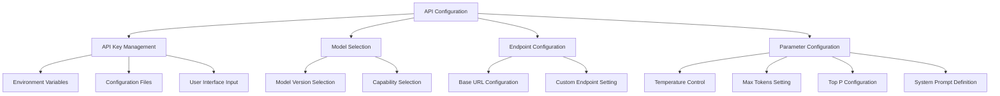

<!-- source: DeepWiki mcp.deepwiki.com · repo deepseek-ai/awesome-deepseek-integration · page 1 Overview · fetched 2026-10-30 -->

# Overview

Relevant source files

The following files were used as context for generating this wiki page:

- [README.md](README.md)
- [README_cn.md](README_cn.md)
- [README_es.md](README_es.md)
- [README_ja.md](README_ja.md)
- [README_zh_tw.md](README_zh_tw.md)
- [docs/4EVERChat/README.md](docs/4EVERChat/README.md)
- [docs/4EVERChat/README_cn.md](docs/4EVERChat/README_cn.md)
- [docs/4EVERChat/README_ja.md](docs/4EVERChat/README_ja.md)
- [docs/DocKit/README.md](docs/DocKit/README.md)
- [docs/DocKit/README_cn.md](docs/DocKit/README_cn.md)
- [docs/DocKit/assets/client-ui.png](docs/DocKit/assets/client-ui.png)
- [docs/DocKit/assets/dockit.png](docs/DocKit/assets/dockit.png)
- [docs/DocKit/assets/wechat_official.png](docs/DocKit/assets/wechat_official.png)
- [docs/DocKit/assets/wechat_ponsor.jpg](docs/DocKit/assets/wechat_ponsor.jpg)
- [docs/OpenXLab/migo/logo.svg](docs/OpenXLab/migo/logo.svg)

This document provides a technical introduction to the DeepSeek integrations ecosystem, explaining how applications, frameworks, tools, and extensions utilize the DeepSeek API to incorporate AI capabilities. It summarizes the integration categories, architecture patterns, and implementation approaches for leveraging DeepSeek's language models across diverse software systems.

## Integration Ecosystem

The DeepSeek ecosystem spans numerous software integrations that connect to the DeepSeek API to access AI models including `deepseek-chat`, `deepseek-coder`, and `deepseek-reasoner`. These integrations are organized into four primary categories:

```mermaid
graph TD
    DeepSeek["DeepSeek API"] --> Apps["Applications"]
    DeepSeek --> Frameworks["AI/Agent Frameworks"]
    DeepSeek --> DevTools["Developer Tools"]
    DeepSeek --> Extensions["Platform Extensions"]
    
    Apps --> ChatApps["Chat Applications"]
    Apps --> TransTools["Translation Tools"]
    Apps --> CodeAsst["Code Assistants"]
    Apps --> KnowledgeBases["Knowledge Bases"]
    Apps --> Productivity["Productivity Tools"]
    
    Frameworks --> AgentF["AI Agent Frameworks"]
    Frameworks --> RAG["RAG Frameworks"]
    Frameworks --> DataAI["Data AI Applications"]
    Frameworks --> FHE["FHE Frameworks"]
    
    DevTools --> CodeEditors["Code Editor Integrations"]
    DevTools --> SDKs["Language SDKs"]
    DevTools --> CLITools["CLI Tools"]
    
    Extensions --> BrowserExt["Browser Extensions"]
    Extensions --> MessagingExt["Messaging App Plugins"]
    Extensions --> OfficeExt["Office Add-ins"]
```

Sources: [README.md:16-42](), [README_cn.md:19-38]()

### Applications

DeepSeek-powered applications provide AI capabilities directly to end-users:

| Type | Examples | Purpose |
|-----------------|----------|---------|
| Chat Applications | `eechat`, `4EVERChat`, `ChatGPT-Next-Web` | Conversational AI interfaces |
| Translation Tools | `Immersive Translate`, `Bob`, `translate.js` | Text translation between languages |
| Code Assistants | `Continue`, `avante.nvim`, `codecompanion.nvim` | Programming assistance |
| Knowledge Bases | `SiYuan`, `DocKit`, `Refine Reader` | Knowledge management with AI |
| Productivity Tools | `SwiftChat`, `ToMemo`, `DingTalk` | AI-enhanced productivity |

Sources: [README.md:45-433](), [README_cn.md:42-358]()

### AI Frameworks

Frameworks that provide infrastructure for building AI applications using DeepSeek:

| Type | Examples | Purpose |
|----------------|----------|---------|
| AI Agent Frameworks | `smolagents`, `SuperAgentX`, `Anda` | Building autonomous AI agents |
| RAG Frameworks | `RAGFlow`, `Autoflow` | Retrieval-augmented generation systems |
| Data AI Frameworks | `DB-GPT` | Data-centric AI applications |
| FHE Frameworks | `Mind FHE SDK` | Homomorphic encryption for AI |

Sources: [README.md:438-541](), [README_cn.md:362-408]()

### Developer Tools

Tools that facilitate DeepSeek integration during development:

| Type | Examples | Purpose |
|-----------|----------|---------|
| Code Editor Extensions | `Continue` (VS Code), `avante.nvim` (Neovim) | IDE integration |
| Language SDKs | `DeepSwiftSeek`, `PHP Client`, `Deepseek Go` | Language-specific APIs |
| CLI Tools | `Cline` | Command-line access |

Sources: [README.md:542-622](), [README_cn.md:409-473]()

### Platform Extensions

Extensions that integrate DeepSeek into existing platforms:

| Type | Examples | Purpose |
|----------------|----------|---------|
| Browser Extensions | `Immersive Translate`, `Refine Reader` | Browser integration |
| Messaging App Plugins | `Huixiangdou`, `LangBot` | Messaging platform integration |
| Office Add-ins | `Office-AI` | Office application integration |

Sources: [README.md:623-715](), [README_cn.md:474-546]()

## Integration Flow Pattern

Most DeepSeek integrations follow this common interaction pattern:

Sources: [README.md:16-42](), [README_cn.md:19-38]()

## Integration Methods Comparison

There are four primary approaches to integrating with the DeepSeek API:

Sources: [README.md:16-42](), [README_cn.md:19-38]()

| Method | Description | Best For |
|--------|-------------|----------|
| Direct API Integration | Directly calling DeepSeek API endpoints | Maximum control and customization |
| SDK-based Integration | Using language-specific libraries | Faster development in specific languages |
| Plugin/Extension Based | Building extensions for existing platforms | Enhancing existing tools |
| Framework Integration | Using higher-level frameworks | Complex AI applications |

## Application Architecture

Most DeepSeek-integrated applications share these architectural components:

Sources: [README.md:45-433](), [README_cn.md:42-358]()

## Example Application: eechat

`eechat` provides a good example of a DeepSeek-integrated application architecture:

Sources: [README.md:54-57](), [README_cn.md:51-53]()

## API Request/Response Flow

The following diagram illustrates the specific API interaction between an application and the DeepSeek API:

Sources: [README.md:54-57](), [README_cn.md:51-53](), [README.md:438-541]()

## API Configuration Patterns

Most DeepSeek integrations implement similar configuration patterns:

Sources: [README.md:16-42](), [README_cn.md:19-38]()

Common configuration elements include:

| Configuration Area | Elements | Description |
|-------------------|----------|-------------|
| API Key Management | Environment variables, Config files, UI settings | Secure handling of API credentials |
| Model Selection | Model variant, capabilities | Selection between different DeepSeek models |
| Endpoint Configuration | Base URL, custom endpoints | API endpoint configuration |
| Parameter Configuration | Temperature, max tokens, top-p, system prompts | Response generation parameters |

## Next Steps

For more detailed information about specific categories of DeepSeek integrations, refer to the following pages:

- For more on integration categories, see [Integration Categories](#1.1)
- For more on integration methods, see [Integration Methods](#1.2)
- For more on API configuration, see [API Configuration](#1.3)
- For details on chat applications, see [Chat Applications](#2)
- For details on productivity tools, see [Productivity Tools](#3)
- For details on document tools, see [Document Tools](#4)
- For details on IDE integrations, see [IDE Integrations](#5)
- For details on browser extensions, see [Browser Extensions](#6)
- For details on AI frameworks, see [AI Frameworks](#7)
- For details on creative tools, see [Creative Tools](#8)
- For details on knowledge management, see [Knowledge Management](#9)

---

