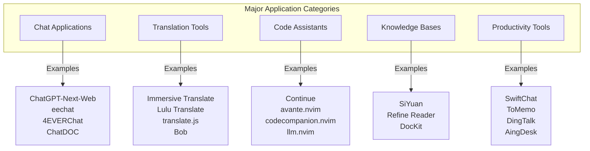
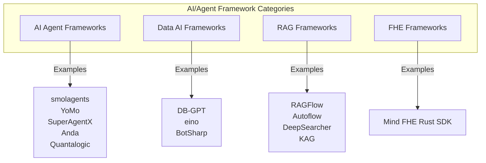
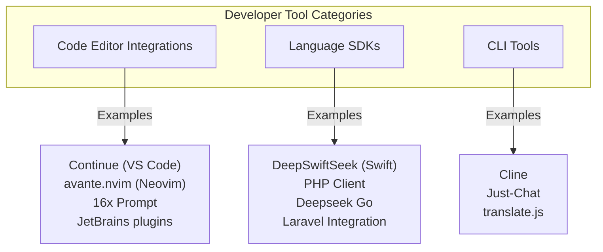
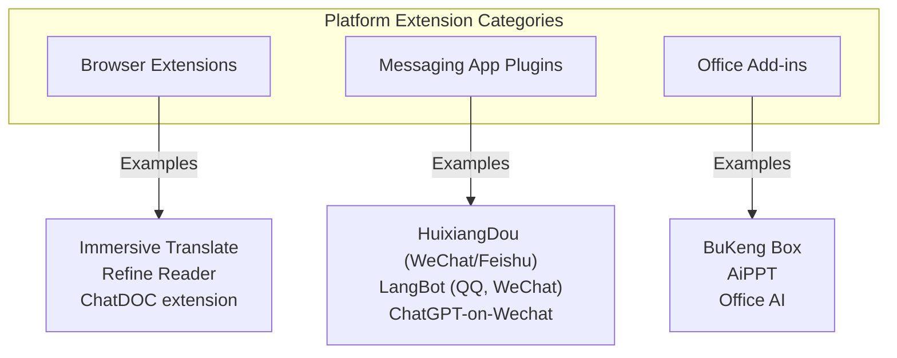
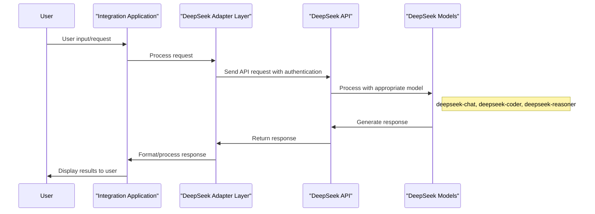

<!-- source: DeepWiki mcp.deepwiki.com · repo deepseek-ai/awesome-deepseek-integration · page 1.1 Integration Categories · fetched 2026-10-30 -->

# Integration Categories

Relevant source files

The following files were used as context for generating this wiki page:

- [README.md](README.md)
- [README_cn.md](README_cn.md)
- [README_ja.md](README_ja.md)
- [README_zh_tw.md](README_zh_tw.md)
- [docs/4EVERChat/README.md](docs/4EVERChat/README.md)
- [docs/4EVERChat/README_cn.md](docs/4EVERChat/README_cn.md)
- [docs/4EVERChat/README_ja.md](docs/4EVERChat/README_ja.md)
- [docs/OpenXLab/migo/logo.svg](docs/OpenXLab/migo/logo.svg)

This page provides an overview of the major categories of integrations in the DeepSeek ecosystem. It classifies the different types of software, frameworks, applications, and tools that integrate with the DeepSeek API. For information about specific integration methods and techniques, see [Integration Methods](#1.2).

## Overview of Integration Categories

The DeepSeek integration ecosystem spans a wide range of software types, from end-user applications to development frameworks and platform extensions. These integrations enable developers and users to access DeepSeek's AI capabilities across various contexts and environments.

```mermaid
graph TD
    subgraph "DeepSeek Integration Categories"
        Applications["Applications"]
        Frameworks["AI/Agent Frameworks"]
        DevTools["Developer Tools"]
        Extensions["Platform Extensions"]
    end
    
    Applications --> MobileApps["Mobile Apps"]
    Applications --> WebApps["Web Applications"] 
    Applications --> DesktopApps["Desktop Applications"]
    
    Frameworks --> AgentF["AI Agent Frameworks"]
    Frameworks --> RAG["RAG Frameworks"]
    Frameworks --> DataAI["Data AI Applications"]
    Frameworks --> FHE["FHE Frameworks"]
    
    DevTools --> CodeEditors["Code Editor Integrations"]
    DevTools --> SDKs["Language SDKs"]
    DevTools --> CLITools["CLI Tools"]
    
    Extensions --> BrowserExt["Browser Extensions"]
    Extensions --> MessagingExt["Messaging App Plugins"]
    Extensions --> OfficeExt["Office Add-ins"]
```

*Diagram: Primary categories of DeepSeek API integrations and their subcategories*

Sources: [README.md:18-41]()

## Applications

Applications represent the largest category of DeepSeek integrations. These are end-user software programs that leverage DeepSeek's language models for various purposes across different platforms.

### Mobile Applications

Mobile applications provide AI capabilities on iOS and Android devices, bringing DeepSeek-powered intelligence to smartphones and tablets.

Key Examples:
- **Pal**: AI Chat Client for iOS/iPadOS
- **SwiftChat**: React Native-based cross-platform chat application
- **ToMemo**: iOS phrasebook and clipboard app with AI integration
- **xhai Browser**: Android desktop management & AI browser

### Web Applications

Web-based applications that run in browsers and integrate with DeepSeek for online AI capabilities.

Key Examples:
- **ChatGPT-Next-Web**: Cross-platform web UI for AI chat
- **4EVERChat**: LLM model selection platform with real-time comparison
- **FastGPT**: Open-source AI knowledge base platform
- **LibreChat**: Customizable open-source app for AI interactions

### Desktop Applications

Native applications for Windows, macOS, or Linux that integrate DeepSeek capabilities directly into desktop environments.

Key Examples:
- **eechat**: Local deployment tool for LLMs with privacy focus
- **AingDesk**: One-click AI model deployment with visual interface
- **ChatDOC**: AI-powered document reading tool
- **DeepChat**: Free desktop smart assistant with advanced capabilities
- **Chatbox**: Multi-model desktop client

Sources: [README.md:45-404]()

## Application Types and Use Cases

DeepSeek's integrations span several common application types focused on specific user needs and workflows.

*Diagram: Major application types and representative examples*

Sources: [README.md:45-404]()

### Chat Applications

Chat applications provide conversational interfaces to DeepSeek's language models, enabling natural language interaction for various purposes.

Key characteristics:
- Interactive dialogue-based interfaces
- Support for multi-turn conversations
- Context retention between interactions
- Often include streaming responses for real-time feedback

### Translation Tools

Translation applications use DeepSeek's language capabilities to translate content between different languages, often with specialized features for specific content types.

Key characteristics:
- Support for multiple language pairs
- Context-aware translation
- Domain-specific terminology handling
- Often include OCR capabilities for image-based translation

### Code Assistants

Code assistants integrate DeepSeek's coding capabilities into development environments to provide coding assistance, documentation, and other programming support.

Key characteristics:
- Code completion and generation
- Documentation assistance
- Bug detection and fixing
- Integration with popular development tools

### Knowledge Bases

Knowledge base applications combine DeepSeek with information retrieval and storage capabilities to create customized information systems.

Key characteristics:
- Document indexing and search
- Question answering based on stored knowledge
- Often implement RAG (Retrieval-Augmented Generation)
- Support for various document formats

### Productivity Tools

Productivity tools integrate DeepSeek capabilities into workflows to improve efficiency across various tasks.

Key characteristics:
- Task-specific AI assistance
- Integration with productivity workflows
- Often provide specialized UI for specific domains
- Cross-platform availability

Sources: [README.md:45-404]()

## AI/Agent Frameworks

AI and Agent Frameworks provide development infrastructure for building applications and services powered by DeepSeek's language models.

*Diagram: AI/Agent Framework categories with examples*

Sources: [README.md:436-486]()

### AI Agent Frameworks

AI Agent frameworks provide infrastructures for building autonomous AI agents that can perform complex tasks using DeepSeek models.

Key characteristics:
- Agent orchestration capabilities
- Tool usage and function calling
- Multi-agent collaboration
- Memory and context management

Key examples:
- **smolagents**: Simplified agent building framework
- **SuperAgentX**: Lightweight framework for autonomous multi-agent applications
- **Anda**: Rust framework for AI agent development
- **Quantalogic**: ReAct (Reasoning & Action) framework

### Data AI Application Frameworks

Data AI frameworks focus on integrating DeepSeek with database technologies and data processing capabilities.

Key characteristics:
- Database integration
- Query generation and interpretation
- Data analysis capabilities
- Specialized for data-centric applications

Key example:
- **DB-GPT**: Open-source framework for AI-native data applications

### RAG Frameworks

RAG (Retrieval-Augmented Generation) frameworks combine DeepSeek's generative capabilities with information retrieval to provide context-aware AI responses.

Key characteristics:
- Document indexing and retrieval
- Vector database integration
- Context augmentation for LLM responses
- Knowledge management workflows

Key examples:
- **RAGFlow**: Open-source RAG engine for document understanding
- **Autoflow**: GraphRAG-based knowledge base tool
- **DeepSearcher**: Combines LLMs with vector databases

### FHE Frameworks

FHE (Fully Homomorphic Encryption) frameworks enable privacy-preserving computation on encrypted data for DeepSeek interactions.

Key characteristics:
- Privacy-preserving AI computation
- Data encryption during processing
- Secure agent consensus mechanisms
- No exposure of underlying data

Key example:
- **Mind FHE Rust SDK**: Open-source SDK for encrypted AI using FHE

Sources: [README.md:436-486]()

## Developer Tools

Developer tools enable software engineers to integrate DeepSeek capabilities into their development workflows and applications.

*Diagram: Developer Tool categories with examples*

Sources: [README.md:195-247]()

### Code Editor Integrations

Code editor integrations bring DeepSeek capabilities directly into programming environments, providing context-aware assistance for software development.

Platforms with DeepSeek integrations include:
- **VS Code**: Continue, 16x Prompt
- **Neovim**: avante.nvim, codecompanion.nvim, llm.nvim
- **JetBrains IDEs**: Various plugins
- **Visual Studio**: Extensions
- **Emacs**: Plugins

### Language SDKs

Language-specific Software Development Kits (SDKs) provide programmers with native interfaces to DeepSeek APIs in their preferred programming languages.

Available SDKs include:
- **Swift**: DeepSwiftSeek
- **PHP**: deepseek-php-client
- **Go**: Deepseek Go
- **PHP/Laravel**: Laravel Integration
- **ASP.NET**: ASP Client

### CLI Tools

Command-Line Interface (CLI) tools provide access to DeepSeek capabilities through terminal interfaces, enabling integration with scripts and automation workflows.

Examples include:
- **Cline**: AI assistant for CLI and editors
- **Just-Chat**: Lightweight library for LLM agents
- **translate.js**: AI i18n tool for frontend developers

Sources: [README.md:195-247](), [README.md:524-578]()

## Platform Extensions

Platform extensions integrate DeepSeek capabilities into existing platforms and services, extending their functionality with AI capabilities.

*Diagram: Platform Extension categories with examples*

Sources: [README.md:487-536]()

### Browser Extensions

Browser extensions add DeepSeek capabilities to web browsers, providing AI features while users browse the internet.

Key characteristics:
- Integration with browsing experience
- Content analysis and transformation
- Translation and summarization features
- Web content interaction

Key examples:
- **Immersive Translate**: In-page translation extension
- **Refine Reader**: Chrome extension for document reading
- **xhai Browser**: Android browser with DeepSeek integration

### Messaging App Plugins

Messaging plugins integrate DeepSeek into communication platforms, enabling AI capabilities within chat experiences.

Key characteristics:
- Chat-based interaction
- Group chat integration
- Command-based invocation
- Context retention within chat threads

Key examples:
- **HuixiangDou**: Integration for personal WeChat/Feishu groups
- **LangBot**: Bot platform for QQ, enterprise WeChat, Feishu
- **AstrBot**: Multi-platform chatbot and development framework

### Office Add-ins

Office add-ins extend productivity suites with DeepSeek capabilities, enhancing document creation and management with AI features.

Key characteristics:
- Integration with document workflows
- Content generation and transformation
- Document analysis and summarization
- Productivity enhancement features

Key examples:
- **BuKeng Box**: Add-in for Word, Excel, and PowerPoint
- **AiPPT**: PPT generation tool
- **Office AI**: Integration for Microsoft Office

Sources: [README.md:487-536]()

## Integration Flow Pattern

Regardless of the integration category, most DeepSeek integrations follow a similar flow pattern for handling user interactions.

*Diagram: Typical flow pattern in DeepSeek integrations*

This standard flow pattern is consistent across different integration types and allows for a modular approach to DeepSeek integration. The adapter layer handles API communication, authentication, and response processing, which can be implemented in different ways depending on the integration category.

Sources: [README.md:45-84]()

## Summary

DeepSeek integrations span a diverse ecosystem of applications, frameworks, developer tools, and platform extensions. These integrations enable AI capabilities across various contexts, from mobile and desktop applications to development environments and productivity tools. The common integration pattern allows for consistent interaction with DeepSeek's models regardless of the integration category.

Each category serves different user needs and technical requirements:

| Category | Primary Purpose | Target Users | Typical Examples |
|----------|----------------|--------------|------------------|
| Applications | End-user AI services | General users | eechat, SwiftChat, ChatDOC |
| AI/Agent Frameworks | Development infrastructure | Developers | smolagents, DB-GPT, RAGFlow |
| Developer Tools | Development assistance | Software engineers | Continue, DeepSwiftSeek, Cline |
| Platform Extensions | Enhance existing platforms | Platform users | Immersive Translate, HuixiangDou, BuKeng Box |

This categorization provides a foundation for understanding the DeepSeek integration ecosystem and navigating the various ways DeepSeek's capabilities can be accessed and utilized.

Sources: [README.md:18-41](), [README.md:45-404](), [README.md:436-486](), [README.md:487-536]()

---

