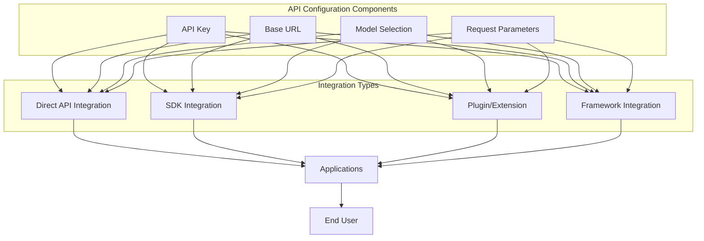
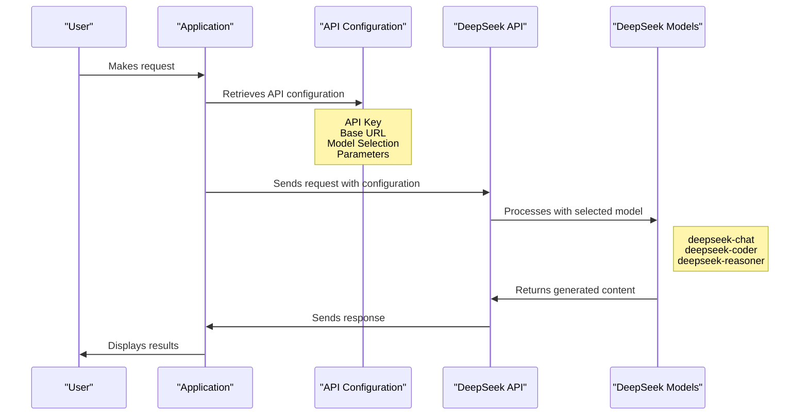
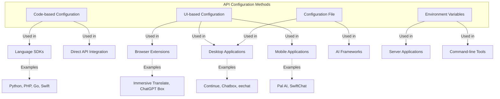
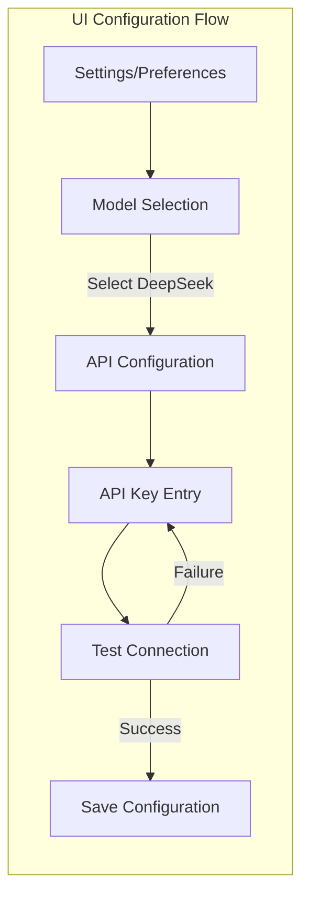
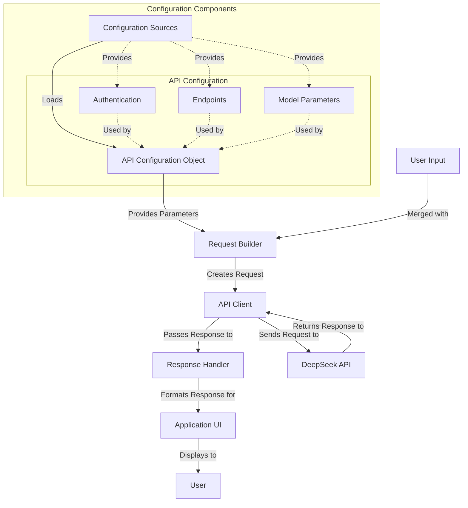

<!-- source: DeepWiki mcp.deepwiki.com · repo deepseek-ai/awesome-deepseek-integration · page 1.3 API Configuration · fetched 2026-10-30 -->

# API Configuration

<details>
<summary>Relevant source files</summary>

The following files were used as context for generating this wiki page:

- [README.md](README.md)
- [README_cn.md](README_cn.md)
- [README_ja.md](README_ja.md)
- [docs/4EVERChat/README.md](docs/4EVERChat/README.md)
- [docs/4EVERChat/README_cn.md](docs/4EVERChat/README_cn.md)
- [docs/4EVERChat/README_ja.md](docs/4EVERChat/README_ja.md)
- [docs/bob_translate/README.md](docs/bob_translate/README.md)
- [docs/bob_translate/README_cn.md](docs/bob_translate/README_cn.md)
- [docs/chatbox/README.md](docs/chatbox/README.md)
- [docs/chatbox/README_cn.md](docs/chatbox/README_cn.md)
- [docs/chatgpt_box/README.md](docs/chatgpt_box/README.md)
- [docs/chatgpt_box/README_cn.md](docs/chatgpt_box/README_cn.md)
- [docs/chatgpt_next_web/README.md](docs/chatgpt_next_web/README.md)
- [docs/chatgpt_next_web/README_cn.md](docs/chatgpt_next_web/README_cn.md)
- [docs/continue/README.md](docs/continue/README.md)
- [docs/continue/README_cn.md](docs/continue/README_cn.md)
- [docs/hcfy/README.md](docs/hcfy/README.md)
- [docs/hcfy/README_cn.md](docs/hcfy/README_cn.md)
- [docs/immersive_translate/README.md](docs/immersive_translate/README.md)
- [docs/immersive_translate/README_cn.md](docs/immersive_translate/README_cn.md)
- [docs/pal/README.md](docs/pal/README.md)
- [docs/pal/README_cn.md](docs/pal/README_cn.md)

</details>


This page documents common patterns for configuring the DeepSeek API across different integrations. It covers essential configuration parameters, authentication methods, and implementation examples to help developers properly set up DeepSeek API in various applications and frameworks.

For information about different integration methods, see [Integration Methods](#1.2).

## API Configuration in the Integration Ecosystem

API configuration is a crucial step when integrating with the DeepSeek platform. It establishes the connection between your application and DeepSeek's AI services, determining how requests are authenticated, processed, and how responses are returned.



Sources:
- README.md
- docs/continue/README.md
- docs/immersive_translate/README.md
- docs/chatgpt_next_web/README.md

## Core API Configuration Parameters

The following parameters are essential when configuring the DeepSeek API:

| Parameter | Description | Example |
|-----------|-------------|---------|
| API Key | Authentication token required to access DeepSeek services | `sk-xxxxxxxxxxxxxxxxxxxxxxxxxxxx` |
| Base URL | The endpoint URL for the DeepSeek API | `https://api.deepseek.com/beta` |
| Model | DeepSeek model to be used | `deepseek-chat`, `deepseek-coder`, `deepseek-reasoner` |
| Temperature | Controls randomness in responses (0-1) | `0.0` for deterministic, `0.7` for creative |
| Max Tokens | Maximum length of the generated response | `256`, `1024`, etc. |
| Context Length | How much context the model can process | `16000`, `128000`, etc. |

Sources:
- docs/continue/README.md:16-42
- docs/continue/README_cn.md:16-42

## API Configuration Flow

The following diagram illustrates how API configuration integrates into the typical request-response flow:



Sources:
- README.md:36-58

## Configuration Methods

There are several methods to configure the DeepSeek API in your application. The following diagram illustrates the most common approaches:



Sources:
- docs/continue/README.md
- docs/immersive_translate/README.md
- docs/hcfy/README.md
- docs/chatgpt_next_web/README.md
- docs/chatbox/README.md
- docs/pal/README.md

## Implementation Examples

### Code-based Configuration (Continue IDE Extension)

In the Continue IDE extension, DeepSeek API is configured through a JSON configuration file:

```json
{
  "models": [
    {
      "title": "DeepSeek",
      "model": "deepseek-chat",
      "contextLength": 128000,
      "apiKey": "REDACTED",
      "provider": "openai",
      "apiBase": "https://api.deepseek.com/beta"
    }
  ],
  "tabAutocompleteModel": {
    "title": "DeepSeek",
    "model": "deepseek-chat",
    "apiKey": "REDACTED",
    "provider": "openai", 
    "apiBase": "https://api.deepseek.com/beta"
  }
}
```

Note the key configuration elements:
- The model is specified as `deepseek-chat`
- The API base URL is set to `https://api.deepseek.com/beta`
- The provider is set to `openai` (indicating OpenAI-compatible API)
- The context length is configured to 128000 tokens

Sources:
- docs/continue/README.md:16-42

### UI-based Configuration

Many applications provide graphical interfaces for configuring the DeepSeek API. The following diagram illustrates the typical UI configuration flow:



Examples of applications with UI-based configuration include:
- Immersive Translate (Browser Extension)
- ChatGPT-Next-Web
- Chatbox (Desktop Application)
- Pal AI (iOS Application)

Sources:
- docs/immersive_translate/README.md
- docs/hcfy/README.md
- docs/chatgpt_next_web/README.md
- docs/chatbox/README.md
- docs/pal/README.md

## API Integration with SDK Libraries

DeepSeek offers integration through various language-specific SDK libraries:

| Language | SDK | Example Usage |
|----------|-----|---------------|
| PHP | deepseek-php-client | PHP client library for DeepSeek API integration |
| Swift | DeepSwiftSeek | Supports chat, streaming, FIM completions with Swift concurrency |
| Go | deepseek-go | Supports Chat and Reasoning models with provider flexibility |
| ASP.NET | Deepseek.Asp.Client | .NET wrapper for the DeepSeek AI API |

Sources:
- README.md:214-237
- README.md:295-298

## Configuration Components and Data Flow

The following diagram provides a more detailed view of how configuration data flows through a typical DeepSeek integration:



Sources:
- README.md
- docs/continue/README.md
- docs/chatgpt_next_web/README.md

## Best Practices for API Configuration

### Security Considerations

1. **API Key Management**:
   - Never hardcode API keys in your source code
   - Use environment variables or secure configuration stores
   - For client-side applications, consider using a backend proxy

2. **Configuration Validation**:
   - Validate configuration parameters before sending requests
   - Implement error handling for invalid configuration

3. **Rate Limiting and Quota Management**:
   - Monitor API usage to prevent exceeding quotas
   - Implement backoff strategies for rate limit errors

### Configuration Recommendations

| Parameter | Recommendation | Use Case |
|-----------|---------------|----------|
| Temperature | 0.0 - 0.3 | Factual responses, code generation |
| Temperature | 0.5 - 0.7 | Creative content, balanced responses |
| Temperature | 0.8 - 1.0 | Highly creative, varied outputs |
| Max Tokens | Lower values | Quick responses, chat applications |
| Max Tokens | Higher values | Long-form content, document generation |
| Model | deepseek-chat | General conversation, Q&A |
| Model | deepseek-coder | Code generation, technical tasks |
| Model | deepseek-reasoner | Complex reasoning, step-by-step solutions |

Sources:
- README.md
- docs/continue/README.md:16-42

## Troubleshooting Common Configuration Issues

| Issue | Possible Causes | Solutions |
|-------|----------------|-----------|
| Authentication Error | Invalid or expired API key | Verify and update your API key |
| Connection Timeout | Network issues, server overload | Implement retry logic with exponential backoff |
| Invalid Request | Incorrect parameters, malformed JSON | Validate request format before sending |
| Model Not Found | Incorrect model name in configuration | Check available models and correct configuration |
| Rate Limit Exceeded | Too many requests in short time | Implement rate limiting, optimize request patterns |

Sources:
- README.md

## Summary

Proper API configuration is essential for successful integration with the DeepSeek platform. The key components include:

1. API authentication with a valid API key
2. Correct base URL and endpoint configuration
3. Appropriate model selection
4. Request parameter optimization

By following the patterns and practices outlined in this document, developers can ensure reliable and efficient communication with the DeepSeek API across various integration types.

---

