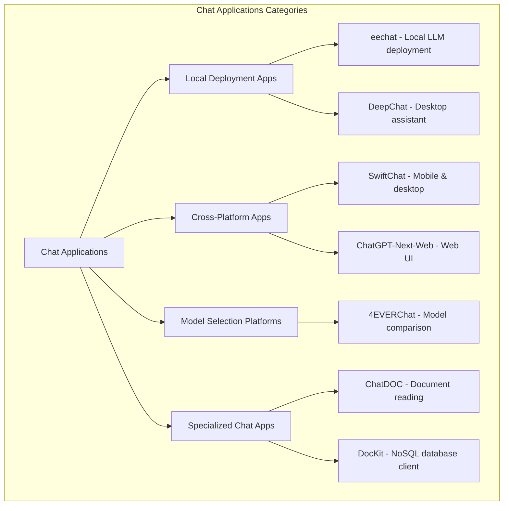
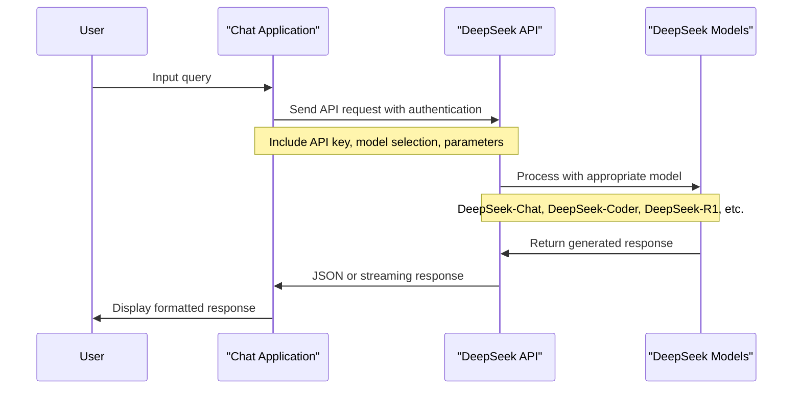
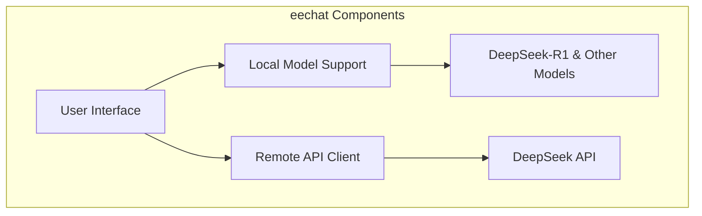
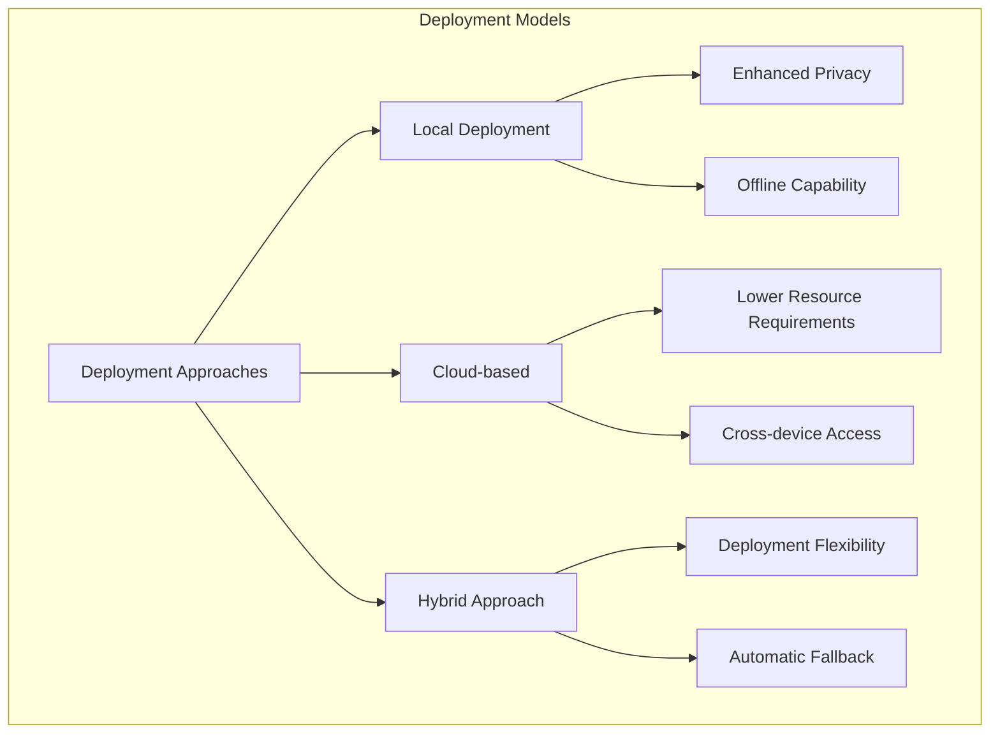

<!-- source: DeepWiki mcp.deepwiki.com · repo deepseek-ai/awesome-deepseek-integration · page 2 Chat Applications · fetched 2026-10-30 -->

# Chat Applications

Relevant source files

The following files were used as context for generating this wiki page:

- [README.md](README.md)
- [README_cn.md](README_cn.md)
- [README_es.md](README_es.md)
- [README_ja.md](README_ja.md)
- [docs/4EVERChat/README.md](docs/4EVERChat/README.md)
- [docs/4EVERChat/README_cn.md](docs/4EVERChat/README_cn.md)
- [docs/4EVERChat/README_ja.md](docs/4EVERChat/README_ja.md)
- [docs/DocKit/README.md](docs/DocKit/README.md)
- [docs/DocKit/README_cn.md](docs/DocKit/README_cn.md)
- [docs/DocKit/assets/client-ui.png](docs/DocKit/assets/client-ui.png)
- [docs/DocKit/assets/dockit.png](docs/DocKit/assets/dockit.png)
- [docs/DocKit/assets/wechat_official.png](docs/DocKit/assets/wechat_official.png)
- [docs/DocKit/assets/wechat_ponsor.jpg](docs/DocKit/assets/wechat_ponsor.jpg)
- [docs/SwiftChat/README.md](docs/SwiftChat/README.md)
- [docs/SwiftChat/README_cn.md](docs/SwiftChat/README_cn.md)
- [docs/SwiftChat/assets/favicon.png](docs/SwiftChat/assets/favicon.png)
- [docs/SwiftChat/assets/promo.png](docs/SwiftChat/assets/promo.png)
- [docs/SwiftChat/assets/settings.png](docs/SwiftChat/assets/settings.png)
- [docs/SwiftChat/assets/system-prompt.png](docs/SwiftChat/assets/system-prompt.png)
- [docs/eechat/assets/README.md](docs/eechat/assets/README.md)
- [docs/eechat/assets/README.zh-CN.md](docs/eechat/assets/README.zh-CN.md)
- [docs/eechat/assets/logo.png](docs/eechat/assets/logo.png)
- [docs/eechat/assets/logo.svg](docs/eechat/assets/logo.svg)
- [docs/eechat/assets/resources/apimodel_dark.png](docs/eechat/assets/resources/apimodel_dark.png)
- [docs/eechat/assets/resources/apimodel_light.png](docs/eechat/assets/resources/apimodel_light.png)

This page documents chat-focused applications that integrate with the DeepSeek API, providing conversational interfaces for users to interact with DeepSeek's large language models. These applications range from general-purpose chat interfaces to specialized tools, all leveraging DeepSeek's capabilities through API integration.

## Types of Chat Applications

Chat applications in the DeepSeek integration ecosystem can be categorized based on their deployment model, platform support, and specialization:

Sources: [README.md:44-130]()

### Local Deployment Applications

These applications support running models locally on the user's device or connecting to remote DeepSeek API endpoints. Examples include:

- **eechat**: A tool for deploying large language models locally with DeepSeek-R1 support
- **DeepChat**: A desktop assistant with the DeepSeek model built-in

### Cross-Platform Applications

These applications provide consistent chat experiences across multiple platforms:

- **SwiftChat**: A React Native application for Android, iOS, and macOS
- **ChatGPT-Next-Web**: A web-based UI supporting multiple LLMs including DeepSeek

### Model Selection Platforms

These platforms allow users to compare and choose from multiple language models:

- **4EVERChat**: Integrates hundreds of LLMs including DeepSeek for real-time comparison

### Specialized Chat Applications

These applications focus on specific use cases beyond general conversation:

- **ChatDOC**: An AI-powered document reading tool
- **DocKit**: A NoSQL database client with DeepSeek integration for query assistance

Sources: [README.md:50-130]()

## Integration Architecture

Chat applications typically follow a common pattern when integrating with the DeepSeek API:

This architecture separates the user interface from the AI processing, allowing applications to focus on user experience while leveraging DeepSeek's models for intelligence.

Sources: [README.md:102-106](), [README.md:430-440]()

## Key Applications

### eechat

eechat is a lightweight application for local deployment of large language models and remote API integration.

Key features:
- Local deployment of DeepSeek-R1 and other models
- Remote API integration for cloud-based models
- Privacy-focused design with local data storage
- Simple user interface for conversations

Sources: [docs/eechat/assets/logo.svg](), [README.md:50-57]()

### SwiftChat

SwiftChat is a cross-platform AI chat application built with React Native that delivers native performance across devices.

Key features:
- Cross-platform support (Android, iOS, macOS)
- Real-time streaming chat with DeepSeek and other providers
- Rich Markdown support including tables and code blocks
- Customizable system prompts for tailored interactions
- AI image generation capabilities

SwiftChat's integration with DeepSeek is configured through its settings interface, allowing users to enter their API key and configure model parameters.

Sources: [docs/SwiftChat/README.md:1-17](), [docs/SwiftChat/assets/settings.png]()

### 4EVERChat

4EVERChat is a model selection platform that integrates hundreds of LLMs, enabling real-time comparison of their performance.

Key features:
- Integration with hundreds of LLM models including DeepSeek
- Real-time model performance comparison
- Unified API endpoint through 4EVERLAND AI RPC
- Cost-free model switching
- Automatic selection of optimal model combinations

4EVERChat eliminates the need for users to manage individual API keys, providing access to DeepSeek and other models through a unified endpoint.

Sources: [docs/4EVERChat/README.md:4-36]()

### DocKit

DocKit is an AI-powered desktop GUI client for NoSQL databases that leverages DeepSeek for query assistance.

Key features:
- Database management interface for Elasticsearch and OpenSearch
- DeepSeek integration for complex DSL query assistance
- Cross-platform support (Mac, Windows, Linux)
- AI-driven data analysis capabilities

DocKit demonstrates how DeepSeek integration can enhance specialized tools beyond general-purpose chat applications.

Sources: [docs/DocKit/README.md:17-19](), [docs/DocKit/assets/client-ui.png]()

## Common Features and Implementation

Chat applications that integrate with DeepSeek typically implement several common features:

### Conversational Interface

All applications provide a conversational interface with:
- Message exchange between user and AI
- Chat history management
- Context preservation across turns
- Response formatting for readability

### Configuration Management

Applications implement configuration interfaces for:
- DeepSeek API key management
- Model selection (DeepSeek-Chat, DeepSeek-Coder, DeepSeek-R1)
- Parameter adjustment (temperature, max tokens, etc.)
- System prompt customization

### Advanced Capabilities

Many applications extend basic chat with:
- Document and file upload/processing
- Web search integration
- Knowledge base access
- Specialized tools for specific domains

## Technical Requirements

To integrate with DeepSeek API, chat applications require:

1. **Authentication**: An API key from the DeepSeek Open Platform
2. **API Communication**: HTTP client for API requests and response handling
3. **User Experience**: Message formatting and conversation management
4. **Configuration**: Settings for API key, model selection, and parameters

Sources: [README.md:9](), [docs/SwiftChat/assets/settings.png]()

## Deployment Models

Chat applications implement various deployment approaches:

1. **Local Deployment**:
   - Models run directly on user's device
   - Enhanced privacy and reduced latency
   - Higher resource requirements
   - Example: eechat

2. **Cloud-based**:
   - API calls to DeepSeek cloud endpoints
   - Lower local resource requirements
   - Requires internet connectivity
   - Example: ChatGPT-Next-Web

3. **Hybrid**:
   - Combines local and cloud capabilities
   - Flexible deployment based on requirements
   - Example: Applications that support both approaches

Sources: [README.md:50-57](), [README.md:114-118]()

## Conclusion

Chat applications represent a significant category within the DeepSeek integration ecosystem, providing conversational interfaces to DeepSeek's language models. These applications demonstrate various approaches to leveraging the DeepSeek API, from simple chat interfaces to sophisticated specialized tools.

By understanding the common patterns and examining the example applications, developers can effectively implement their own chat applications that leverage DeepSeek's capabilities.

Sources: [README.md:9-14](), [README.md:44-130]()

---

