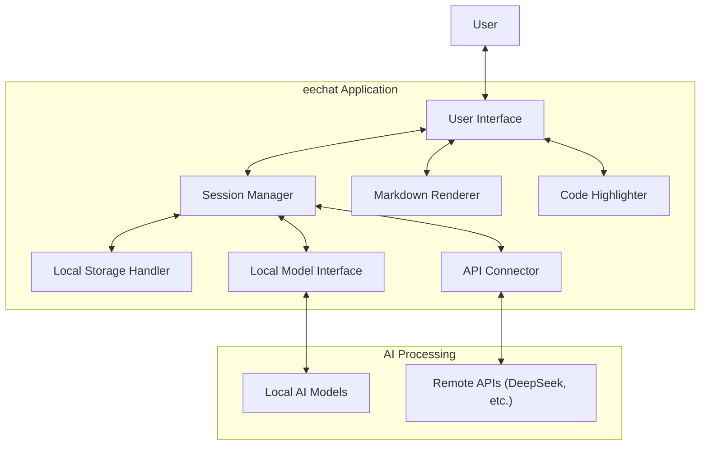
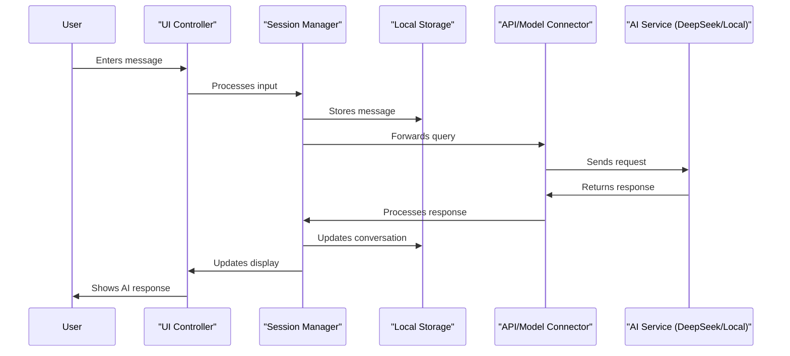
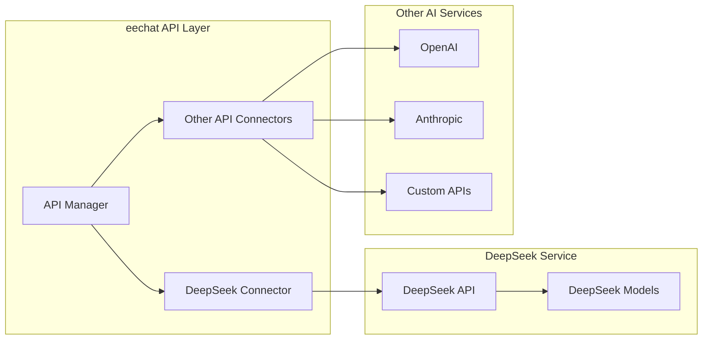
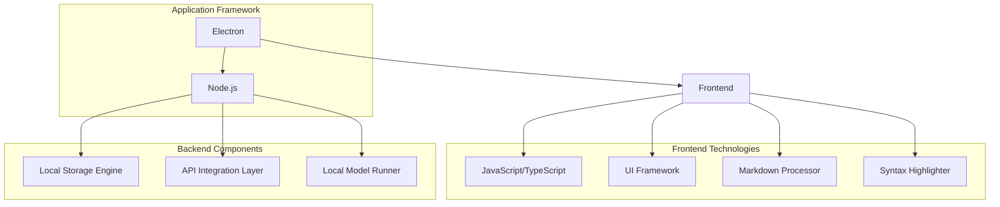

<!-- source: DeepWiki mcp.deepwiki.com · repo deepseek-ai/awesome-deepseek-integration · page 2.1 eechat · fetched 2026-10-30 -->

# eechat

<details>
<summary>Relevant source files</summary>

The following files were used as context for generating this wiki page:

- [docs/eechat/assets/README.md](docs/eechat/assets/README.md)
- [docs/eechat/assets/README.zh-CN.md](docs/eechat/assets/README.zh-CN.md)
- [docs/eechat/assets/logo.png](docs/eechat/assets/logo.png)
- [docs/eechat/assets/logo.svg](docs/eechat/assets/logo.svg)
- [docs/eechat/assets/resources/apimodel_dark.png](docs/eechat/assets/resources/apimodel_dark.png)
- [docs/eechat/assets/resources/apimodel_light.png](docs/eechat/assets/resources/apimodel_light.png)

</details>


eechat is a powerful local AI chat application that focuses on security, efficiency, and personalization. This document details the architecture, features, and integration capabilities of eechat, specifically in the context of DeepSeek integration.

For information about other chat applications in the DeepSeek ecosystem, see [Chat Applications](#2).

## System Overview

eechat implements a client-side architecture that prioritizes local data storage while providing flexible AI model integration options, including DeepSeek API connectivity. The application allows users to interact with AI models securely with all conversation data remaining on the user's device.



Sources: docs/eechat/assets/README.md, docs/eechat/assets/README.zh-CN.md

## Data Flow Architecture

The application uses a structured data flow to process user inputs, manage conversations, and integrate with AI models:



Sources: docs/eechat/assets/README.md:25-35, docs/eechat/assets/README.zh-CN.md:25-38

## Core Features

### Data Privacy & Security

eechat prioritizes user privacy through several key mechanisms:

- **Local Data Storage**: All conversation data is stored on the user's device
- **Offline Capability**: Functions without continuous internet connection after initial setup
- **API Customization**: Supports custom API endpoints with user-controlled credentials

| Storage Type | Location | Security Benefit |
|--------------|----------|------------------|
| Conversation History | Local device only | No data sent to third parties |
| User Settings | Local device only | Configuration remains private |
| Prompt Templates | Local device only | Intellectual property protection |

Sources: docs/eechat/assets/README.md:25-35, docs/eechat/assets/README.zh-CN.md:25-38

### Conversation Management

The application provides comprehensive conversation management capabilities:

- Multi-session support with independent conversation contexts
- Automatic history tracking and recall
- Context-aware AI responses for natural conversation flow

Sources: docs/eechat/assets/README.md:38-42, docs/eechat/assets/README.zh-CN.md:41-45

### Advanced Text Rendering

eechat implements sophisticated text processing and display features:

- **Complete Markdown Support**: Renders formatted text, including tables and lists
- **Code Highlighting**: Automatic language detection and syntax highlighting
- **Math Formula Support**: Renders complex mathematical expressions

Sources: docs/eechat/assets/README.md:43-45, docs/eechat/assets/README.zh-CN.md:44-45

### Customization Options

The application offers extensive customization capabilities:

- Light and dark theme switching
- Prompt template management for frequently used queries
- Model parameter adjustment (temperature, max output tokens, etc.)

Sources: docs/eechat/assets/README.md:48-52, docs/eechat/assets/README.zh-CN.md:48-52

## DeepSeek Integration

eechat integrates with the DeepSeek API as one of its supported AI model providers. The implementation follows a modular approach that allows users to configure and use DeepSeek's models alongside other AI services.



Key integration components:

- **API Manager**: Coordinates different API connections
- **DeepSeek Connector**: Handles communication with DeepSeek API
- **Configuration Interface**: Allows users to set API keys and endpoints

Sources: docs/eechat/assets/README.md:32-34, docs/eechat/assets/README.md:56-57, docs/eechat/assets/README.zh-CN.md:35-38, docs/eechat/assets/README.zh-CN.md:56-57

## Local AI Model Support

In addition to API integration, eechat supports running local AI models for completely offline operation:

- Support for locally installed language models
- Resource management for optimal performance
- Memory usage optimization for different system capabilities

Sources: docs/eechat/assets/README.md:28-31, docs/eechat/assets/README.zh-CN.md:29-34

## User Interface Components

eechat implements a structured user interface organized into functional components:

```mermaid
flowchart TD
    subgraph "Main UI Components"
        MainView["Main View Controller"]
        Sidebar["Sidebar Controller"]
        Settings["Settings Panel"]
    end
    
    subgraph "Conversation Components"
        ChatArea["Chat Area"]
        InputBox["Input Box"]
        PromptSelector["Prompt Template Selector"]
        ResponseRenderer["Response Renderer"]
    end
    
    subgraph "Session Management"
        SessionList["Session List"]
        NewSession["New Session Button"]
        SessionSearch["Session Search"]
    end
    
    subgraph "Configuration"
        ModelSelector["Model Selector"]
        APIConfig["API Configuration"]
        ThemeToggle["Theme Toggle"]
        ParameterControls["Parameter Controls"]
    end
    
    MainView --> ChatArea
    MainView --> InputBox
    MainView --> PromptSelector
    MainView --> ResponseRenderer
    
    Sidebar --> SessionList
    Sidebar --> NewSession
    Sidebar --> SessionSearch
    
    Settings --> ModelSelector
    Settings --> APIConfig
    Settings --> ThemeToggle
    Settings --> ParameterControls
```



The UI provides access to all core functionality while maintaining a clean, intuitive interface that adapts to user preferences.

Sources: docs/eechat/assets/README.md:38-52, docs/eechat/assets/README.zh-CN.md:41-52

## Developer-Focused Features

eechat includes specialized functionality for developers:

- Code generation and explanation across multiple programming languages
- API documentation assistance
- Debugging support and code issue identification

These features make the application particularly valuable for software development workflows.

Sources: docs/eechat/assets/README.md:65-72, docs/eechat/assets/README.zh-CN.md:68-72

## Deployment & System Requirements

### System Requirements

| Component | Requirement |
|-----------|-------------|
| Operating System | Windows 10/11 64-bit, macOS 10.15+, Linux (Ubuntu 18.04+, Debian 10+) |
| Memory | Minimum 4GB RAM |
| Storage | 500MB available disk space |
| GPU (optional) | CUDA support, 8GB+ for Windows |

### Installation Methods

#### Pre-built Packages
Pre-compiled application packages can be downloaded from the GitHub releases page.

#### Building from Source
```bash
# Clone repository
git clone https://github.com/Lucassssss/eechat.git
cd eechat

# Install dependencies
npm install

# Run in development mode
npm run dev

# Build application
npm run build
```

Sources: docs/eechat/assets/README.md:76-112, docs/eechat/assets/README.zh-CN.md:80-113

## Technical Stack

eechat is built using modern cross-platform technologies:



This architecture enables eechat to deliver high performance while maintaining cross-platform compatibility and offline capabilities.

Sources: docs/eechat/assets/README.md, docs/eechat/assets/README.zh-CN.md

---

