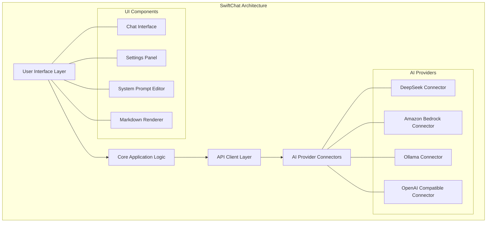
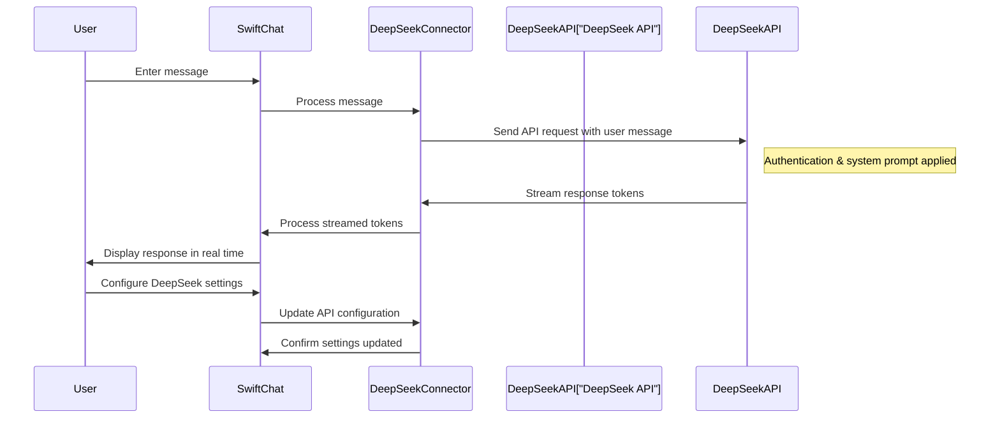
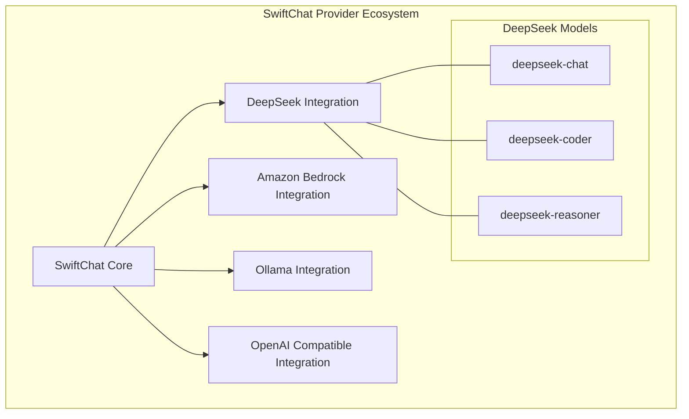

<!-- source: DeepWiki mcp.deepwiki.com · repo deepseek-ai/awesome-deepseek-integration · page 2.2 SwiftChat · fetched 2026-10-30 -->

# SwiftChat

Relevant source files

The following files were used as context for generating this wiki page:

- [docs/SwiftChat/README.md](docs/SwiftChat/README.md)
- [docs/SwiftChat/README_cn.md](docs/SwiftChat/README_cn.md)
- [docs/SwiftChat/assets/favicon.png](docs/SwiftChat/assets/favicon.png)
- [docs/SwiftChat/assets/promo.png](docs/SwiftChat/assets/promo.png)
- [docs/SwiftChat/assets/settings.png](docs/SwiftChat/assets/settings.png)
- [docs/SwiftChat/assets/system-prompt.png](docs/SwiftChat/assets/system-prompt.png)

This document provides a comprehensive overview of SwiftChat, a cross-platform AI chat application that integrates with DeepSeek API. It covers the application's architecture, features, and integration capabilities with a focus on how DeepSeek is implemented within the system.

## 1. Overview

SwiftChat is a lightning-fast, cross-platform AI chat application built with React Native. It provides native performance on Android, iOS, iPad, Android tablets, and macOS while offering seamless integration with multiple AI providers including DeepSeek, Amazon Bedrock, Ollama, and OpenAI API-compatible models.

The application is designed with performance in mind, featuring a minimalist UI that ensures instant launch and responsive interactions across all supported platforms.

Sources: [docs/SwiftChat/README.md:3-3]()

## 2. Key Features

SwiftChat offers a comprehensive set of features for AI interaction:

| Feature | Description |
|---------|-------------|
| Real-time streaming chat | Instant responses with streaming capabilities |
| Rich Markdown support | Tables, code blocks, LaTeX rendering |
| AI image generation | Built-in support for generating images via AI |
| Customizable system prompts | Configurable prompts to control AI behavior |
| Model switching | Quick switching between different AI models |
| Multimodal capabilities | Support for both text and image inputs |
| Cross-platform support | Android, iOS, iPad, Android tablets, macOS |

Sources: [docs/SwiftChat/README.md:3-3]()

## 3. Architecture

SwiftChat is built on React Native, enabling true cross-platform functionality while maintaining native performance. The architecture is optimized for responsiveness and low-latency communication with AI providers.

The application follows a layered architecture pattern:
- **User Interface Layer**: Handles all user interactions and rendering
- **Core Application Logic**: Manages the application state and business logic
- **API Client Layer**: Handles communication with external services
- **AI Provider Connectors**: Specific implementations for each AI provider

Sources: [docs/SwiftChat/README.md:3-3]()

## 4. DeepSeek Integration

SwiftChat integrates with DeepSeek's API to provide advanced AI capabilities. The integration flow is structured to ensure efficient communication and optimal user experience.

### 4.1 Configuration

To integrate with DeepSeek API, users need to configure their API settings in the SwiftChat settings panel. The following settings are available:

1. API Key: User's DeepSeek API key
2. Model selection: Choose from available DeepSeek models
3. System prompt configuration: Custom instructions for the AI behavior

Sources: [docs/SwiftChat/README.md:9-11](), [docs/SwiftChat/assets/settings.png]()

### 4.2 System Prompts

SwiftChat allows users to define custom system prompts specifically for DeepSeek models. These prompts help guide the AI's behavior and responses according to user preferences.

System prompts can be configured to:
- Define the AI's personality
- Set constraints on responses
- Provide context for specialized knowledge
- Establish preferred response formats

Sources: [docs/SwiftChat/README.md:13-15](), [docs/SwiftChat/assets/system-prompt.png]()

## 5. User Interface

SwiftChat features a clean, minimalist UI design optimized for efficient interaction with AI models. The interface is designed to be intuitive and responsive across all supported platforms.

### 5.1 Main Chat Interface

The main chat interface presents:
- Message history with clear distinction between user and AI messages
- Input area with support for text and multimodal inputs
- Markdown rendering for formatting, code blocks, tables, and LaTeX content
- Real-time streaming of AI responses

### 5.2 Settings Interface

The settings interface allows users to configure:
- AI provider selection (DeepSeek, Amazon Bedrock, Ollama, OpenAI)
- API keys and endpoints
- Model selection for each provider
- System prompt configuration
- Interface preferences

Sources: [docs/SwiftChat/README.md:6-7](), [docs/SwiftChat/assets/settings.png]()

## 6. Usage Examples

### 6.1 Basic Conversation

Users can engage in natural conversations with the AI by simply typing messages in the input area. SwiftChat will process these messages through the selected AI provider (such as DeepSeek) and display the responses in real-time.

### 6.2 Using System Prompts with DeepSeek

To customize the AI's behavior:
1. Access the settings panel
2. Select DeepSeek as the AI provider
3. Configure your API key
4. Enter a custom system prompt
5. Start a new conversation

The system prompt will be applied to all subsequent interactions with the DeepSeek model, guiding its responses according to your specifications.

Sources: [docs/SwiftChat/README.md:13-15](), [docs/SwiftChat/assets/system-prompt.png]()

## 7. Integration with Other AI Systems

Beyond DeepSeek, SwiftChat supports integration with multiple AI providers, allowing users to leverage different models based on their specific needs.

SwiftChat's modular architecture allows for seamless switching between AI providers, enabling users to select the most appropriate model for their specific task.

Sources: [docs/SwiftChat/README.md:3-3]()

## 8. Availability and Installation

SwiftChat is an open-source project available on GitHub. Users can access the source code, contribute to the project, or download pre-built versions for their preferred platforms.

For more information and to access the latest version of SwiftChat, please refer to the [official GitHub repository](https://github.com/aws-samples/swift-chat).

Sources: [docs/SwiftChat/README.md:1-1](), [docs/SwiftChat/README.md:17-17]()

## 9. Related Resources

For information about other chat applications that integrate with DeepSeek, see:
- [eechat](#2.1)
- [4EVERChat](#2.3)

For information about productivity tools with DeepSeek integration, see:
- [Productivity Tools](#3)

Sources: [docs/SwiftChat/README.md:1-17]()

---

