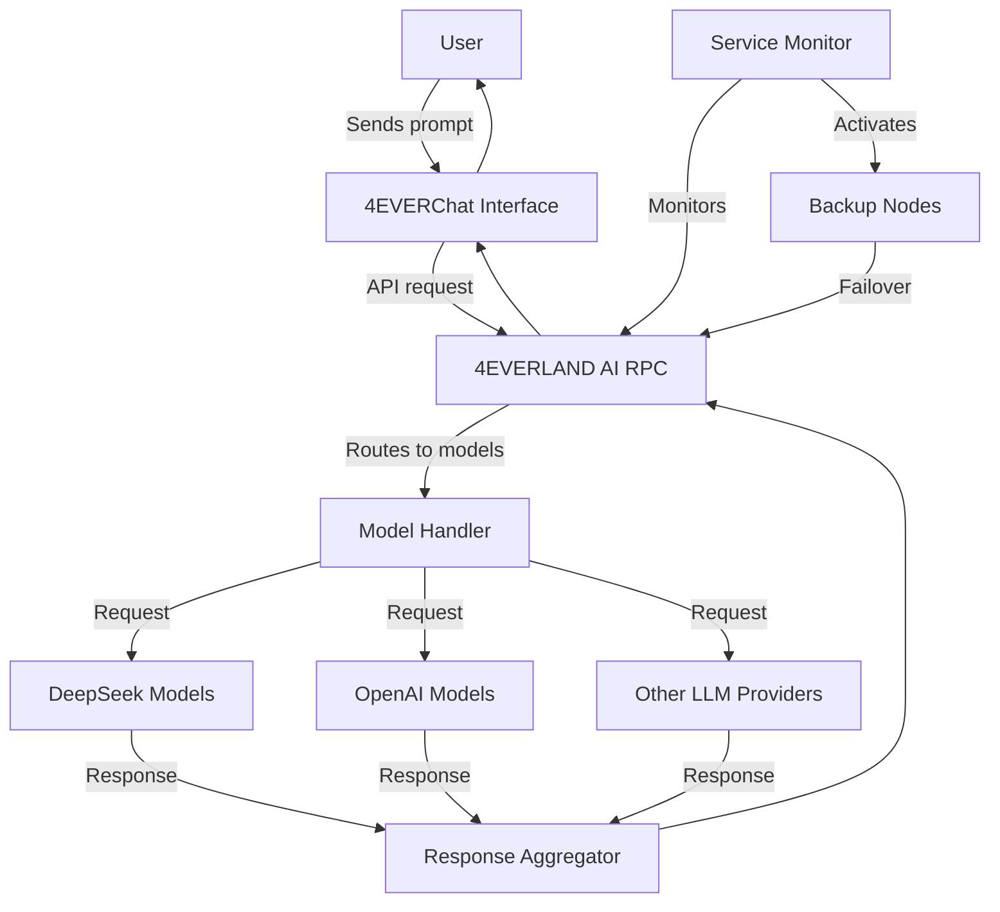
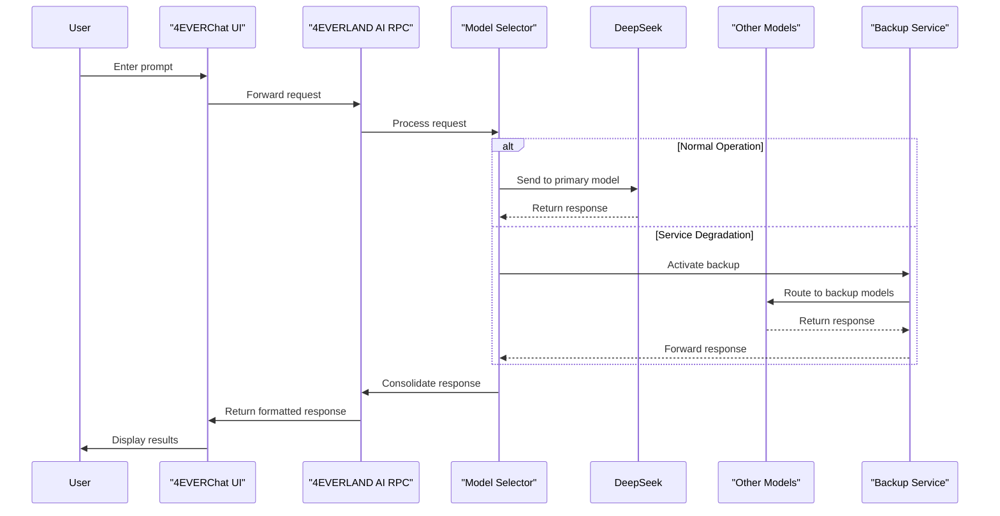
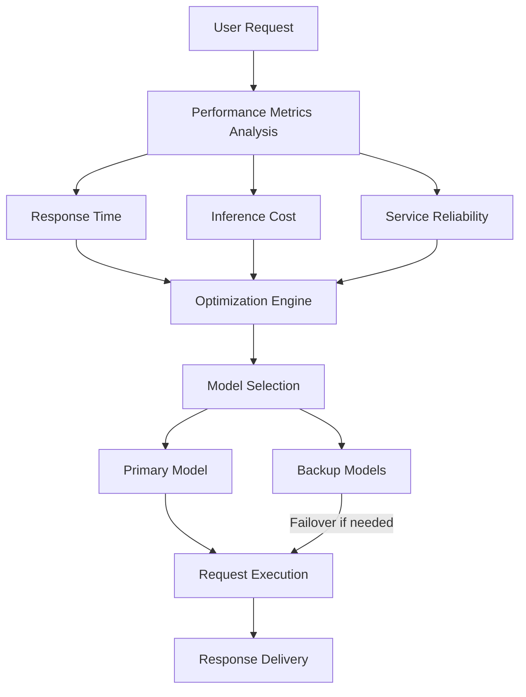

<!-- source: DeepWiki mcp.deepwiki.com · repo deepseek-ai/awesome-deepseek-integration · page 2.3 4EVERChat · fetched 2026-10-30 -->

# 4EVERChat

Relevant source files

The following files were used as context for generating this wiki page:

- [README.md](README.md)
- [README_cn.md](README_cn.md)
- [README_ja.md](README_ja.md)
- [docs/4EVERChat/README.md](docs/4EVERChat/README.md)
- [docs/4EVERChat/README_cn.md](docs/4EVERChat/README_cn.md)
- [docs/4EVERChat/README_ja.md](docs/4EVERChat/README_ja.md)

## Purpose and Scope

4EVERChat is a large language model selection platform that seamlessly integrates hundreds of mainstream LLM models, including DeepSeek, ChatGPT, and Grok. This document covers the architecture, functionality, and integration capabilities of 4EVERChat, with a particular focus on its DeepSeek integration. The platform enables real-time comparison of different models' response characteristics, helping developers identify the optimal engine for their specific needs.

Sources: [README.md:80-83](), [docs/4EVERChat/README.md:5-7]()

## System Architecture

4EVERChat leverages the 4EVERLAND AI RPC technology as its foundation, providing a unified API endpoint through which hundreds of models can be accessed without configuration overhead. This architecture enables zero-cost switching between different LLM providers while maintaining performance optimization.

### System Integration Flow

Sources: [docs/4EVERChat/README.md:7-8](), [README.md:81-82]()

### Request Processing Flow

Sources: [docs/4EVERChat/README.md:7-8](), [README.md:81-82]()

## Dynamic Model Selection

4EVERChat automatically selects model combinations with fast response times and low inference costs. The platform monitors service status in real-time and dynamically routes requests to optimize for both performance and cost-efficiency.

### Model Selection Process

Sources: [docs/4EVERChat/README.md:7-8](), [README.md:81-82]()

## User Interface

4EVERChat provides an intuitive interface that allows users to interact with multiple LLM models simultaneously, comparing their outputs side-by-side for quality assessment.

### 4EVERChat UI
The platform features a chat-style interface where users can input prompts and view responses from different models in parallel, making it easy to compare performance characteristics.

### 4EVER AI RPC Interface
The underlying AI RPC service provides administrative capabilities for managing model integrations, monitoring service status, and configuring performance parameters.

Sources: [docs/4EVERChat/README.md:21-29](), [docs/4EVERChat/README_cn.md:16-24]()

## DeepSeek Integration

4EVERChat fully integrates with DeepSeek's language models, making them available alongside other major LLM providers. Users can select DeepSeek models from the model selection interface and compare their performance against other options.

### Model Selection Workflow

```mermaid
graph LR
    User["User"] --> |"Opens"| ModelSelection["Model Selection UI"]
    ModelSelection --> |"Selects"| DeepSeekModels["DeepSeek Models"]
    DeepSeekModels --> |"Configures"| ModelParameters["Model Parameters"]
    ModelParameters --> |"Applies"| ChatSession["Chat Session"]
    ChatSession --> |"Uses"| DeepSeekAPI["DeepSeek API via AI RPC"]
    DeepSeekAPI --> |"Processes"| UserPrompts["User Prompts"]
    UserPrompts --> |"Generates"| ModelResponses["Model Responses"]
```

Sources: [docs/4EVERChat/README.md:33-35](), [docs/4EVERChat/README_cn.md:28-30]()

## Key Features

| Feature | Description |
|---------|-------------|
| Model Integration | Seamless integration of hundreds of LLM models including DeepSeek |
| Real-time Comparison | Side-by-side comparison of model responses for quality assessment |
| No API Key Required | Ready-to-use platform with no need for individual API key configuration |
| Unified API Endpoint | Single endpoint for accessing multiple LLM providers |
| Dynamic Model Selection | Automatic selection of optimal models based on response time and cost |
| Service Monitoring | Real-time monitoring with automatic backup node activation |
| Cost Optimization | Zero-cost switching between models to optimize for inference costs |

Sources: [docs/4EVERChat/README.md:5-8](), [README.md:80-83]()

## Technical Implementation

The platform's core functionality relies on 4EVERLAND AI RPC, which provides:

1. A unified API endpoint for accessing hundreds of models
2. Zero-cost model switching capabilities
3. Real-time service status monitoring
4. Automatic backup node activation
5. Dynamic model selection based on performance metrics

This architecture ensures high availability and optimal performance while maintaining cost efficiency for AI development infrastructure.

Sources: [docs/4EVERChat/README.md:7-8](), [README.md:81-82]()

## Usage

4EVERChat can be accessed at [https://chat.4everland.org/](https://chat.4everland.org/) and requires no API key configuration. Users can immediately begin comparing different LLM models, including DeepSeek, to identify the optimal solution for their specific use cases.

The underlying 4EVERLAND platform can be accessed at [https://www.4everland.org/](https://www.4everland.org/) for additional information and services.

Sources: [docs/4EVERChat/README.md:13-15](), [docs/4EVERChat/README_cn.md:10-14]()

---

