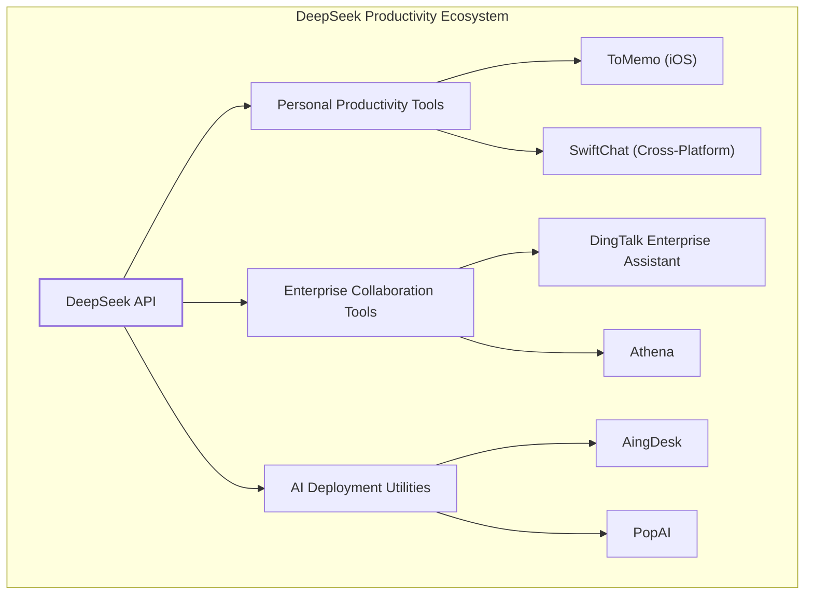
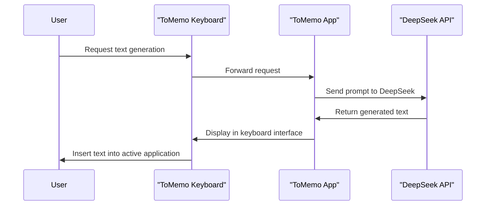
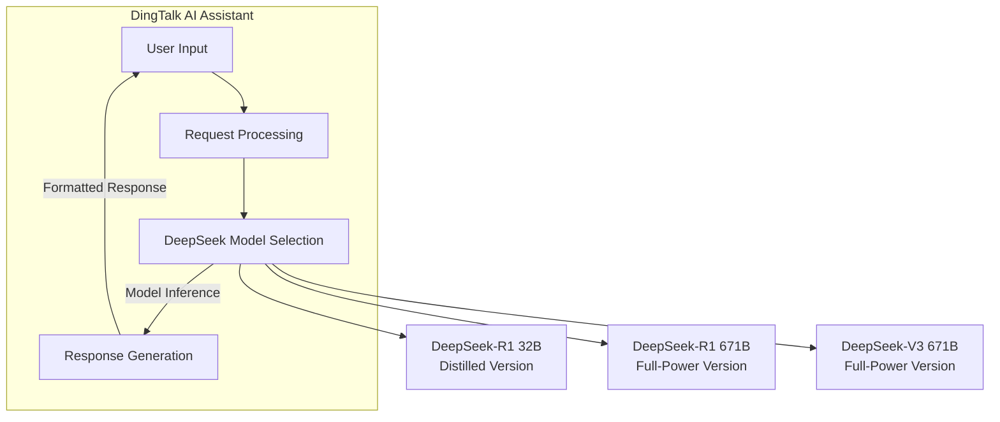
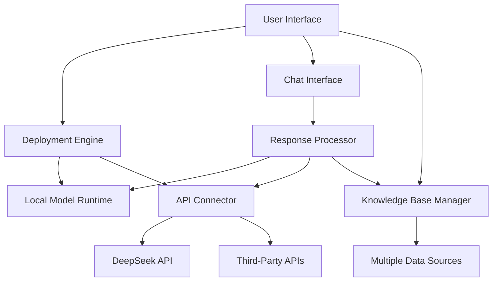
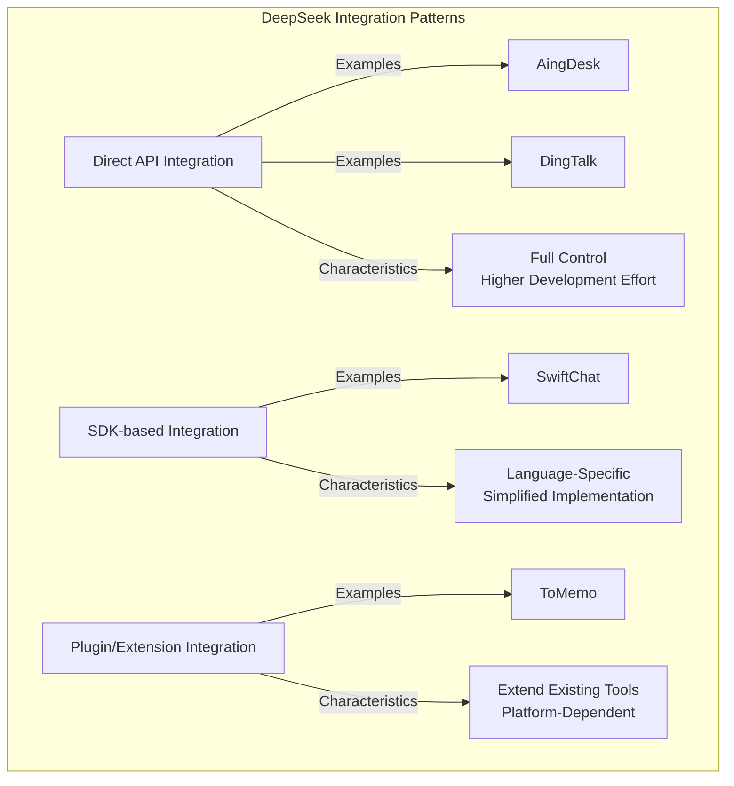
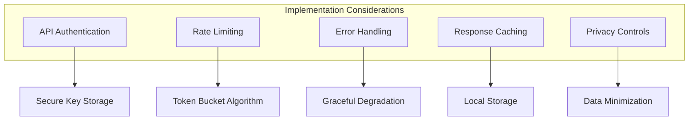

<!-- source: DeepWiki mcp.deepwiki.com · repo deepseek-ai/awesome-deepseek-integration · page 3 Productivity Tools · fetched 2026-10-30 -->

# Productivity Tools

Relevant source files

The following files were used as context for generating this wiki page:

- [README.md](README.md)
- [README_cn.md](README_cn.md)
- [README_ja.md](README_ja.md)
- [docs/4EVERChat/README.md](docs/4EVERChat/README.md)
- [docs/4EVERChat/README_cn.md](docs/4EVERChat/README_cn.md)
- [docs/4EVERChat/README_ja.md](docs/4EVERChat/README_ja.md)
- [docs/aingdesk/README.md](docs/aingdesk/README.md)
- [docs/aingdesk/README.zh_cn.md](docs/aingdesk/README.zh_cn.md)
- [docs/aingdesk/assets/img/1_en.png](docs/aingdesk/assets/img/1_en.png)
- [docs/aingdesk/assets/img/1_zh.png](docs/aingdesk/assets/img/1_zh.png)
- [docs/aingdesk/assets/img/2_zh.png](docs/aingdesk/assets/img/2_zh.png)
- [docs/aingdesk/assets/img/3_zh.png](docs/aingdesk/assets/img/3_zh.png)
- [docs/dingtalk/README.md](docs/dingtalk/README.md)
- [docs/dingtalk/README_cn.md](docs/dingtalk/README_cn.md)
- [docs/dingtalk/assets/dingtalk.png](docs/dingtalk/assets/dingtalk.png)
- [docs/dingtalk/assets/dingtalk_ai_assistant.png](docs/dingtalk/assets/dingtalk_ai_assistant.png)
- [docs/dingtalk/assets/dingtalk_icon.png](docs/dingtalk/assets/dingtalk_icon.png)
- [docs/dingtalk/img.png](docs/dingtalk/img.png)
- [docs/tomemo/README.md](docs/tomemo/README.md)
- [docs/tomemo/README_cn.md](docs/tomemo/README_cn.md)
- [docs/tomemo/assets/Integrate.jpg](docs/tomemo/assets/Integrate.jpg)
- [docs/tomemo/assets/app-provider.png](docs/tomemo/assets/app-provider.png)
- [docs/tomemo/assets/ui-keyboard.jpg](docs/tomemo/assets/ui-keyboard.jpg)
- [docs/tomemo/assets/ui.jpg](docs/tomemo/assets/ui.jpg)
- [docs/tomemo/assets/use-deepseek.png](docs/tomemo/assets/use-deepseek.png)

This page documents productivity applications that leverage DeepSeek AI to enhance user efficiency and workflow automation. These tools transform DeepSeek's capabilities into practical solutions that can be seamlessly integrated into daily work routines across various platforms. For information about document-specific productivity tools, see [Document Tools](#4). For code assistance tools, see [IDE Integrations](#5).

## Overview of Productivity Tool Categories

Productivity tools in the DeepSeek ecosystem fall into three primary categories: personal productivity assistants, enterprise collaboration tools, and AI deployment utilities. Each category serves distinct user needs while leveraging DeepSeek's language models.

Sources: [README.md:175-179](). [README.md:60-68](). [README.md:55-58]().

## Personal Productivity Assistants

Personal productivity assistants integrate DeepSeek AI capabilities into everyday tools and applications, helping users manage information, automate repetitive tasks, and enhance their creative workflows.

### ToMemo

ToMemo is an iOS application that combines three core functions: a phrasebook for storing useful text snippets, a clipboard history manager, and an AI-powered keyboard that enables quick text generation and transformation. The app seamlessly integrates with DeepSeek models to provide AI assistance directly within the keyboard interface.

**Key Features:**
- AI-assisted text generation through custom keyboard
- Clipboard history management for quick access to previously copied text
- Phrasebook functionality for storing and organizing frequently used text snippets
- Direct integration with DeepSeek API for text processing and generation

**Integration Process:**
1. Access Settings > Extensions > AI Services > AI Providers
2. Add DeepSeek as a provider and enter your API key
3. Test the connection and load available models
4. Enable the service and save settings
5. Create an AI Assistant using DeepSeek models

Sources: [docs/tomemo/README.md:1-30](). [docs/tomemo/README_cn.md:1-31]().

### SwiftChat

SwiftChat is a high-performance, cross-platform AI chat application built with React Native that delivers native performance on Android, iOS, and macOS. It provides a unified interface for interacting with DeepSeek models and other AI providers.

**Key Features:**
- Real-time streaming chat with minimal latency
- Rich Markdown support for formatted content
- AI image generation capabilities
- Customizable system prompts
- Quick model selection and multimodal capabilities

Sources: [README.md:75-79]().

## Enterprise Collaboration Tools

Enterprise collaboration tools leverage DeepSeek's AI capabilities to enhance team productivity, automate routine tasks, and provide intelligent assistance for business processes.

### DingTalk AI Assistant

DingTalk AI Assistant is an enterprise-focused intelligent tool that integrates multiple AI features to support daily workflows within organizations. It leverages DeepSeek models to provide AI-powered capabilities for communication, collaboration, and management.

**Key Features:**
- Smart communication tools for efficient messaging
- Intelligent collaboration for team coordination
- Automated administrative process assistance
- Meeting summarization and key points extraction
- Task notification and schedule reminders
- Knowledge base for answering common questions about company policies and procedures

**Supported DeepSeek Models:**
- DeepSeek-R1 32B Distilled Version
- DeepSeek-R1 671B Full-Power Version
- DeepSeek-V3 671B Full-Power Version

Sources: [docs/dingtalk/README.md:1-11](). [README.md:60-68]().

## AI Deployment Utilities

AI deployment utilities help users seamlessly deploy and manage DeepSeek models for various productivity applications.

### AingDesk

AingDesk is a one-click deployment tool for AI models, including DeepSeek, that provides a visual interface for model management and interaction. It enables users to deploy models on their local computers and share access with others for collaborative use.

**Key Features:**
- One-click deployment of DeepSeek and other AI models
- Visual interface for model management and interaction
- Multi-source knowledge base support for enhanced responses
- Web search and third-party API integration
- Online sharing functionality for collaborative use
- Support for Windows, Linux, and macOS platforms

**Technical Architecture:**

Sources: [docs/aingdesk/README.md:1-41](). [docs/aingdesk/README.zh_cn.md:1-35](). [README.md:55-58]().

## Integration Patterns

Productivity tools typically integrate with DeepSeek API using one of three primary patterns: direct API integration, SDK-based integration, or plugin/extension-based integration.

Sources: [README.md:60-68](). [README.md:175-179](). [README.md:55-58]().

## Common Features Comparison

The following table compares key features across the major productivity tools that integrate DeepSeek:

| Feature | ToMemo | DingTalk | AingDesk | SwiftChat |
|---------|--------|----------|----------|-----------|
| Platform | iOS | Enterprise | Windows/Linux/macOS | Android/iOS/macOS |
| Primary Use Case | Personal text management | Enterprise collaboration | Model deployment | Conversational AI |
| DeepSeek Integration | API-based | Multiple models | One-click deployment | API-based |
| Multi-model Support | Yes | Yes | Yes | Yes |
| Knowledge Base | Limited | Yes | Yes | No |
| Web Search | No | Yes | Yes | No |
| Sharing/Collaboration | No | Yes | Yes | No |
| Real-time Streaming | Limited | Yes | Yes | Yes |

Sources: [README.md:175-179](). [README.md:60-68](). [README.md:55-58](). [README.md:75-79]().

## Implementation Considerations

When implementing productivity tools with DeepSeek integration, consider the following factors:

1. **API Authentication**: All productivity tools require secure handling of DeepSeek API keys
2. **Rate Limiting**: Enterprise tools like DingTalk implement sophisticated rate limiting to manage API costs
3. **Error Handling**: Robust error handling for API failures is critical for user experience
4. **Caching**: Local caching of responses helps improve performance and reduce API calls
5. **Privacy**: Tools like ToMemo and AingDesk emphasize privacy and local processing where possible

Sources: [docs/tomemo/README.md:1-30](). [docs/aingdesk/README.md:1-41](). [README.md:60-68]().

## Use Cases and Workflows

DeepSeek-powered productivity tools enable several key workflows:

### Personal Content Creation and Management

1. **Text Generation and Refinement**: Using ToMemo to quickly generate and refine text content directly from the keyboard
2. **Information Organization**: Leveraging tools like SwiftChat to organize and retrieve information through conversational interfaces

### Enterprise Collaboration and Knowledge Management

1. **Meeting Assistance**: DingTalk AI Assistant helps prepare for, conduct, and summarize meetings
2. **Policy Inquiries**: Answering employee questions about company policies and procedures
3. **Administrative Automation**: Streamlining administrative processes through intelligent assistance

### AI Model Deployment and Customization

1. **Local AI Infrastructure**: Using AingDesk to create personal AI infrastructure for various productivity tasks
2. **Custom Knowledge Bases**: Building specialized knowledge bases to enhance AI responses for domain-specific tasks

Sources: [README.md:60-68](). [README.md:175-179](). [README.md:55-58](). [README.md:75-79]().

## Future Directions

Productivity tools in the DeepSeek ecosystem continue to evolve, with several trends emerging:

1. **Enhanced Multimodal Capabilities**: Integration of image, voice, and text understanding in a unified interface
2. **Advanced Agent Functionality**: Moving beyond simple commands to complex, multi-step task execution
3. **Cross-tool Integration**: Creating seamless workflows across different productivity applications
4. **Customization and Personalization**: More sophisticated personalization of AI responses based on user preferences and behavior
5. **Privacy-Preserving Computation**: Increased focus on local processing and privacy controls

Sources: [docs/aingdesk/README.zh_cn.md:25-29](). [README.md:60-68](). [README.md:175-179]().

---

