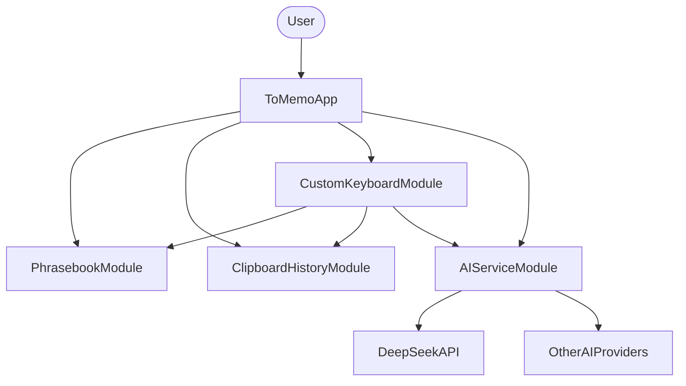
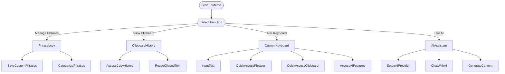
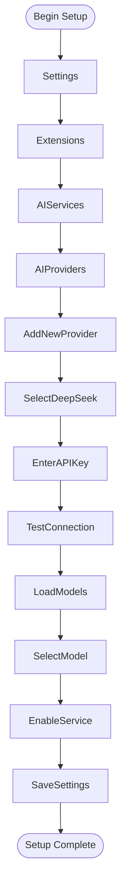
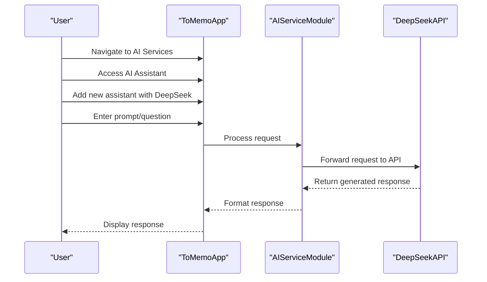

<!-- source: DeepWiki mcp.deepwiki.com · repo deepseek-ai/awesome-deepseek-integration · page 3.1 ToMemo · fetched 2026-10-30 -->

# ToMemo

Relevant source files

The following files were used as context for generating this wiki page:

- [docs/tomemo/README.md](docs/tomemo/README.md)
- [docs/tomemo/README_cn.md](docs/tomemo/README_cn.md)
- [docs/tomemo/assets/Integrate.jpg](docs/tomemo/assets/Integrate.jpg)
- [docs/tomemo/assets/app-provider.png](docs/tomemo/assets/app-provider.png)
- [docs/tomemo/assets/ui-keyboard.jpg](docs/tomemo/assets/ui-keyboard.jpg)
- [docs/tomemo/assets/ui.jpg](docs/tomemo/assets/ui.jpg)
- [docs/tomemo/assets/use-deepseek.png](docs/tomemo/assets/use-deepseek.png)

ToMemo is an iOS application that combines a phrasebook, clipboard history manager, and custom keyboard with integrated AI capabilities. This document explains the purpose, features, and integration of ToMemo with DeepSeek's AI models, focusing on how users can leverage these features for enhanced productivity.

## 1. System Overview

ToMemo provides three core functionalities: a phrasebook for storing frequently used text, a clipboard history manager that tracks copied content, and a custom iOS keyboard that allows quick access to both stored phrases and clipboard items. The app also integrates with AI services like DeepSeek to provide AI assistant capabilities directly within the app.

### ToMemo System Architecture

Sources: [docs/tomemo/README.md:1-5](). [docs/tomemo/README_cn.md:1-5]()

## 2. Primary Features

### 2.1 Phrasebook
The phrasebook functionality allows users to save frequently used phrases, sentences, or templates for quick access. This is particularly useful for responses, greetings, or specialized text that users need to type frequently.

### 2.2 Clipboard History
The clipboard history feature automatically tracks and stores text copied to the clipboard, allowing users to access and reuse previously copied content without having to switch between apps to re-copy text.

### 2.3 Custom Keyboard
ToMemo includes a custom iOS keyboard that integrates with both the phrasebook and clipboard history, enabling users to quickly insert saved phrases or previously copied text while typing in any app.

### 2.4 AI Integration
The AI service integration allows users to communicate with AI models, including DeepSeek, directly within ToMemo. This enables AI-assisted text generation, answering questions, and other language-based tasks.

### User Interaction Flow

Sources: [docs/tomemo/README.md:5](). [docs/tomemo/README_cn.md:5]()

## 3. DeepSeek Integration

ToMemo supports integration with DeepSeek's AI models, allowing users to utilize advanced AI capabilities within the app. This section details how to configure and use DeepSeek with ToMemo.

### 3.1 DeepSeek Configuration Flow

Sources: [docs/tomemo/README.md:13-19](). [docs/tomemo/README_cn.md:13-19]()

### 3.2 Configuration Steps

1. Go to "Settings > Extensions > AI Services > AI Providers"
2. Click "Add" in the top right corner
3. Select "DeepSeek" from the provider options
4. Enter your DeepSeek API Key
5. Click "Test" to verify the API key works
6. Click "Load Models" to retrieve available models
7. Select the desired model
8. Toggle "Enable" on
9. Click "Save" to complete the setup

### 3.3 DeepSeek Usage Process

Sources: [docs/tomemo/README.md:23-28](). [docs/tomemo/README_cn.md:23-28]()

### 3.4 Using DeepSeek

1. Navigate to "Settings > Extensions > AI Services"
2. Click on "AI Assistant" to enter the AI Assistant interface
3. Add a new AI assistant by clicking the add button in the top right corner
4. Select "Deepseek" from the available models
5. Start chatting with the DeepSeek-powered assistant
6. Your messages will be processed by the DeepSeek API, and the AI's responses will be displayed in the conversation

## 4. User Interface

ToMemo features a clean and functional user interface designed for efficient text management and AI interaction.

### 4.1 Main App Interface

The main interface provides access to all key features, including:
- Phrasebook management
- Clipboard history
- Settings for AI services and other configurations

### 4.2 Keyboard Interface

The custom keyboard interface enables:
- Standard typing capabilities
- Quick access to saved phrases
- Access to clipboard history
- Integration with AI features for typing assistance

### 4.3 Screenshots

The application provides a clean interface for managing phrases, clipboard items, and AI interactions:

The custom keyboard provides integrated access to phrases, clipboard, and AI features:

The DeepSeek provider configuration screen allows users to set up and test their API connection:

The DeepSeek chat interface provides AI assistant functionality:

Sources: [docs/tomemo/README.md:7-11, 21, 30](). [docs/tomemo/README_cn.md:7-11, 21, 30]()

## 5. Benefits and Use Cases

ToMemo is particularly useful for:

1. **Repetitive Text Entry**: Save time by accessing frequently used phrases or templates with a few taps
2. **Cross-App Text Management**: Easily reuse clipboard content across different applications
3. **AI-Assisted Writing**: Get help from AI models for drafting, editing, or generating content
4. **Language Assistance**: Use AI to help with translations, grammar checking, or language learning
5. **Productivity Enhancement**: Combine all text-related tools in one accessible interface

By integrating phrasebook, clipboard management, and AI capabilities into a custom keyboard, ToMemo streamlines text-based workflows on iOS devices.

Sources: [docs/tomemo/README.md:3-5](). [docs/tomemo/README_cn.md:3-5]()

---

