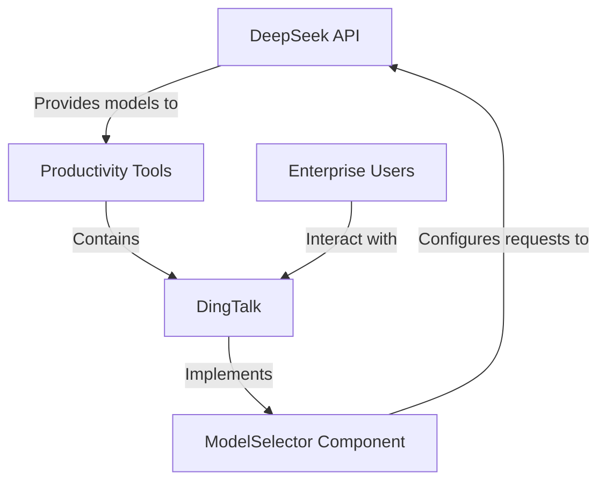
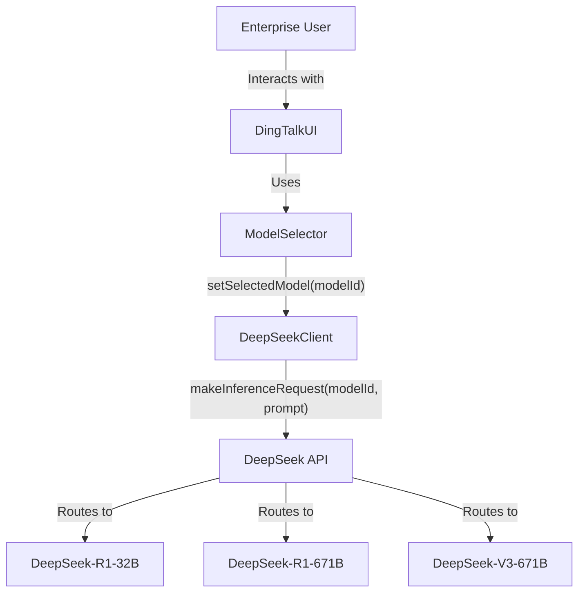
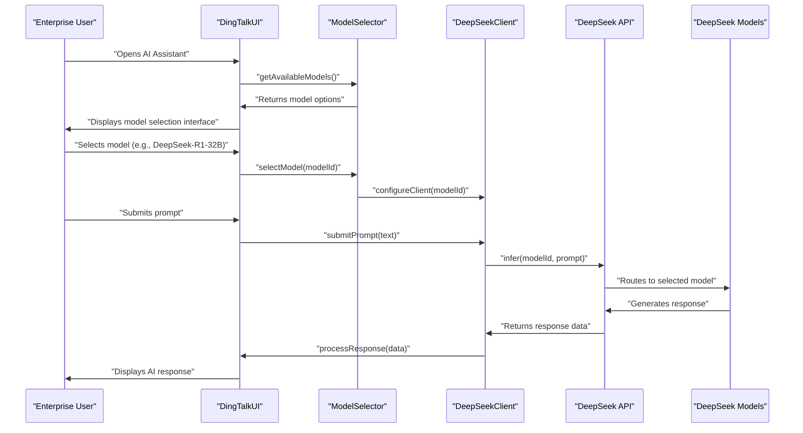

<!-- source: DeepWiki mcp.deepwiki.com · repo deepseek-ai/awesome-deepseek-integration · page 3.2 DingTalk · fetched 2026-10-30 -->

# DingTalk

Relevant source files

The following files were used as context for generating this wiki page:

- [docs/dingtalk/README.md](docs/dingtalk/README.md)
- [docs/dingtalk/README_cn.md](docs/dingtalk/README_cn.md)
- [docs/dingtalk/assets/dingtalk.png](docs/dingtalk/assets/dingtalk.png)
- [docs/dingtalk/assets/dingtalk_ai_assistant.png](docs/dingtalk/assets/dingtalk_ai_assistant.png)
- [docs/dingtalk/assets/dingtalk_icon.png](docs/dingtalk/assets/dingtalk_icon.png)
- [docs/dingtalk/img.png](docs/dingtalk/img.png)

DingTalk is an enterprise AI assistant that integrates with the DeepSeek API, allowing organizations to leverage AI capabilities within their collaboration environment. This document focuses on DingTalk's implementation of DeepSeek model selection and inference capabilities. For information about other productivity tools in the DeepSeek ecosystem, see [ToMemo](#3.1) and [AingDesk](#3.3).

## Overview

The DingTalk AI Assistant empowers users to independently select different DeepSeek models for their AI tasks. This model selection functionality enables organizations to choose the most appropriate model based on their specific requirements, balancing factors such as model size, capability, and performance.

### DingTalk in the DeepSeek Integration Ecosystem

Sources: docs/dingtalk/README.md

## Supported DeepSeek Models

DingTalk AI Assistant provides users with three DeepSeek model options:

| Model Identifier | Version | Parameters | Type |
|------------------|---------|------------|------|
| `DeepSeek-R1-32B` | R1 | 32B | Distilled Version |
| `DeepSeek-R1-671B` | R1 | 671B | Full-Power Version |
| `DeepSeek-V3-671B` | V3 | 671B | Full-Power Version |

Sources: docs/dingtalk/README.md, docs/dingtalk/README_cn.md

## Integration Architecture

The following diagram illustrates the likely architecture of DingTalk's integration with the DeepSeek API:

Sources: docs/dingtalk/README.md

## Model Selection Workflow

The following sequence diagram illustrates the process flow when a user selects a model and makes an inference request:

Sources: docs/dingtalk/README.md

## User Interface

The DingTalk AI Assistant interface includes a model selection component that allows users to choose between the available DeepSeek models. The interface likely contains:

- `ModelSelectorDropdown`: For selecting the DeepSeek model variant
- `PromptInputArea`: For entering text prompts
- `ResponseDisplay`: For viewing AI-generated responses
- `ModelInfoPanel`: For displaying information about the selected model

Sources: docs/dingtalk/README.md, docs/dingtalk/assets/dingtalk_ai_assistant.png

## Implementation Considerations

When implementing or using the DingTalk AI Assistant, consider these aspects:

1. **Model Selection**: The different models offer tradeoffs between performance and capability:
   - `DeepSeek-R1-32B`: Suitable for faster responses and lower resource usage
   - `DeepSeek-R1-671B`: Provides higher-quality responses but may require more time
   - `DeepSeek-V3-671B`: Offers the latest capabilities with the newest model version

2. **API Integration**: The integration likely uses the standard DeepSeek API endpoints with model specification parameters to route requests to the appropriate model.

3. **Deployment Environment**: For enterprise deployments, consider network configurations to ensure reliable access to the DeepSeek API from the DingTalk environment.

Sources: docs/dingtalk/README.md

---

