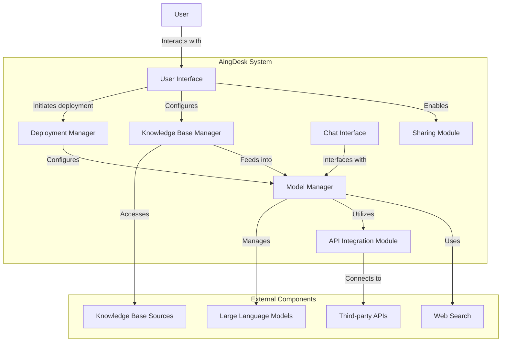
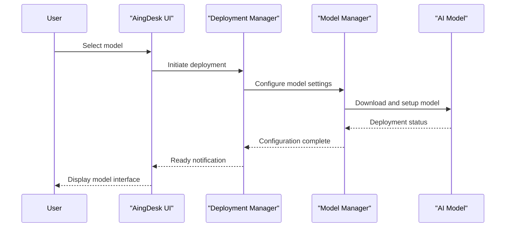
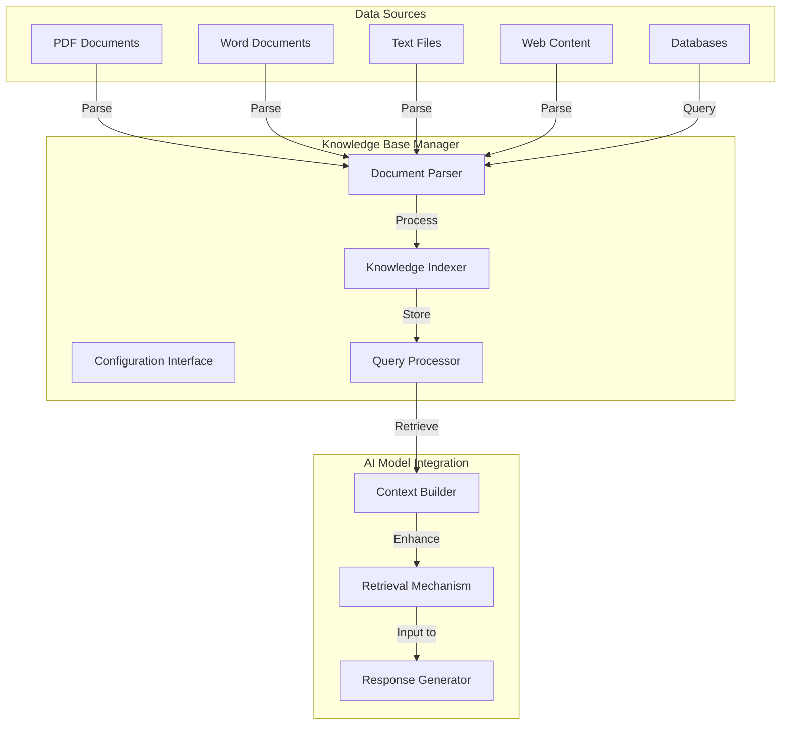
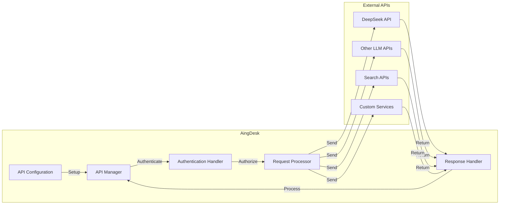
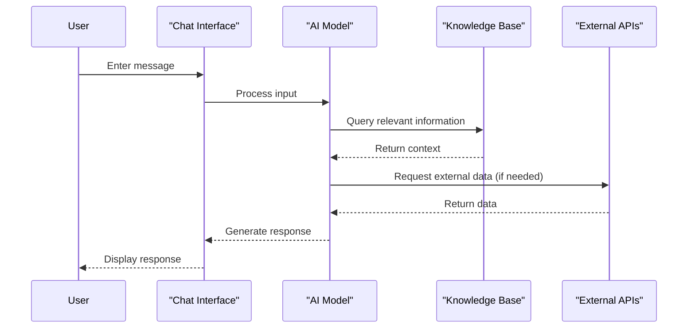
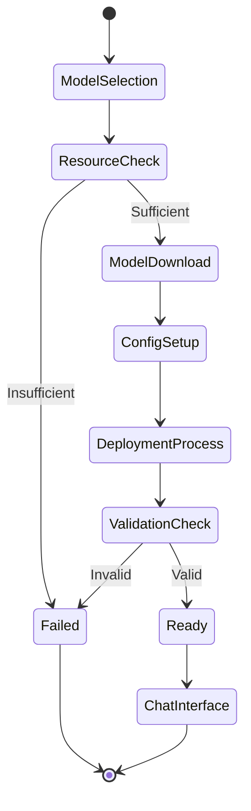
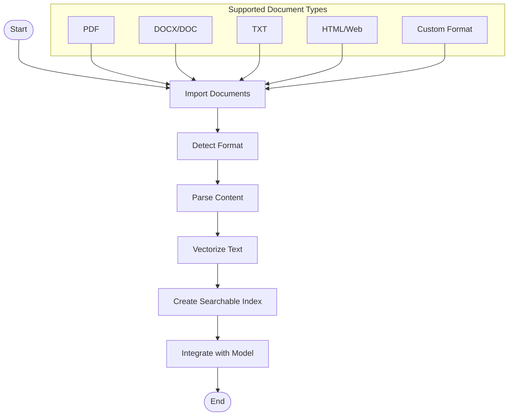
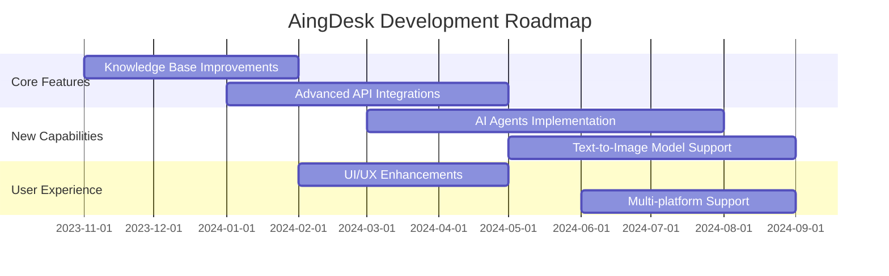
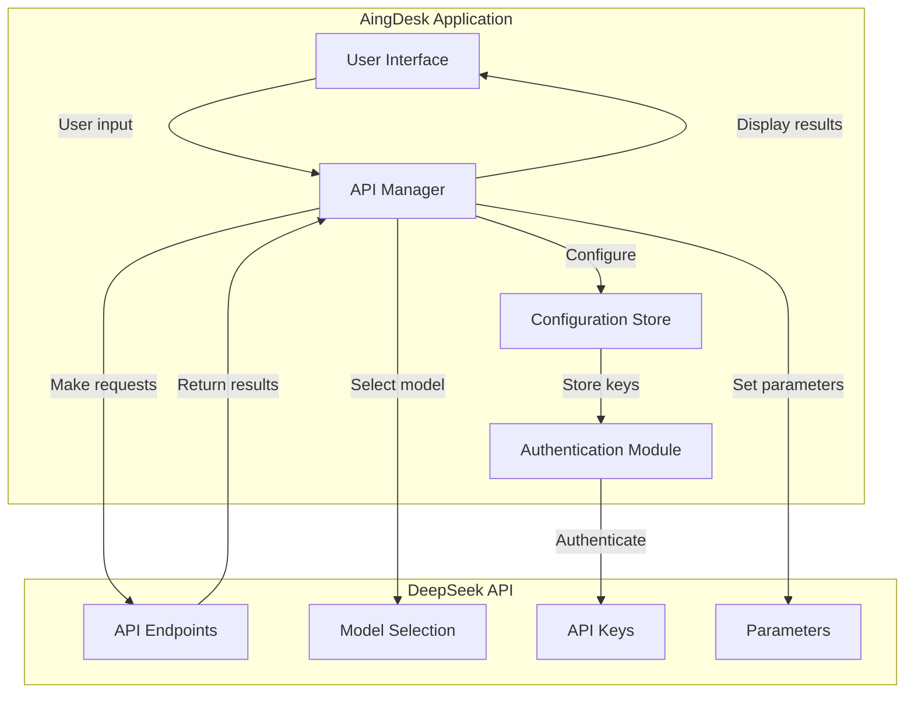

<!-- source: DeepWiki mcp.deepwiki.com · repo deepseek-ai/awesome-deepseek-integration · page 3.3 AingDesk · fetched 2026-10-30 -->

# AingDesk

Relevant source files

The following files were used as context for generating this wiki page:

- [docs/aingdesk/README.md](docs/aingdesk/README.md)
- [docs/aingdesk/README.zh_cn.md](docs/aingdesk/README.zh_cn.md)
- [docs/aingdesk/assets/img/1_en.png](docs/aingdesk/assets/img/1_en.png)
- [docs/aingdesk/assets/img/1_zh.png](docs/aingdesk/assets/img/1_zh.png)
- [docs/aingdesk/assets/img/2_zh.png](docs/aingdesk/assets/img/2_zh.png)
- [docs/aingdesk/assets/img/3_zh.png](docs/aingdesk/assets/img/3_zh.png)

AingDesk is a desktop application that enables one-click deployment of DeepSeek and other AI language models on local machines. This page documents the architecture, features, and technical aspects of AingDesk, focusing on its model deployment capabilities and knowledge base integrations.

## Purpose and Scope

This document covers the technical implementation and features of AingDesk, a tool designed to simplify the process of deploying and interacting with large language models. It details the application's architecture, deployment workflow, knowledge base support, and third-party API integrations.

## System Overview

AingDesk provides a user-friendly interface to deploy, configure, and interact with AI models locally. It supports both DeepSeek models and other compatible AI models, allowing users to create and manage personalized AI assistants.

### Architecture Diagram

Sources: docs/aingdesk/README.md, docs/aingdesk/README.zh_cn.md

## Core Features

### One-Click Model Deployment

AingDesk's primary feature is its ability to deploy DeepSeek or other AI models with a single click. The user interface provides a streamlined process for model selection, configuration, and deployment.

Sources: docs/aingdesk/README.md, docs/aingdesk/assets/img/1_en.png

### Multi-Source Knowledge Base Support

AingDesk allows users to integrate various data sources as knowledge bases for the AI models. This feature enhances the models' capabilities by providing domain-specific information.

Sources: docs/aingdesk/README.zh_cn.md, docs/aingdesk/assets/img/2_zh.png

### Third-Party API Support

AingDesk supports integration with third-party APIs, allowing the models to access external services and information sources.

Sources: docs/aingdesk/README.zh_cn.md, docs/aingdesk/assets/img/3_zh.png

### Built-in Chat Interface

AingDesk includes a built-in chat interface for interacting with deployed models, providing a seamless user experience.

Sources: docs/aingdesk/README.md, docs/aingdesk/README.zh_cn.md

## Technical Implementation

### Deployment Workflow

The deployment process in AingDesk follows a structured workflow that handles model selection, resource allocation, and configuration.

Sources: docs/aingdesk/README.md

### Knowledge Base Integration Process

Sources: docs/aingdesk/README.zh_cn.md, docs/aingdesk/assets/img/2_zh.png

## Usage Examples

### Model Deployment Example

1. Launch AingDesk application
2. Select DeepSeek or another supported AI model from the available options
3. Configure resource allocation (CPU, GPU, RAM)
4. Click the Deploy button
5. Wait for deployment completion
6. Start interacting with the model through the chat interface

### Knowledge Base Configuration Example

1. Navigate to the Knowledge Base section in AingDesk
2. Add documents by clicking the import button
3. Select document type and source location
4. Configure indexing settings
5. Process and index the documents
6. Test knowledge base integration with a query

## Future Development Plans

AingDesk's roadmap includes several planned features and enhancements:

1. **AI Agents**: Implementation of autonomous AI agents that can perform complex tasks
2. **Local Text-to-Image Models**: Support for deploying and using text-to-image hybrid models

Sources: docs/aingdesk/README.md, docs/aingdesk/README.zh_cn.md

## Integration with DeepSeek API

AingDesk is designed to work seamlessly with the DeepSeek API, providing a user-friendly interface to interact with DeepSeek models.

Sources: docs/aingdesk/README.md, docs/aingdesk/README.zh_cn.md

## System Requirements

AingDesk is designed to work on modern desktop systems. The specific requirements depend on the AI models being deployed. Here's a general guide:

| Component | Minimum Requirements | Recommended Specifications |
|-----------|----------------------|----------------------------|
| Operating System | Windows 10/11, macOS 10.15+, Linux (major distributions) | Windows 11, macOS 12+, Ubuntu 22.04+ |
| Processor | Intel Core i5 (8th gen) or AMD Ryzen 5 | Intel Core i7/i9 or AMD Ryzen 7/9 |
| RAM | 8GB | 16GB+ (32GB+ for larger models) |
| Storage | 10GB free space | SSD with 50GB+ free space |
| GPU | Not required for small models | NVIDIA GPU with 8GB+ VRAM for larger models |
| Network | Stable internet connection | High-speed internet connection |

Sources: docs/aingdesk/README.md

## Installation Guide

AingDesk can be installed from various sources:

1. **Official Website**: Download from [the official AingDesk website](https://www.aingdesk.com/en/download.html)
2. **GitHub**: Download from [AingDesk GitHub releases](https://github.com/aingdesk/AingDesk/releases)
3. **CNB**: Download from [CNB](https://cnb.cool/aingdesk/AingDesk/-/releases/)

After downloading, follow the standard installation process for your operating system.

Sources: docs/aingdesk/README.md, docs/aingdesk/README.zh_cn.md

## Conclusion

AingDesk provides a powerful yet user-friendly interface for deploying and utilizing DeepSeek and other AI models. Its one-click deployment, knowledge base integration, and built-in chat interface make it an excellent tool for both AI enthusiasts and professionals looking to leverage the capabilities of large language models without dealing with complex setup procedures.

The application continues to evolve with planned features like AI agents and text-to-image model support, promising even more functionality in future releases.

Sources: docs/aingdesk/README.md, docs/aingdesk/README.zh_cn.md

---

