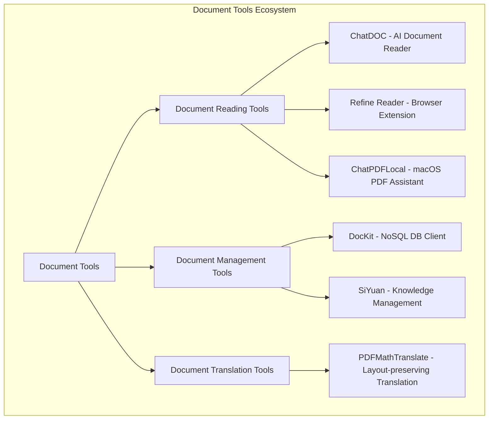
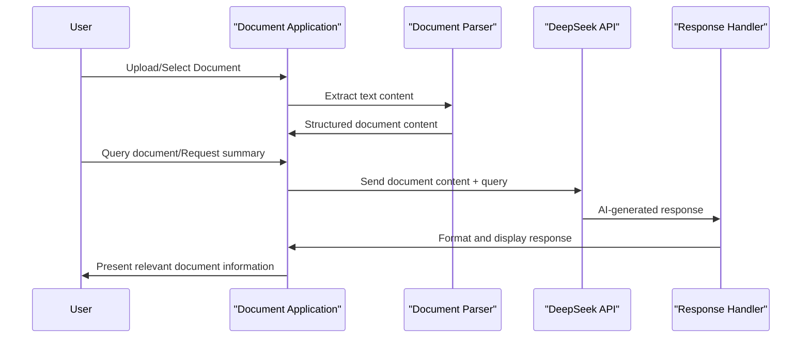
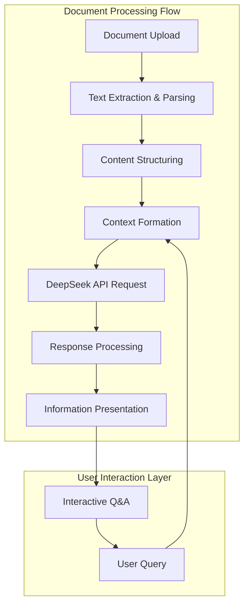

<!-- source: DeepWiki mcp.deepwiki.com · repo deepseek-ai/awesome-deepseek-integration · page 4 Document Tools · fetched 2026-10-30 -->

# Document Tools

Relevant source files

The following files were used as context for generating this wiki page:

- [README.md](README.md)
- [README_cn.md](README_cn.md)
- [README_ja.md](README_ja.md)
- [docs/4EVERChat/README.md](docs/4EVERChat/README.md)
- [docs/4EVERChat/README_cn.md](docs/4EVERChat/README_cn.md)
- [docs/4EVERChat/README_ja.md](docs/4EVERChat/README_ja.md)
- [docs/ChatDOC/README.md](docs/ChatDOC/README.md)
- [docs/ChatDOC/README_cn.md](docs/ChatDOC/README_cn.md)
- [docs/ChatDOC/assets/settings.png](docs/ChatDOC/assets/settings.png)
- [docs/ChatDOC/assets/ui.png](docs/ChatDOC/assets/ui.png)
- [docs/refinereader/README.md](docs/refinereader/README.md)
- [docs/refinereader/README_cn.md](docs/refinereader/README_cn.md)
- [docs/refinereader/assets/refinereader-128.png](docs/refinereader/assets/refinereader-128.png)
- [docs/refinereader/assets/refinereader-preview-1.png](docs/refinereader/assets/refinereader-preview-1.png)
- [docs/refinereader/assets/refinereader-preview-2.png](docs/refinereader/assets/refinereader-preview-2.png)
- [docs/refinereader/assets/refinereader-preview-3.jpg](docs/refinereader/assets/refinereader-preview-3.jpg)

Document tools represent applications and extensions that leverage DeepSeek's AI capabilities to enhance document reading, analysis, and management. These tools facilitate efficient information extraction, document summarization, and interactive questioning of document content through the DeepSeek API integration.

This page covers document-focused applications within the DeepSeek integration ecosystem. For information about other tools such as IDE integrations, see [IDE Integrations](#5), and for browser extensions, see [Browser Extensions](#6).

## Document Tools Overview

Document tools in the DeepSeek ecosystem can be categorized into three main types based on their primary functionality:

Sources: [README.md:61-73](). [README.md:190-204](). [README.md:428-432](), [README_cn.md:70-72]()

## Integration Architecture

Document tools typically follow a similar pattern when integrating with the DeepSeek API. The diagram below illustrates how document content flows through these applications to leverage DeepSeek's AI capabilities:

Sources: [README.md:73-90]()

## Document Reading Tools

### ChatDOC

ChatDOC is an AI-powered document reading tool that focuses on information traceability. It ensures that every piece of information provided by the AI is clearly traced back to its source in the document, allowing users to efficiently and accurately understand document content.

**Key Features:**
- Robust source traceability for all information
- AI-powered document analysis
- Interactive document questioning
- DeepSeek API integration through settings panel

**DeepSeek Integration:**
ChatDOC allows users to connect to the DeepSeek API through its settings interface, enabling document analysis using DeepSeek's language models.

Sources: [docs/ChatDOC/README.md:1-13](), [docs/ChatDOC/README_cn.md:1-11]()

### Refine Reader

Refine Reader (萃花阅读) is a Chrome extension that serves as an AI-powered intelligent reading assistant. It helps users quickly understand and extract article essentials through interactive reading support.

**Key Features:**
- AI smart summary generation (core viewpoints, key arguments, crucial conclusions)
- Multi-language support (Simplified/Traditional Chinese, English, Japanese, Korean)
- Multiple theme options
- Multi-turn dialogue based on article content
- Built-in question templates for quick insights

**Supported AI Models:**
- DeepSeek
- OpenAI (GPT-4/3.5)
- Tongyi Qianwen
- Claude
- Ollama (Local Deployment)

**Use Cases:**
- Quickly understanding key points of long articles
- Generating professional article analysis
- Obtaining multi-perspective interpretations
- One-click content sharing generation

Sources: [docs/refinereader/README.md:1-64](), [docs/refinereader/README_cn.md:1-67]()

### ChatPDFLocal

ChatPDFLocal is a macOS application designed to help users interact with PDF documents using AI. It integrates with DeepSeek and other AI models to improve reading efficiency.

**Key Features:**
- PDF document analysis
- Interactive querying of PDF content
- Integration with multiple AI models including DeepSeek
- Native macOS application

Sources: [README.md:201-204](), [README_cn.md:190-193]()

## Document Management Tools

### DocKit

DocKit is an AI-powered desktop GUI client designed specifically for NoSQL databases. It supports Elasticsearch and OpenSearch across Mac, Windows, and Linux platforms. By integrating with large models like DeepSeek, DocKit helps developers write complex DSL queries and provides an enhanced experience for data management and analysis.

**Key Features:**
- GUI interface for NoSQL databases
- Support for Elasticsearch and OpenSearch
- Cross-platform compatibility (Mac, Windows, Linux)
- AI assistance for complex query writing through DeepSeek integration
- Enhanced data management and analysis capabilities

Sources: [README.md:428-432](), [README_cn.md:354-357]()

### SiYuan

SiYuan is a privacy-focused personal knowledge management system that supports complete offline usage and provides end-to-end encrypted data synchronization. It integrates with DeepSeek to enhance its knowledge management capabilities.

**Key Features:**
- Privacy-first approach
- Complete offline functionality
- End-to-end encrypted data sync
- Knowledge management with AI assistance

Sources: [README.md:245-248](), [README_cn.md:201-202]()

## Document Translation Tools

### PDFMathTranslate

PDFMathTranslate is an AI-based full-text bilingual translation tool that fully preserves the layout of PDF documents. It integrates with AI models like DeepSeek to provide high-quality translations while maintaining the original document structure.

**Key Features:**
- Preservation of PDF layout during translation
- Full-text bilingual translation
- AI-powered translation quality

Sources: [README.md:399-402](), [README_cn.md:325-328]()

## Integration Methods

Document tools in the DeepSeek ecosystem typically integrate with the DeepSeek API through one of the following methods:

| Integration Method | Description | Example |
|-------------------|-------------|---------|
| Direct API Integration | Applications directly call the DeepSeek API endpoints | ChatDOC |
| Settings Configuration | Tools allow users to configure their own DeepSeek API keys | Refine Reader |
| Client Libraries | Applications use language-specific client libraries to access DeepSeek | DocKit |

Most document tools follow a similar pattern for processing documents with DeepSeek:

1. Document ingestion and parsing
2. Content extraction and structuring
3. Query formation based on user input
4. API request to DeepSeek with document context
5. Response processing and presentation

Sources: [README.md:73-90]()

## Common Use Cases

Document tools with DeepSeek integration are commonly used for:

1. **Document Summarization**: Quickly generating summaries of lengthy documents
2. **Information Extraction**: Pulling specific information from documents through targeted queries
3. **Content Analysis**: Analyzing document content for insights, trends, or key points
4. **Interactive Document Exploration**: Asking questions about document content and receiving contextually relevant answers
5. **Complex Query Generation**: For database tools like DocKit, generating complex queries based on natural language descriptions
6. **Document Translation**: Translating documents while preserving formatting and layout

Sources: [docs/refinereader/README.md:35-41](), [docs/ChatDOC/README.md:1-3]()

## Comparison of Document Tools

| Tool | Platform | Primary Focus | Unique Features |
|------|----------|---------------|-----------------|
| ChatDOC | Web | Document reading and analysis | Traceability features for source verification |
| Refine Reader | Chrome Extension | Web article analysis | Quick insights via templates, multi-language support |
| ChatPDFLocal | macOS | PDF interaction | Native macOS application |
| DocKit | Mac, Windows, Linux | NoSQL database management | AI for complex DSL query generation |
| SiYuan | Cross-platform | Knowledge management | Privacy-first, end-to-end encryption |
| PDFMathTranslate | Unspecified | PDF translation | Layout preservation during translation |

Sources: [README.md:61-73](), [README.md:190-204](), [README.md:428-432](), [docs/refinereader/README.md:1-64](), [docs/ChatDOC/README.md:1-13]()

---

