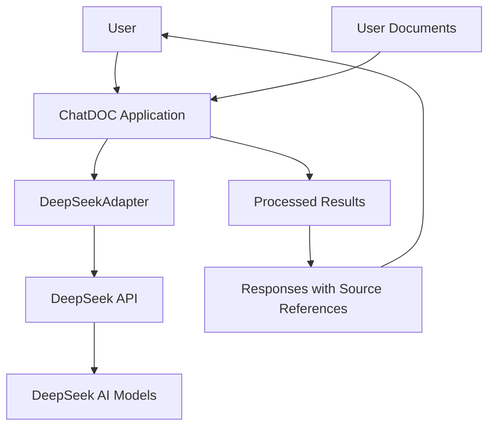
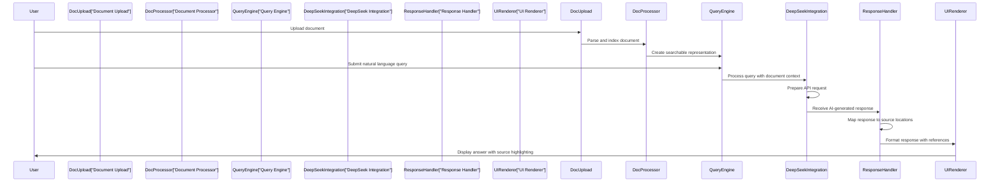

<!-- source: DeepWiki mcp.deepwiki.com · repo deepseek-ai/awesome-deepseek-integration · page 4.1 ChatDOC · fetched 2026-10-30 -->

# ChatDOC

Relevant source files

The following files were used as context for generating this wiki page:

- [docs/ChatDOC/README.md](docs/ChatDOC/README.md)
- [docs/ChatDOC/README_cn.md](docs/ChatDOC/README_cn.md)
- [docs/ChatDOC/assets/settings.png](docs/ChatDOC/assets/settings.png)
- [docs/ChatDOC/assets/ui.png](docs/ChatDOC/assets/ui.png)

ChatDOC is an AI-powered document reading tool that integrates with the DeepSeek API. It features robust traceability capabilities, ensuring that the source of every piece of information is clear and verifiable, helping users efficiently and accurately grasp the core of their documents.

## Overview and Purpose

ChatDOC serves as a specialized document analysis tool within the DeepSeek integration ecosystem. It enables users to:
- Upload and process various document formats
- Query document content using natural language
- Receive AI-generated answers with clear source attribution
- Navigate complex documents efficiently with AI assistance

The system maintains traceability throughout the analysis process, allowing users to verify information sources directly within the original document.

Sources: [docs/ChatDOC/README.md:3]()

## System Architecture

### ChatDOC in the DeepSeek Ecosystem

Sources: [docs/ChatDOC/README.md:3](), [docs/ChatDOC/README.md:9-11]()

### Document Processing and Query Flow

This diagram illustrates the typical document processing and query flow in ChatDOC, showing how user queries are processed through the system and how responses maintain traceability back to source material.

Sources: [docs/ChatDOC/README.md:3]()

## User Interface

ChatDOC provides an intuitive interface designed for efficient document interaction and analysis. The UI offers:

- Document viewing pane (likely showing the uploaded document with source highlighting)
- Query input area for natural language questions
- Response display that links back to relevant document sections
- Navigation tools for exploring document content

The interface prioritizes traceability, making it easy for users to verify the sources of information provided by the AI assistant.

Sources: [docs/ChatDOC/README.md:5-7]()

## DeepSeek API Integration

ChatDOC leverages the DeepSeek API to power its document understanding and question-answering capabilities. The integration focuses on:

1. **API Configuration**: Users can set up the DeepSeek API connection through the settings interface
2. **Model Selection**: Options to choose appropriate DeepSeek language models
3. **Authentication**: Secure API key management
4. **Context Management**: Transmitting document context along with user queries

The settings interface allows users to customize the DeepSeek API integration according to their specific needs, potentially including model selection, parameter tuning, and authentication configuration.

Sources: [docs/ChatDOC/README.md:9-11]()

## Key Technical Components

| Component | Function |
|-----------|----------|
| Document Parser | Processes various document formats into analyzable text |
| Index Builder | Creates searchable representations of document content |
| Query Processor | Transforms user questions into structured queries |
| DeepSeek Connector | Manages communication with the DeepSeek API |
| Source Mapper | Links AI-generated responses back to original document locations |
| Response Renderer | Displays answers with appropriate source highlighting |

These components work together to provide a seamless document analysis experience while maintaining strict traceability between AI-generated responses and source material.

Sources: [docs/ChatDOC/README.md:3]()

## Use Cases

ChatDOC is particularly valuable for professionals and researchers who need to extract specific information from complex documents while maintaining data provenance:

- **Legal professionals** analyzing case documents and legislation
- **Researchers** working with academic papers and technical reports
- **Business analysts** reviewing lengthy financial or market reports
- **Students** studying textbooks and research materials
- **Technical professionals** navigating complex documentation

The tool's ability to trace information back to source material makes it especially useful in contexts where accuracy and verification are critical.

Sources: [docs/ChatDOC/README.md:3]()

## Summary

ChatDOC represents an integration of DeepSeek's AI capabilities with specialized document processing technology. By maintaining strict traceability between AI-generated responses and source material, it enables users to efficiently extract information from documents while ensuring that sources remain clear and verifiable.

Sources: [docs/ChatDOC/README.md:3]()

---

