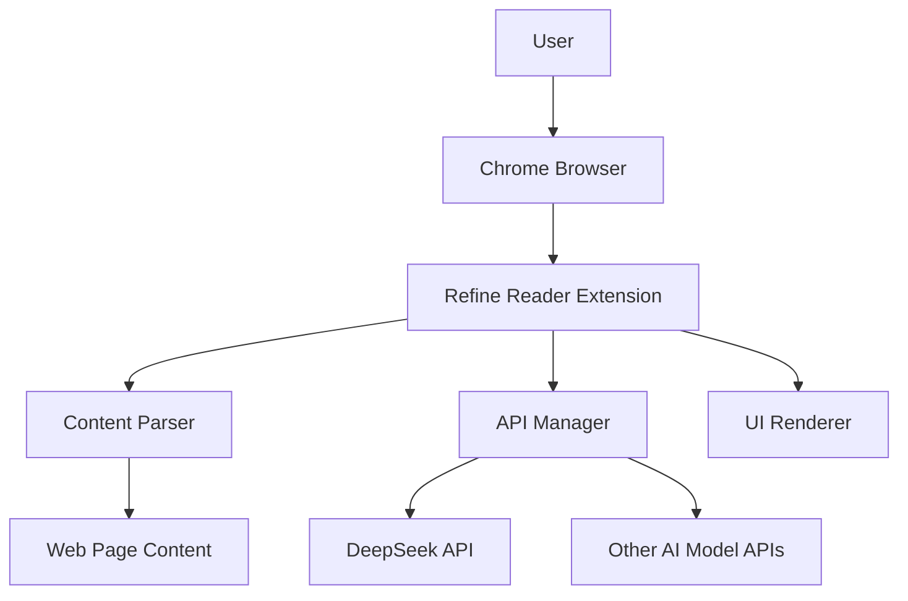
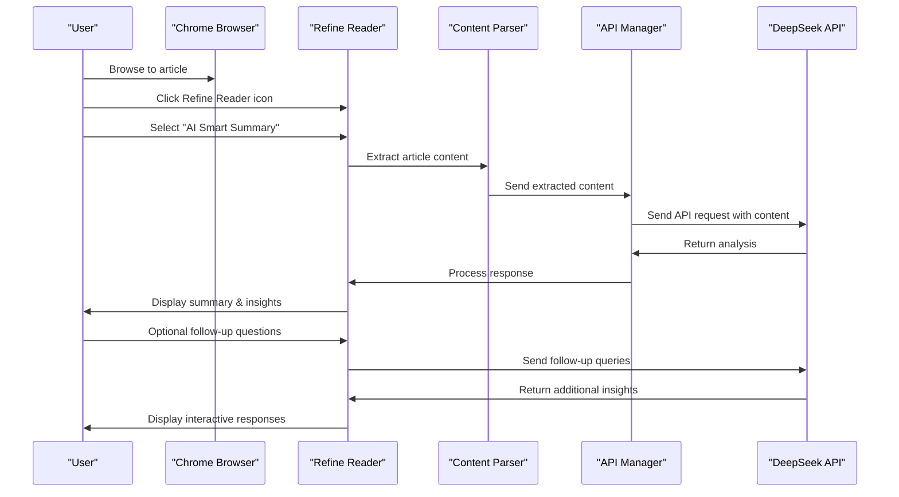
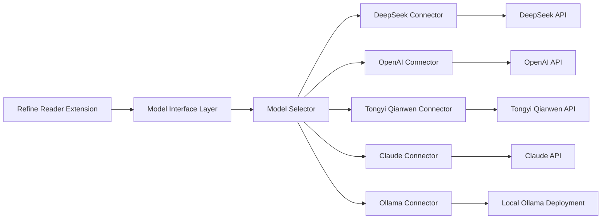
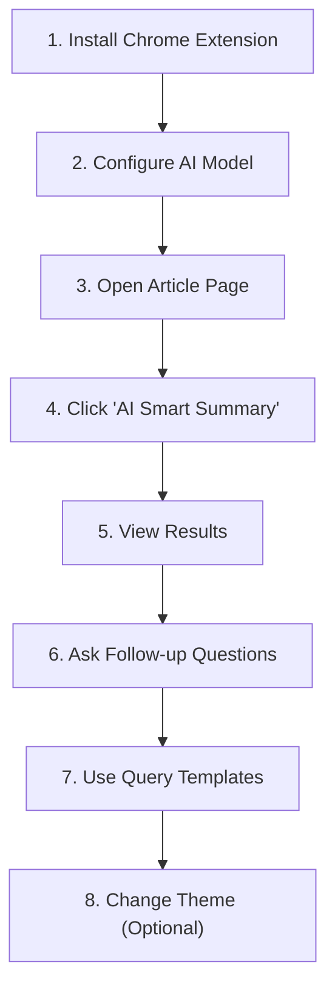

<!-- source: DeepWiki mcp.deepwiki.com · repo deepseek-ai/awesome-deepseek-integration · page 4.2 Refine Reader · fetched 2026-10-30 -->

# Refine Reader

Relevant source files

The following files were used as context for generating this wiki page:

- [docs/refinereader/README.md](docs/refinereader/README.md)
- [docs/refinereader/README_cn.md](docs/refinereader/README_cn.md)
- [docs/refinereader/assets/refinereader-128.png](docs/refinereader/assets/refinereader-128.png)
- [docs/refinereader/assets/refinereader-preview-1.png](docs/refinereader/assets/refinereader-preview-1.png)
- [docs/refinereader/assets/refinereader-preview-2.png](docs/refinereader/assets/refinereader-preview-2.png)
- [docs/refinereader/assets/refinereader-preview-3.jpg](docs/refinereader/assets/refinereader-preview-3.jpg)

Refine Reader is a Chrome extension that serves as an AI-powered intelligent reading assistant. It enables users to quickly understand and extract article essentials, providing interactive reading support for various content types. This wiki page documents the purpose, architecture, functionality, and integration with DeepSeek API.

## Overview and Purpose

Refine Reader helps users efficiently comprehend and interact with written content through AI assistance. By leveraging AI models including DeepSeek, it can generate summaries, answer questions, and provide analytical insights about any article or document visible in the Chrome browser.

Sources: [docs/refinereader/README.md:7-9](), [docs/refinereader/README_cn.md:7-9]()

## System Architecture

### High-Level Architecture

Sources: [docs/refinereader/README.md:11-18](). [docs/refinereader/README.md:19-26]()

### User Interaction Flow

Sources: [docs/refinereader/README.md:28-33](), [docs/refinereader/README.md:35-41]()

## Key Features

### AI Smart Summary

Refine Reader's primary feature is its ability to generate concise summaries of web content, highlighting:
- Core viewpoints
- Key arguments
- Crucial conclusions
- Main themes and topics

This feature enables users to quickly grasp the essence of long articles without reading the entire content.

### Multi-language Support

The extension supports content analysis in multiple languages:
- Simplified Chinese
- Traditional Chinese
- English
- Japanese
- Korean

This makes it versatile for international users accessing content in different languages.

### Theme Switching

Multiple UI themes are available, including:
- Chinese Ink theme
- Spring Vibes theme
- Other aesthetic options

This allows users to customize their experience according to visual preferences.

### Reading Interaction

Users can engage in multi-turn dialogue with the AI about the article content, asking follow-up questions or requesting further analysis on specific aspects of the document.

### Quick Inquiry

Built-in question templates allow users to instantly generate professional insights with one click, such as:
- Request for critical analysis
- Alternative viewpoints
- Background context
- Related knowledge

Sources: [docs/refinereader/README.md:11-18](), [docs/refinereader/README_cn.md:12-19]()

## AI Model Integration

### Supported Models Architecture

### Supported AI Models

Refine Reader integrates with multiple AI models, allowing users to choose their preferred provider:

| Model | Type | Deployment |
|-------|------|------------|
| DeepSeek | Cloud API | Remote |
| OpenAI (GPT-4/3.5) | Cloud API | Remote |
| Tongyi Qianwen | Cloud API | Remote |
| Claude | Cloud API | Remote |
| Ollama | Self-hosted | Local |

The extension is designed with a flexible model interface that allows for adding more integrations in the future.

Sources: [docs/refinereader/README.md:19-26](), [docs/refinereader/README_cn.md:20-27]()

## Usage Flow

The typical usage flow starts with installation from the Chrome Web Store, followed by configuration of the preferred AI model (including setting up API keys). Users can then browse to any article, click the "AI Smart Summary" button, and interact with the results through follow-up questions or predefined query templates.

Sources: [docs/refinereader/README.md:28-33](), [docs/refinereader/README_cn.md:29-34]()

## Use Cases

Refine Reader serves several key use cases:

1. **Rapid Content Comprehension**: Quickly understanding long articles without reading entirely
2. **Professional Analysis**: Obtaining structured, analytical insights about complex topics
3. **Multi-perspective Interpretation**: Viewing content from different angles or frameworks
4. **Content Sharing Preparation**: Generating shareable summaries and key points

Sources: [docs/refinereader/README.md:35-41](), [docs/refinereader/README_cn.md:36-42]()

## Privacy and Security Features

Refine Reader includes important privacy measures:

- All configuration information is stored locally only
- API keys are securely encrypted
- No collection of personal user information occurs

This ensures user data and API credentials remain secure while using the extension.

Sources: [docs/refinereader/README.md:54-58](), [docs/refinereader/README_cn.md:56-60]()

## Developer Information

The extension is developed by:
- GitHub repository: wzfukui/refinereader
- Website: https://refinereader.cuihuaer.com

Sources: [docs/refinereader/README.md:60-63](), [docs/refinereader/README_cn.md:63-66]()

---

