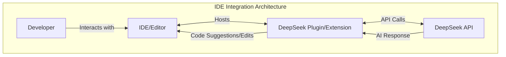
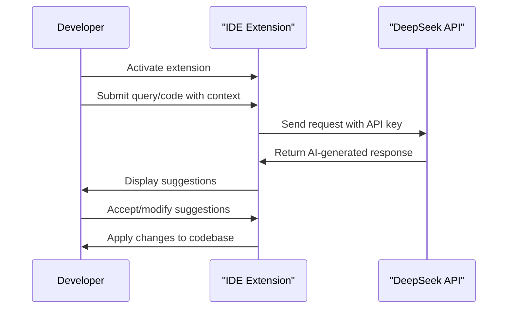
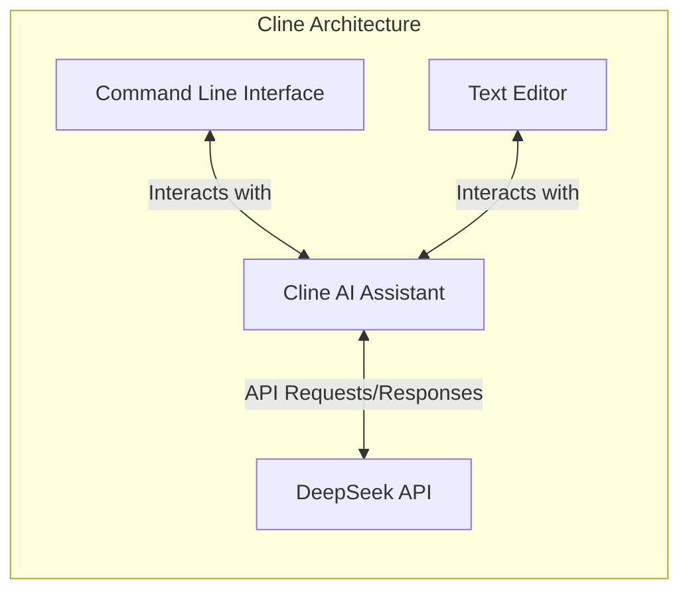

<!-- source: DeepWiki mcp.deepwiki.com · repo deepseek-ai/awesome-deepseek-integration · page 5 IDE Integrations · fetched 2026-10-30 -->

# IDE Integrations

<details>
<summary>Relevant source files</summary>

The following files were used as context for generating this wiki page:

- [README.md](README.md)
- [README_cn.md](README_cn.md)
- [README_ja.md](README_ja.md)
- [docs/4EVERChat/README.md](docs/4EVERChat/README.md)
- [docs/4EVERChat/README_cn.md](docs/4EVERChat/README_cn.md)
- [docs/4EVERChat/README_ja.md](docs/4EVERChat/README_ja.md)
- [docs/avante.nvim/README.md](docs/avante.nvim/README.md)
- [docs/avante.nvim/README_cn.md](docs/avante.nvim/README_cn.md)
- [docs/cline/README.md](docs/cline/README.md)
- [docs/cline/README_cn.md](docs/cline/README_cn.md)
- [docs/cline/assets/cline-00.png](docs/cline/assets/cline-00.png)
- [docs/cline/assets/cline-01.png](docs/cline/assets/cline-01.png)
- [docs/cline/assets/cline-02.png](docs/cline/assets/cline-02.png)
- [docs/cline/assets/favicon.png](docs/cline/assets/favicon.png)
- [docs/cline/assets/roocline-00.png](docs/cline/assets/roocline-00.png)
- [docs/codecompanion.nvim/README.md](docs/codecompanion.nvim/README.md)
- [docs/codecompanion.nvim/README_cn.md](docs/codecompanion.nvim/README_cn.md)
- [docs/continue/README.md](docs/continue/README.md)
- [docs/continue/README_cn.md](docs/continue/README_cn.md)
- [docs/llm.nvim/README.md](docs/llm.nvim/README.md)
- [docs/llm.nvim/README_cn.md](docs/llm.nvim/README_cn.md)

</details>


This page documents code editor extensions and plugins that integrate with DeepSeek. These integrations allow developers to leverage DeepSeek's AI capabilities directly within their preferred development environments, enhancing productivity through features like code generation, refactoring, explanation, and AI-assisted programming.

For information about browser extensions that integrate with DeepSeek, see [Browser Extensions](#6).

## Overview of IDE Integrations

DeepSeek integrations are available for several popular development environments, including Visual Studio Code, Neovim, and command-line interfaces. These integrations provide a seamless way to access DeepSeek's language models directly within your coding workflow.



Sources: [README.md:30-34](). [docs/continue/README.md](). [docs/avante.nvim/README.md](). [docs/codecompanion.nvim/README.md](). [docs/llm.nvim/README.md](). [docs/cline/README.md]().

### Integration Workflow

The typical workflow for using DeepSeek within an IDE follows this pattern:



Sources: [docs/continue/README.md](). [docs/avante.nvim/README.md](). [docs/codecompanion.nvim/README.md](). [docs/llm.nvim/README.md](). [docs/cline/README.md]().

## VS Code Extensions

### Continue

Continue is an open-source autopilot for VS Code that provides AI-powered assistance for generating, refactoring, and explaining code. It integrates with DeepSeek to offer context-aware code suggestions directly within your editor.

#### Features

- Code generation based on natural language prompts
- Code refactoring suggestions
- Code explanation capabilities
- Tab autocompletion

#### DeepSeek Configuration

To integrate Continue with DeepSeek, you need to configure your `config.json` file:

```json
{
  "completionOptions": {
    "BaseCompletionOptions": {
        "temperature": 0.0,
        "maxTokens": 256
    }
  },
  "models": [
    {
      "title": "DeepSeek",
      "model": "deepseek-chat",
      "contextLength": 128000,
      "apiKey": "YOUR_API_KEY",
      "provider": "openai",
      "apiBase": "https://api.deepseek.com/beta"
    }
  ],
  "tabAutocompleteModel": {
    "title": "DeepSeek",
    "model": "deepseek-chat",
    "apiKey": "YOUR_API_KEY",
    "provider": "openai",
    "apiBase": "https://api.deepseek.com/beta"
  }
}
```

Sources: [docs/continue/README.md:12-42](). [README.md:31](). 

## Neovim Plugins

Neovim offers several plugins that integrate with DeepSeek, providing AI-assisted coding directly within this powerful text editor.

### avante.nvim

avante.nvim is a Neovim plugin designed to emulate the behavior of the Cursor AI IDE. It provides AI-powered code assistance with the ability to apply suggestions directly to source files.

#### Features

- AI-driven code assistance for current code files
- One-click application of AI suggestions
- Seamless integration with Neovim's editing workflow

#### DeepSeek Configuration

Configure avante.nvim with DeepSeek by adding the following to your Neovim configuration:

```lua
return {
  {
    "yetone/avante.nvim",
    event = "VeryLazy",
    lazy = false,
    version = false,
    opts = {
      provider = "deepseek",
      vendors = {
        deepseek = {
          __inherited_from = "openai",
          api_key_name = "DEEPSEEK_API_KEY",
          endpoint = "https://api.deepseek.com",
          model = "deepseek-coder",
          max_tokens = 8192,
        },
      },
    },
    build = "make",
    dependencies = {
      -- Dependencies omitted for brevity
    },
  },
}
```

Sources: [docs/avante.nvim/README.md:1-85](). [README.md:32]().

### codecompanion.nvim

codecompanion.nvim is a productivity tool for Neovim that streamlines development with LLMs, offering features like inline transformations and code refactoring.

#### Features

- Support for multiple AI providers including DeepSeek
- Inline code transformations and refactoring
- Built-in prompt library for common tasks
- Multiple chat sessions simultaneously

#### DeepSeek Configuration

Configure codecompanion.nvim with DeepSeek using:

```lua
require("codecompanion").setup({
  adapters = {
    deepseek = function()
      return require("codecompanion.adapters").extend("deepseek", {
        env = {
          api_key = "YOUR_API_KEY",
        },
      })
    end,
  },
  strategies = {
    chat = { adapter = "deepseek", },
    inline = { adapter = "deepseek" },
    agent = { adapter = "deepseek" },
  },
})
```

Sources: [docs/codecompanion.nvim/README.md:1-95](). [README.md:32]().

### llm.nvim

llm.nvim is a free large language model plugin for Neovim that enables interaction with LLMs, including DeepSeek.

#### Features

- AI chat directly within Neovim
- Code explanation and optimization
- Translation capabilities
- Git commit message generation
- Documentation generation

#### DeepSeek Configuration

Configure llm.nvim with DeepSeek by adding:

```lua
require("llm").setup({
  url = "https://api.deepseek.com/chat/completions",
  model = "deepseek-chat",
  api_type = "openai",
  max_tokens = 4096,
  temperature = 0.3,
  top_p = 0.7,
  
  prompt = "You are a helpful Chinese assistant.",
  
  -- Configuration continues...
})
```

Sources: [docs/llm.nvim/README.md:1-77](). [README.md:32]().

## CLI and Editor AI Assistants

### Cline

Cline is an AI assistant that can operate within your command-line interface and editor, providing intelligent coding assistance and automation.



#### Features

- Agentic coding capabilities
- File and project management
- Terminal integration
- Browser automation
- Context-aware assistance
- Proactive error handling

#### DeepSeek Integration

Cline can be configured to use DeepSeek as its AI provider through the settings menu. However, there are some best practices to consider:

- Disable Cline's Auto Approve feature when using DeepSeek to reduce resource consumption
- Use caution with large projects, as they can slow down API request processing due to the large context
- Consider using modified versions like Roo-Cline for improved performance with DeepSeek

Sources: [docs/cline/README.md:1-50](). [README.md:34]().

## Integration Comparison

Here's a comparison of the different IDE integrations available for DeepSeek:

| Integration | IDE/Editor | Key Features | Configuration Complexity |
|-------------|------------|--------------|--------------------------|
| Continue | VS Code | Code generation, refactoring, explanation, tab autocompletion | Medium (JSON configuration) |
| avante.nvim | Neovim | AI code assistance, one-click suggestion application | Medium (Lua configuration) |
| codecompanion.nvim | Neovim | Inline transformations, multiple chat sessions, prompt library | Medium (Lua configuration) |
| llm.nvim | Neovim | AI chat, code explanation, translation, git commit generation | Low (Simple Lua setup) |
| Cline | CLI & Editors | Agentic coding, terminal integration, browser automation | Medium (GUI settings) |

Sources: [README.md:30-34](). [docs/continue/README.md](). [docs/avante.nvim/README.md](). [docs/codecompanion.nvim/README.md](). [docs/llm.nvim/README.md](). [docs/cline/README.md]().

## Best Practices for IDE Integrations

When using DeepSeek in IDE integrations, consider these best practices:

1. **API Key Management**: Store your DeepSeek API key securely, preferably as an environment variable
2. **Optimize Context**: Limit the amount of code context sent to DeepSeek in large projects
3. **Temperature Settings**: Lower the temperature setting (0.0-0.3) for more deterministic code generation
4. **Rate Limiting**: Implement rate limiting in high-usage scenarios to avoid hitting API limits
5. **Review Generated Code**: Always review and understand AI-generated code before integrating it

Sources: [docs/continue/README.md](). [docs/avante.nvim/README.md](). [docs/codecompanion.nvim/README.md](). [docs/llm.nvim/README.md](). [docs/cline/README.md]().

---

