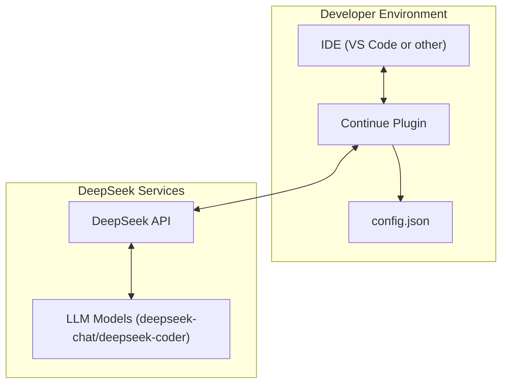
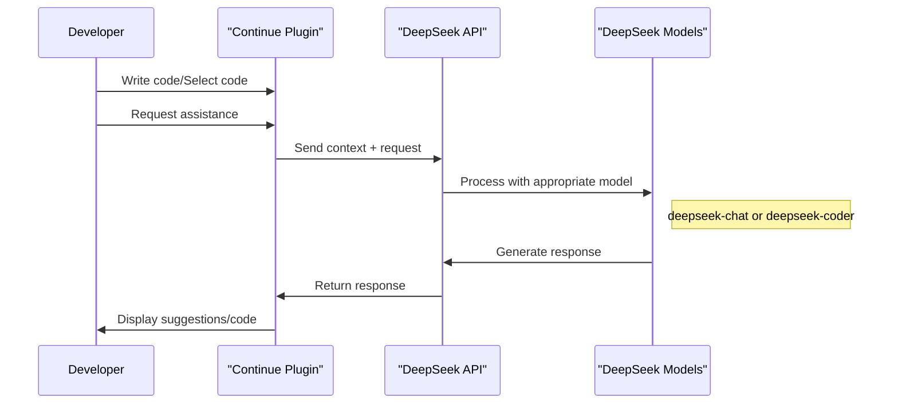
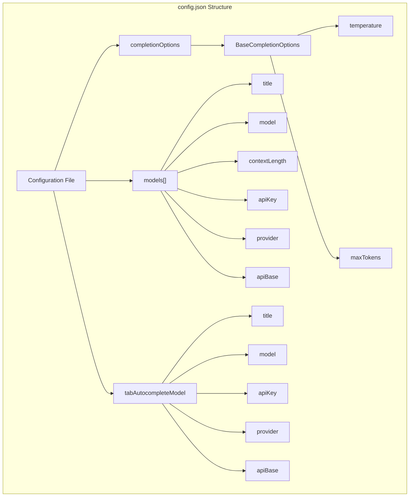
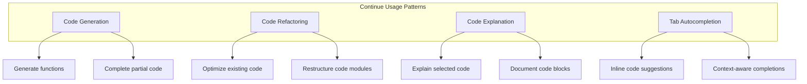

<!-- source: DeepWiki mcp.deepwiki.com · repo deepseek-ai/awesome-deepseek-integration · page 5.1 Continue · fetched 2026-10-30 -->

# Continue

Relevant source files

The following files were used as context for generating this wiki page:

- [docs/continue/README.md](docs/continue/README.md)
- [docs/continue/README_cn.md](docs/continue/README_cn.md)

Continue is an open-source autopilot plugin for integrated development environments (IDEs) that uses Large Language Models (LLMs) to assist with coding tasks. This document explains how Continue integrates with DeepSeek's API to provide code generation, refactoring, and explanation capabilities directly within your development environment.

## Overview

Continue functions as an AI assistant embedded directly in your IDE, allowing developers to leverage the power of language models for various coding tasks without leaving their development environment. By integrating with DeepSeek's language models, Continue provides intelligent code suggestions, refactoring assistance, and code explanations.

Sources: [docs/continue/README.md:5-9]()

## System Architecture

Continue operates as an IDE plugin that communicates with the DeepSeek API to provide coding assistance. Here's how the components interact:

The Continue plugin integrates directly with your IDE and communicates with the DeepSeek API based on the configuration specified in the `config.json` file.

Sources: [docs/continue/README.md:12-42]()

## DeepSeek Integration

Continue allows integration with DeepSeek models through a simple configuration process. This enables developers to leverage DeepSeek's powerful language models for coding assistance.

### Integration Flow

Sources: [docs/continue/README.md:12-42](), [docs/continue/README_cn.md:12-42]()

## Configuration

Continue requires a `config.json` file to set up the DeepSeek API integration. This configuration specifies which models to use, API credentials, and other parameters.

### Basic Configuration Structure

The configuration file includes the following key sections:

1. **Completion Options**: Basic parameters for code completions 
2. **Models**: Configuration for the main models used
3. **Tab Autocomplete Model**: Configuration for the tab autocomplete functionality

### Example Configuration

Below is an example configuration for integrating Continue with DeepSeek:

| Configuration Parameter | Value |
|------------------------|-------|
| Model Name | deepseek-chat or deepseek-coder |
| Context Length | 128000 |
| API Base | https://api.deepseek.com/beta |
| Provider | openai or deepseek (depends on version) |
| Temperature | 0.0 (for deterministic responses) |
| Max Tokens | 256 (default limit for responses) |

Note: The provider is set as "openai" in the English documentation but "deepseek" in the Chinese documentation. This reflects different configuration approaches in different versions.

Sources: [docs/continue/README.md:16-42](), [docs/continue/README_cn.md:16-42]()

## Usage Patterns

Continue with DeepSeek integration supports several key usage patterns:

Each of these usage patterns leverages either the main DeepSeek model (configured in the "models" section) or the tab autocomplete model (configured in the "tabAutocompleteModel" section).

Sources: [docs/continue/README.md:5-7](), [docs/continue/README_cn.md:5-6]()

## Model Selection

Continue allows configuration of different DeepSeek models for different tasks:

| Task Type | Recommended Model | Notes |
|-----------|------------------|-------|
| General coding assistance | deepseek-chat | Good for general-purpose coding help |
| Code-specific completions | deepseek-coder | Optimized for code generation |
| Tab autocompletion | deepseek-coder | Better for short, context-aware completions |

The Chinese documentation specifically recommends using deepseek-coder for tab autocompletion, which suggests it may be more optimized for this particular use case.

Sources: [docs/continue/README.md:23-40](), [docs/continue/README_cn.md:23-40]()

## Configuration Differences

There are some notable differences in the configuration between the English and Chinese documentation:

| Parameter | English Documentation | Chinese Documentation |
|-----------|----------------------|----------------------|
| Provider | "openai" | "deepseek" |
| Tab Autocomplete Model | "deepseek-chat" | "deepseek-coder" |

These differences might represent different versions of the integration or alternative configuration approaches.

Sources: [docs/continue/README.md:25-39](), [docs/continue/README_cn.md:25-39]()

## Conclusion

Continue provides a seamless integration with DeepSeek's powerful language models directly within your IDE. By configuring the `config.json` file, developers can leverage DeepSeek's capabilities for code generation, refactoring, and explanation without leaving their development environment.

The integration is flexible, allowing users to choose between different DeepSeek models for various tasks and to fine-tune parameters like temperature and token limits to suit their specific needs.

---

