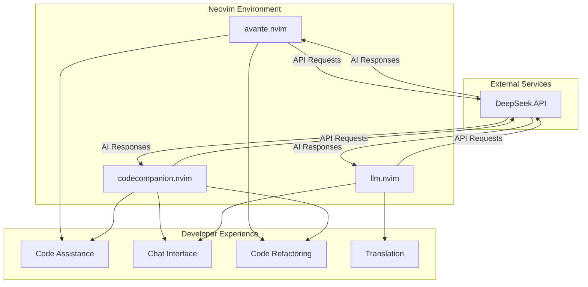
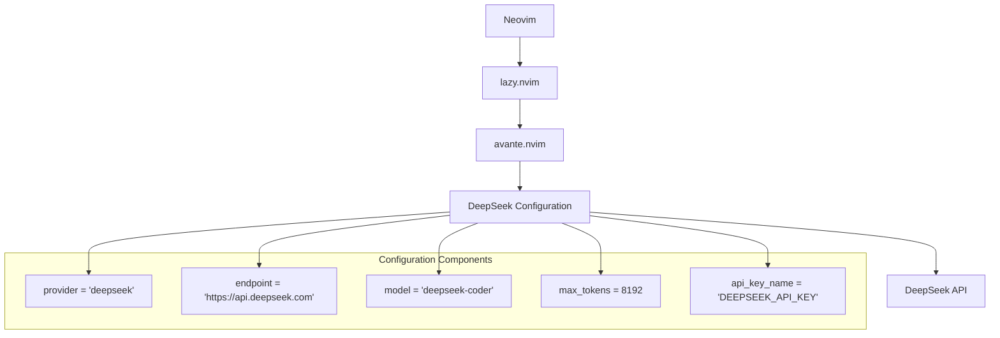
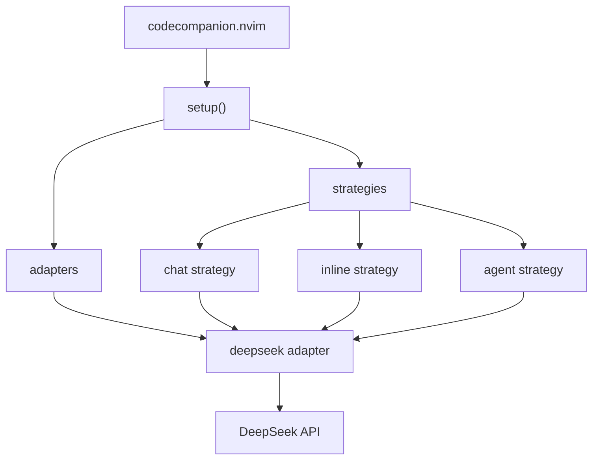
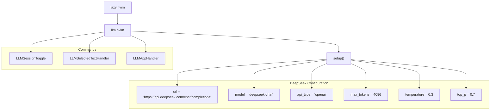
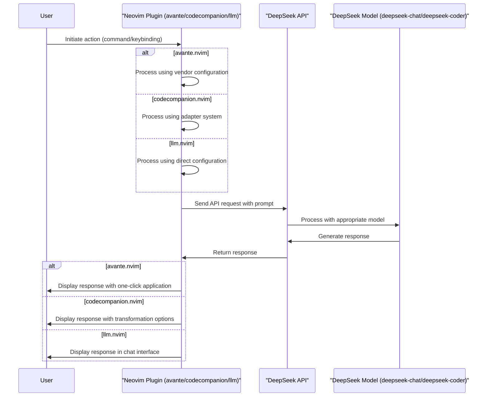

<!-- source: DeepWiki mcp.deepwiki.com · repo deepseek-ai/awesome-deepseek-integration · page 5.2 Neovim Plugins · fetched 2026-10-30 -->

# Neovim Plugins

Relevant source files

The following files were used as context for generating this wiki page:

- [docs/avante.nvim/README.md](docs/avante.nvim/README.md)
- [docs/avante.nvim/README_cn.md](docs/avante.nvim/README_cn.md)
- [docs/codecompanion.nvim/README.md](docs/codecompanion.nvim/README.md)
- [docs/codecompanion.nvim/README_cn.md](docs/codecompanion.nvim/README_cn.md)
- [docs/llm.nvim/README.md](docs/llm.nvim/README.md)
- [docs/llm.nvim/README_cn.md](docs/llm.nvim/README_cn.md)

## Introduction

This document provides detailed information about Neovim plugins that integrate with the DeepSeek API, allowing developers to leverage DeepSeek's AI capabilities directly within their Neovim editor. These plugins enhance coding workflows by providing AI-powered code assistance, chat interfaces, and other productivity features.

The plugins covered in this document include:
- avante.nvim
- codecompanion.nvim
- llm.nvim

For information about other IDE integrations, such as the Continue plugin for VS Code, see [Continue](#5.1).

## Integration Overview

The following diagram illustrates how these Neovim plugins connect to the DeepSeek API:

Sources: [docs/avante.nvim/README.md](), [docs/codecompanion.nvim/README.md](), [docs/llm.nvim/README.md]()

## Plugin Comparison

The following table compares the key features of each plugin:

| Feature | avante.nvim | codecompanion.nvim | llm.nvim |
|---------|------------|-------------------|----------|
| Code Assistance | ✓ | ✓ | ✓ |
| Chat Interface | ✓ | ✓ | ✓ |
| Code Refactoring | ✓ | ✓ | ✓ |
| Translation | - | - | ✓ |
| Git Commit Generation | - | - | ✓ |
| Docstring Generation | - | - | ✓ |
| Multiple Chat Sessions | - | ✓ | ✓ |
| DeepSeek Integration | Pre-configured | Via adapters | Direct configuration |

Sources: [docs/avante.nvim/README.md](), [docs/codecompanion.nvim/README.md](), [docs/llm.nvim/README.md]()

## avante.nvim

avante.nvim is designed to emulate the behavior of the Cursor AI IDE within Neovim, providing AI-driven code suggestions and the ability to apply these recommendations directly to source files.

### Features

- AI-powered code assistance for suggesting improvements and modifications
- One-click application of AI suggestions to streamline the editing process
- Integration with multiple AI providers, including DeepSeek

### Installation and Configuration

avante.nvim can be installed using plugin managers like lazy.nvim. Here's how to configure it for DeepSeek:

The configuration for DeepSeek in avante.nvim involves setting the provider to "deepseek" and configuring vendor-specific settings, as shown in [docs/avante.nvim/README.md:27-36]().

Sources: [docs/avante.nvim/README.md]()

## codecompanion.nvim

codecompanion.nvim is a productivity tool that streamlines LLM usage within Neovim, offering various features to enhance the development workflow.

### Features

- Combines functionality similar to Copilot Chat and Zed AI
- Supports multiple LLM providers, including DeepSeek
- Inline transformations, code creation, and refactoring
- Custom prompts, variables, and slash commands
- Multiple simultaneous chat sessions
- Asynchronous execution for better performance

### Installation and Configuration

codecompanion.nvim can be installed via plugin managers like lazy.nvim or mini.deps. The DeepSeek integration is handled through the adapters system:

The key components of DeepSeek configuration include creating a custom adapter and setting strategies to use that adapter, as shown in [docs/codecompanion.nvim/README.md:35-48]().

Sources: [docs/codecompanion.nvim/README.md]()

## llm.nvim

llm.nvim is a free large language model plugin that enables Neovim users to interact with LLMs, including DeepSeek, offering various AI-powered features.

### Features

- AI chat interface
- Code explanation and optimization
- Translation functionality
- Test case generation
- Git commit message generation
- Docstring generation

### Installation and Configuration

The plugin can be installed using lazy.nvim, with configuration specifically for DeepSeek:

The configuration for DeepSeek in llm.nvim involves setting the API URL, model, and other parameters as shown in [docs/llm.nvim/README.md:29-34]().

Sources: [docs/llm.nvim/README.md]()

## Integration Architecture

The following diagram illustrates the common architecture pattern shared by these Neovim plugins when integrating with DeepSeek:

Sources: [docs/avante.nvim/README.md](), [docs/codecompanion.nvim/README.md](), [docs/llm.nvim/README.md]()

## Installation Considerations

When installing these plugins, consider the following:

1. **API Key Management**: All plugins require a DeepSeek API key, which can be configured through environment variables or directly in the setup configuration.

2. **Dependencies**: 
   - avante.nvim: Requires nvim-treesitter, dressing.nvim, plenary.nvim, and nui.nvim
   - codecompanion.nvim: Requires plenary.nvim and nvim-treesitter
   - llm.nvim: Requires plenary.nvim and nui.nvim

3. **Plugin Manager Compatibility**: All plugins support installation via lazy.nvim, while codecompanion.nvim also has explicit support for mini.deps.

4. **Build Requirements**: avante.nvim requires a build step (`make` on Unix systems or `powershell` script on Windows).

## Conclusion

The Neovim plugins covered in this document provide powerful ways to integrate DeepSeek's AI capabilities into your coding workflow. While they share core functionality like code assistance and chat interfaces, each has unique features and approaches to integration:

- avante.nvim emphasizes simplicity and a Cursor-like experience
- codecompanion.nvim offers flexibility with its adapter system and extensive feature set
- llm.nvim provides specialized features like translation and git commit generation

Choose the plugin that best fits your workflow requirements and integration preferences.

Sources: [docs/avante.nvim/README.md](), [docs/codecompanion.nvim/README.md](), [docs/llm.nvim/README.md]()

---

