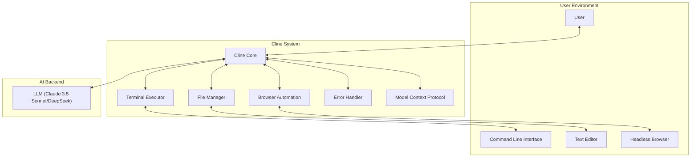
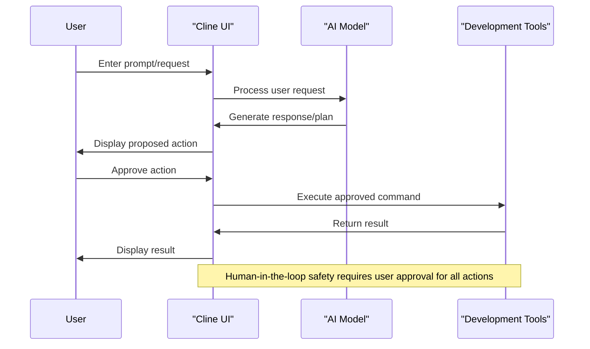
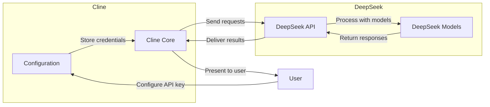

<!-- source: DeepWiki mcp.deepwiki.com · repo deepseek-ai/awesome-deepseek-integration · page 5.3 Cline · fetched 2026-10-30 -->

# Cline

Relevant source files

The following files were used as context for generating this wiki page:

- [docs/cline/README.md](docs/cline/README.md)
- [docs/cline/README_cn.md](docs/cline/README_cn.md)
- [docs/cline/assets/cline-00.png](docs/cline/assets/cline-00.png)
- [docs/cline/assets/cline-01.png](docs/cline/assets/cline-01.png)
- [docs/cline/assets/cline-02.png](docs/cline/assets/cline-02.png)
- [docs/cline/assets/favicon.png](docs/cline/assets/favicon.png)
- [docs/cline/assets/roocline-00.png](docs/cline/assets/roocline-00.png)

This document provides an overview of Cline, an AI assistant that can use your Command Line Interface (CLI) and text editors. It explains Cline's key features, architecture, integration with DeepSeek API, and best practices for effective use.

## Introduction

Cline is an AI-powered assistant designed to enhance developer productivity by providing intelligent assistance within the CLI and editor environments. Unlike traditional AI coding assistants that are limited to code completion or technical support, Cline can perform complex software development tasks step-by-step by leveraging advanced AI capabilities to interact with your terminal, edit files, and even automate browser interactions.

Sources: docs/cline/README.md:1-3, docs/cline/README_cn.md:1-3

## Key Features

Cline offers several powerful capabilities that set it apart from conventional AI assistants:

1. **Agentic Coding**: Leverages advanced AI capabilities to handle complex software development tasks step-by-step, going beyond simple code completion.

2. **File and Project Management**: Creates, edits, and explores files within large projects, enabling seamless navigation and modification of codebases.

3. **Terminal Integration**: Executes terminal commands and monitors their output with user permission, allowing it to react dynamically to issues like development server errors.

4. **Browser Automation**: For web development, launches sites in a headless browser, interacts with pages (click, type, scroll), and captures screenshots and console logs to debug runtime errors and visual bugs.

5. **Human-in-the-Loop Safety**: Requires user approval for every file change and terminal command via a GUI, ensuring a secure and controlled environment.

6. **Context-Aware Assistance**: Analyzes file structures, source code ASTs, and runs regex searches to understand existing projects, providing relevant assistance without overwhelming the context window.

7. **Proactive Error Handling**: Monitors linter/compiler errors and proactively fixes issues like missing imports and syntax errors during file editing.

8. **Model Context Protocol (MCP)**: Extends its own capabilities by creating new tools using the MCP, enabling continuous adaptation to user needs.

9. **Task Completion with Ease**: Presents results with simple terminal commands that users can execute with a single click.

Sources: docs/cline/README.md:9-27, docs/cline/README_cn.md:9-27

## Architecture and Components

Cline's architecture enables seamless interaction between the AI model, your development environment, and external tools. Below is a high-level overview of how Cline works:

The core components of Cline include:

1. **Cline Core**: The central component that orchestrates all interactions between the user, the AI model, and the various tools.

2. **File Manager**: Handles file operations like creation, modification, and navigation.

3. **Terminal Executor**: Manages command execution in the CLI and captures output.

4. **Browser Automation**: Controls headless browser instances for web development and debugging.

5. **Error Handler**: Monitors and proactively addresses issues in code.

6. **Model Context Protocol (MCP)**: Provides extensibility for creating new tools.

Sources: docs/cline/README.md:11-27, docs/cline/README_cn.md:11-27

## User Interface

Cline offers an intuitive interface that enables seamless interaction between the user, the AI assistant, and the development environment.

The interface includes:
- Input area for user requests
- Display of AI responses and proposed actions
- Approval mechanisms for suggested file changes and terminal commands
- Output display showing results of executed actions

Sources: docs/cline/README.md:29-31, docs/cline/README_cn.md:29-31

## Integration with DeepSeek API

Cline can integrate with DeepSeek's API to utilize its language models for AI-powered assistance. The integration process is straightforward but requires careful configuration for optimal performance.

Setting up DeepSeek integration requires configuring your API credentials within the Cline interface, as shown in the screenshot referenced in the documentation.

Sources: docs/cline/README.md:33-35, docs/cline/README_cn.md:33-35

## Best Practices for DeepSeek Integration

When using Cline with DeepSeek, consider the following best practices to ensure optimal performance:

1. **Disable Auto Approve Feature**: It's recommended to disable Cline's Auto Approve feature when using DeepSeek to reduce resource consumption and minimize lag risk caused by concurrent multiple requests.

2. **Consider Modified Versions**: Alternative versions like Roo-Cline or ALine carry shorter contexts, handle requests more smoothly, and have higher cache hit rates, which can help save API call costs.

3. **Be Cautious with Large Projects**: DeepSeek + Cline is not recommended for large code projects as they typically carry substantial code context, significantly slowing down API request processing.

4. **Consider Alternative LLM Providers**: For a smoother experience, you might want to switch to other LLM providers when using Cline.

These recommendations are based on observed performance characteristics when using Cline with DeepSeek.

Sources: docs/cline/README.md:37-45, docs/cline/README_cn.md:37-45

## Modified Versions

### Roo Cline

Roo Cline is a modified version of Cline that offers optimizations for performance and efficiency. It maintains the core functionality of Cline while providing some advantages:

- Carries shorter context, making API requests more efficient
- Processes requests more smoothly
- Has higher cache hit rates
- Helps reduce API call costs

The interface of Roo Cline maintains most of the essential features of the original Cline while optimizing for performance with DeepSeek and other LLMs.

Sources: docs/cline/README.md:47-49, docs/cline/README_cn.md:47-49

## Comparative Analysis: Cline vs. Traditional AI Assistants

Cline differentiates itself from traditional AI assistants through its agent-like capabilities and deep integration with development environments:

| Feature | Cline | Traditional AI Coding Assistants |
|---------|-------|-----------------------------------|
| Terminal Integration | Yes - can execute and monitor commands | Limited or none |
| File Management | Complete file creation and editing | Usually limited to suggestions |
| Browser Automation | Supports headless browser interactions | Generally not available |
| Human Approval | Required for all actions | Not applicable (suggestion-only) |
| Context Understanding | Analyzes file structures, ASTs, regex | Typically relies only on visible code |
| Error Handling | Proactive detection and fixing | Usually reactive to explicit queries |
| Extensibility | Can create new tools via MCP | Fixed capabilities |

Cline operates more as an AI agent rather than just an assistant, with the ability to perform complex sequences of actions while maintaining user control through approval mechanisms.

Sources: docs/cline/README.md:11-27, docs/cline/README_cn.md:11-27

## Use Case Scenarios

Cline is particularly effective in several development scenarios:

1. **Project Initialization**: Setting up new projects, creating file structures, and implementing boilerplate code.

2. **Debugging Complex Issues**: Diagnosing and fixing runtime errors by combining terminal output monitoring, browser interactions, and code analysis.

3. **Refactoring**: Understanding existing code structures through AST analysis and making coordinated changes across multiple files.

4. **Learning New Frameworks**: Guiding developers through the setup and implementation of unfamiliar technologies.

5. **Automating Repetitive Tasks**: Using MCP to create custom tools for recurring development workflows.

The human-in-the-loop approach ensures that while Cline can automate many aspects of these workflows, the developer maintains control over all actions.

Sources: docs/cline/README.md:11-27, docs/cline/README_cn.md:11-27

## Conclusion

Cline represents an advancement in AI-assisted development by going beyond simple code completion to offer comprehensive assistance across the entire development environment. Its ability to interact with terminals, files, and browsers while maintaining user control through approval mechanisms provides a powerful yet safe approach to AI-augmented coding.

When integrating with DeepSeek, following the recommended best practices ensures optimal performance. For specific use cases or performance requirements, modified versions like Roo Cline offer alternative optimizations.

Sources: docs/cline/README.md:1-49, docs/cline/README_cn.md:1-49

---

