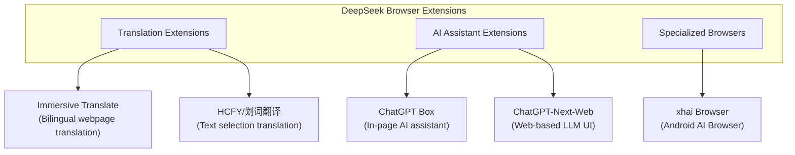
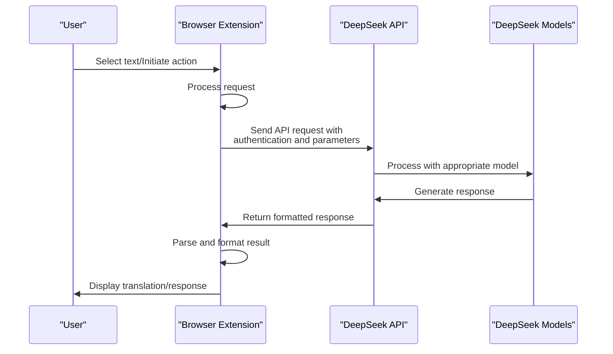
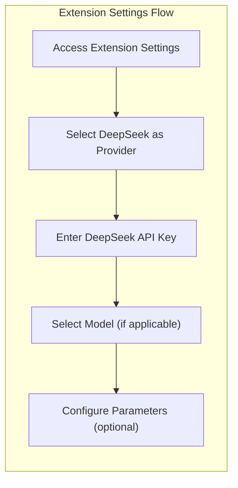

<!-- source: DeepWiki mcp.deepwiki.com · repo deepseek-ai/awesome-deepseek-integration · page 6 Browser Extensions · fetched 2026-10-30 -->

# Browser Extensions

Relevant source files

The following files were used as context for generating this wiki page:

- [.gitignore](.gitignore)
- [README.md](README.md)
- [README_cn.md](README_cn.md)
- [README_ja.md](README_ja.md)
- [docs/4EVERChat/README.md](docs/4EVERChat/README.md)
- [docs/4EVERChat/README_cn.md](docs/4EVERChat/README_cn.md)
- [docs/4EVERChat/README_ja.md](docs/4EVERChat/README_ja.md)
- [docs/bob_translate/README.md](docs/bob_translate/README.md)
- [docs/bob_translate/README_cn.md](docs/bob_translate/README_cn.md)
- [docs/chatbox/README.md](docs/chatbox/README.md)
- [docs/chatbox/README_cn.md](docs/chatbox/README_cn.md)
- [docs/chatgpt_box/README.md](docs/chatgpt_box/README.md)
- [docs/chatgpt_box/README_cn.md](docs/chatgpt_box/README_cn.md)
- [docs/chatgpt_next_web/README.md](docs/chatgpt_next_web/README.md)
- [docs/chatgpt_next_web/README_cn.md](docs/chatgpt_next_web/README_cn.md)
- [docs/hcfy/README.md](docs/hcfy/README.md)
- [docs/hcfy/README_cn.md](docs/hcfy/README_cn.md)
- [docs/immersive_translate/README.md](docs/immersive_translate/README.md)
- [docs/immersive_translate/README_cn.md](docs/immersive_translate/README_cn.md)
- [docs/pal/README.md](docs/pal/README.md)
- [docs/pal/README_cn.md](docs/pal/README_cn.md)
- [docs/xhai_browser/README.md](docs/xhai_browser/README.md)
- [docs/xhai_browser/README_cn.md](docs/xhai_browser/README_cn.md)
- [docs/xhai_browser/assets/deepseek3-4_2t.jpg](docs/xhai_browser/assets/deepseek3-4_2t.jpg)
- [docs/xhai_browser/assets/deepseek3-4t.jpg](docs/xhai_browser/assets/deepseek3-4t.jpg)
- [docs/xhai_browser/assets/desktop_512.png](docs/xhai_browser/assets/desktop_512.png)
- [docs/xhai_browser/assets/logo_512.png](docs/xhai_browser/assets/logo_512.png)

This page documents browser extensions that integrate with DeepSeek's API, enabling users to access DeepSeek's AI capabilities directly within their web browsers. These extensions span translation services, AI assistants, and specialized browsers with DeepSeek integration. For mobile applications with DeepSeek integration, see [Mobile Apps](#2), and for desktop applications, see [Desktop Applications](#2.2).

## Types of Browser Extensions

Browser extensions supporting DeepSeek can be categorized based on their primary functionality and integration approach.

Sources: [README.md:29-31](), [README_cn.md:31-32](), [README_ja.md:30-31]()

## Translation Extensions

Translation extensions leverage DeepSeek's language models to provide real-time translation capabilities directly in the browser.

### Immersive Translate

Immersive Translate is a bilingual webpage translation plugin that creates side-by-side translations of web content, supporting DeepSeek API integration.

**Key Features:**
- Parallel bilingual translation of entire webpages
- Customizable translation rules and preferences
- Multiple translation service providers including DeepSeek
- Preservation of original webpage formatting and structure

**DeepSeek Integration:**
The extension allows users to configure their DeepSeek API key through the settings menu, which enables the extension to leverage DeepSeek's language models for high-quality translations.

Sources: [docs/immersive_translate/README.md](), [docs/immersive_translate/README_cn.md]()

### HCFY (划词翻译)

HCFY is a browser translation plugin that provides text selection translation capabilities, supporting multiple translation APIs including DeepSeek.

**Key Features:**
- Text selection-based translation
- Multiple translation service integrations
- Customizable hotkeys and context menu options
- Dictionary lookups and definitions

**DeepSeek Integration:**
The plugin includes dedicated configuration options for DeepSeek API, allowing users to specify their API key and customize model parameters for optimal translation quality.

Sources: [docs/hcfy/README.md](), [docs/hcfy/README_cn.md]()

## Integration Architecture

Browser extensions that integrate with DeepSeek follow a common pattern for API communication and content processing.

### Common Integration Flow

Sources: [README.md:29-31](), [docs/immersive_translate/README.md](), [docs/hcfy/README.md]()

### API Configuration Pattern

Most browser extensions follow a similar pattern for DeepSeek API configuration:

Sources: [docs/immersive_translate/README.md:12-14](), [docs/hcfy/README.md:11-14](), [docs/chatgpt_box/README.md:11-12](), [docs/chatgpt_next_web/README.md:11-12]()

## AI Assistant Extensions

AI assistant extensions leverage DeepSeek's language models to provide content generation, summarization, and conversational capabilities directly in the browser.

### ChatGPT Box

ChatGPT Box integrates large language models including DeepSeek directly into the browser, providing in-context AI assistance.

**Key Features:**
- In-page AI assistance activated via context menu or keyboard shortcuts
- Multiple LLM provider support, including DeepSeek
- Content summarization and generation
- Customizable prompts and templates

**DeepSeek Integration:**
ChatGPT Box allows users to add DeepSeek as a provider through its settings interface, where users can configure their API key and model preferences.

Sources: [docs/chatgpt_box/README.md](), [docs/chatgpt_box/README_cn.md]()

### ChatGPT-Next-Web

ChatGPT-Next-Web provides a cross-platform web UI for ChatGPT and other large language models, including DeepSeek.

**Key Features:**
- Clean, intuitive user interface
- Support for multiple LLM providers
- Conversation history management
- Customizable settings and prompt templates

**DeepSeek Integration:**
Users can configure DeepSeek API access through the settings menu, which allows the application to connect to DeepSeek's models for conversation generation.

Sources: [docs/chatgpt_next_web/README.md](), [docs/chatgpt_next_web/README_cn.md]()

## Specialized Browsers

### xhai Browser

xhai Browser is an Android desktop management and AI browser application with DeepSeek integrated as the default AI dialog engine.

**Key Features:**
- Fast performance (0.2 seconds startup time)
- Compact size (3MB APK)
- Ad-free experience with ad blocking
- Multi-screen classification and navigation
- Integrated AI capabilities powered by DeepSeek

**DeepSeek Integration:**
Unlike extensions that require configuration, xhai Browser comes with DeepSeek pre-integrated as the default AI dialog engine, providing out-of-the-box AI capabilities.

Sources: [docs/xhai_browser/README.md](), [docs/xhai_browser/README_cn.md]()

## Integration Comparison

The following table compares key aspects of various browser extensions that integrate with DeepSeek:

| Extension | Type | Integration Method | Configuration Complexity | Primary Use Case |
|-----------|------|-------------------|--------------------------|------------------|
| Immersive Translate | Translation | API Key + Custom Parameters | Medium | Webpage Translation |
| HCFY | Translation | API Key + Custom Parameters | Medium | Selected Text Translation |
| ChatGPT Box | Assistant | API Key + Provider Selection | Medium | In-context AI Assistance |
| ChatGPT-Next-Web | Assistant | API Key + Model Selection | Medium | Conversational Interface |
| xhai Browser | Specialized Browser | Pre-integrated | None (Built-in) | Mobile AI Browsing |

Sources: [README.md:29-31](), [docs/immersive_translate/README.md](), [docs/hcfy/README.md](), [docs/chatgpt_box/README.md](), [docs/chatgpt_next_web/README.md](), [docs/xhai_browser/README.md]()

## Configuration Guide

### Obtaining a DeepSeek API Key

Most browser extensions require a DeepSeek API key for integration:

1. Visit the [DeepSeek Open Platform](https://platform.deepseek.com/)
2. Create an account or sign in
3. Navigate to the API management section
4. Generate a new API key
5. Copy the key for use in extension configuration

### Common Configuration Steps

While specific configuration interfaces vary, most extensions follow a similar pattern:

1. Access the extension's settings or options
2. Navigate to the API or model provider section
3. Select DeepSeek as a provider
4. Enter your DeepSeek API key
5. Select specific DeepSeek models if applicable
6. Configure additional parameters as needed
7. Save settings and test the integration

Sources: [README.md:9](), [docs/immersive_translate/README.md:12-14](), [docs/hcfy/README.md:11-14](), [docs/chatgpt_next_web/README.md:11-12]()

## Troubleshooting

Common issues when using DeepSeek with browser extensions:

1. **Authentication Errors**: Verify your API key is valid and correctly entered
2. **API Quota Limits**: Check if you've reached your usage limits
3. **Network Connectivity**: Ensure your browser can connect to DeepSeek's API servers
4. **Extension Compatibility**: Verify the extension version supports DeepSeek integration
5. **Browser Permissions**: Confirm the extension has necessary permissions for API communication

For extension-specific issues, refer to the documentation or GitHub repository of the respective extension.

Sources: [README.md:9]()

---

