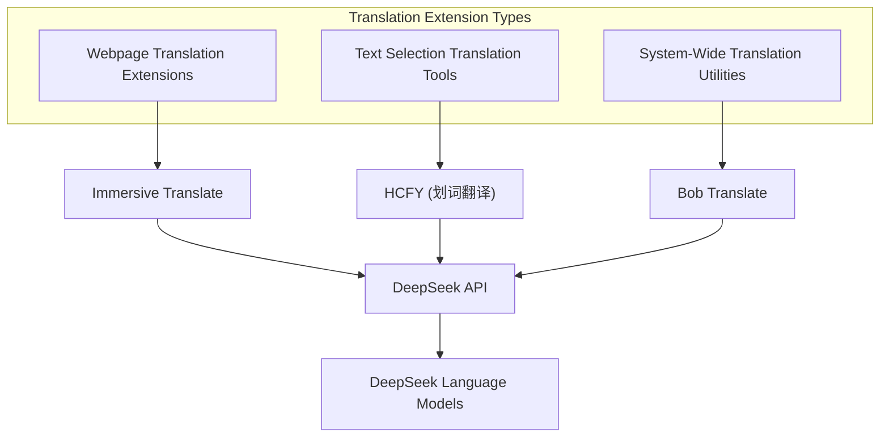
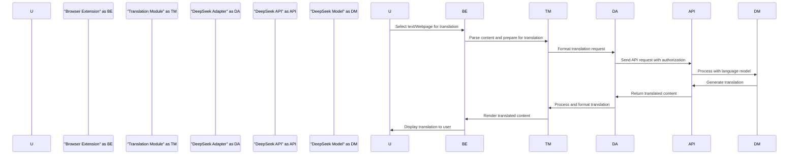
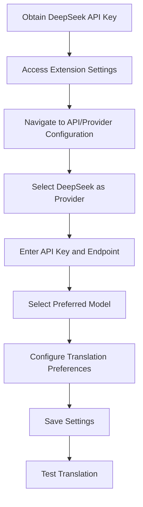
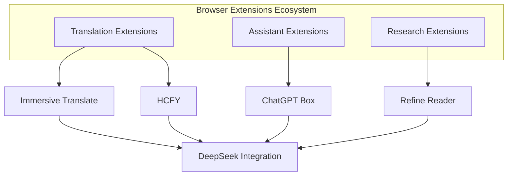

<!-- source: DeepWiki mcp.deepwiki.com · repo deepseek-ai/awesome-deepseek-integration · page 6.1 Translation Extensions · fetched 2026-10-30 -->

# Translation Extensions

Relevant source files

The following files were used as context for generating this wiki page:

- [docs/bob_translate/README.md](docs/bob_translate/README.md)
- [docs/bob_translate/README_cn.md](docs/bob_translate/README_cn.md)
- [docs/chatbox/README.md](docs/chatbox/README.md)
- [docs/chatbox/README_cn.md](docs/chatbox/README_cn.md)
- [docs/chatgpt_box/README.md](docs/chatgpt_box/README.md)
- [docs/chatgpt_box/README_cn.md](docs/chatgpt_box/README_cn.md)
- [docs/chatgpt_next_web/README.md](docs/chatgpt_next_web/README.md)
- [docs/chatgpt_next_web/README_cn.md](docs/chatgpt_next_web/README_cn.md)
- [docs/hcfy/README.md](docs/hcfy/README.md)
- [docs/hcfy/README_cn.md](docs/hcfy/README_cn.md)
- [docs/immersive_translate/README.md](docs/immersive_translate/README.md)
- [docs/immersive_translate/README_cn.md](docs/immersive_translate/README_cn.md)
- [docs/pal/README.md](docs/pal/README.md)
- [docs/pal/README_cn.md](docs/pal/README_cn.md)

This document covers browser extensions and translation tools that integrate with the DeepSeek API to provide enhanced translation capabilities. These extensions leverage DeepSeek's language models to deliver high-quality, context-aware translations directly within web browsers and other applications. For information about general browser assistant extensions, see [Assistant Extensions](#6.2).

## Overview of Translation Extensions

Translation extensions utilizing DeepSeek enhance the standard browser experience by offering powerful AI-driven translation capabilities. These tools enable users to translate web content while preserving context and nuance that traditional translation services might miss.

Sources: docs/immersive_translate/README.md, docs/hcfy/README.md, docs/bob_translate/README.md

## Key Translation Extensions

### Immersive Translate

Immersive Translate is a sophisticated bilingual webpage translation plugin that provides side-by-side views of original content and translations. It maintains webpage layout and formatting while delivering seamless translation experiences.

**Key Features:**
- Bilingual parallel translation of entire webpages
- Preservation of original page structure and formatting
- DeepSeek AI integration for natural-sounding translations
- Customizable translation display preferences

**Integration with DeepSeek API:**
Immersive Translate allows users to configure DeepSeek API access through its settings interface, providing a straightforward way to utilize DeepSeek's language models for translation tasks.

Sources: docs/immersive_translate/README.md, docs/immersive_translate/README_cn.md

### HCFY (划词翻译)

HCFY, or "划词翻译" (Huaci Fanyi, which means "select text to translate" in Chinese), is a versatile browser translation plugin that integrates multiple translation APIs including DeepSeek.

**Key Features:**
- Text selection translation with popup interface
- Support for multiple translation providers and LLM APIs
- Customizable user interface and keyboard shortcuts
- Context-aware translation capabilities

**Integration with DeepSeek API:**
HCFY provides dedicated configuration options for DeepSeek API, allowing users to input their API credentials and select preferred models for translation tasks.

Sources: docs/hcfy/README.md, docs/hcfy/README_cn.md

### Bob Translate

Bob Translate is a macOS-exclusive translation and OCR application that provides system-wide translation capabilities. While not strictly a browser extension, it complements browser-based workflows by offering translation services in any application.

**Key Features:**
- System-wide translation functionality on macOS
- Optical Character Recognition (OCR) for translating text in images
- Plugin ecosystem for extending functionality
- Efficient, minimalist interface

**Integration with DeepSeek API:**
Bob Translate supports DeepSeek integration through the OpenAI Translator plugin, which allows users to configure DeepSeek API access for translation tasks.

Sources: docs/bob_translate/README.md, docs/bob_translate/README_cn.md

## Translation Extension Architecture

Sources: docs/immersive_translate/README.md, docs/hcfy/README.md, docs/bob_translate/README.md

## Configuration Workflow

Setting up DeepSeek API in translation extensions typically follows this common pattern:

Sources: docs/immersive_translate/README.md, docs/hcfy/README.md, docs/bob_translate/README.md

## Detailed DeepSeek Integration Screenshots

### Immersive Translate Configuration

Sources: docs/immersive_translate/README.md

### HCFY Configuration

HCFY provides a comprehensive configuration interface for DeepSeek API integration:

1. Access to model selection:

2. API configuration settings:

3. Translation preferences:

Sources: docs/hcfy/README.md

### Bob Translate Configuration

Bob Translate requires the installation of the OpenAI Translator plugin to integrate with DeepSeek API. The plugin is available at: [https://github.com/openai-translator/bob-plugin-openai-translator](https://github.com/openai-translator/bob-plugin-openai-translator)

Sources: docs/bob_translate/README.md

## Use Cases and Advantages

### Primary Use Cases

| Use Case | Description | Best Tool |
|----------|-------------|-----------|
| Full webpage translation | Translating entire webpages while preserving layout | Immersive Translate |
| On-demand text translation | Translating selected portions of text on demand | HCFY |
| System-wide translation | Translating text across different applications | Bob Translate |
| Research across languages | Accessing and understanding content in foreign languages | All extensions |
| Language learning | Improving language skills through parallel text display | Immersive Translate |

### DeepSeek Advantages for Translation

- Context-aware translations that understand nuance
- Preservation of technical terminology accuracy
- Natural language output that reads fluently
- Handling of complex formatting and structures
- Consistent quality across many language pairs

Sources: docs/immersive_translate/README.md, docs/hcfy/README.md, docs/bob_translate/README.md

## Comparison with Other Platform Extensions

Translation extensions represent one category within the broader ecosystem of DeepSeek-integrated browser extensions. While focusing specifically on translation tasks, they share architectural similarities with other browser extensions that leverage DeepSeek's API.

Sources: docs/immersive_translate/README.md, docs/hcfy/README.md, docs/chatgpt_box/README.md

Translation extensions demonstrate the versatility of DeepSeek's API in handling specialized natural language processing tasks beyond general conversation, showing how the same underlying AI capabilities can be applied to specific use cases with appropriate interfaces.

---

