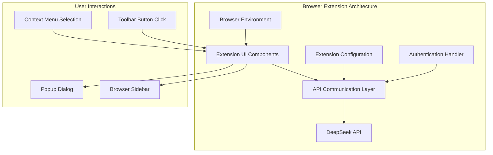
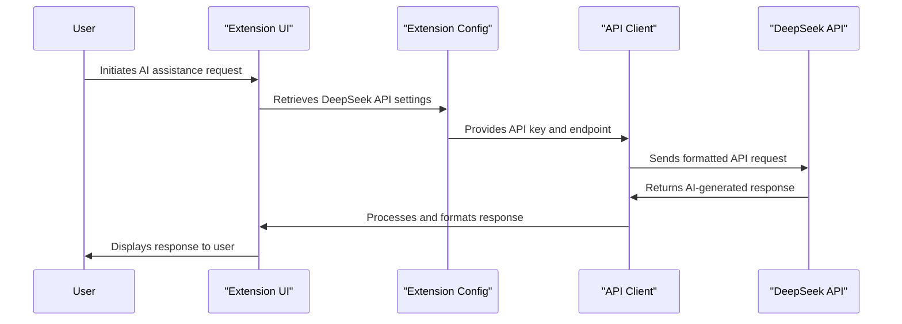
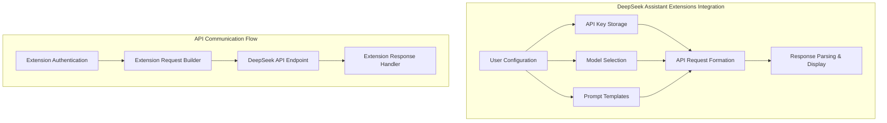

<!-- source: DeepWiki mcp.deepwiki.com · repo deepseek-ai/awesome-deepseek-integration · page 6.2 Assistant Extensions · fetched 2026-10-30 -->

# Assistant Extensions

Relevant source files

The following files were used as context for generating this wiki page:

- [docs/bob_translate/README.md](docs/bob_translate/README.md)
- [docs/chatbox/README.md](docs/chatbox/README.md)
- [docs/chatgpt_box/README.md](docs/chatgpt_box/README.md)
- [docs/chatgpt_next_web/README.md](docs/chatgpt_next_web/README.md)
- [docs/hcfy/README.md](docs/hcfy/README.md)
- [docs/immersive_translate/README.md](docs/immersive_translate/README.md)
- [docs/pal/README.md](docs/pal/README.md)

This page documents browser AI assistant extensions that integrate with the DeepSeek API. These extensions enable users to access DeepSeek's AI capabilities directly within their browsers, providing conversational AI assistance for various tasks. For translation-specific browser extensions, see [Translation Extensions](#6.1).

## Overview of Assistant Browser Extensions

Assistant browser extensions serve as convenient access points to AI capabilities, enabling users to interact with large language models without leaving their browser context. These tools differ from standalone applications by operating within the browser environment, typically as browser add-ons that can be invoked through context menus, popups, or sidebars.

Sources: docs/chatgpt_box/README.md, docs/chatgpt_next_web/README.md, docs/chatbox/README.md

## Key Extensions Supporting DeepSeek

Browser AI assistant extensions that integrate with DeepSeek offer various UI approaches and feature sets. The following comparison highlights the most notable implementations:

| Extension | Type | Key Features | UI Approach | Platforms |
|-----------|------|--------------|-------------|-----------|
| ChatGPT-Next-Web | Web UI | Multi-LLM support, conversation history, prompt templates | Web interface | Cross-platform |
| ChatGPT Box | Browser extension | In-page assistance, sidebar chat, context menu | Embedded overlay | Chrome, Firefox, Edge |
| Chatbox | Desktop application | Multi-model support, conversation management | Native desktop app | Windows, Mac, Linux |

Sources: docs/chatgpt_box/README.md, docs/chatgpt_next_web/README.md, docs/chatbox/README.md

### Integration Pattern

Sources: docs/chatgpt_box/README.md, docs/chatgpt_next_web/README.md, docs/chatbox/README.md

## ChatGPT-Next-Web

ChatGPT-Next-Web is a well-designed cross-platform web UI for interacting with multiple LLM providers, including DeepSeek. It offers a comprehensive interface with conversation management capabilities.

### Features
- Clean, intuitive chat interface
- Support for multiple LLMs including DeepSeek
- Conversation history management
- Customizable system prompts
- Cross-platform accessibility

### DeepSeek Integration
ChatGPT-Next-Web provides direct integration with DeepSeek API through its model selection interface, allowing users to configure their API key and select from available DeepSeek models.

Sources: docs/chatgpt_next_web/README.md

## ChatGPT Box

ChatGPT Box is a browser extension that deeply integrates LLMs, including DeepSeek, directly into the browsing experience. It provides multiple access methods within the browser interface.

### Features
- Context menu integration for targeted assistance
- Floating window for chat interactions
- Multiple LLM provider support
- Free to use (requires user's API keys)

### DeepSeek Integration
ChatGPT Box allows users to configure the DeepSeek API as one of their LLM providers through the extension settings, enabling access to DeepSeek's capabilities throughout the browsing experience.

Sources: docs/chatgpt_box/README.md

## Chatbox

Chatbox is a desktop application that functions as a client for multiple LLM models, including DeepSeek. Though not strictly a browser extension, it provides similar assistant functionality in a dedicated desktop environment.

### Features
- Native desktop application for Windows, Mac, and Linux
- Support for multiple LLM providers
- Conversation management
- Customizable interface

### DeepSeek Integration
Chatbox allows users to configure DeepSeek API access through its settings interface, providing access to DeepSeek's models alongside other LLM providers.

Sources: docs/chatbox/README.md

## Common Integration Patterns

Sources: docs/chatgpt_box/README.md, docs/chatgpt_next_web/README.md, docs/chatbox/README.md

## Configuration Considerations

Most DeepSeek-integrated assistant extensions require similar configuration elements:

1. **API Key**: A valid DeepSeek API key that must be obtained and entered by the user
2. **Model Selection**: Choice between available DeepSeek models (e.g., deepseek-chat, deepseek-coder)
3. **API Parameters**: Configuration of temperature, max tokens, and other generation parameters
4. **System Prompts**: Customizable prompts to configure the assistant's behavior

Users typically need to provide their own DeepSeek API key through the extension's settings interface. This approach allows the extensions to remain free to use while providing access to DeepSeek's capabilities.

Sources: docs/chatgpt_box/README.md, docs/chatgpt_next_web/README.md, docs/chatbox/README.md

## Security Considerations

Browser assistant extensions implementing DeepSeek API integration should consider these security aspects:

1. **API Key Storage**: API keys should be securely stored using browser's secure storage mechanisms
2. **Data Privacy**: Clear communication about what user data is sent to DeepSeek API
3. **Permission Scope**: Minimal permission requirements for browser extension functionality
4. **Content Security**: Proper sanitization of AI-generated responses before rendering

These considerations help ensure that users' API credentials and interaction data remain secure while using DeepSeek-integrated browser assistants.

Sources: docs/chatgpt_box/README.md, docs/chatgpt_next_web/README.md

## Conclusion

Browser assistant extensions provide convenient access to DeepSeek's AI capabilities within the web browsing context. Through various integration approaches, these extensions enable users to interact with DeepSeek models without leaving their browser, enhancing productivity and accessibility. The flexible configuration options allow users to customize their experience according to their specific needs while maintaining control over their API access.

---

