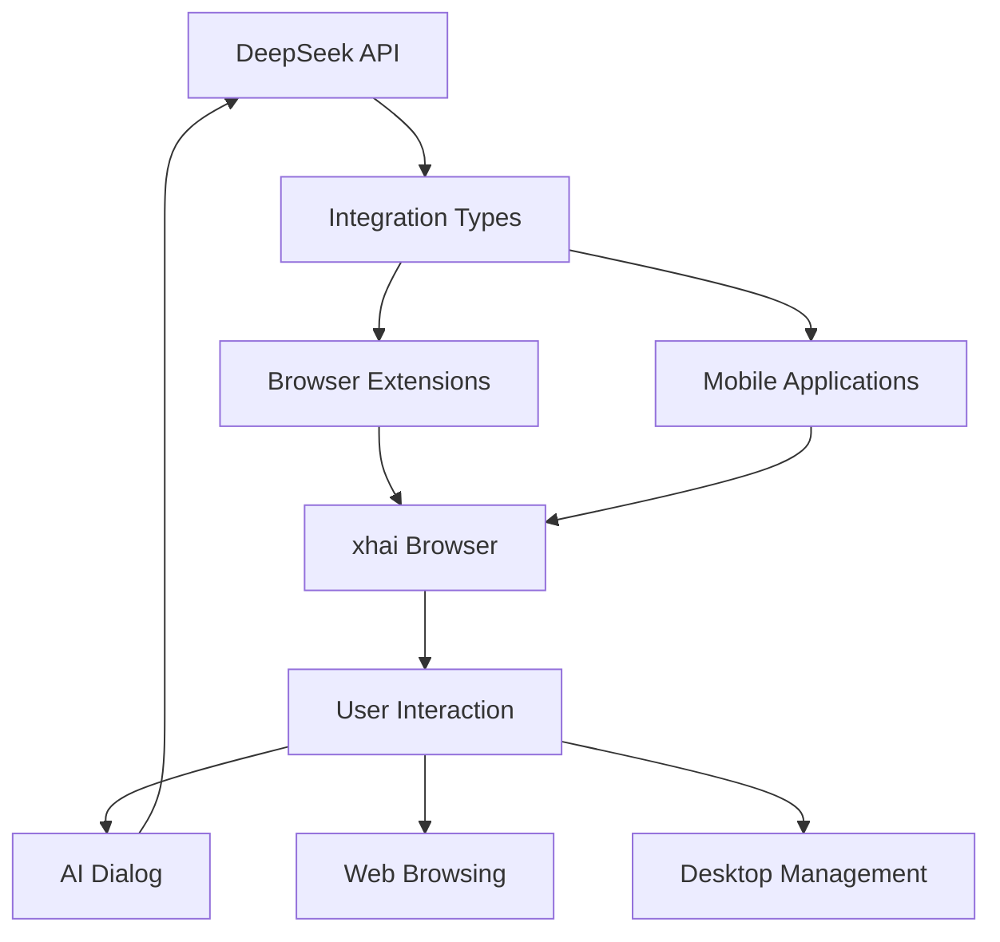
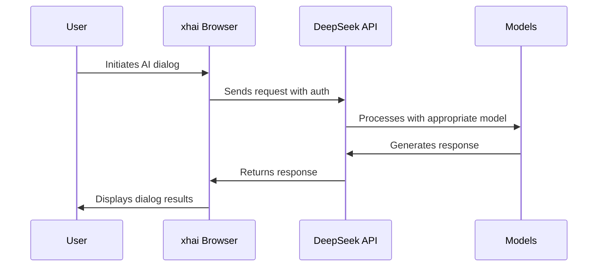
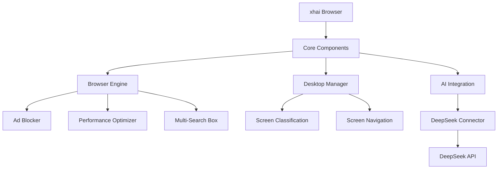

<!-- source: DeepWiki mcp.deepwiki.com · repo deepseek-ai/awesome-deepseek-integration · page 6.3 xhai Browser · fetched 2026-10-30 -->

# xhai Browser

Relevant source files

The following files were used as context for generating this wiki page:

- [.gitignore](.gitignore)
- [docs/xhai_browser/README.md](docs/xhai_browser/README.md)
- [docs/xhai_browser/README_cn.md](docs/xhai_browser/README_cn.md)
- [docs/xhai_browser/assets/deepseek3-4_2t.jpg](docs/xhai_browser/assets/deepseek3-4_2t.jpg)
- [docs/xhai_browser/assets/deepseek3-4t.jpg](docs/xhai_browser/assets/deepseek3-4t.jpg)
- [docs/xhai_browser/assets/desktop_512.png](docs/xhai_browser/assets/desktop_512.png)
- [docs/xhai_browser/assets/logo_512.png](docs/xhai_browser/assets/logo_512.png)

## Purpose and Scope

This document covers the xhai Browser Android application and its integration with DeepSeek AI. This lightweight, high-performance browser uses DeepSeek as its default AI dialog engine. For information about other browser extensions that integrate with DeepSeek, see [Browser Extensions](#6).

## Overview

xhai Browser (derived from "xiaohai" in Chinese, meaning "extreme, high-performance, AI Browser") is an Android application that functions as both a desktop management tool and an AI-powered browser. It demonstrates a mobile implementation of DeepSeek AI integration.

Key characteristics include:
- Performance: 0.2 seconds startup time
- Size: 3MB APK package
- Features: No ads, ultra-fast ad blocking, multi-screen classification, screen navigation
- Search: Multiple search box functionality with single-box multi-search capability
- AI: Native DeepSeek AI dialog integration

Sources: docs/xhai_browser/README.md, docs/xhai_browser/README_cn.md

## DeepSeek Integration

### DeepSeek Ecosystem Position

xhai Browser integrates with DeepSeek as its default AI dialog engine, making it part of the broader DeepSeek integration ecosystem. It represents how DeepSeek can be incorporated into a mobile browser context while maintaining high performance standards.

Sources: docs/xhai_browser/README.md

## AI Dialog Flow

The communication between user, xhai Browser, and DeepSeek follows the standard integration pattern for DeepSeek implementations. When a user initiates an AI interaction through the browser's interface, the request is authenticated and sent to the DeepSeek API, which processes it using the appropriate AI model and returns the response for display within the browser.

Sources: docs/xhai_browser/README.md

## User Interface

The xhai Browser provides a dedicated interface for DeepSeek AI dialog, as shown in the documentation screenshots. This interface allows users to interact with DeepSeek's AI capabilities directly within the browser environment.

The UI demonstrates how AI functionality can be integrated into a browser experience, allowing for seamless transitions between web browsing and AI assistance. The interface appears to maintain the browser's overall focus on performance and efficiency while providing access to DeepSeek's capabilities.

Sources: docs/xhai_browser/assets/deepseek3-4t.jpg, docs/xhai_browser/assets/deepseek3-4_2t.jpg

## Browser Architecture Components

The browser's architecture combines three main component sets:
1. A lightweight browser engine with ad blocking and multi-search capabilities
2. A desktop management system for organizing content 
3. The DeepSeek AI integration layer

This design enables the browser to maintain its performance characteristics (0.2-second startup time, 3MB size) while still providing advanced features including AI dialog capabilities.

Sources: docs/xhai_browser/README.md, docs/xhai_browser/README_cn.md

## Integration Significance

xhai Browser demonstrates how DeepSeek AI can be integrated into a performance-focused mobile application. This integration exemplifies how DeepSeek can enhance mobile browsing experiences while maintaining performance efficiency.

The browser serves as an example of:
- Mobile AI integration with DeepSeek
- Performance-optimized AI implementation
- Combined desktop management and AI-powered browsing

This implementation shows the versatility of the DeepSeek API, demonstrating its ability to enhance mobile applications without compromising performance - a particularly important consideration for mobile platforms.

Sources: docs/xhai_browser/README.md, docs/xhai_browser/README_cn.md

## Documentation Note

This documentation is based on the information available in the repository, which includes descriptive documentation about xhai Browser but not its source code. The architectural diagrams represent conceptual models based on the described functionality.

---

