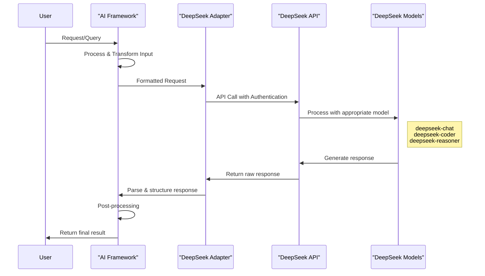
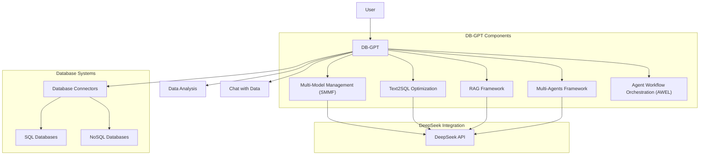
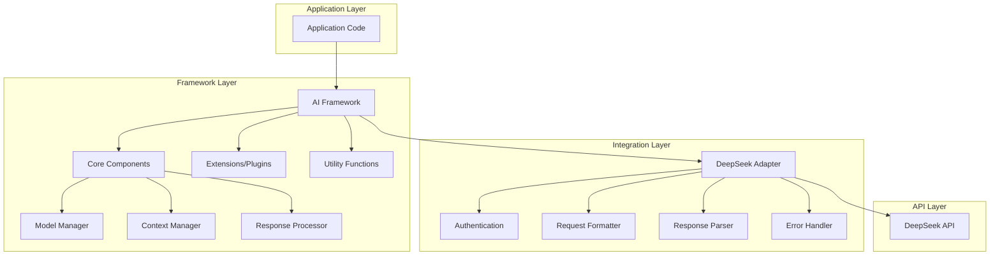

<!-- source: DeepWiki mcp.deepwiki.com · repo deepseek-ai/awesome-deepseek-integration · page 7 AI Frameworks · fetched 2026-10-30 -->

# AI Frameworks

Relevant source files

The following files were used as context for generating this wiki page:

- [README.md](README.md)
- [README_cn.md](README_cn.md)
- [README_ja.md](README_ja.md)
- [docs/4EVERChat/README.md](docs/4EVERChat/README.md)
- [docs/4EVERChat/README_cn.md](docs/4EVERChat/README_cn.md)
- [docs/4EVERChat/README_ja.md](docs/4EVERChat/README_ja.md)
- [docs/agentUniverse/README.md](docs/agentUniverse/README.md)
- [docs/agentUniverse/README_cn.md](docs/agentUniverse/README_cn.md)
- [docs/agentUniverse/README_ja.md](docs/agentUniverse/README_ja.md)
- [docs/agentUniverse/assets/agentUniverse_logo.jpg](docs/agentUniverse/assets/agentUniverse_logo.jpg)
- [docs/agentUniverse/assets/agentUniverse_logo_s.png](docs/agentUniverse/assets/agentUniverse_logo_s.png)
- [docs/dbgpt/README.md](docs/dbgpt/README.md)
- [docs/dbgpt/README_cn.md](docs/dbgpt/README_cn.md)
- [docs/dbgpt/assets/dbgpt_chat_data.jpg](docs/dbgpt/assets/dbgpt_chat_data.jpg)
- [docs/dbgpt/assets/dbgpt_chat_data_en.jpg](docs/dbgpt/assets/dbgpt_chat_data_en.jpg)
- [docs/dbgpt/assets/dbgpt_datasource.jpg](docs/dbgpt/assets/dbgpt_datasource.jpg)
- [docs/dbgpt/assets/dbgpt_datasource_en.jpg](docs/dbgpt/assets/dbgpt_datasource_en.jpg)
- [docs/dbgpt/assets/dbgpt_ui.jpg](docs/dbgpt/assets/dbgpt_ui.jpg)
- [docs/dbgpt/assets/dbgpt_ui_en.jpg](docs/dbgpt/assets/dbgpt_ui_en.jpg)
- [docs/huixiangdou/README.md](docs/huixiangdou/README.md)
- [docs/huixiangdou/README_cn.md](docs/huixiangdou/README_cn.md)
- [docs/translate.js/README.md](docs/translate.js/README.md)
- [docs/translate.js/README_cn.md](docs/translate.js/README_cn.md)
- [docs/translate.js/README_ja.md](docs/translate.js/README_ja.md)
- [docs/translate.js/assets/application_properties_demo.png](docs/translate.js/assets/application_properties_demo.png)
- [docs/translate.js/assets/html_demo.gif](docs/translate.js/assets/html_demo.gif)
- [docs/translate.js/assets/icon.png](docs/translate.js/assets/icon.png)
- [docs/translate.js/assets/site_demo.png](docs/translate.js/assets/site_demo.png)
- [docs/translate.js/assets/texts_translate_api_demo.png](docs/translate.js/assets/texts_translate_api_demo.png)

This document provides an overview of AI frameworks that integrate with the DeepSeek API. These frameworks serve as intermediary layers that abstract and extend DeepSeek's capabilities, enabling developers to build more complex AI applications with specialized functionality. For specific implementations and details about individual frameworks, see [Agent Frameworks](#7.1) and [Data AI Frameworks](#7.2).

## Framework Categories

The DeepSeek integration ecosystem supports various types of AI frameworks, each serving different purposes and use cases:

```mermaid
graph TD
    DeepSeek["DeepSeek API"] --> AgentFrameworks["Agent Frameworks"]
    DeepSeek --> DataFrameworks["Data AI Frameworks"]
    DeepSeek --> RAGFrameworks["RAG Frameworks"]
    DeepSeek --> FHEFrameworks["FHE Frameworks"]
    DeepSeek --> BlockchainFrameworks["Blockchain Frameworks"]
    DeepSeek --> DataCuration["Synthetic Data Curation"]
    
    subgraph "Agent Frameworks"
        AgentFrameworks --> smolagents["smolagents"]
        AgentFrameworks --> YoMo["YoMo"]
        AgentFrameworks --> SuperAgentX["SuperAgentX"]
        AgentFrameworks --> Anda["Anda"]
        AgentFrameworks --> AgentUniverse["agentUniverse"]
    end
    
    subgraph "Data AI Frameworks"
        DataFrameworks --> DBGPT["DB-GPT"]
        DataFrameworks --> Eino["Eino"]
    end
    
    subgraph "RAG Frameworks"
        RAGFrameworks --> RAGFlow["RAGFlow"]
        RAGFrameworks --> AutoFlow["AutoFlow"]
        RAGFrameworks --> DeepSearcher["DeepSearcher"]
        RAGFrameworks --> KAG["KAG"]
    end
    
    subgraph "FHE & Blockchain"
        FHEFrameworks --> MindFHE["Mind FHE SDK"]
        BlockchainFrameworks --> SolanaKit["Solana Agent Kit"]
    end
    
    subgraph "Data Curation"
        DataCuration --> Dingo["Dingo"]
    end
    
    classDef default fill:#f9f9f9,stroke:#333,stroke-width:1px;
```

Sources: [README.md:424-433](), [README.md:435-448](), [README.md:410-422](), [README.md:452-460](), [README.md:464-472](), [README.md:476-484]()

## Integration Architecture

AI frameworks typically integrate with DeepSeek through a structured architecture that processes user inputs, transforms them into appropriate API calls, and manages the responses:

Sources: [README.md:84-107](), [README.md:437-448]()

## Framework Types and Capabilities

### Agent Frameworks

Agent frameworks facilitate the development of AI agents that can perform complex tasks, make decisions, and execute actions using DeepSeek's language models.

| Framework | Key Features | Use Cases |
|-----------|--------------|-----------|
| smolagents | Simple agent construction, prioritizes open models | Building task-specific agents, orchestration |
| YoMo | Stateful serverless LLM function calling, strongly-typed support | Real-time data processing, streaming applications |
| SuperAgentX | Lightweight framework for autonomous multi-agent applications | Complex collaborative tasks, AGI capabilities |
| Anda | Rust-based framework for AI agent development | Highly composable agent networks with persistent memory |
| agentUniverse | Multi-agent collaboration framework | Complex business scenarios, agent coordination |

Sources: [README.md:437-448](), [README.md:449-453](), [README.md:454-458](), [README.md:459-463]()

### Data AI Frameworks

Data AI frameworks focus on integrating DeepSeek with database systems and data processing pipelines.

| Framework | Key Features | Use Cases |
|-----------|--------------|-----------|
| DB-GPT | AI native data app development framework, AWEL support | Text2SQL, database interaction, data analysis |
| Eino | Go language LLM application framework | Building data-focused AI applications with Go |

The DB-GPT framework is particularly notable for its comprehensive integration with database systems:

Sources: [docs/dbgpt/README.md:1-11](), [docs/dbgpt/README_cn.md:1-6]()

### RAG Frameworks

Retrieval-Augmented Generation (RAG) frameworks enhance DeepSeek's capabilities by integrating external knowledge retrieval.

| Framework | Key Features | Use Cases |
|-----------|--------------|-----------|
| RAGFlow | Deep document understanding | Q&A with source citations, document analysis |
| Autoflow | GraphRAG-based knowledge base tool | Perplexity-like search, website integration |
| DeepSearcher | Combines LLMs with vector databases | Private data search, evaluation, reasoning |
| KAG | Based on OpenSPG engine, logical reasoning | Vertical domain knowledge bases, multi-hop reasoning |

Sources: [README.md:424-433]()

### Specialized Frameworks

#### FHE Frameworks

Fully Homomorphic Encryption (FHE) frameworks enable computation on encrypted data, preserving privacy while leveraging DeepSeek's capabilities.

| Framework | Description |
|-----------|-------------|
| Mind FHE Rust SDK | Open-source SDK for encrypted AI using FHE, enabling agent consensus while protecting privacy |

#### Blockchain Frameworks

These frameworks connect AI agents to blockchain systems, enabling autonomous interactions with blockchain protocols.

| Framework | Description |
|-----------|-------------|
| Solana Agent Kit | Open-source toolkit connecting AI agents to the Solana protocol, enabling autonomous execution of Solana operations |

#### Synthetic Data Curation

Tools focused on evaluating and curating synthetic data for AI training and fine-tuning.

| Framework | Description |
|-----------|-------------|
| Dingo | Comprehensive data quality assessment tool |

Sources: [README.md:452-460](), [README.md:464-472](), [README.md:476-484]()

## Framework-to-Codebase Mapping

The following diagram maps key AI frameworks to their underlying code repositories and components:

```mermaid
graph TD
    subgraph "DeepSeek Integration"
        DeepSeekAPI["DeepSeek API"]
    end
    
    subgraph "Agent Frameworks"
        AgentFrameworks["Agent Frameworks"] --> smolagentsRepo["huggingface/smolagents"]
        AgentFrameworks --> AndaRepo["panda-fans/anda"]
        AgentFrameworks --> SuperAgentXRepo["superagentxai/superagentX"]
        AgentFrameworks --> YoMoRepo["yomo-run"]
    end
    
    subgraph "Data AI Frameworks"
        DataFrameworks["Data AI Frameworks"] --> DBGPTRepo["eosphoros-ai/DB-GPT"]
        DBGPTRepo --> SMMF["Multi-model management"]
        DBGPTRepo --> Text2SQL["Text2SQL optimization"]
        DBGPTRepo --> RAGFramework["RAG framework"]
        DBGPTRepo --> MultiAgents["Multi-Agents framework"]
        DBGPTRepo --> AWEL["Agent workflow orchestration"]
        
        DataFrameworks --> EinoRepo["cloudwego/eino"]
    end
    
    subgraph "RAG Frameworks"
        RAGFrameworks["RAG Frameworks"] --> RAGFlowRepo["RAGFlow implementation"]
        RAGFrameworks --> AutoFlowRepo["pingcap/autoflow"]
        RAGFrameworks --> DeepSearcherRepo["zilliztech/deep-searcher"]
        RAGFrameworks --> KAGRepo["OpenSPG/KAG"]
    end
    
    DeepSeekAPI --> AgentFrameworks
    DeepSeekAPI --> DataFrameworks
    DeepSeekAPI --> RAGFrameworks
    
    DBGPTRepo --> DataAnalysis["Data analysis components"]
    DBGPTRepo --> Chat["Chat with data interfaces"]
    DBGPTRepo --> DBConnectors["Database connectors"]
```

Sources: [docs/dbgpt/README.md:1-19](), [README.md:437-448](), [README.md:410-422]()

## Integration Patterns

AI frameworks typically integrate with DeepSeek following several common patterns:

1. **API Wrapper**: Most frameworks implement adapter components that wrap the DeepSeek API, handling authentication, request formatting, and response parsing.

2. **Model Selection**: Frameworks often provide mechanisms to select specific DeepSeek models (deepseek-chat, deepseek-coder, etc.) based on task requirements.

3. **Context Management**: Many frameworks implement context window management to optimize token usage and handle longer conversations.

4. **Error Handling**: Robust error handling for API limits, connection issues, and other potential failures.

5. **Extension Points**: Frameworks typically expose hooks or extension points that allow developers to customize behavior at various stages of the interaction flow.

The following diagram illustrates the typical component structure of AI frameworks integrating with DeepSeek:

Sources: [README.md:84-107](), [README.md:437-448]()

## Framework Selection Guide

When selecting an AI framework for DeepSeek integration, consider these key factors:

| Category | Considerations |
|----------|----------------|
| **Task Complexity** | Simple tasks may require only basic frameworks, while complex autonomous behaviors benefit from agent frameworks |
| **Development Language** | Match the framework to your tech stack (Python, Go, Rust, etc.) |
| **Specialization** | Choose frameworks designed for your domain (data, document processing, agents, etc.) |
| **Integration Effort** | Consider the complexity of integrating the framework with existing systems |
| **Performance Requirements** | Evaluate frameworks based on throughput, latency, and resource efficiency |
| **Community & Support** | Consider the activity level of the framework's community and available support |

Sources: [README.md:424-484]()

## Conclusion

AI frameworks provide powerful abstractions that simplify the process of building complex AI applications with DeepSeek. By choosing the right framework for your specific use case, you can accelerate development, ensure best practices, and unlock advanced capabilities like agent autonomy, data analysis, document retrieval, and more. For more detailed information about specific framework types, refer to the dedicated pages on [Agent Frameworks](#7.1) and [Data AI Frameworks](#7.2).

---

