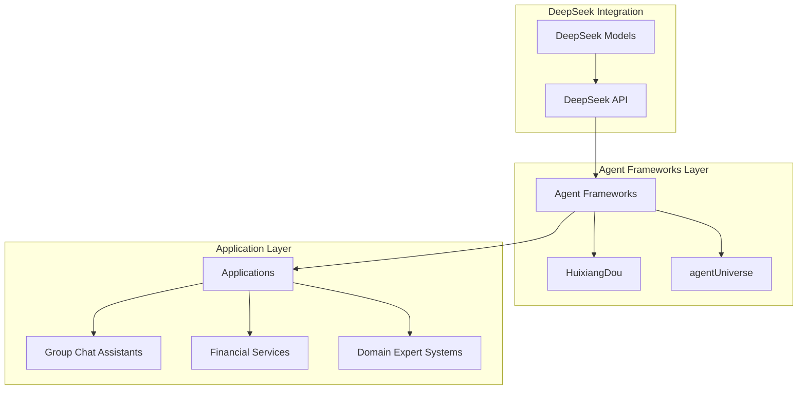
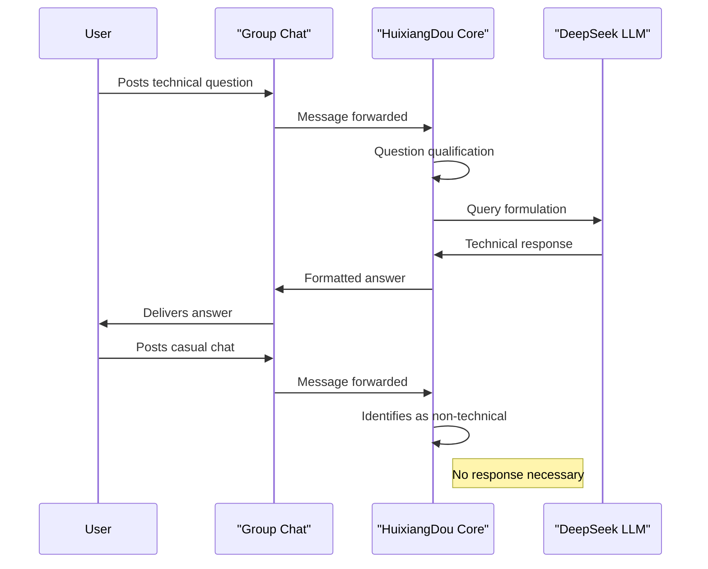
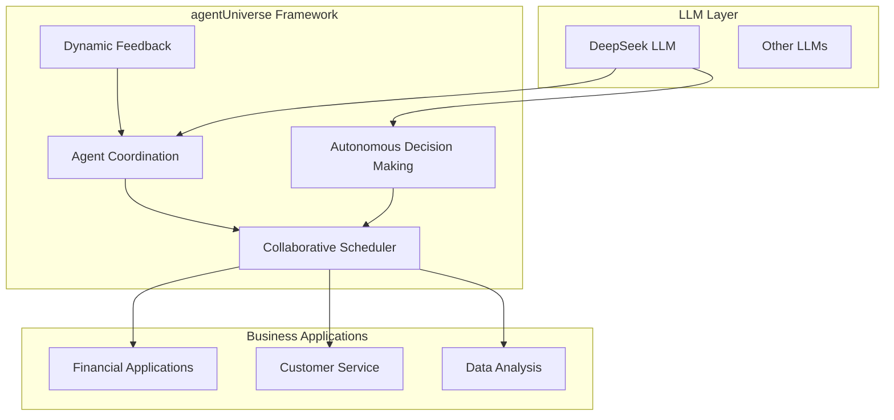
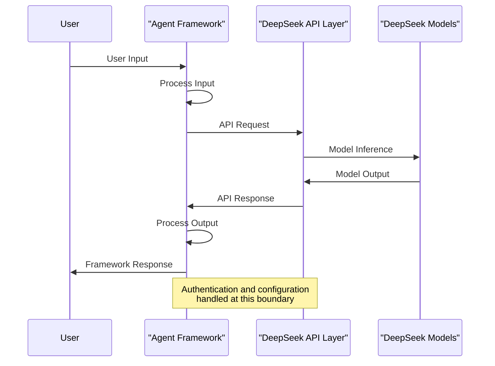

<!-- source: DeepWiki mcp.deepwiki.com · repo deepseek-ai/awesome-deepseek-integration · page 7.1 Agent Frameworks · fetched 2026-10-30 -->

# Agent Frameworks

<details>
<summary>Relevant source files</summary>

The following files were used as context for generating this wiki page:

- [docs/agentUniverse/README.md](docs/agentUniverse/README.md)
- [docs/agentUniverse/README_cn.md](docs/agentUniverse/README_cn.md)
- [docs/agentUniverse/README_ja.md](docs/agentUniverse/README_ja.md)
- [docs/agentUniverse/assets/agentUniverse_logo.jpg](docs/agentUniverse/assets/agentUniverse_logo.jpg)
- [docs/agentUniverse/assets/agentUniverse_logo_s.png](docs/agentUniverse/assets/agentUniverse_logo_s.png)
- [docs/huixiangdou/README.md](docs/huixiangdou/README.md)
- [docs/huixiangdou/README_cn.md](docs/huixiangdou/README_cn.md)

</details>


This page documents the agent frameworks that integrate with DeepSeek's models and APIs. These frameworks provide structured environments for building sophisticated AI applications using DeepSeek's large language models. For information about data-specific AI frameworks, see [Data AI Frameworks](#7.2).

## Introduction to Agent Frameworks

Agent frameworks provide architectures and tools for creating AI systems that can perform complex tasks with varying degrees of autonomy. In the context of DeepSeek integration, these frameworks leverage DeepSeek's language models to power intelligent agents that can understand, reason, and act based on natural language instructions and environmental context.

The frameworks documented here range from domain-specific assistants to comprehensive multi-agent collaboration platforms, each designed to solve different types of problems.



**Diagram: Agent Frameworks in the DeepSeek Ecosystem**

Sources: [docs/huixiangdou/README.md](), [docs/agentUniverse/README.md]()

## HuixiangDou: Domain Knowledge Assistant Framework

HuixiangDou (茴香豆) is a domain knowledge assistant framework built on top of LLMs, including DeepSeek models. It is specifically designed to handle complex scenarios such as group chat environments where traditional chatbots might struggle.

### Key Features

- **Selective Response**: Only responds to relevant technical questions, ignoring idle chat
- **Algorithm-driven**: Uses a specialized algorithm pipeline rather than additional training
- **Low Deployment Cost**: Efficient infrastructure requirements
- **Battle-tested**: Has been used by thousands of users with over 20,000 interactions



**Diagram: HuixiangDou Interaction Flow**

Sources: [docs/huixiangdou/README.md](), [docs/huixiangdou/README_cn.md]()

### DeepSeek Integration

HuixiangDou can be configured to use DeepSeek's LLM through its configuration file. The integration involves setting up API credentials and model parameters.

#### Configuration Steps

1. Obtain a token from the DeepSeek open platform
2. Configure the `config.ini` file with DeepSeek parameters:

```ini
[llm]
enable_local = 0
enable_remote = 1
..
[llm.server]
..
remote_type = "deepseek"
remote_api_key = "YOUR-API-KEY"
remote_llm_max_text_length = 16000
remote_llm_model = "deepseek-chat"
```

3. Run the application with: `python3 -m huixiangdou.main --standalone`

Sources: [docs/huixiangdou/README.md:33-52](), [docs/huixiangdou/README_cn.md:36-58]()

## agentUniverse: Multi-Agent Collaboration Framework

agentUniverse is a comprehensive multi-agent collaboration framework designed for complex business scenarios. Originally developed from Ant Group's financial industry experiences, it now features full integration with DeepSeek models.

### Key Features

- **Multi-Agent Collaboration**: Enables coordination among multiple specialized agents
- **Autonomous Decision-Making**: Agents can make independent decisions based on context
- **Dynamic Feedback Mechanisms**: Systems for providing and incorporating feedback
- **Business-Oriented Design**: Built to handle complex real-world business scenarios



**Diagram: agentUniverse Architecture**

Sources: [docs/agentUniverse/README.md](), [docs/agentUniverse/README_cn.md]()

### DeepSeek Integration

agentUniverse offers two methods for integrating with DeepSeek API:

#### Method 1: Python Environment Variables

```python
import os
os.environ['DEEPSEEK_API_KEY'] = 'sk-***'
os.environ['DEEPSEEK_API_BASE'] = 'https://xxxxxx'  # Optional
```

#### Method 2: Configuration File

Add to `custom_key.toml` under the config directory:

```toml
DEEPSEEK_API_KEY="sk-******"
DEEPSEEK_API_BASE="https://xxxxxx"  # Optional
```

Sources: [docs/agentUniverse/README.md:16-27](), [docs/agentUniverse/README_cn.md:16-29](), [docs/agentUniverse/README_ja.md:16-27]()

## Comparison of Agent Frameworks

Both HuixiangDou and agentUniverse provide integration with DeepSeek, but they serve different purposes and use cases.

| Framework | Primary Purpose | Key Features | Optimal Use Case |
|-----------|----------------|--------------|------------------|
| HuixiangDou | Domain knowledge assistant | Message filtering, Group chat focused, Algorithm-driven | Technical support, Community forums, Knowledge sharing platforms |
| agentUniverse | Multi-agent collaboration | Complex workflows, Business process automation, Autonomous decision-making | Financial services, Enterprise applications, Complex business processes |

Sources: [docs/huixiangdou/README.md](), [docs/agentUniverse/README.md]()

## Integration Flow Pattern

Both frameworks follow a similar pattern for integrating with DeepSeek's API, though they implement it differently based on their specific architectures.



**Diagram: Common Integration Flow Pattern**

Sources: [docs/huixiangdou/README.md:30-53](), [docs/agentUniverse/README.md:14-29]()

## Best Practices for Agent Frameworks

When working with agent frameworks and DeepSeek integration, consider these best practices:

1. **Secure API Key Management**: Store API keys securely, either as environment variables or in protected configuration files
2. **Error Handling**: Implement robust error handling for API calls, particularly for network issues or rate limiting
3. **Model Selection**: Choose the appropriate DeepSeek model based on the specific requirements of your application
4. **Context Management**: Be mindful of token limits and optimize prompt construction 
5. **Testing**: Thoroughly test agent behavior under various scenarios before deployment

Sources: [docs/huixiangdou/README.md](), [docs/agentUniverse/README.md]()

## Summary

Agent frameworks like HuixiangDou and agentUniverse extend the capabilities of DeepSeek's language models by providing structured environments for creating sophisticated AI applications. They handle the complexity of agent coordination, decision-making, and integration with the underlying LLM, allowing developers to focus on building domain-specific solutions.

Whether you need a domain knowledge assistant for technical support or a multi-agent system for complex business processes, these frameworks provide the foundation for leveraging DeepSeek's powerful language models in agent-based applications.

---

