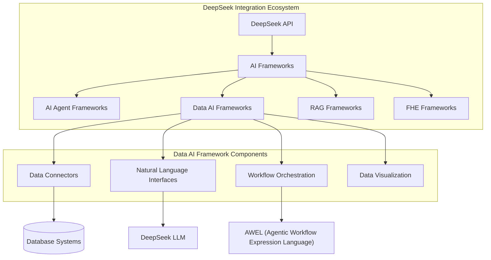
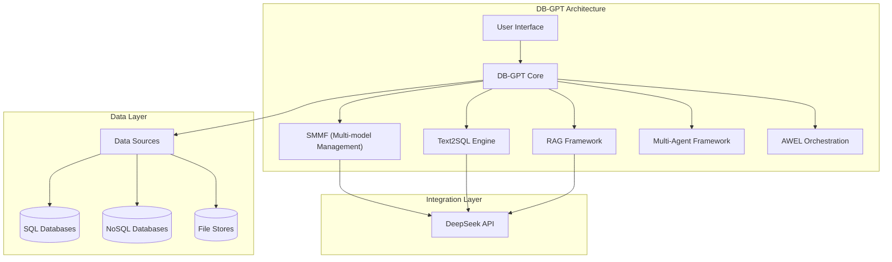
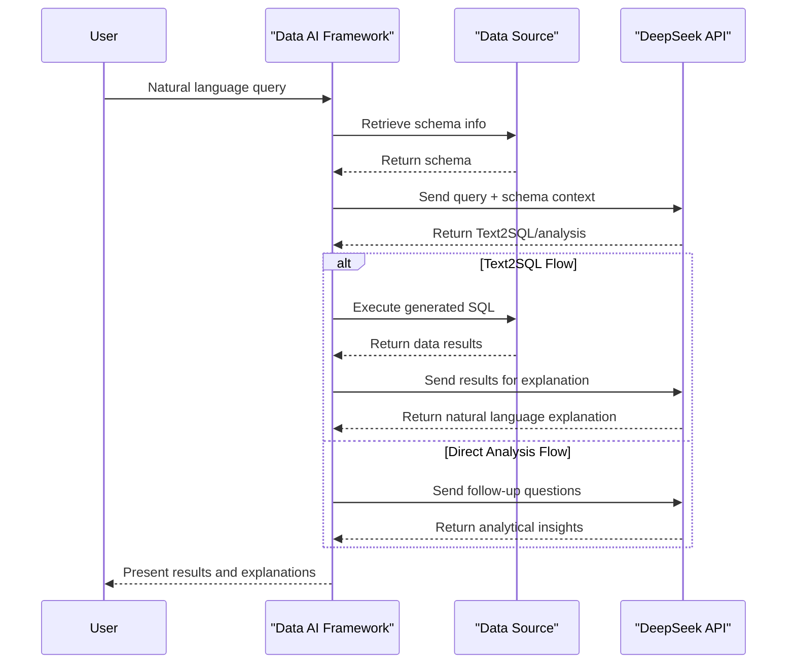
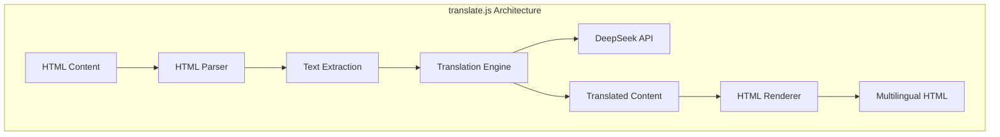

<!-- source: DeepWiki mcp.deepwiki.com · repo deepseek-ai/awesome-deepseek-integration · page 7.2 Data AI Frameworks · fetched 2026-10-30 -->

# Data AI Frameworks

Relevant source files

The following files were used as context for generating this wiki page:

- [docs/dbgpt/README.md](docs/dbgpt/README.md)
- [docs/dbgpt/README_cn.md](docs/dbgpt/README_cn.md)
- [docs/dbgpt/assets/dbgpt_chat_data.jpg](docs/dbgpt/assets/dbgpt_chat_data.jpg)
- [docs/dbgpt/assets/dbgpt_chat_data_en.jpg](docs/dbgpt/assets/dbgpt_chat_data_en.jpg)
- [docs/dbgpt/assets/dbgpt_datasource.jpg](docs/dbgpt/assets/dbgpt_datasource.jpg)
- [docs/dbgpt/assets/dbgpt_datasource_en.jpg](docs/dbgpt/assets/dbgpt_datasource_en.jpg)
- [docs/dbgpt/assets/dbgpt_ui.jpg](docs/dbgpt/assets/dbgpt_ui.jpg)
- [docs/dbgpt/assets/dbgpt_ui_en.jpg](docs/dbgpt/assets/dbgpt_ui_en.jpg)
- [docs/translate.js/README.md](docs/translate.js/README.md)
- [docs/translate.js/README_cn.md](docs/translate.js/README_cn.md)
- [docs/translate.js/README_ja.md](docs/translate.js/README_ja.md)
- [docs/translate.js/assets/application_properties_demo.png](docs/translate.js/assets/application_properties_demo.png)
- [docs/translate.js/assets/html_demo.gif](docs/translate.js/assets/html_demo.gif)
- [docs/translate.js/assets/icon.png](docs/translate.js/assets/icon.png)
- [docs/translate.js/assets/site_demo.png](docs/translate.js/assets/site_demo.png)
- [docs/translate.js/assets/texts_translate_api_demo.png](docs/translate.js/assets/texts_translate_api_demo.png)

This document provides an overview of data-focused AI frameworks that integrate with DeepSeek's API. These frameworks specialize in processing, analyzing, and managing data using large language models, enabling advanced AI-powered database interactions, data analysis, and application development.

For information about agent-focused frameworks, see [Agent Frameworks](#7.1).

## Overview of Data AI Frameworks

Data AI Frameworks serve as a bridge between traditional data systems and large language models, allowing organizations to leverage AI capabilities for data-centric operations. These frameworks typically provide:

1. **Data connectivity** - Interfaces to connect with various data sources
2. **Natural language processing** for data queries and analysis
3. **Workflow orchestration** for complex data operations
4. **Specialized visualization** of AI-processed data

Within the DeepSeek integration ecosystem, these frameworks enable developers to build applications that process, analyze, and interact with data using DeepSeek's language models without having to handle all the complexity of direct API integration.

**Diagram: Data AI Frameworks in the DeepSeek Ecosystem**

Sources: `docs/dbgpt/README.md`

## Key Framework: DB-GPT

DB-GPT stands as a prominent example of a Data AI Framework that integrates with the DeepSeek API. It's an open-source AI native data application development framework that incorporates Agentic Workflow Expression Language (AWEL) and agents to simplify building large model applications with data.

### Core Capabilities

DB-GPT provides several key capabilities that demonstrate the power of Data AI Frameworks:

1. **Multi-model management (SMMF)** - Manages and orchestrates multiple AI models
2. **Text2SQL optimization** - Converts natural language into optimized SQL queries
3. **RAG framework** - Implements Retrieval Augmented Generation for enhanced responses
4. **Multi-Agents collaboration** - Enables multiple AI agents to work together on data tasks
5. **AWEL orchestration** - Provides a workflow language for orchestrating agent activities

**Diagram: DB-GPT Architecture and DeepSeek Integration**

Sources: `docs/dbgpt/README.md`, `docs/dbgpt/assets/dbgpt_ui_en.jpg`, `docs/dbgpt/assets/dbgpt_datasource_en.jpg`

### DB-GPT and DeepSeek Integration

DB-GPT integrates with the DeepSeek API to enhance its data analysis capabilities. The integration allows users to:

1. Perform natural language data analysis on connected databases
2. Generate SQL queries from natural language prompts
3. Receive AI-powered explanations of data insights
4. Create visualizations based on language instructions

The framework manages the complexity of API calls, context management, and result formatting, providing a seamless user experience.

Sources: `docs/dbgpt/README.md`, `docs/dbgpt/assets/dbgpt_chat_data_en.jpg`

## Data Flow and Integration Patterns

Data AI Frameworks like DB-GPT follow specific patterns when integrating with the DeepSeek API. Understanding these patterns helps developers implement their own integrations or customize existing ones.

**Diagram: Data AI Framework Integration Flow**

Sources: `docs/dbgpt/README.md`

### Key Integration Considerations

When integrating Data AI Frameworks with DeepSeek, developers should consider:

1. **Context management** - Effectively managing the context window to include relevant schema information and data samples
2. **Prompt engineering** - Crafting effective prompts that leverage DeepSeek's capabilities for data tasks
3. **Error handling** - Gracefully handling API errors and invalid responses
4. **Performance optimization** - Implementing caching and asynchronous processing for better user experience

## Use Cases for Data AI Frameworks

Data AI Frameworks with DeepSeek integration enable several powerful use cases:

| Use Case | Description | Benefits |
|----------|-------------|----------|
| Natural language data querying | Allows users to query databases using natural language | Democratizes data access for non-technical users |
| Automated data analysis | Performs AI-powered analysis of datasets | Uncovers insights that might be missed with traditional methods |
| Data explanation | Explains complex data in simple terms | Improves data literacy across organizations |
| Code generation | Generates data processing code based on requirements | Accelerates development of data pipelines |
| Data documentation | Automatically documents databases and data models | Keeps documentation current and comprehensive |

Sources: `docs/dbgpt/README.md`, `docs/dbgpt/assets/dbgpt_chat_data_en.jpg`

## Translation Framework Example: translate.js

Another example of a Data AI Framework in the DeepSeek ecosystem is translate.js, which focuses on language translation. While DB-GPT handles general data operations, translate.js specializes in making web content multilingual through AI-powered translation.

**Diagram: translate.js Architecture**

Key features of translate.js include:
- Automatic HTML translation with minimal code
- No need for separate language configuration files
- SEO-friendly implementation
- Batch translation to minimize API calls

Sources: `docs/translate.js/README.md`, `docs/translate.js/assets/html_demo.gif`

## Framework Comparison

The table below compares different Data AI Frameworks that integrate with DeepSeek:

| Framework | Primary Focus | Key Features | Integration Method |
|-----------|---------------|--------------|-------------------|
| DB-GPT | Database interaction & analysis | Text2SQL, multi-model management, RAG framework | Direct API integration |
| translate.js | Web content translation | Automatic HTML translation, SEO-friendly | Translation API wrapper |

This comparison highlights how different Data AI Frameworks serve specific needs while all leveraging DeepSeek's capabilities through API integration.

Sources: `docs/dbgpt/README.md`, `docs/translate.js/README.md`

## Conclusion

Data AI Frameworks represent a powerful approach to integrating DeepSeek's capabilities with data-centric applications. By abstracting the complexities of API integration and providing specialized functionality for data operations, these frameworks enable developers to rapidly build sophisticated AI-powered data applications.

The examples of DB-GPT and translate.js demonstrate the versatility of the approach, showing how frameworks can be developed for specific domains (database interaction, translation) while sharing common integration patterns with the DeepSeek API.

---

