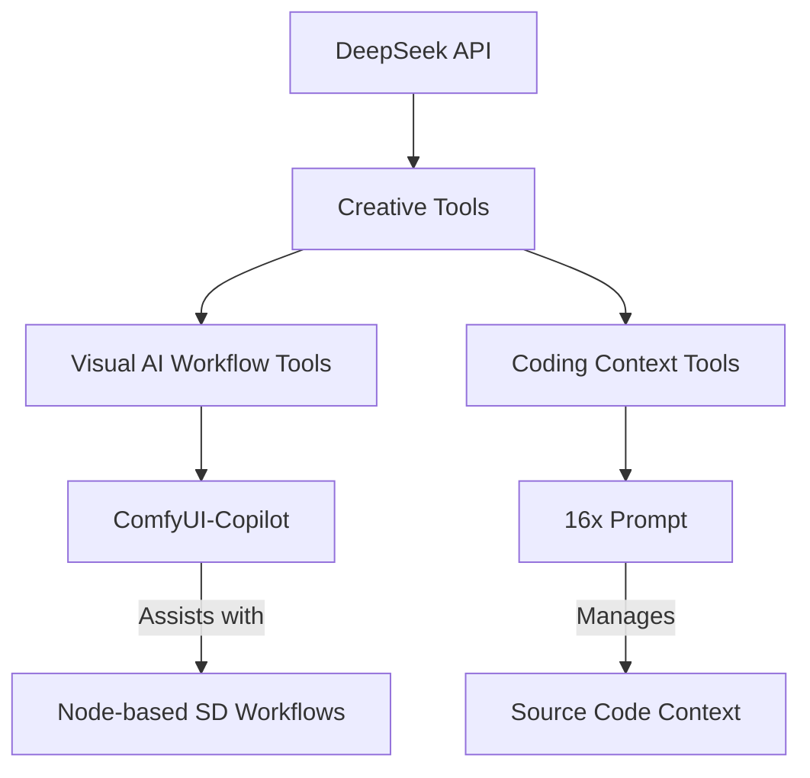
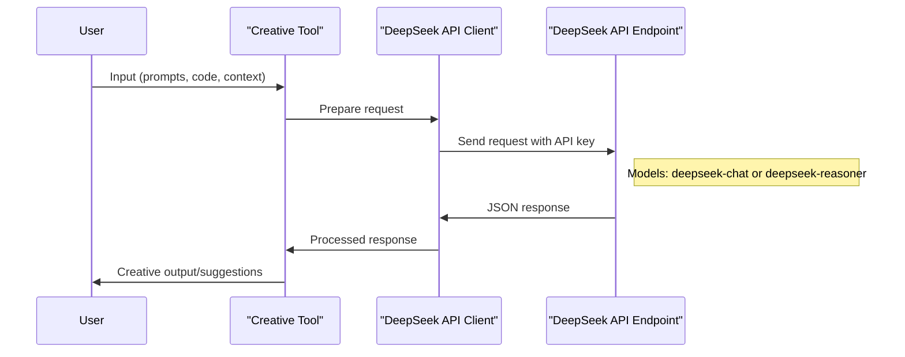
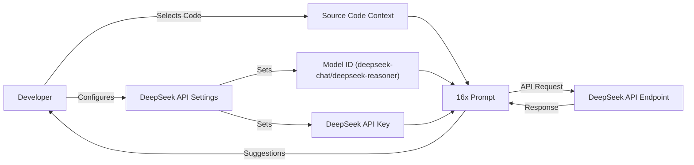

<!-- source: DeepWiki mcp.deepwiki.com · repo deepseek-ai/awesome-deepseek-integration · page 8 Creative Tools · fetched 2026-10-30 -->

# Creative Tools

Relevant source files

The following files were used as context for generating this wiki page:

- [README.md](README.md)
- [README_cn.md](README_cn.md)
- [README_ja.md](README_ja.md)
- [docs/16x_prompt/README.md](docs/16x_prompt/README.md)
- [docs/16x_prompt/assets/16x_prompt_integration.png](docs/16x_prompt/assets/16x_prompt_integration.png)
- [docs/16x_prompt/assets/16x_prompt_ui.png](docs/16x_prompt/assets/16x_prompt_ui.png)
- [docs/4EVERChat/README.md](docs/4EVERChat/README.md)
- [docs/4EVERChat/README_cn.md](docs/4EVERChat/README_cn.md)
- [docs/4EVERChat/README_ja.md](docs/4EVERChat/README_ja.md)

This page documents the creative tools that integrate with the DeepSeek API, focusing on applications that enhance creative workflows through AI assistance. These tools help users leverage DeepSeek's language models for visual content creation, code development with context awareness, and other creative tasks.

For information about general AI capabilities and frameworks, see [AI Frameworks](#7).

## Overview of Creative Tools

Creative tools in the DeepSeek ecosystem are specialized applications that leverage DeepSeek's AI capabilities to enhance creative workflows, whether for visual content generation, coding, or other forms of content creation. These tools provide intuitive interfaces for interacting with the powerful AI models.

Sources: README.md

The typical integration pattern for creative tools follows this workflow:

Sources: README.md

## Visual AI Workflow Tools

### ComfyUI-Copilot

ComfyUI-Copilot is an assistant designed for AI workflows in ComfyUI, a node-based interface for creating stable diffusion pipelines. It integrates with the DeepSeek API to provide intelligent assistance for visual content creation workflows.

Key features:
- AI-assisted workflow creation for visual content
- Integration with ComfyUI's node-based interface
- Intelligent suggestions for workflow improvement
- DeepSeek model integration for workflow assistance

Sources: README.md (based on JSON table of contents)

## Code Context Management Tools

### 16x Prompt

16x Prompt is an AI coding tool with dedicated context management capabilities. It helps developers manage source code context and craft effective prompts for complex coding tasks on existing codebases.

Sources: docs/16x_prompt/README.md

#### Integration with DeepSeek API

16x Prompt offers straightforward integration with the DeepSeek API:

1. Click on the model selection button at the bottom right of the interface
2. Click on "DeepSeek API" to automatically fill in the API Endpoint
3. Enter the model ID:
   - `deepseek-chat` for DeepSeek V3
   - `deepseek-reasoner` for DeepSeek R1
4. Enter your DeepSeek API key

Key features:
- Source code context management for better AI assistance
- Intelligent prompt crafting for complex coding tasks
- Support for multiple DeepSeek models
- Contextual code suggestions based on existing codebase

Use cases:
- Working with large, unfamiliar codebases
- Generating code that fits existing architecture
- Refactoring and optimizing code with AI assistance
- Debugging complex issues with contextual AI help

Sources:
- README.md:317-321
- docs/16x_prompt/README.md

## Other Creative Tools in the DeepSeek Ecosystem

Several other tools in the DeepSeek integration ecosystem can be used for creative purposes, though they may be categorized under different sections:

| Tool | Category | Creative Use Case |
|------|----------|-------------------|
| Story-Flicks | Application | Generate high-definition videos from a single sentence |
| Video Subtitle Master | Media Processing | Batch generate and translate video subtitles |
| LiberSonora | Audiobook Toolkit | Create and process audiobooks with AI assistance |
| Cherry Studio | Producer Assistant | AI-powered desktop assistant for content production |

### Story-Flicks

Story-Flicks allows users to quickly generate high-definition story short videos from just a single sentence prompt. The tool supports DeepSeek models for video generation, enabling rapid creation of visual narratives.

Sources: README.md:312-316

### Video Subtitle Master

This is a client-side tool that supports both Mac and Windows platforms, allowing users to batch generate subtitles for videos and translate them into other languages. It integrates with multiple translation services including DeepSeek.

Sources: README.md:175-178

### LiberSonora

LiberSonora is an AI-powered audiobook toolkit that includes features like intelligent subtitle extraction, AI title generation, and multilingual translation. It supports GPU acceleration and batch offline processing.

Sources: README.md:270-273

### Cherry Studio

Cherry Studio is a desktop AI assistant specifically designed for producers to enhance creative workflows. It leverages DeepSeek's AI capabilities to assist with various aspects of content production.

Sources: README.md:171-174

---

