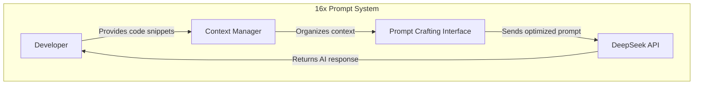
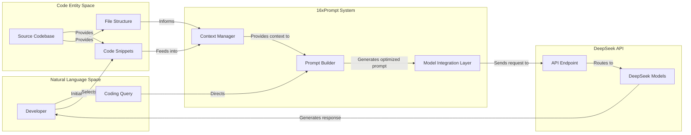
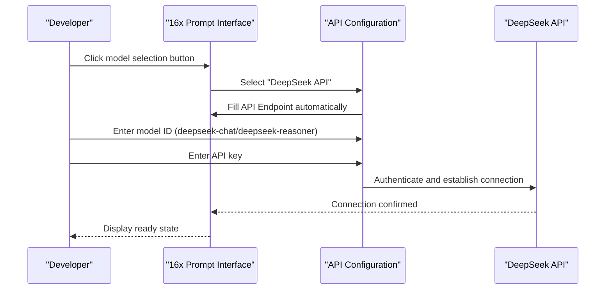
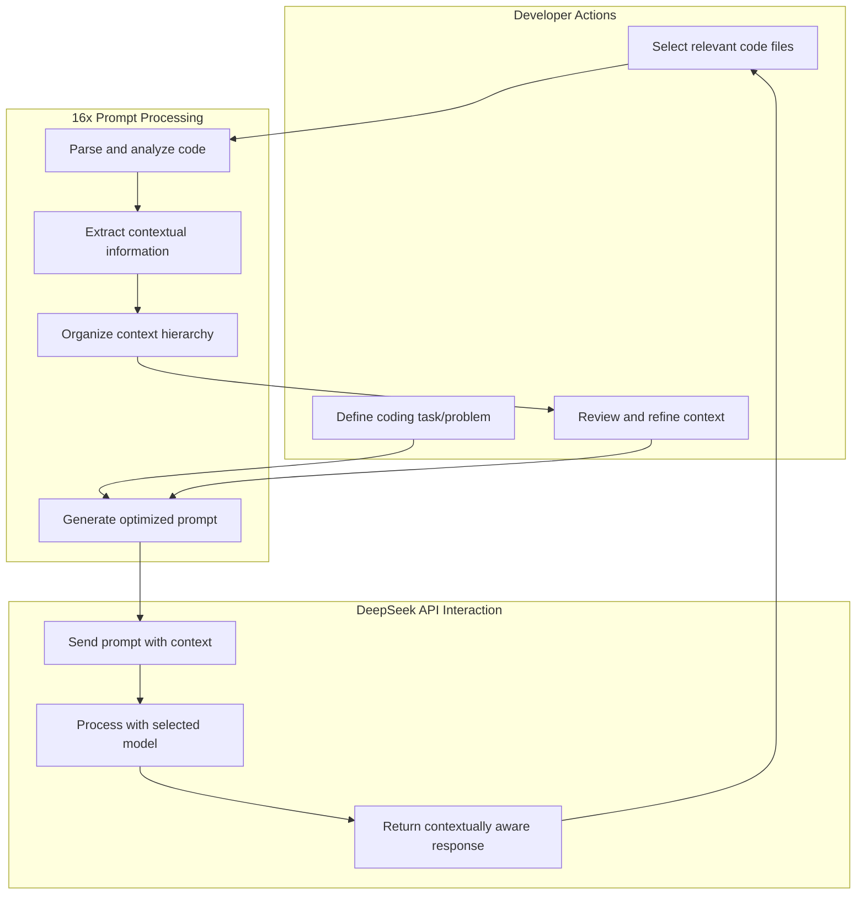
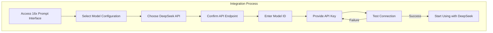

<!-- source: DeepWiki mcp.deepwiki.com · repo deepseek-ai/awesome-deepseek-integration · page 8.2 16x Prompt · fetched 2026-10-30 -->

# 16x Prompt

Relevant source files

The following files were used as context for generating this wiki page:

- [docs/16x_prompt/README.md](docs/16x_prompt/README.md)
- [docs/16x_prompt/assets/16x_prompt_integration.png](docs/16x_prompt/assets/16x_prompt_integration.png)
- [docs/16x_prompt/assets/16x_prompt_ui.png](docs/16x_prompt/assets/16x_prompt_ui.png)

## Purpose and Scope

This document describes 16x Prompt, a context management tool designed to help developers manage source code context and craft effective prompts for complex coding tasks on existing codebases. The tool streamlines the process of working with AI coding assistants by providing specialized context management features that integrate with DeepSeek models.

For related creative tools that integrate with DeepSeek, see [ComfyUI-Copilot](#8.1).

Sources: [docs/16x_prompt/README.md:1-5]()

## Overview

16x Prompt serves as an intermediary layer between developers and AI language models, specifically focusing on providing proper context for coding-related tasks. It helps developers extract, organize, and present relevant code context to AI models to get more accurate and useful responses for development tasks.

Sources: [docs/16x_prompt/README.md:3-5]()

## System Architecture

16x Prompt facilitates the flow of context from source code repositories to language models through a specialized interface. The tool manages contextual information to ensure AI models have sufficient understanding of the codebase to provide relevant assistance.

Sources: [docs/16x_prompt/README.md:3-5]()

## DeepSeek API Integration

16x Prompt integrates directly with the DeepSeek API, allowing developers to leverage powerful language models for coding assistance. The integration supports multiple DeepSeek models, including DeepSeek V3 (deepseek-chat) and DeepSeek R1 (deepseek-reasoner).

### Integration Configuration

The integration with DeepSeek API requires several configuration steps:

1. API endpoint selection
2. Model ID specification
3. API key authentication

### Supported DeepSeek Models

16x Prompt supports multiple DeepSeek models:

| Model ID | Description |
|----------|-------------|
| `deepseek-chat` | DeepSeek V3 - General purpose chat model |
| `deepseek-reasoner` | DeepSeek R1 - Advanced reasoning model |

Sources: [docs/16x_prompt/README.md:11-17]()

## Context Management Workflow

The core functionality of 16x Prompt revolves around its context management capabilities, which facilitate more effective AI-assisted coding.

Sources: [docs/16x_prompt/README.md:3-5]()

## User Interface

16x Prompt provides a specialized interface designed for managing code context and crafting prompts. The interface includes:

1. Context management area
2. Prompt crafting section
3. Model configuration controls
4. Response display area

The UI is optimized for working with code snippets and technical prompts, with features specifically designed for developer workflows.

Sources: [docs/16x_prompt/README.md:7-9]()

## Integration Steps

To use 16x Prompt with DeepSeek models:

1. Access the 16x Prompt interface (available at https://prompt.16x.engineer/)
2. Navigate to the model selection button at the bottom right of the interface
3. Select "DeepSeek API" from the available options
4. Confirm the API endpoint is automatically filled in
5. Enter the appropriate model ID based on your requirements:
   - `deepseek-chat` for DeepSeek V3
   - `deepseek-reasoner` for DeepSeek R1
6. Enter your DeepSeek API key
7. Begin using the tool with your selected DeepSeek model

### Technical Integration Flow

Sources: [docs/16x_prompt/README.md:11-17]()

## Summary

16x Prompt provides developers with a specialized tool for managing code context when working with AI coding assistants. Its integration with DeepSeek models enables more effective AI-assisted coding by providing the models with better contextual understanding of the codebase. The tool bridges the gap between complex codebases and AI language models, making it easier for developers to get relevant assistance for coding tasks.

Sources: [docs/16x_prompt/README.md:1-17]()

---

