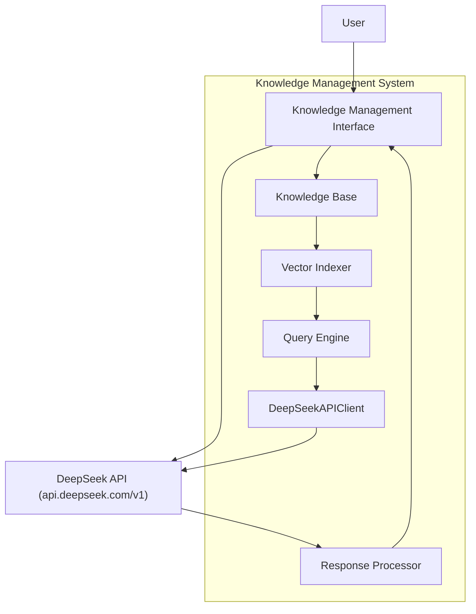
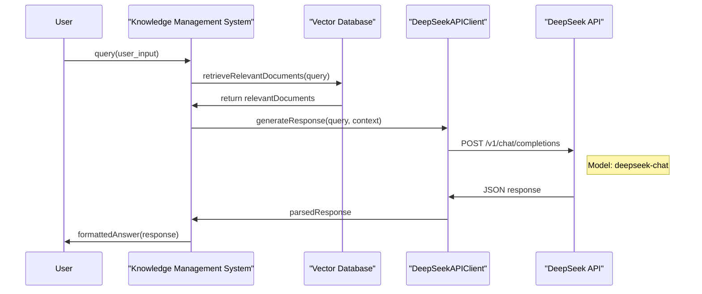
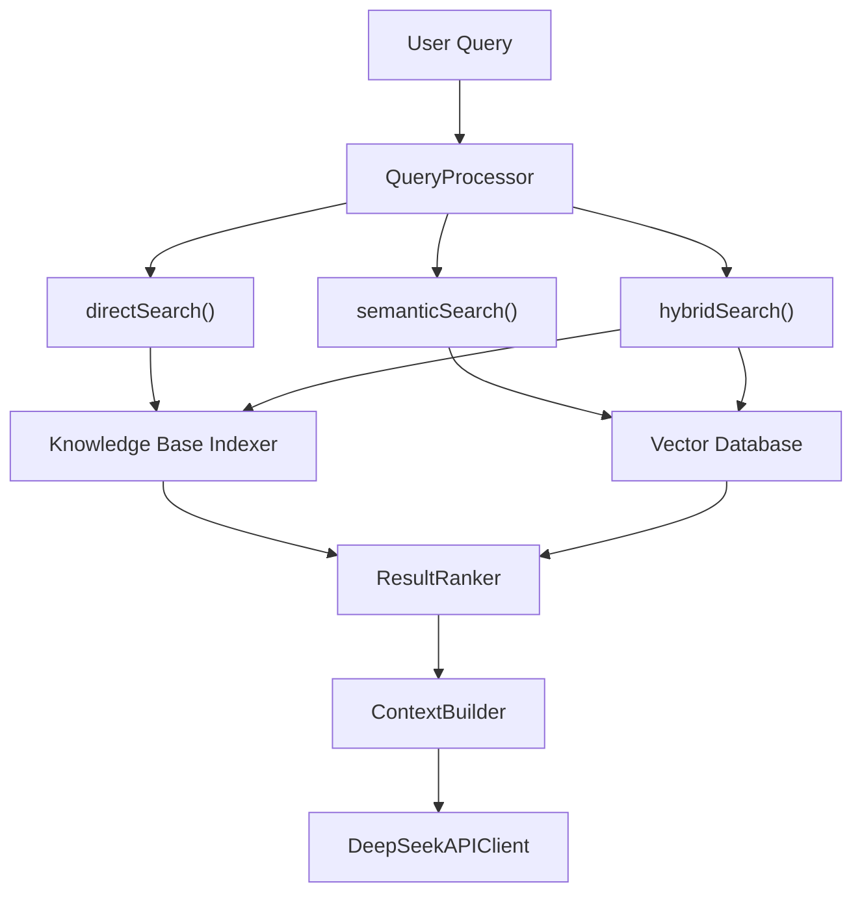
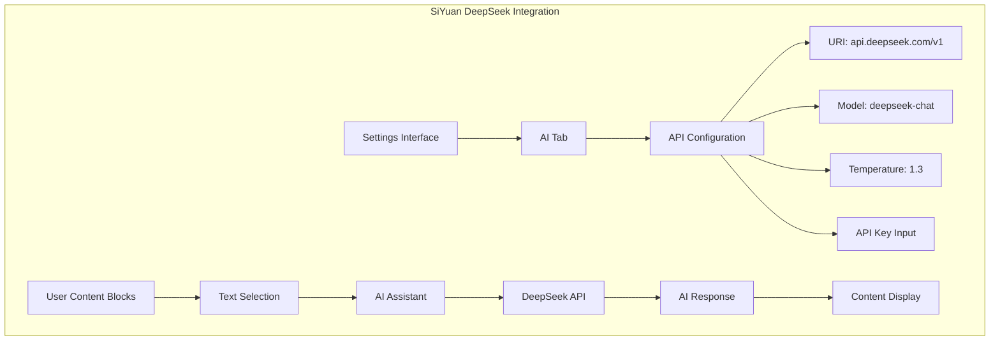
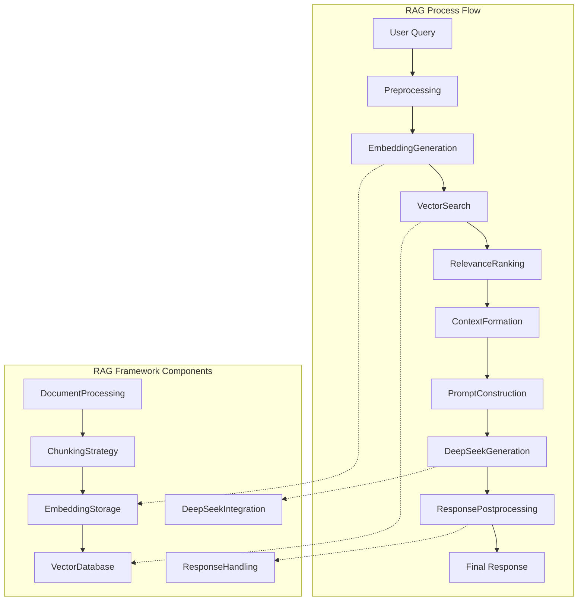
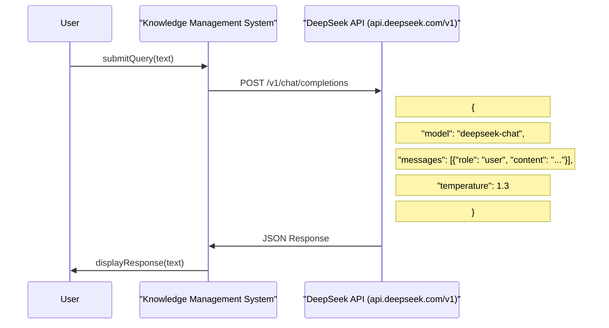
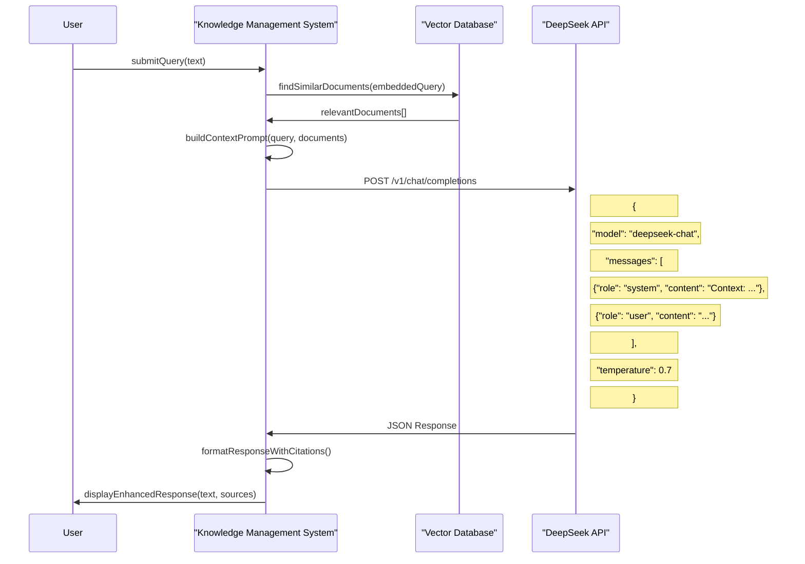

<!-- source: DeepWiki mcp.deepwiki.com · repo deepseek-ai/awesome-deepseek-integration · page 9 Knowledge Management · fetched 2026-10-30 -->

# Knowledge Management

Relevant source files

The following files were used as context for generating this wiki page:

- [README.md](README.md)
- [README_cn.md](README_cn.md)
- [README_ja.md](README_ja.md)
- [docs/4EVERChat/README.md](docs/4EVERChat/README.md)
- [docs/4EVERChat/README_cn.md](docs/4EVERChat/README_cn.md)
- [docs/4EVERChat/README_ja.md](docs/4EVERChat/README_ja.md)
- [docs/SiYuan/README.md](docs/SiYuan/README.md)
- [docs/SiYuan/README_cn.md](docs/SiYuan/README_cn.md)
- [docs/SiYuan/assets/image-20250122162241-32a4oma.png](docs/SiYuan/assets/image-20250122162241-32a4oma.png)
- [docs/SiYuan/assets/image-20250122162425-wlsgw0u.png](docs/SiYuan/assets/image-20250122162425-wlsgw0u.png)
- [docs/SiYuan/assets/image-20250122163007-hkuruoe.png](docs/SiYuan/assets/image-20250122163007-hkuruoe.png)

This document provides a technical overview of knowledge management systems and frameworks that integrate with the DeepSeek API. It covers tools for organizing, storing, retrieving, and enhancing information using DeepSeek's language models, focusing specifically on systems like SiYuan, remio, DocKit, and various RAG frameworks that leverage DeepSeek's capabilities.

For related information about AI agent frameworks that also handle knowledge, see [AI Agent Frameworks](#7.1).

## Architecture Overview

Knowledge management systems in the DeepSeek ecosystem integrate with the API to provide AI-enhanced capabilities for organizing and retrieving information.

### Typical Knowledge Management Architecture

Sources: 
- [README.md:245-248]()
- [docs/SiYuan/README.md:35-37]()

### Integration Flow

Sources:
- [README.md:245-248]()
- [docs/SiYuan/README.md:35-37]()

## Key Components

### 1. Knowledge Storage and Indexing

Knowledge management systems store information in various formats:

| Component | Description | Example Systems |
|-----------|-------------|-----------------|
| Document Storage | Storage for full documents and their metadata | SiYuan, DocKit |
| Vector Database | Storage for document embeddings for semantic search | RAGFlow, DeepSearcher |
| Block Storage | Storage for atomic units of information with bidirectional links | SiYuan |
| Metadata Index | Index for document properties, tags, and references | remio, Casibase |

Sources:
- [README.md:245-248]()
- [docs/SiYuan/README.md:9]()

### 2. DeepSeek API Integration

All systems connect to the DeepSeek API, typically configuring:

- API Endpoint: `https://api.deepseek.com/v1/`
- Model Selection: Usually `deepseek-chat` or other DeepSeek models
- Temperature Settings: Adjustable based on use case (typically 0.7-1.3)
- Additional Parameters: `max_tokens`, `top_p`, etc.

Sources:
- [docs/SiYuan/README.md:35-39]()
- [README.md:245-248]()

### 3. Retrieval Mechanisms

Knowledge management tools implement various retrieval strategies:

Sources:
- [README.md:430-435]()
- [README.md:437-441]()

## Knowledge Management Systems

### SiYuan

SiYuan is a privacy-first personal knowledge management system that supports complete offline usage with end-to-end encrypted data sync. It integrates DeepSeek for AI-powered queries.

#### Configuration Process

To configure DeepSeek in SiYuan:

1. Obtain a DeepSeek API key from the DeepSeek Open Platform
2. Access the Settings interface
3. Navigate to the "AI" tab
4. Configure the following parameters:
   - API Key: Your DeepSeek API key
   - URI: `https://api.deepseek.com/v1/`
   - Model: `deepseek-chat`
   - Temperature: 1.3 (adjustable)

After configuration, users can query DeepSeek directly within the knowledge base by selecting blocks of text and invoking the AI features.

Sources:
- [docs/SiYuan/README.md:17-40]()
- [docs/SiYuan/README_cn.md:15-34]()
- [docs/SiYuan/assets/image-20250122162241-32a4oma.png]()
- [docs/SiYuan/assets/image-20250122163007-hkuruoe.png]()

### remio

remio is an AI-powered personal knowledge hub that builds personalized knowledge bases from:
- Web browsing content (auto-captured)
- Local file parsing
- Personal note integration

It enables searching and natural language Q&A within the personal knowledge base while offering smart writing assistance that adapts to the user's style. remio implements a local-first storage design that prioritizes data privacy.

Sources:
- [README.md:423-426]()

### DocKit

DocKit is an AI-powered desktop GUI client for NoSQL databases that supports:
- Elasticsearch and OpenSearch databases
- Cross-platform operation (Mac, Windows, Linux)
- Integration with DeepSeek for complex DSL query generation
- Visual data management and analysis interfaces

Sources:
- [README.md:428-431]()

## RAG Frameworks

RAG (Retrieval-Augmented Generation) frameworks enhance LLM outputs by retrieving relevant information from knowledge bases before generating responses. The DeepSeek ecosystem includes several RAG implementations.

### RAG Process Flow

Sources:
- [README.md:426-446]()

### RAGFlow

RAGFlow is an open-source RAG engine based on deep document understanding, providing:
- Enhanced document comprehension capabilities
- Support for complex document formats
- Reliable question answering with source attribution
- Integration with DeepSeek LLMs

Sources:
- [README.md:428-432]()

### Autoflow

Autoflow is a GraphRAG-based knowledge base tool built on:
- TiDB Vector database
- LlamaIndex for indexing and retrieval
- DSPy for prompt engineering
- JavaScript-based website embedding functionality

Sources:
- [README.md:434-437]()

### DeepSearcher

DeepSearcher combines LLMs (including DeepSeek) with vector databases like Milvus to:
- Search private data repositories
- Evaluate information quality and relevance
- Apply reasoning to produce accurate answers
- Generate comprehensive reports

Sources:
- [README.md:439-442]()

### KAG

KAG is a logic reasoning Q&A framework built on:
- OpenSPG engine for knowledge graph representation
- Large language models for reasoning
- Specialized architecture for vertical domain knowledge bases
- Optimizations to overcome traditional RAG limitations

Sources:
- [README.md:443-446]()

## Integration Patterns

Knowledge management tools typically integrate with the DeepSeek API through these patterns:

### Direct API Integration

### RAG-Enhanced Integration

Sources:
- [docs/SiYuan/README.md:35-40]()
- [README.md:427-446]()

## Best Practices

### Privacy and Security Considerations

When implementing knowledge management with DeepSeek:
- Use end-to-end encryption for sensitive data
- Consider local-first approaches for privacy-critical information
- Implement proper API key management
- Control what information is sent to external APIs

### Performance Optimization

For optimal knowledge management performance:
- Implement efficient document chunking strategies
- Use appropriate vector similarity metrics
- Balance retrieval relevance with context length
- Consider caching frequently accessed information

Sources:
- [README.md:423-426]()
- [docs/SiYuan/README.md:9]()

## 4EVERChat Integration Example

The 4EVERChat platform integrates with DeepSeek for knowledge management purposes, allowing users to interact with multiple LLM models including DeepSeek. It provides:

- Unified API endpoint through 4EVERLAND AI RPC
- Zero-cost switching between hundreds of models
- Real-time comparison of different model responses
- Dynamic selection of model combinations based on response speed and cost

Sources:
- [docs/4EVERChat/README.md:5-7]()
- [docs/4EVERChat/README_cn.md:5-7]()
- [docs/4EVERChat/README_ja.md:5-7]()

---

