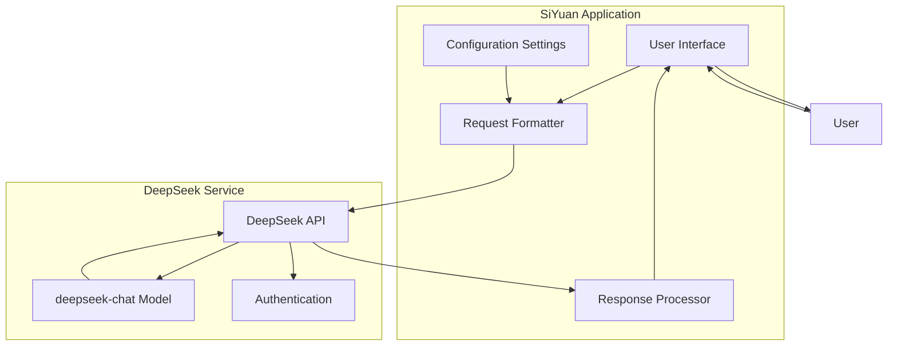
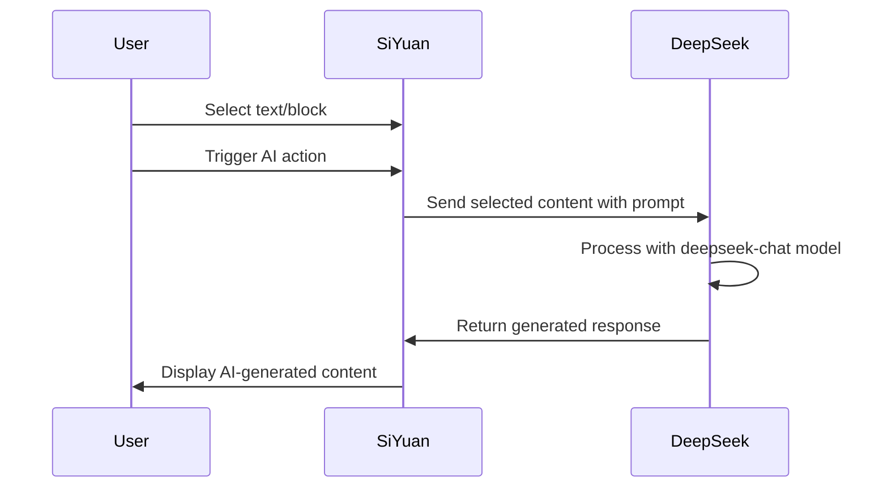
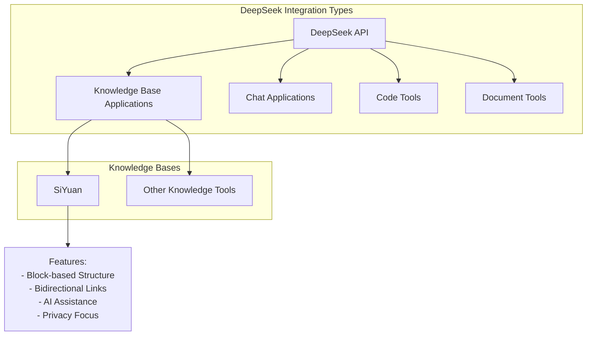

<!-- source: DeepWiki mcp.deepwiki.com · repo deepseek-ai/awesome-deepseek-integration · page 9.1 SiYuan · fetched 2026-10-30 -->

# SiYuan

Relevant source files

The following files were used as context for generating this wiki page:

- [docs/SiYuan/README.md](docs/SiYuan/README.md)
- [docs/SiYuan/README_cn.md](docs/SiYuan/README_cn.md)
- [docs/SiYuan/assets/image-20250122162241-32a4oma.png](docs/SiYuan/assets/image-20250122162241-32a4oma.png)
- [docs/SiYuan/assets/image-20250122162425-wlsgw0u.png](docs/SiYuan/assets/image-20250122162425-wlsgw0u.png)
- [docs/SiYuan/assets/image-20250122163007-hkuruoe.png](docs/SiYuan/assets/image-20250122163007-hkuruoe.png)

This wiki page documents the integration of SiYuan, a personal knowledge management system, with the DeepSeek API. It covers the setup process, configuration options, and usage of AI capabilities within SiYuan through DeepSeek's language models. For information about other knowledge management tools in the DeepSeek ecosystem, see the main Knowledge Management section [Knowledge Management](#9).

## 1. Overview of SiYuan

SiYuan is a privacy-first personal knowledge management system that supports complete offline usage and provides end-to-end encrypted data synchronization. It differentiates itself by fusing blocks, outlines, and bidirectional links to help users organize their knowledge and restructure their thinking processes.

Within the DeepSeek integration ecosystem, SiYuan represents a sophisticated example of how AI capabilities can enhance knowledge management systems by providing contextual assistance, content generation, and information processing capabilities.

Sources: 
- [docs/SiYuan/README.md:7-11]()
- [docs/SiYuan/README_cn.md:7-8]()

## 2. Integration Architecture

SiYuan integrates with DeepSeek through a direct API connection. When a user triggers an AI operation in SiYuan, the application sends the request to DeepSeek's API servers, which process it using the specified model and return the response back to SiYuan for display.

The integration follows a request-response pattern where:
1. User initiates an AI action through the SiYuan interface
2. SiYuan formats the request with proper parameters and API key
3. The request is sent to DeepSeek's API endpoint
4. DeepSeek authenticates and processes the request
5. The response is returned and displayed in SiYuan

Sources:
- [docs/SiYuan/README.md:15-40]()
- General ecosystem flow pattern from the introduction

## 3. Integration Setup Process

Setting up the DeepSeek integration with SiYuan requires obtaining an API key and configuring the connection parameters in SiYuan's settings.

### 3.1 Obtaining a DeepSeek API Key

Before configuring SiYuan, you need to obtain an API token from the DeepSeek open platform:

1. Visit the [DeepSeek Open Platform](https://platform.deepseek.com/)
2. Register or log in to your account
3. Navigate to the API section to create a new API key
4. Save the generated token securely

Sources:
- [docs/SiYuan/README.md:15-17]()
- [docs/SiYuan/README_cn.md:9-11]()

### 3.2 Configuring SiYuan

After obtaining your API key, configure SiYuan with these steps:

1. Open SiYuan and navigate to the Settings interface
2. Select the "AI" tab in the settings panel
3. Enter your DeepSeek API key in the provided field
4. Configure the endpoint URL and model parameters:
   - URI: `https://api.deepseek.com/v1/`
   - Model: `deepseek-chat`
   - Temperature: 1.3
5. Save the settings

This configuration establishes the connection between SiYuan and DeepSeek's language models.

Sources:
- [docs/SiYuan/README.md:21-39]()
- [docs/SiYuan/README_cn.md:14-29]()

## 4. Configuration Parameters

The integration between SiYuan and DeepSeek requires several key configuration parameters:

| Parameter | Value | Description |
|-----------|-------|-------------|
| API Key | Your personal token | Authenticates requests to DeepSeek API |
| URI | `https://api.deepseek.com/v1/` | Endpoint URL for DeepSeek API |
| Model | `deepseek-chat` | The language model used for processing |
| Temperature | 1.3 | Controls randomness in responses |

### 4.1 Understanding the Temperature Setting

The temperature parameter (set to 1.3 by default) controls the randomness and creativity of the AI responses:

- Higher values (like 1.3) produce more creative, diverse outputs
- Lower values (closer to 0) produce more deterministic, focused responses
- The default setting balances creativity with coherence for knowledge management tasks

Sources:
- [docs/SiYuan/README.md:26-28]()
- [docs/SiYuan/README_cn.md:25-28]()

## 5. Using DeepSeek AI in SiYuan

After configuration, users can access DeepSeek AI capabilities directly within SiYuan's interface. The integration provides AI assistance for various knowledge management tasks.

### 5.1 User Workflows

Common use cases for the DeepSeek integration include:

1. **Content Generation**: Creating new notes or expanding on existing ideas
2. **Summarization**: Condensing longer content into key points
3. **Question Answering**: Getting information based on your knowledge base
4. **Translation**: Converting content between languages
5. **Restructuring**: Reorganizing information in different formats

### 5.2 Accessing AI Features

To use DeepSeek AI features:

1. Select a block or text in your SiYuan note
2. Access the AI menu through the context menu or dedicated button
3. Choose the desired AI operation
4. Review and incorporate the generated content into your notes

Sources:
- [docs/SiYuan/README.md:44-48]()
- [docs/SiYuan/README_cn.md:32-34]()

## 6. Integration Benefits

The integration of DeepSeek AI capabilities into SiYuan provides several key benefits:

1. **Enhanced Knowledge Processing**: Leverage AI to organize and process information more effectively
2. **Privacy-Focused AI**: Maintain SiYuan's privacy-first approach while gaining AI capabilities
3. **Contextual Assistance**: Get AI help that understands the context of your knowledge base
4. **Seamless Workflow**: Access AI features within your familiar SiYuan environment
5. **Customizable Experience**: Adjust parameters like temperature to suit your specific needs

By combining SiYuan's powerful knowledge management tools with DeepSeek's AI capabilities, users can significantly enhance their ability to capture, organize, and leverage information.

## 7. Technical Context

SiYuan represents an important integration pattern within the DeepSeek ecosystem. As illustrated in the broader integration categories, it exemplifies how specialized knowledge management applications can incorporate AI capabilities through direct API integration.

Within this ecosystem, SiYuan demonstrates how specialized tools that already have sophisticated knowledge organization capabilities can be enhanced with AI to provide additional value to users.

Sources:
- Overview of integration ecosystem from the introduction

## 8. Troubleshooting

If you encounter issues with the DeepSeek integration in SiYuan, consider these common troubleshooting steps:

1. **API Key Verification**: Ensure your DeepSeek API key is valid and correctly entered
2. **Network Connectivity**: Check that SiYuan can connect to the DeepSeek API endpoint
3. **Parameter Settings**: Verify the URI, model name, and temperature settings
4. **Token Limits**: Be aware of token limits when sending large blocks of text
5. **API Rate Limits**: If you receive errors, you may have hit DeepSeek API rate limits

For persistent issues, check the SiYuan community forums or documentation for updated information on the DeepSeek integration.

## Summary

The integration between SiYuan and DeepSeek brings powerful AI capabilities to a privacy-focused knowledge management system. By following the straightforward configuration process outlined in this guide, users can enhance their knowledge management workflows with AI assistance while maintaining the security and organization benefits that SiYuan provides.

The combination of SiYuan's block-based structure and DeepSeek's language models creates a powerful environment for organizing information, generating content, and developing ideas - all while respecting user privacy and control over data.