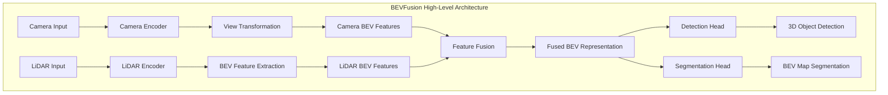
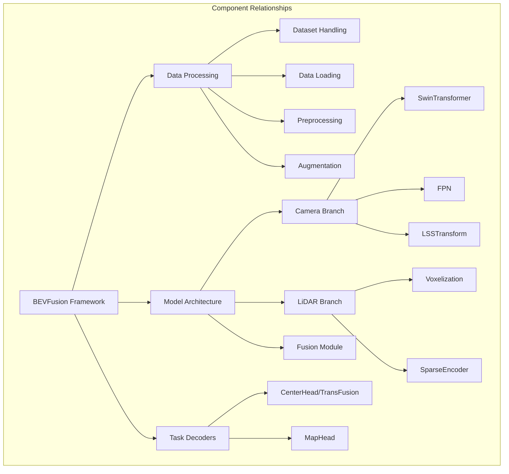
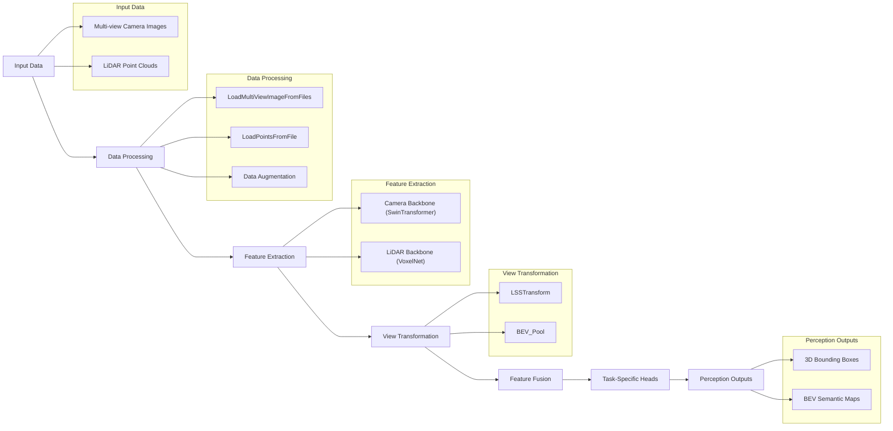

<!-- source: DeepWiki mcp.deepwiki.com · repo mit-han-lab/bevfusion · page 1 Overview · fetched 2026-10-30 -->

# Overview

Relevant source files

The following files were used as context for generating this wiki page:

- [README.md](README.md)
- [assets/demo.gif](assets/demo.gif)
- [docker/Dockerfile](docker/Dockerfile)
- [mmdet3d/datasets/pipelines/utils.py](mmdet3d/datasets/pipelines/utils.py)

This document provides a comprehensive introduction to BEVFusion, a state-of-the-art multi-sensor fusion framework for 3D perception in autonomous driving. BEVFusion unifies camera and LiDAR data in a shared bird's-eye view (BEV) representation to achieve high-performance object detection and semantic segmentation.

## Purpose and Scope

BEVFusion is designed to address the challenges of multi-modal sensor fusion for autonomous driving perception tasks. The framework:

- Integrates camera and LiDAR data into a unified BEV representation
- Preserves both geometric and semantic information from different sensor modalities
- Supports multiple perception tasks including 3D object detection and BEV map segmentation
- Provides an efficient and scalable architecture for real-time autonomous driving applications

For detailed information about the system architecture, see [System Architecture](#2), and for specifics on the data processing pipeline, see [Data Processing Pipeline](#3).

Sources: [README.md:18-20]()

## Key Features and Innovations

BEVFusion introduces several key innovations in multi-sensor fusion:

1. **Unified BEV Representation**: Rather than using point-level fusion (augmenting LiDAR points with camera features), BEVFusion transforms features from both modalities into a shared BEV space.

2. **Efficient View Transformation**: The framework implements highly optimized BEV pooling operations that reduce latency by more than 40x compared to previous approaches.

3. **Task-Agnostic Design**: The architecture seamlessly supports different 3D perception tasks with minimal architectural changes.

4. **State-of-the-Art Performance**: BEVFusion achieves leading performance on major benchmarks including nuScenes and Waymo for 3D object detection and BEV map segmentation.

5. **Deployment Optimizations**: The framework has been optimized for deployment on edge devices, with TensorRT acceleration achieving 25 FPS on NVIDIA Jetson Orin platforms.

Sources: [README.md:18-20](), [README.md:9-15]()

## High-Level Architecture

BEVFusion's architecture consists of parallel processing branches for camera and LiDAR data that are eventually fused in a common BEV representation space.

Sources: [README.md:18-20]()

## Core Components

BEVFusion consists of several key components that work together to process multi-modal sensor data:

### 1. Sensor Encoders

- **Camera Encoder**: Processes multi-view camera images using a backbone network (typically SwinTransformer) followed by a feature pyramid network (FPN) to extract multi-scale features.
  
- **LiDAR Encoder**: Converts point cloud data into a structured representation through voxelization and processes it using a sparse convolutional network to extract 3D features.

### 2. View Transformation

- **LSSTransform/DepthLSSTransform**: Transforms 2D camera features into 3D BEV space using camera geometry (intrinsics and extrinsics).
  
- **BEV Pooling**: Efficiently projects features from the perspective view to the bird's-eye view using optimized CUDA operations.

### 3. Feature Fusion

- **Fusion Mechanism**: Combines the BEV features from camera and LiDAR branches, typically using concatenation or a convolutional fusion approach.

### 4. Task Heads

- **Detection Head**: Processes the fused BEV features to predict 3D bounding boxes for objects in the scene.
  
- **Segmentation Head**: Operates on the same fused BEV features to produce semantic segmentation maps.

Sources: [README.md:45-59](), [README.md:184-192]()

## Data Flow

The following diagram illustrates how data flows through the BEVFusion system, from input sensors to final outputs:

Sources: [README.md:60-72](), [README.md:106-128]()

## Technical Implementation

BEVFusion leverages several specialized techniques to achieve efficient multi-modal fusion:

### Custom CUDA Operations

BEVFusion implements highly optimized CUDA operations for BEV pooling, which is critical for transforming perspective view features to bird's-eye view representation. This optimization reduces the computational bottleneck in view transformation.

### Sparse Processing

For LiDAR data, sparse convolutional networks are used to efficiently process the inherently sparse point cloud data, reducing computational requirements while preserving geometric information.

### Modular Design

The framework is designed with modularity in mind, allowing for different configurations of:
- Camera backbones (e.g., SwinTransformer)
- LiDAR encoders (e.g., VoxelNet)
- Fusion strategies (e.g., ConvFuser, concatenation)
- Detection heads (e.g., CenterHead, TransFusion)
- Segmentation heads (e.g., MapHead)

Sources: [README.md:77-96](), [README.md:197-197]()

## Performance and Benchmarks

BEVFusion has achieved state-of-the-art performance on major autonomous driving benchmarks:

### nuScenes Dataset

| Model | Modality | mAP | NDS | mIoU (BEV Map) |
|:-----:|:--------:|:---:|:---:|:--------------:|
| BEVFusion | Camera + LiDAR | 68.52 | 71.38 | 62.95 |
| Camera-Only | Camera | 35.56 | 41.21 | 57.09 |
| LiDAR-Only | LiDAR | 64.68 | 69.28 | 48.56 |

### Deployment

The framework has been optimized for real-time performance:
- NVIDIA's TensorRT deployment solution achieves 25 FPS on Jetson Orin
- Integrated into NVIDIA DeepStream for sensor fusion applications

Sources: [README.md:22-59](), [README.md:9-11]()

## Available Configurations

BEVFusion supports various configurations for different use cases:

- Object detection with camera + LiDAR fusion
- Object detection with camera-only
- Object detection with LiDAR-only
- BEV map segmentation with camera + LiDAR fusion
- BEV map segmentation with camera-only
- BEV map segmentation with LiDAR-only

Sources: [README.md:45-59](), [README.md:160-192]()

## Summary

BEVFusion represents a significant advancement in multi-sensor fusion for autonomous driving perception. By unifying camera and LiDAR data in a shared bird's-eye view representation, it achieves superior performance across multiple perception tasks while maintaining computational efficiency. The framework's modular design and optimized implementation make it suitable for both research exploration and real-world deployment.

For more detailed information about specific components of BEVFusion, please refer to the following pages:
- [System Architecture](#2) - Detailed explanation of the overall architecture
- [Data Processing Pipeline](#3) - Information about data handling and preprocessing
- [Model Components](#4) - Details on each component of the model architecture
- [CUDA Operations](#5) - Explanation of custom CUDA operations for acceleration

---

