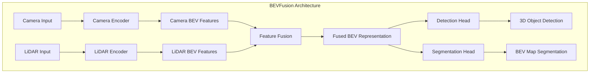
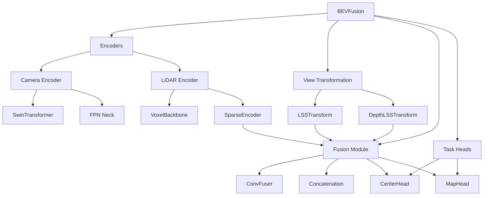
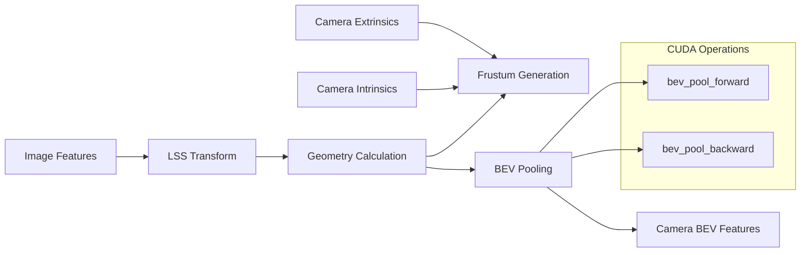
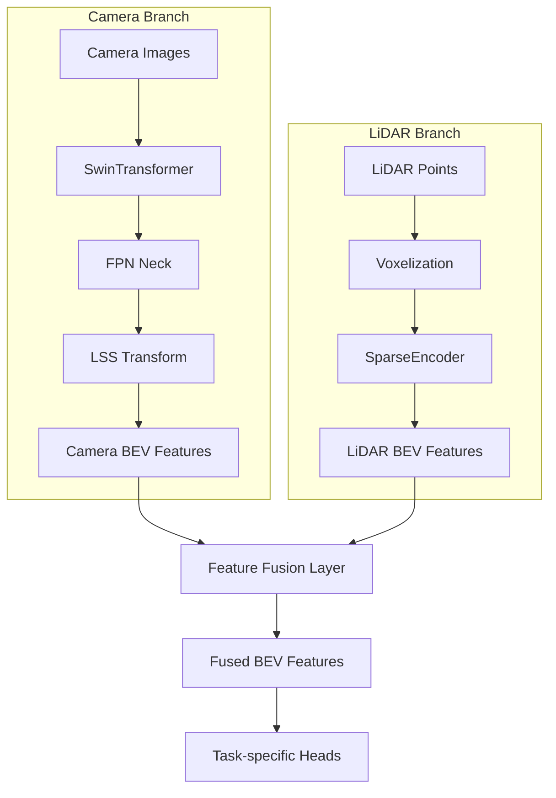
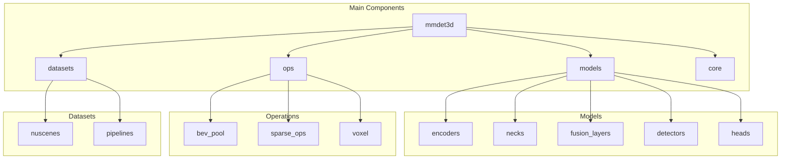

<!-- source: DeepWiki mcp.deepwiki.com · repo mit-han-lab/bevfusion · page 2 System Architecture · fetched 2026-10-30 -->

# System Architecture

Relevant source files

The following files were used as context for generating this wiki page:

- [README.md](README.md)
- [assets/demo.gif](assets/demo.gif)
- [docker/Dockerfile](docker/Dockerfile)
- [mmdet3d/datasets/pipelines/utils.py](mmdet3d/datasets/pipelines/utils.py)

This document provides a detailed overview of the BEVFusion system architecture, explaining the core components and their interactions. BEVFusion is a multi-sensor fusion framework for 3D perception that unifies camera and LiDAR data in a shared bird's-eye view (BEV) representation. For information about data processing workflows, see [Data Processing Pipeline](#3).

## Core Architecture Overview

BEVFusion employs a modular design that processes data from multiple sensor modalities (primarily camera and LiDAR), transforms them into a unified BEV representation, and uses this representation for downstream tasks such as 3D object detection and BEV map segmentation.

Sources: [README.md:18-22]()

## Component Structure and Relationships

The BEVFusion architecture consists of multiple interrelated components organized into a processing pipeline. The system is designed to be modular, allowing for different configurations based on application requirements.

Sources: [README.md:206-209]()

## Sensor-Specific Processing Paths

### Camera Branch

The camera branch processes multi-view image inputs through a feature extraction backbone and transforms the features into the BEV space:

1. **Input**: Multi-view camera images
2. **Feature Extraction**: SwinTransformer backbone followed by a Feature Pyramid Network (FPN)
3. **View Transformation**: LSS (Lift, Splat, Shoot) transform that projects 2D image features into the 3D BEV space

### LiDAR Branch

The LiDAR branch processes point cloud data through specialized operations:

1. **Input**: LiDAR point cloud
2. **Voxelization**: Converts the point cloud into voxel features
3. **Feature Extraction**: Processes voxels through a sparse encoder
4. **BEV Representation**: Creates BEV features directly from the 3D data

## BEV Transformation Process

A critical component of BEVFusion is the transformation of camera features into the BEV space, enabling fusion with LiDAR features.

Sources: [README.md:51-52]()

The BEV pooling operation is a performance-critical component, implemented as custom CUDA operations for efficiency. This operation transforms view-dependent features into a view-independent BEV space, allowing them to be fused with LiDAR features.

## Multi-Modal Fusion

BEVFusion implements feature-level fusion after both camera and LiDAR data are transformed into the BEV space:

1. **ConvFuser**: Uses convolutional layers to fuse features
2. **Simple Concatenation**: Alternative approach that directly concatenates the feature maps

The fusion is performed in the BEV space, which preserves both geometric and semantic information from both modalities.

Sources: [README.md:67-77]()

## Task-Specific Heads

BEVFusion supports multiple perception tasks through dedicated task heads:

1. **Detection Head**: For 3D object detection (CenterHead implementation)
2. **Segmentation Head**: For BEV map segmentation

These heads operate on the fused BEV features and are trained jointly or separately depending on the specific application.

## Implementation Details

### Custom CUDA Operations

BEVFusion implements several custom CUDA operations to achieve real-time performance:

1. **BEV Pooling**: Efficient transformation of perspective view features to BEV space
2. **Sparse Convolution**: Optimized processing of sparse point cloud data

These operations significantly accelerate the inference process, enabling real-time applications.

### Modular Configuration System

The system uses a configuration-based approach to define model architectures, allowing for easy experimentation with different combinations of components:

- Sensor modalities (camera-only, LiDAR-only, or both)
- Backbone architectures
- View transformation methods
- Fusion strategies
- Task-specific heads and losses

This modular design is reflected in the configuration files, where different components can be easily swapped or combined.

## Performance Considerations

BEVFusion achieves state-of-the-art performance while maintaining real-time inference capabilities:

- The optimized implementation can reach 25 FPS on NVIDIA Jetson Orin platforms
- The architecture makes efficient use of computational resources with optimized CUDA operations
- The BEV representation enables effective fusion of different sensor modalities with minimal information loss

For deployment details and optimization strategies, see [Deployment](#8).

Sources: [README.md:9-10]()

## Code Organization

The codebase is organized around the main architectural components:

Sources: [README.md:126-128]()

This organization reflects the modular nature of the architecture, where each component can be developed, tested, and optimized independently.

---

