<!-- source: DeepWiki mcp.deepwiki.com · repo mit-han-lab/bevfusion · page 2.1 Data Flow · fetched 2026-10-30 -->

# Data Flow

Relevant source files

The following files were used as context for generating this wiki page:

- [README.md](README.md)
- [assets/demo.gif](assets/demo.gif)
- [docker/Dockerfile](docker/Dockerfile)
- [mmdet3d/datasets/nuscenes_dataset.py](mmdet3d/datasets/nuscenes_dataset.py)
- [mmdet3d/datasets/pipelines/utils.py](mmdet3d/datasets/pipelines/utils.py)

## Purpose and Scope

This document describes the data flow in the BEVFusion system, tracing the journey of multi-modal data from input sensors through the processing pipeline to the final outputs. It covers how camera and LiDAR data are loaded, preprocessed, encoded, transformed into bird's-eye view (BEV) representation, fused, and finally processed by task-specific heads for 3D object detection and BEV map segmentation.

For information about specific model components, see [Model Components](#4).

## Overview of Data Flow

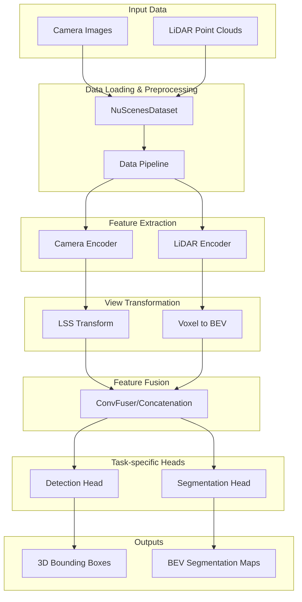

Sources: [README.md:18-20]()

## Data Sources and Format

BEVFusion primarily works with the nuScenes dataset, which provides:

1. **Camera Images**: Multi-view camera images from 6 cameras (front, front left, front right, back, back left, back right)
2. **LiDAR Point Clouds**: 3D point cloud data from LiDAR sensors 
3. **Annotations**: Ground truth 3D bounding boxes and semantic maps

The system also supports data from multiple sweeps (temporal frames) to improve perception quality.

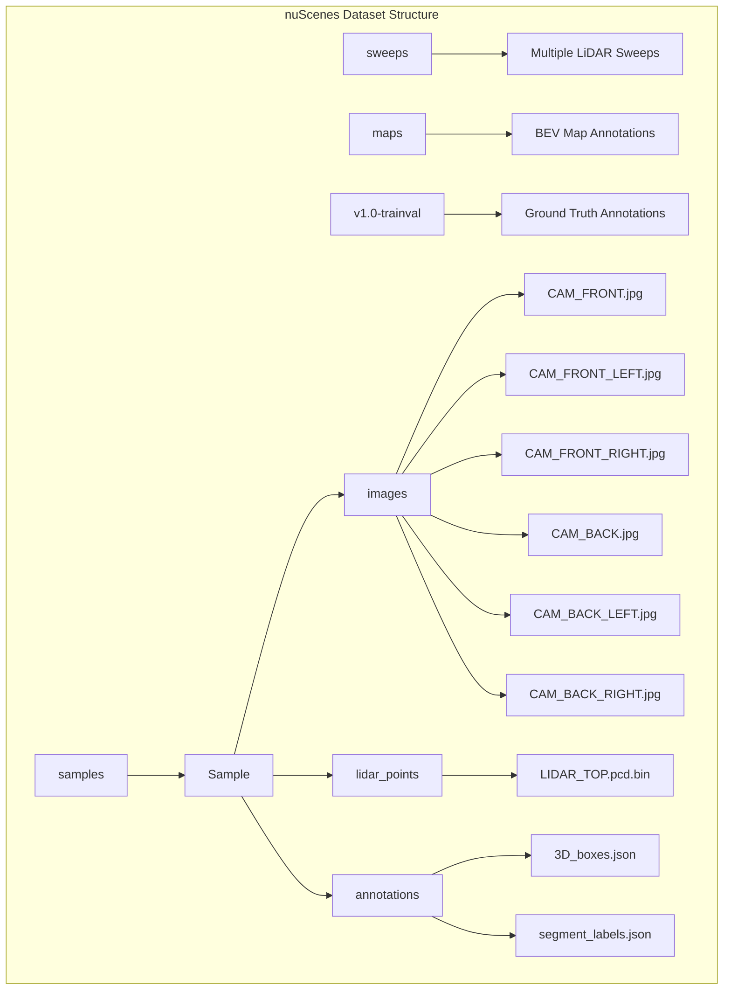

Sources: [mmdet3d/datasets/nuscenes_dataset.py:193-207](), [README.md:105-128]()

## Data Loading Pipeline

The data loading stage uses `NuScenesDataset` to read and organize the raw sensor data and annotations.

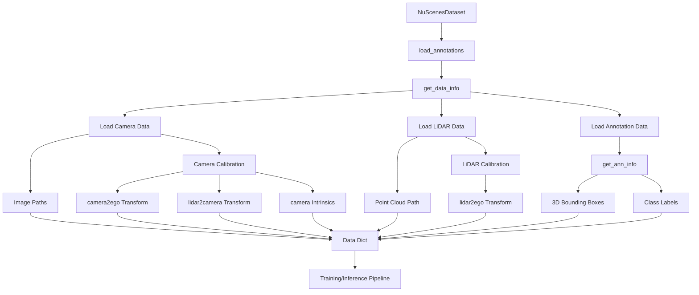

Sources: [mmdet3d/datasets/nuscenes_dataset.py:209-285]()

For each sample, the system loads:

1. **Camera Data**:
   - Image paths
   - Camera-to-ego transforms
   - Camera intrinsic parameters
   - LiDAR-to-camera projections

2. **LiDAR Data**:
   - Point cloud paths
   - LiDAR-to-ego transforms
   - Temporal sweeps (optional)

3. **Annotation Data**:
   - 3D bounding boxes
   - Class labels
   - Instance attributes

Key transformation matrices computed in this stage:
- **ego2global**: Transform from ego vehicle coordinates to global coordinates
- **lidar2ego**: Transform from LiDAR coordinates to ego vehicle coordinates
- **lidar2camera**: Transform from LiDAR coordinates to camera coordinates
- **camera2ego**: Transform from camera coordinates to ego vehicle coordinates

These transformation matrices are essential for correctly aligning data from different sensors into a unified coordinate system.

Sources: [mmdet3d/datasets/nuscenes_dataset.py:227-281]()

## Data Preprocessing and Augmentation

After loading, the data undergoes preprocessing and augmentation through a configurable pipeline:

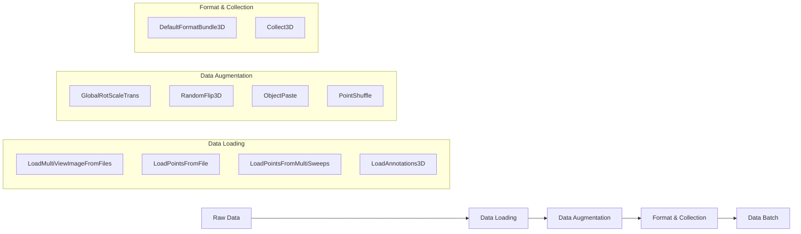

Sources: [mmdet3d/datasets/pipelines/utils.py:310-384](), [README.md:156-194]()

The data augmentation includes:
- **Geometric Transforms**: Rotation, scaling, and translation
- **Random Flipping**: Horizontal flipping of images and point clouds
- **Object Paste**: Copying objects from one scene to another
- **Point Noise**: Adding noise to point cloud coordinates

For LiDAR data, specific augmentations include:
- **Points Shuffling**: Randomly shuffling points to increase robustness
- **Voxelization**: Converting raw point clouds into voxel grid representation

For camera data:
- **Image Resizing**: Resizing images to a standard input size
- **Photometric Distortion**: Adjusting brightness, contrast, saturation
- **Normalization**: Standardizing pixel values

Sources: [mmdet3d/datasets/pipelines/utils.py:11-109]()

## Feature Extraction

After preprocessing, the data enters parallel processing branches for feature extraction:

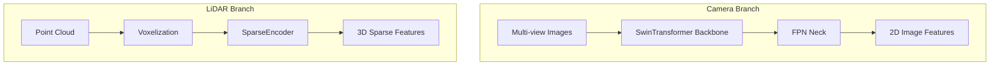

Sources: [README.md:163-175]()

### Camera Feature Extraction
- **Input**: Multi-view camera images (typically 6 views)
- **Backbone**: Swin Transformer processes each image independently
- **Feature Pyramid Network (FPN)**: Generates multi-scale features
- **Output**: 2D feature maps for each camera view

### LiDAR Feature Extraction
- **Input**: LiDAR point cloud (single or multiple sweeps)
- **Voxelization**: Converts point cloud into sparse 3D voxel grid
- **Sparse 3D CNN**: Processes voxelized point cloud
- **Output**: 3D sparse feature volumes

## BEV View Transformation

A critical step in BEVFusion is transforming both camera and LiDAR features into a common bird's-eye view (BEV) representation:

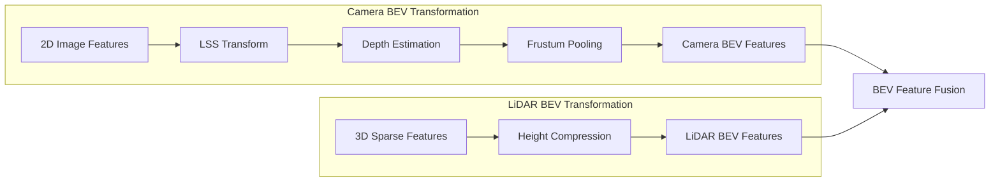

Sources: [README.md:85-107]()

### Camera View Transformation
The camera-to-BEV transformation uses the Lift-Splat-Shoot (LSS) method:
1. **Feature Lifting**: 2D image features are "lifted" to 3D space using estimated depth
2. **Frustum Creation**: Creates a 3D frustum for each pixel in the image
3. **BEV Pooling**: Projects and aggregates 3D features into the BEV grid using efficient CUDA implementations

The camera transformation requires:
- Camera intrinsic parameters
- Camera-to-ego transformation matrices
- Estimated depth information (for DepthLSS variant)

### LiDAR View Transformation
The LiDAR-to-BEV transformation is more straightforward:
1. **Height Compression**: 3D voxel features are compressed along the height dimension
2. **Feature Reorganization**: Reorganized into a dense BEV grid

## Feature Fusion

After both modalities are transformed to BEV representation, they are fused:

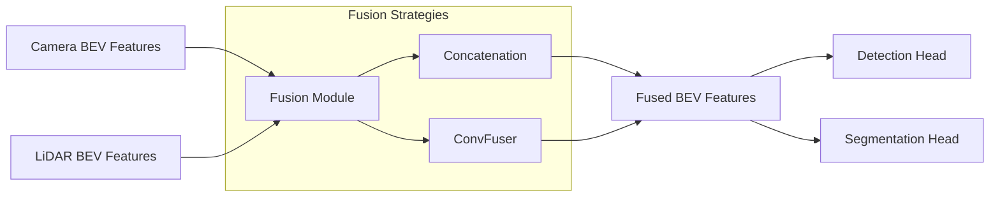

Sources: [README.md:184-190]()

The fusion module supports different strategies:
1. **Simple Concatenation**: Directly concatenating camera and LiDAR BEV features along the channel dimension
2. **ConvFuser**: Using convolutional layers to learn cross-modal feature interactions

The fused BEV features preserve both geometric information (from LiDAR) and semantic information (from cameras), creating a unified representation for downstream tasks.

## Task-specific Processing and Outputs

The fused BEV features are processed by task-specific heads:

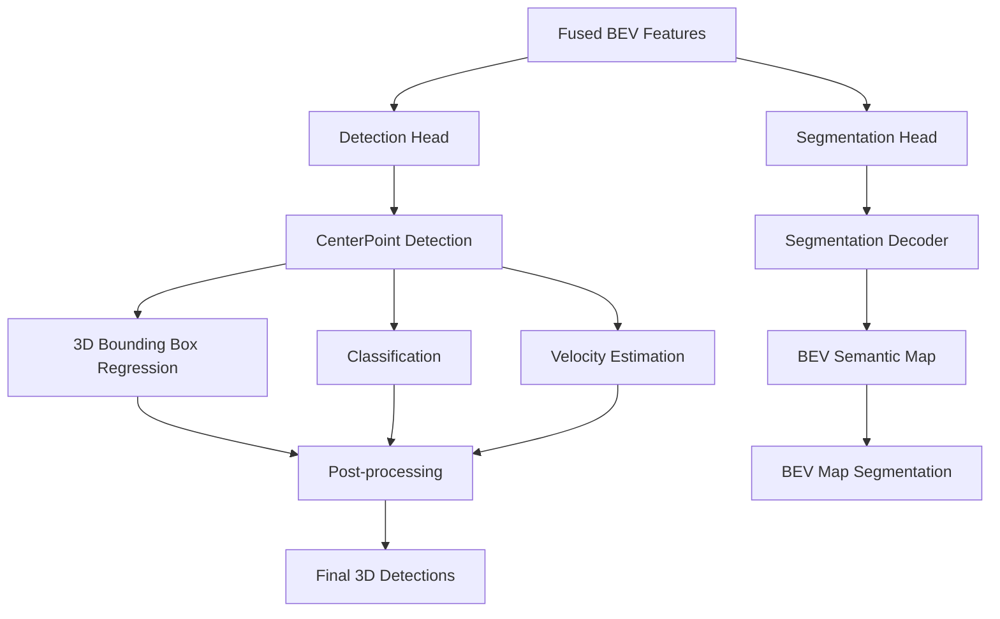

Sources: [mmdet3d/datasets/nuscenes_dataset.py:337-407](), [mmdet3d/datasets/nuscenes_dataset.py:498-530]()

### Detection Head
- **CenterPoint Detection**: Identifies object centers in BEV space
- **Box Regression**: Estimates 3D box dimensions, orientation, and location
- **Classification**: Predicts object class (car, pedestrian, etc.)
- **Velocity Estimation**: Predicts object velocity (if enabled)

### Segmentation Head
- **Segmentation Decoder**: Processes BEV features to predict semantic classes
- **Output**: BEV semantic map with classes like road, sidewalk, vegetation, etc.

## Evaluation and Output Formatting

The final outputs are formatted and evaluated:

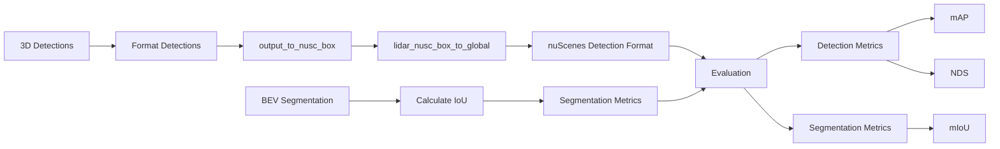

Sources: [mmdet3d/datasets/nuscenes_dataset.py:410-465](), [mmdet3d/datasets/nuscenes_dataset.py:498-530](), [mmdet3d/datasets/nuscenes_dataset.py:532-572]()

For detection outputs:
1. Predicted boxes are converted to the nuScenes box format
2. Boxes are transformed from LiDAR to global coordinates
3. Attributes like object velocity and status are added
4. Evaluation metrics like mAP and NDS are calculated

For segmentation outputs:
1. IoU is calculated for each class across different thresholds
2. mIoU (mean Intersection over Union) is calculated for the BEV map segmentation

## Complete Data Flow Diagram

Here's the complete data flow diagram showing all main components:

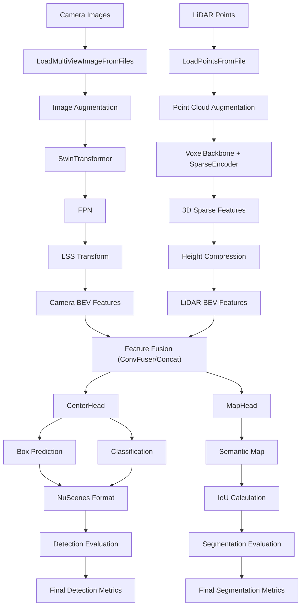

Sources: [README.md:20-45](), [mmdet3d/datasets/nuscenes_dataset.py:5-653]()

## Coordinate Systems and Transformations

A critical aspect of the data flow is the handling of different coordinate systems:

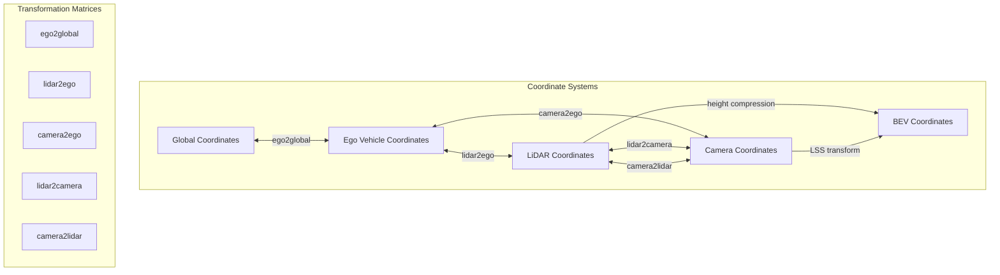

Sources: [mmdet3d/datasets/nuscenes_dataset.py:227-281]()

The system maintains these transformations to properly align multi-modal data:
- **Global → Ego**: Places data in ego-vehicle frame
- **Ego → Sensor**: Transforms between vehicle and sensor frames
- **Sensor → BEV**: Projects sensor data to bird's-eye view

The consistent handling of these coordinate transformations is crucial for accurate fusion of the multi-modal data.

---

