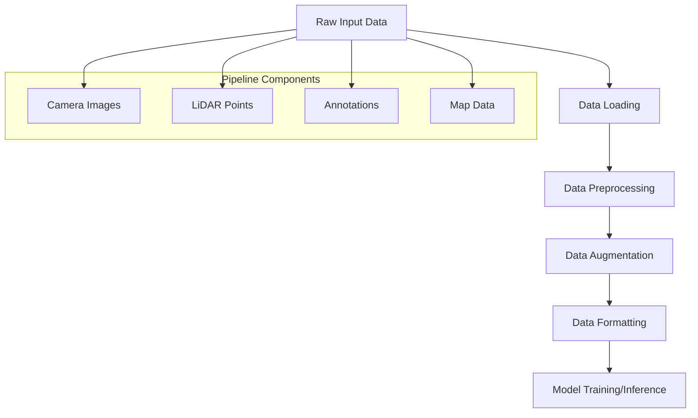
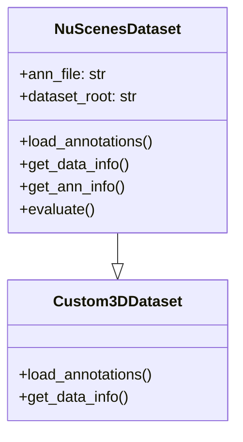
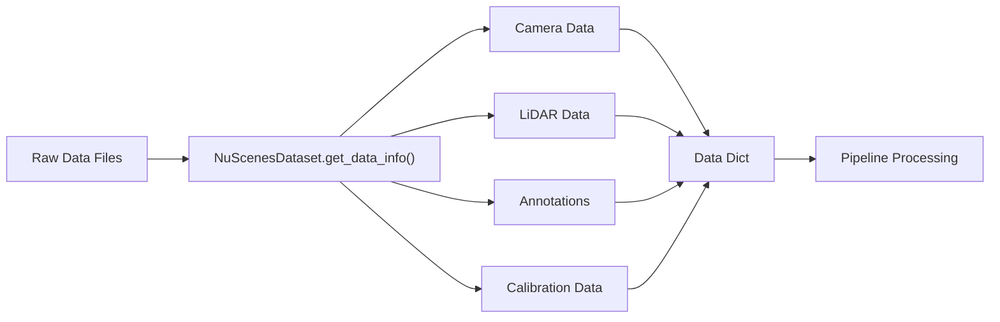
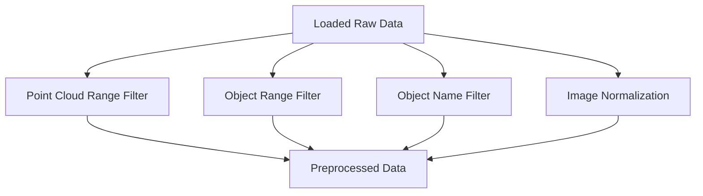
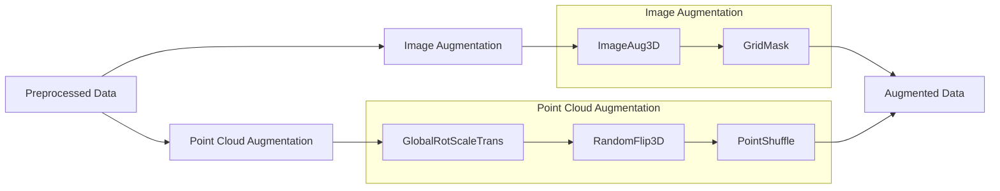
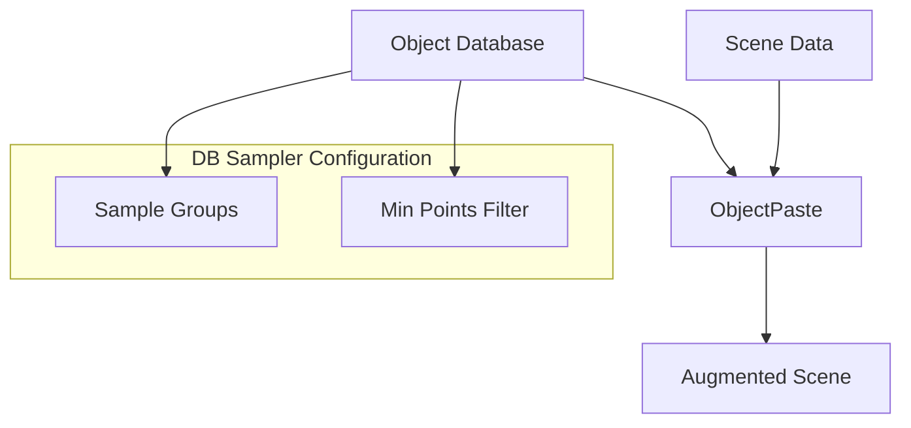
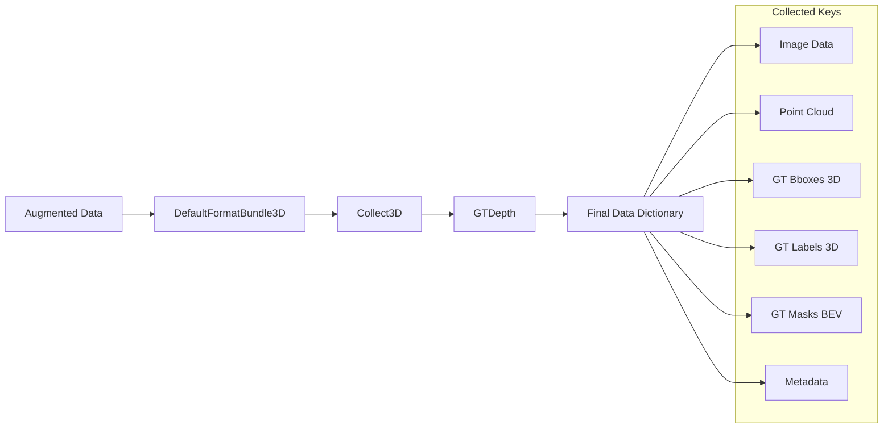
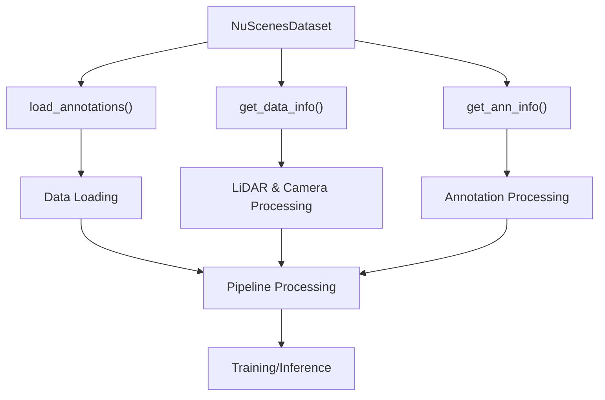

<!-- source: DeepWiki mcp.deepwiki.com · repo mit-han-lab/bevfusion · page 3 Data Processing Pipeline · fetched 2026-10-30 -->

# Data Processing Pipeline

Relevant source files

The following files were used as context for generating this wiki page:

- [configs/nuscenes/default.yaml](configs/nuscenes/default.yaml)
- [mmdet3d/datasets/nuscenes_dataset.py](mmdet3d/datasets/nuscenes_dataset.py)

## Purpose and Scope

This document explains the data processing pipeline in BEVFusion, which handles the preparation of multi-modal sensor data (camera images and LiDAR point clouds) for training and inference tasks. The pipeline covers data loading, preprocessing, augmentation, and formatting components essential for the fusion-based 3D object detection and segmentation. For information about the model components that process this data, see [Model Components](#4).

Sources: [configs/nuscenes/default.yaml:55-188](), [configs/nuscenes/default.yaml:190-264]()

## Dataset Structure

BEVFusion primarily uses the nuScenes dataset, which is handled by the `NuScenesDataset` class. This dataset contains synchronized camera images from multiple views, LiDAR point clouds, and 3D annotations for autonomous driving perception tasks.

### Key Dataset Components

| Component | Description | File Path Reference |
|-----------|-------------|---------------------|
| Object Classes | Classes for 3D object detection (e.g., car, truck, pedestrian) | [configs/nuscenes/default.yaml:25-35]() |
| Map Classes | Classes for BEV map segmentation (e.g., drivable_area, walkway) | [configs/nuscenes/default.yaml:37-47]() |
| Input Modalities | Sensor modalities used (LiDAR, camera) | [configs/nuscenes/default.yaml:48-53]() |

Sources: [mmdet3d/datasets/nuscenes_dataset.py:18-543]()

## Data Loading Pipeline

The data loading process transforms raw sensor data into a format suitable for model training or inference. BEVFusion uses separate specialized loaders for each data type.

### Data Loaders

| Loader | Purpose | Configuration Reference |
|--------|---------|-------------------------|
| `LoadMultiViewImageFromFiles` | Loads multiple camera images | [configs/nuscenes/default.yaml:56-58]() |
| `LoadPointsFromFile` | Loads LiDAR point cloud data | [configs/nuscenes/default.yaml:60-65]() |
| `LoadPointsFromMultiSweeps` | Loads and combines multiple LiDAR sweeps | [configs/nuscenes/default.yaml:67-74]() |
| `LoadAnnotations3D` | Loads 3D bounding box annotations | [configs/nuscenes/default.yaml:76-79]() |
| `LoadBEVSegmentation` | Loads bird's-eye view segmentation maps | [configs/nuscenes/default.yaml:133-137]() |

The core function `get_data_info` in the `NuScenesDataset` class prepares the sensor data and metadata:

Sources: [mmdet3d/datasets/nuscenes_dataset.py:209-285]()

## Data Preprocessing

Before augmentation, the raw sensor data undergoes preprocessing to ensure consistency and compatibility with the model inputs.

### Key Preprocessing Steps

1. **Point Cloud Range Filtering**: Removes points outside the defined detection range
2. **Object Range Filtering**: Filters out objects outside the detection range
3. **Object Name Filtering**: Keeps only objects from the specified classes
4. **Image Normalization**: Normalizes image pixel values

Sources: [configs/nuscenes/default.yaml:141-152](), [configs/nuscenes/default.yaml:236-241]()

## Data Augmentation

Data augmentation increases the diversity of training samples to improve model generalization. BEVFusion implements separate augmentation strategies for camera images and LiDAR point clouds.

### 2D Augmentation (Camera Images)

| Technique | Purpose | Parameter Range |
|-----------|---------|-----------------|
| Resize | Changes image dimensions | 0.38-0.55 (train), 0.48 (test) |
| Rotation | Randomly rotates images | ±5.4° (train only) |
| Flip | Randomly flips images | True (train only) |
| GridMask | Applies grid-like mask | Probability configurable |

### 3D Augmentation (LiDAR Points)

| Technique | Purpose | Parameter Range |
|-----------|---------|-----------------|
| Global Rotation | Rotates point cloud | ±0.78539816 rad (±45°) |
| Global Scaling | Scales point cloud | 0.9-1.1 |
| Global Translation | Translates point cloud | ±0.5m |
| Random Flip | Randomly flips point cloud | Applied after other transforms |
| Point Shuffle | Randomly shuffles points | Applied before final formatting |

Sources: [configs/nuscenes/default.yaml:119-165](), [configs/nuscenes/default.yaml:216-228]()

### Object Paste Augmentation

A special augmentation technique called `ObjectPaste` samples objects from a database and pastes them into the current scene. This is particularly useful for increasing the frequency of rare object classes.

Sources: [configs/nuscenes/default.yaml:80-118]()

## Data Formatting and Collection

The final stage of the pipeline formats the processed data and collects it into a standardized dictionary structure for model training or inference.

### Formatting Process

1. **DefaultFormatBundle3D**: Converts data to the required tensor formats
2. **Collect3D**: Assembles the final data dictionary with all required keys
3. **GTDepth** (optional): Generates ground truth depth information for camera-based models

Sources: [configs/nuscenes/default.yaml:167-188](), [configs/nuscenes/default.yaml:243-264]()

## Train vs. Test Pipeline Differences

BEVFusion uses different data processing pipelines for training and testing/validation. The main differences are in the augmentation strategies.

| Component | Training Pipeline | Testing Pipeline |
|-----------|-------------------|------------------|
| Image Resize | Random 0.38-0.55 | Fixed 0.48 |
| Image Rotation | Random ±5.4° | No rotation (0°) |
| Image Flip | Random flip | No flip |
| Point Cloud Scaling | Random 0.9-1.1 | Fixed 1.0 |
| Point Cloud Rotation | Random ±45° | No rotation (0°) |
| Point Cloud Translation | Random ±0.5m | No translation (0m) |
| GridMask Augmentation | Applied | Not applied |
| ObjectPaste | Applied | Not applied |

These differences ensure diverse training samples while maintaining consistency during evaluation.

Sources: [configs/nuscenes/default.yaml:55-188](), [configs/nuscenes/default.yaml:190-264]()

## Dataset Implementation Details

The `NuScenesDataset` class in BEVFusion handles all dataset-specific operations and integrates with the data processing pipeline.

Key implementation details:
- The dataset loads annotations from pickle files to efficiently access pre-processed metadata
- Calibration information (transformations between different sensor coordinate systems) is carefully calculated
- For each sample, the dataset provides a structured dictionary with all necessary information for the model
- The dataset implementation supports both training and testing modes with appropriate configurations

Sources: [mmdet3d/datasets/nuscenes_dataset.py:18-193](), [mmdet3d/datasets/nuscenes_dataset.py:194-207](), [mmdet3d/datasets/nuscenes_dataset.py:209-285](), [mmdet3d/datasets/nuscenes_dataset.py:287-335]()

---

