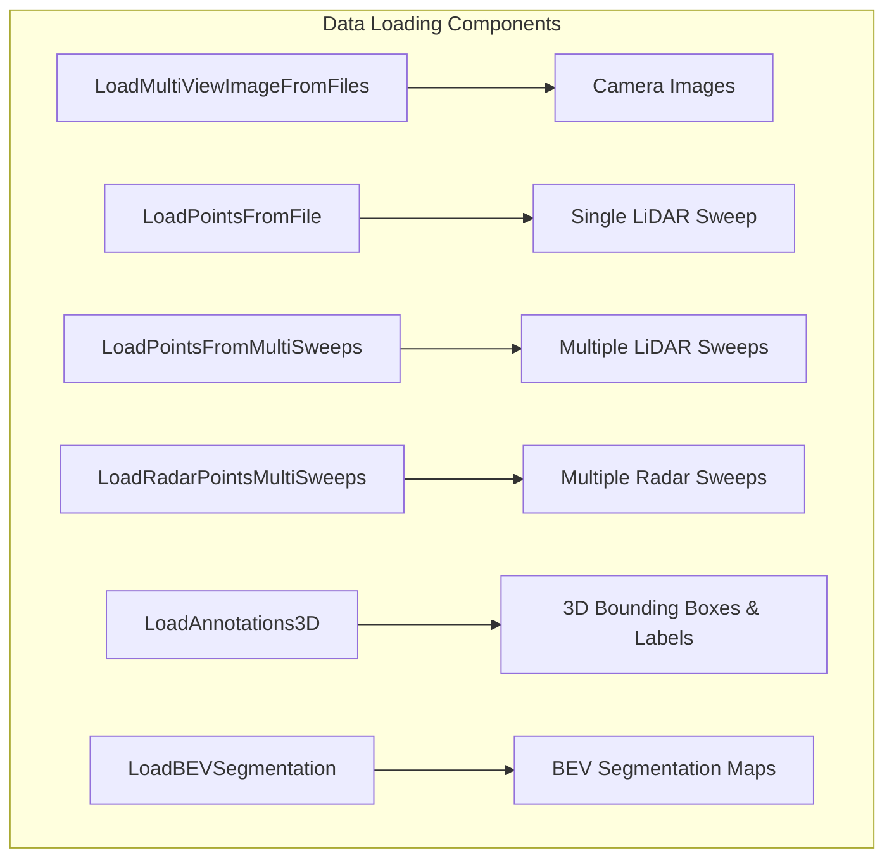
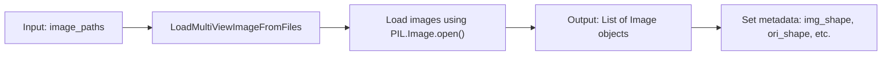
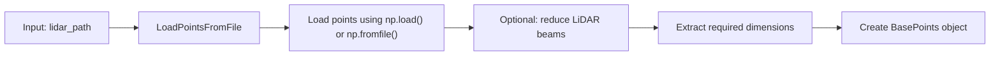
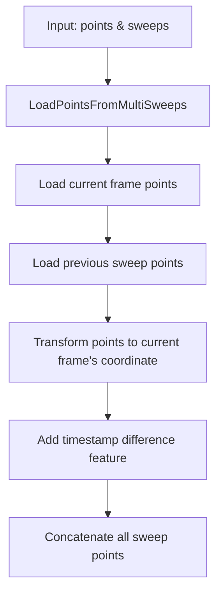
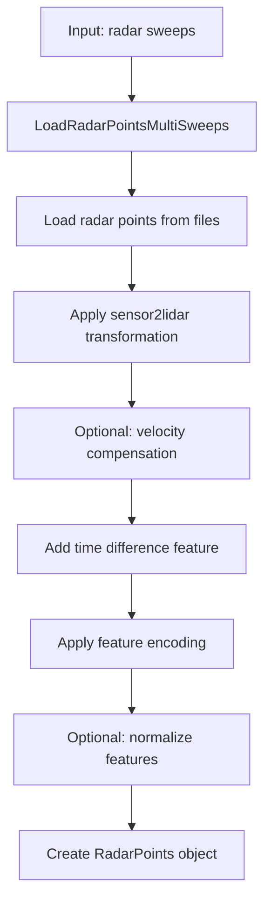
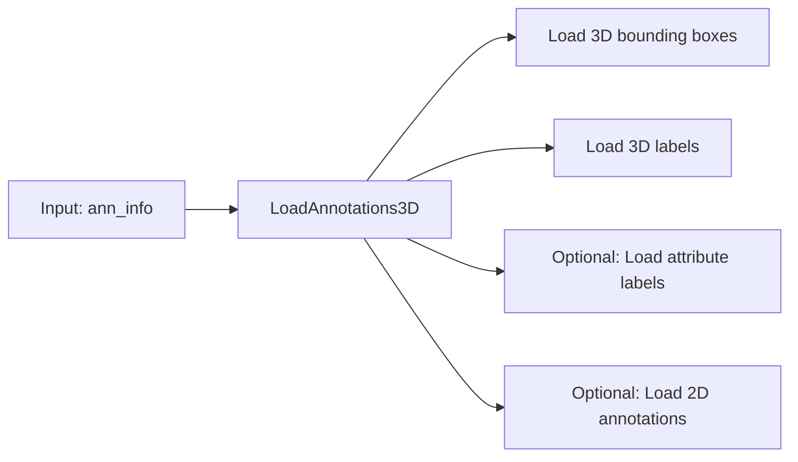
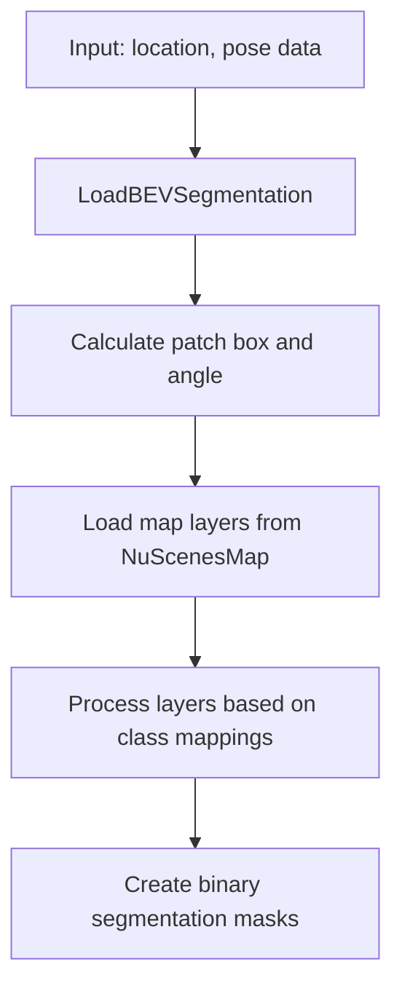
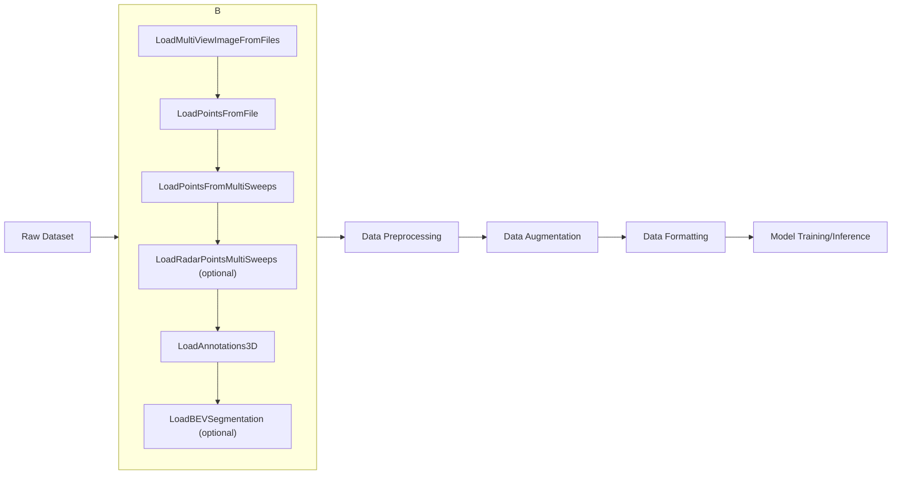
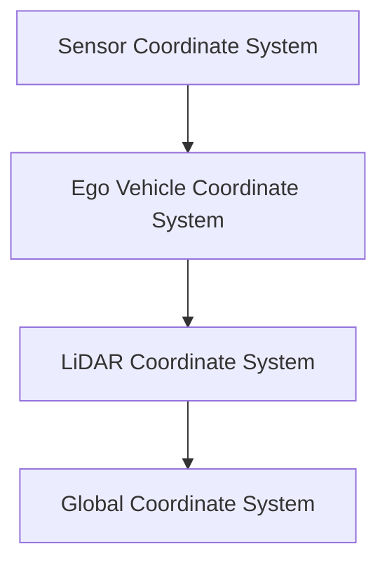

<!-- source: DeepWiki mcp.deepwiki.com · repo mit-han-lab/bevfusion · page 3.1 Data Loading · fetched 2026-10-30 -->

# Data Loading

Relevant source files

The following files were used as context for generating this wiki page:

- [mmdet3d/datasets/pipelines/loading.py](mmdet3d/datasets/pipelines/loading.py)

## Purpose and Scope

This document details the data loading components and processes in BEVFusion. It describes how the system loads data from various sources including camera images, LiDAR point clouds, radar data, and 3D annotations. The data loading module serves as the first step in the data processing pipeline, preparing raw data for subsequent preprocessing, augmentation, and model training/inference. For information about data augmentation, see [Data Augmentation & Transformation](#3.2).

Sources: [mmdet3d/datasets/pipelines/loading.py:21-794]()

## Data Loading Components

BEVFusion employs several specialized data loading components to handle different data types. Each component is implemented as a callable class that can be integrated into the data processing pipeline.

### Image Data Loading

The `LoadMultiViewImageFromFiles` class is responsible for loading multi-view camera images, which are crucial for the camera branch of BEVFusion.

Sources: [mmdet3d/datasets/pipelines/loading.py:21-83]()

Key implementation details:
- Loads images from a list of file paths specified in `results["image_paths"]`
- Uses PIL's `Image.open()` to load images without any preprocessing
- Returns a list of image objects rather than a stacked array
- Sets metadata fields including `filename`, `img_shape`, `ori_shape`, `pad_shape`, and `scale_factor`

### Point Cloud Data Loading

The `LoadPointsFromFile` class handles loading point cloud data from a single file (typically LiDAR data).

Sources: [mmdet3d/datasets/pipelines/loading.py:316-436]()

Key implementation details:
- Supports loading from `.npy` files or binary files
- Allows selection of specific dimensions to use (e.g., x, y, z, intensity)
- Can optionally reduce the number of LiDAR beams
- Supports optional augmented point cloud loading
- Creates a `BasePoints` object with the coordinate type (LIDAR, CAMERA, or DEPTH)

### Multi-sweep Point Cloud Loading

The `LoadPointsFromMultiSweeps` class loads point clouds from multiple time frames (sweeps) and combines them, which is essential for temporal information utilization.

Sources: [mmdet3d/datasets/pipelines/loading.py:86-240]()

Key implementation details:
- Loads points from the current frame and several previous frames
- Transforms points from previous frames to the current frame's coordinate system
- Adds a temporal dimension (timestamp difference) to each point
- Supports random or sequential sweep selection for training and testing
- Can optionally remove points too close to the ego vehicle

### Radar Data Loading

The `LoadRadarPointsMultiSweeps` class loads radar point clouds from multiple sweeps, similar to the LiDAR multi-sweep loader but with radar-specific processing.

Sources: [mmdet3d/datasets/pipelines/loading.py:575-794]()

Key implementation details:
- Loads radar points using the `RadarPointCloud` class
- Performs coordinate transformations to the LiDAR frame
- Can compensate velocity based on ego motion
- Applies feature encoding (one-hot, ordinal, or filtering-based)
- Optionally normalizes features to a specified range
- Pads or drops points to maintain a consistent output size

### 3D Annotation Loading

The `LoadAnnotations3D` class loads 3D annotations including bounding boxes, labels, and attribute labels.

Sources: [mmdet3d/datasets/pipelines/loading.py:437-563]()

Key implementation details:
- Extends `LoadAnnotations` from MMDetection
- Supports loading 3D bounding boxes, labels, and attribute labels
- Can optionally load 2D annotations (bounding boxes, labels, masks)
- Also supports loading 2.5D annotations (centers2d and depths)

### BEV Segmentation Loading

The `LoadBEVSegmentation` class loads bird's-eye view segmentation maps, which are used for training the segmentation head.

Sources: [mmdet3d/datasets/pipelines/loading.py:243-313]()

Key implementation details:
- Requires dataset root and location information
- Uses `NuScenesMap` to load map data for the specific location
- Creates masks for different map elements based on class mappings
- Transforms map data to the current ego vehicle's coordinate system
- Outputs binary segmentation masks for each class

## Data Loading Pipeline

In BEVFusion, the data loading components are organized into a pipeline that processes raw data into a format suitable for model training and inference. Each component is registered to the PIPELINES registry and can be configured in the dataset config file.

Sources: [mmdet3d/datasets/pipelines/loading.py:21-794]()

The pipeline follows these general steps:

1. Load multi-view camera images
2. Load LiDAR point cloud data for the current frame
3. Load and combine point clouds from multiple frames (if needed)
4. Load radar data from multiple frames (if used)
5. Load 3D annotations (for training)
6. Load BEV segmentation maps (if segmentation is used)

Each component in the pipeline takes a `results` dictionary as input, processes it, and returns the updated dictionary with additional data and metadata. This incremental approach allows for flexibility in constructing different data loading pipelines for different tasks.

## Key Implementation Details

### Data Format Standardization

All data loading components standardize their outputs to ensure compatibility with subsequent pipeline stages:

- Images are stored as lists of PIL Image objects
- Point clouds are converted to subclasses of `BasePoints` (e.g., `LiDARPoints`, `RadarPoints`)
- 3D bounding boxes are stored in the format expected by the detection head
- Segmentation masks are stored as binary arrays

### Coordinate System Handling

When loading data from multiple sensors or timestamps, coordinate transformations are applied to ensure all data is in a consistent coordinate system:

Sources: [mmdet3d/datasets/pipelines/loading.py:86-240](), [mmdet3d/datasets/pipelines/loading.py:575-794]()

- Camera-to-LiDAR transformations are applied using `sensor2lidar_rotation` and `sensor2lidar_translation`
- Previous sweeps are transformed to the current frame using temporal transformations
- Map data is transformed to the ego vehicle's coordinate system for BEV segmentation

### Temporal Information Management

For multi-sweep loading, temporal information is preserved:

- Points from previous sweeps are tagged with a timestamp difference
- Velocity information is optionally compensated based on ego vehicle motion
- Sweeps can be selected randomly (for training) or sequentially (for testing)

### Feature Encoding

Point cloud and radar data can undergo feature encoding:

- One-hot encoding for categorical features
- Ordinal encoding for ordered features
- Custom filtering based on feature values
- Feature normalization to specified ranges

## Conclusion

The data loading components in BEVFusion provide a flexible and efficient way to load, transform, and prepare multimodal data for 3D object detection and segmentation. By supporting various data sources and formats, BEVFusion can effectively utilize camera, LiDAR, and radar data in a unified framework.

For information about what happens to the data after loading, see [Data Augmentation & Transformation](#3.2) and [Data Formatting](#3.3).

---

