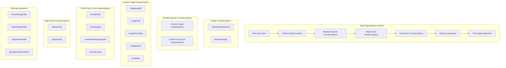
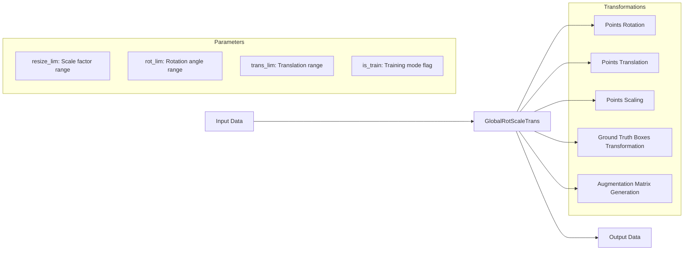
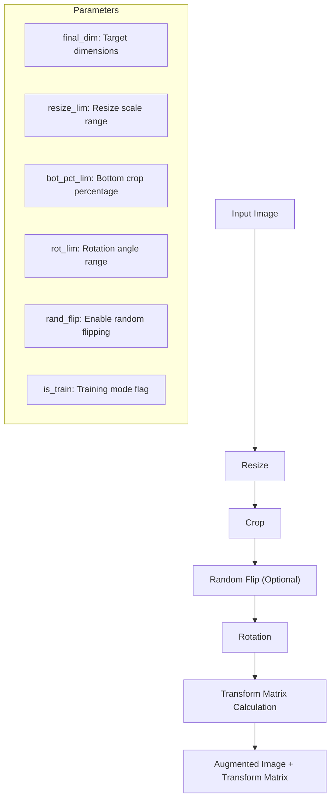
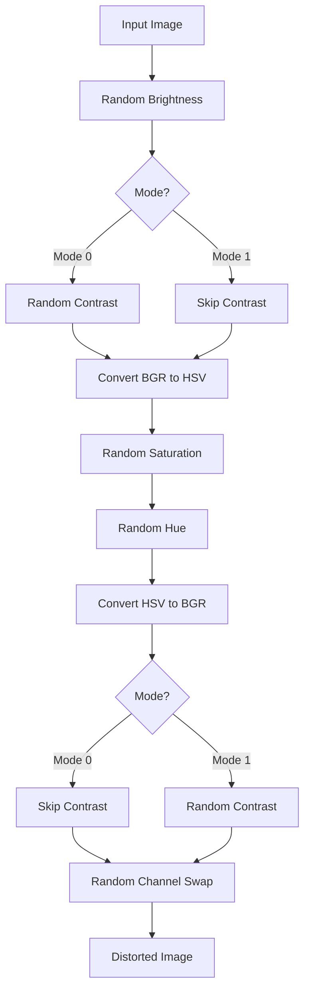
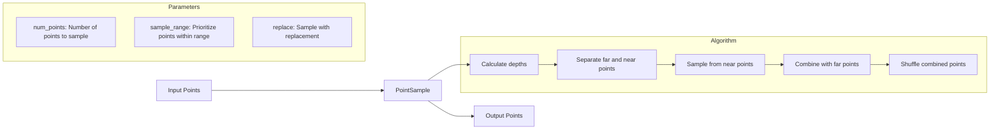
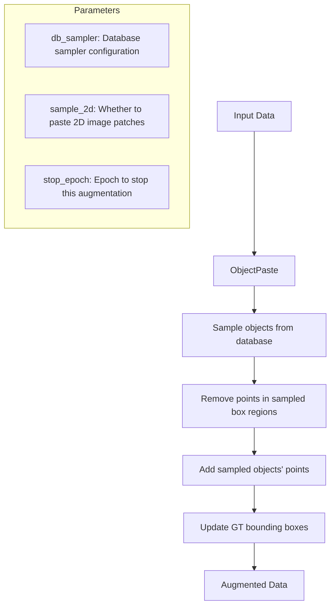
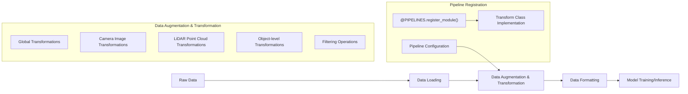

<!-- source: DeepWiki mcp.deepwiki.com · repo mit-han-lab/bevfusion · page 3.2 Data Augmentation & Transformation · fetched 2026-10-30 -->

# Data Augmentation & Transformation

Relevant source files

The following files were used as context for generating this wiki page:

- [mmdet3d/datasets/pipelines/transforms_3d.py](mmdet3d/datasets/pipelines/transforms_3d.py)

## Purpose and Scope

This document details the data augmentation and transformation techniques used in the BEVFusion framework for 3D object detection and segmentation. These operations are crucial for enhancing model robustness, preventing overfitting, and adapting input data to the required formats. The document covers transformations for both LiDAR point clouds and camera images, as well as transformations that operate on 3D bounding boxes and other metadata.

For information about data loading, see [Data Loading](#3.1), and for data formatting, see [Data Formatting](#3.3).

## Overview of Augmentation Pipeline

Data augmentation in BEVFusion follows a sequential pipeline where various transformations are applied to the input data. These transformations can be broadly categorized into camera-based transformations, LiDAR-based transformations, and joint transformations.

Sources: [mmdet3d/datasets/pipelines/transforms_3d.py:196-232](), [mmdet3d/datasets/pipelines/transforms_3d.py:323-353](), [mmdet3d/datasets/pipelines/transforms_3d.py:97-192](), [mmdet3d/datasets/pipelines/transforms_3d.py:935-988](), [mmdet3d/datasets/pipelines/transforms_3d.py:991-1006](), [mmdet3d/datasets/pipelines/transforms_3d.py:1009-1091](), [mmdet3d/datasets/pipelines/transforms_3d.py:236-320](), [mmdet3d/datasets/pipelines/transforms_3d.py:527-531](), [mmdet3d/datasets/pipelines/transforms_3d.py:638-736](), [mmdet3d/datasets/pipelines/transforms_3d.py:798-932](), [mmdet3d/datasets/pipelines/transforms_3d.py:508-524](), [mmdet3d/datasets/pipelines/transforms_3d.py:356-450](), [mmdet3d/datasets/pipelines/transforms_3d.py:452-505](), [mmdet3d/datasets/pipelines/transforms_3d.py:584-616](), [mmdet3d/datasets/pipelines/transforms_3d.py:534-581](), [mmdet3d/datasets/pipelines/transforms_3d.py:617-635](), [mmdet3d/datasets/pipelines/transforms_3d.py:740-795]()

## Global Transformations

Global transformations affect all aspects of the data, including point clouds, images, and annotations simultaneously to maintain consistency across different modalities.

### GlobalRotScaleTrans

This transformation applies global rotation, scaling, and translation to the entire scene, affecting both point clouds and ground-truth boxes.

Sources: [mmdet3d/datasets/pipelines/transforms_3d.py:196-232]()

### RandomFlip3D

Randomly flips the point clouds, objects, and masks in either horizontal or vertical direction.

| Parameter | Description |
|-----------|-------------|
| None | This class does not require parameters. It randomly decides whether to flip horizontally and vertically. |

Sources: [mmdet3d/datasets/pipelines/transforms_3d.py:323-353]()

## Camera Image Transformations

These transformations specifically target the camera images to improve model generalization on image data.

### ImageAug3D

`ImageAug3D` applies a series of geometric transformations to the camera images:

Sources: [mmdet3d/datasets/pipelines/transforms_3d.py:97-192]()

### ImageNormalize

Normalizes images using mean and standard deviation values.

| Parameter | Description |
|-----------|-------------|
| `mean` | Mean values for each channel |
| `std` | Standard deviation values for each channel |

Sources: [mmdet3d/datasets/pipelines/transforms_3d.py:991-1006]()

### ImagePad

Pads images to either a fixed size or to a size divisible by a specific number.

| Parameter | Description |
|-----------|-------------|
| `size` | Fixed padding size (tuple) |
| `size_divisor` | The divisor of padded size (int) |
| `pad_val` | Padding value (default: 0) |

Sources: [mmdet3d/datasets/pipelines/transforms_3d.py:935-988]()

### ImageDistort

Applies photometric distortions to improve model robustness to lighting changes.

Sources: [mmdet3d/datasets/pipelines/transforms_3d.py:1009-1091]()

### GridMask

Applies a grid mask to images for regularization.

| Parameter | Description |
|-----------|-------------|
| `use_h` | Whether to apply grid mask on height |
| `use_w` | Whether to apply grid mask on width |
| `max_epoch` | Maximum epoch for probability calculation |
| `rotate` | Mask rotation options |
| `offset` | Whether to use offset |
| `ratio` | Ratio of grid to cell size |
| `mode` | Mode of operation (0 or 1) |
| `prob` | Initial probability |

Sources: [mmdet3d/datasets/pipelines/transforms_3d.py:236-320]()

## LiDAR Point Cloud Transformations

These transformations are specific to point cloud data to enhance model generalization on LiDAR inputs.

### PointShuffle

Randomly shuffles the point cloud to eliminate any order bias.

| Parameter | Description |
|-----------|-------------|
| None | This class does not require parameters |

Sources: [mmdet3d/datasets/pipelines/transforms_3d.py:527-531]()

### PointSample

Samples a subset of points from the point cloud, optionally prioritizing points based on distance.

Sources: [mmdet3d/datasets/pipelines/transforms_3d.py:638-736]()

### VoxelBasedPointSampler

Samples points based on voxel representation, useful for balancing point distribution.

| Parameter | Description |
|-----------|-------------|
| `cur_sweep_cfg` | Config for sampling current sweep points |
| `prev_sweep_cfg` | Config for sampling previous sweep points |
| `time_dim` | Index of time dimension in point feature |

Sources: [mmdet3d/datasets/pipelines/transforms_3d.py:798-932]()

### FrameDropout

Randomly drops temporal frames from the point cloud to simulate sensor data loss.

| Parameter | Description |
|-----------|-------------|
| `prob` | Probability of dropping a frame |
| `time_dim` | Index of time dimension in point feature |

Sources: [mmdet3d/datasets/pipelines/transforms_3d.py:508-524]()

## Object-level Transformations

These transformations operate on 3D objects (bounding boxes) to augment the training data.

### ObjectPaste

Pastes objects from a database into the current scene, useful for augmenting rare classes.

Sources: [mmdet3d/datasets/pipelines/transforms_3d.py:356-450]()

### ObjectNoise

Adds noise to ground truth objects' position, rotation, and global orientation.

| Parameter | Description |
|-----------|-------------|
| `translation_std` | Standard deviation for translation noise |
| `global_rot_range` | Range for global rotation noise |
| `rot_range` | Range for per-object rotation noise |
| `num_try` | Number of attempts for valid noise application |

Sources: [mmdet3d/datasets/pipelines/transforms_3d.py:452-505]()

## Filtering Operations

These operations filter data points based on various criteria to focus on relevant information.

### PointsRangeFilter

Filters points outside a specified 3D range.

| Parameter | Description |
|-----------|-------------|
| `point_cloud_range` | 3D range specification [x_min, y_min, z_min, x_max, y_max, z_max] |

Sources: [mmdet3d/datasets/pipelines/transforms_3d.py:584-616]()

### ObjectRangeFilter

Filters objects whose centers are outside a specified BEV (bird's-eye view) range.

| Parameter | Description |
|-----------|-------------|
| `point_cloud_range` | 3D range specification [x_min, y_min, z_min, x_max, y_max, z_max] |

Sources: [mmdet3d/datasets/pipelines/transforms_3d.py:534-581]()

### ObjectNameFilter

Filters objects based on their class names.

| Parameter | Description |
|-----------|-------------|
| `classes` | List of class names to keep |

Sources: [mmdet3d/datasets/pipelines/transforms_3d.py:617-635]()

### BackgroundPointsFilter

Removes background points near ground truth bounding boxes.

| Parameter | Description |
|-----------|-------------|
| `bbox_enlarge_range` | Range to enlarge bounding boxes for filtering |

Sources: [mmdet3d/datasets/pipelines/transforms_3d.py:740-795]()

## Integration with Data Pipeline

The augmentation and transformation operations are integrated into the BEVFusion data pipeline using a modular design. Each transformation is registered with the `PIPELINES` registry and can be configured in the pipeline configuration files.

Sources: [mmdet3d/datasets/pipelines/transforms_3d.py:25-1091]()

## Commonly Used Transformation Combinations

Based on the BEVFusion implementation, here are commonly used transformation combinations for different scenarios:

### For Camera-only Models

| Transformation | Purpose |
|----------------|---------|
| `ImageAug3D` | Geometric augmentations |
| `ImageNormalize` | Normalize image values |
| `ImagePad` | Ensure consistent image sizes |
| `ImageDistort` | Photometric augmentations |

### For LiDAR-only Models

| Transformation | Purpose |
|----------------|---------|
| `GlobalRotScaleTrans` | Global geometric augmentations |
| `RandomFlip3D` | Additional geometric augmentation |
| `PointsRangeFilter` | Focus on relevant region |
| `ObjectRangeFilter` | Remove out-of-range objects |
| `PointShuffle` | Eliminate order bias |
| `ObjectPaste` | Augment rare classes |

### For Multi-modal Fusion Models

A combination of both camera and LiDAR transformations is used, with special attention to maintaining consistency between the two modalities through the use of transformation matrices that are shared between modalities.

Sources: [mmdet3d/datasets/pipelines/transforms_3d.py:25-1091]()

## Special Transformations for Multi-modal Fusion

### GTDepth

Generates ground truth depth maps from LiDAR point clouds, which is crucial for certain multi-modal fusion approaches.

| Parameter | Description |
|-----------|-------------|
| `keyframe_only` | Whether to use only keyframe points |

Sources: [mmdet3d/datasets/pipelines/transforms_3d.py:25-94]()

## Conclusion

BEVFusion employs a comprehensive set of data augmentation and transformation techniques to enhance model robustness and performance. These techniques are carefully designed to work with both camera and LiDAR modalities, ensuring consistent transformations across different data sources. The modular design allows for easy configuration and combination of different transformations based on specific requirements.

---

