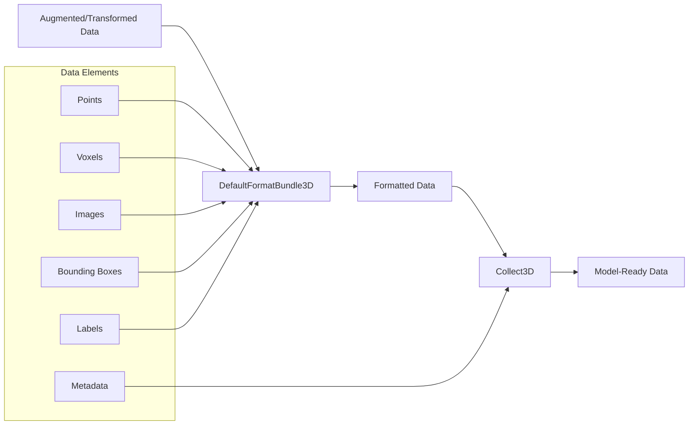
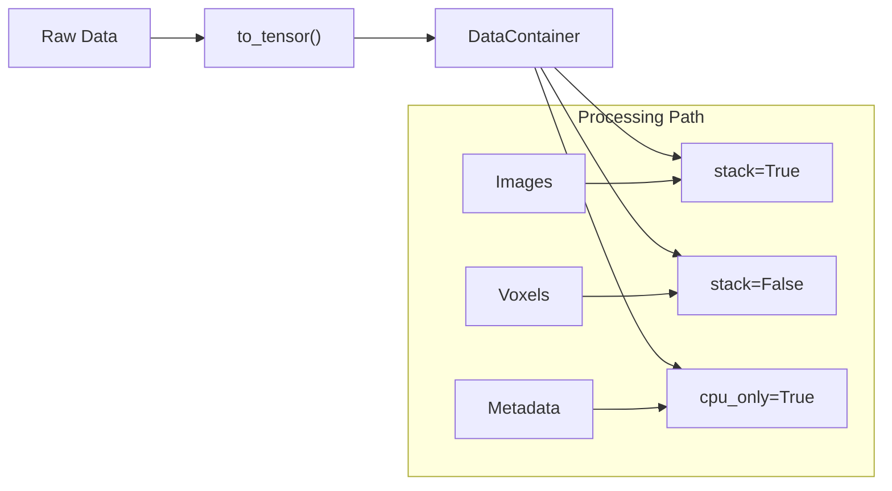
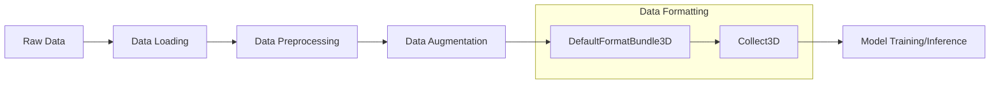

<!-- source: DeepWiki mcp.deepwiki.com · repo mit-han-lab/bevfusion · page 3.3 Data Formatting · fetched 2026-10-30 -->

# Data Formatting

<details>
<summary>Relevant source files</summary>

The following files were used as context for generating this wiki page:

- [mmdet3d/datasets/pipelines/formating.py](mmdet3d/datasets/pipelines/formating.py)

</details>


This document details the data formatting subsystem of BEVFusion, which is responsible for transforming processed data into model-ready formats. Data formatting is the final step in the data preprocessing pipeline before the data is fed into the model for training or inference. For information about data loading and augmentation, see [Data Loading](#3.1) and [Data Augmentation & Transformation](#3.2).

## Overview of Data Formatting

Data formatting in BEVFusion serves to standardize the representation of various data types (images, point clouds, bounding boxes, labels, etc.) into consistent formats that can be efficiently processed by deep learning models. The formatting process handles both data type conversion and structural organization.



Sources: [mmdet3d/datasets/pipelines/formating.py:13-127]()

## Key Components

BEVFusion implements two primary components for data formatting:

1. **DefaultFormatBundle3D**: Converts various data types to tensors and wraps them in DataContainer objects
2. **Collect3D**: Organizes the formatted data and metadata into the final structure expected by the model

### DefaultFormatBundle3D

The `DefaultFormatBundle3D` class handles the conversion of various data elements into the appropriate tensor formats and wraps them in `DataContainer` objects for efficient batch processing.

```mermaid
classDiagram
    class DefaultFormatBundle3D {
        +class_names: list
        +with_gt: bool
        +with_label: bool
        +__call__(results): dict
    }
    
    class "Data Types" {
        +Points
        +Radar data
        +Voxels
        +GT bounding boxes
        +GT labels
        +Images
    }
    
    class "Converted Types" {
        +Tensors
        +DataContainer objects
    }
    
    DefaultFormatBundle3D --> "Data Types" : Processes
    DefaultFormatBundle3D --> "Converted Types" : Produces
```

Sources: [mmdet3d/datasets/pipelines/formating.py:13-127]()

The `DefaultFormatBundle3D` handles the following types of data:

| Data Type | Processing |
|-----------|------------|
| Points | Converted to tensor and wrapped in DataContainer |
| Radar | Converted to tensor and wrapped in DataContainer |
| Voxels/Coordinates | Converted to tensor and wrapped in DataContainer |
| Ground-truth 3D bounding boxes | Processed based on masks, converted to tensor, and wrapped in DataContainer |
| Ground-truth labels | Generated from class names and converted to appropriate format |
| Images | Stacked into a single tensor and wrapped in DataContainer |

Key features of DefaultFormatBundle3D:

1. **Mask Application**: Applies masks to filter out invalid bounding boxes and their associated labels
2. **Label Conversion**: Converts class names to numeric indices based on the provided class list
3. **Tensor Conversion**: Transforms numpy arrays into PyTorch tensors
4. **DataContainer Wrapping**: Wraps the tensors in DataContainer objects for efficient batch processing

Sources: [mmdet3d/datasets/pipelines/formating.py:13-127]()

### Collect3D

The `Collect3D` class is responsible for collecting and organizing the formatted data and metadata into the final structure that will be passed to the model.

```mermaid
classDiagram
    class Collect3D {
        +keys: list
        +meta_keys: tuple
        +meta_lis_keys: tuple
        +__call__(results): dict
    }
    
    class "Data" {
        +img
        +points
        +voxels
        +gt_bboxes
        +gt_labels
        +etc.
    }
    
    class "Meta Keys" {
        +camera_intrinsics
        +camera2ego
        +img_aug_matrix
        +lidar_aug_matrix
    }
    
    class "Meta List Keys" {
        +filename
        +timestamp
        +lidar2image
        +box_mode_3d
        +etc.
    }
    
    class "Output" {
        +data: dict
        +metas: DataContainer
    }
    
    Collect3D --> "Data" : Collects
    Collect3D --> "Meta Keys" : Processes
    Collect3D --> "Meta List Keys" : Processes
    Collect3D --> "Output" : Produces
```

Sources: [mmdet3d/datasets/pipelines/formating.py:130-200]()

`Collect3D` organizes the data into two main components:

1. **Data**: Contains the actual data elements (images, points, voxels, etc.) that will be processed by the model
2. **Metas**: Contains metadata (camera parameters, file paths, etc.) that provides context for the data

The keys to be included in each component are specified during initialization:

| Component | Key Types | Examples |
|-----------|-----------|----------|
| Data | Main data keys | 'img', 'points', 'voxels', 'gt_bboxes', 'gt_labels' |
| Data | Meta keys | 'camera_intrinsics', 'camera2ego', 'img_aug_matrix', 'lidar_aug_matrix' |
| Metas | List keys | 'filename', 'timestamp', 'lidar2image', 'box_mode_3d', etc. |

Sources: [mmdet3d/datasets/pipelines/formating.py:130-200]()

## Data Container

The `DataContainer` (DC) class from MMCV is a key component used throughout the formatting process. It serves as a wrapper for various data types and provides additional functionality for batch processing.

Key features of DataContainer:

1. **Stack Control**: Determines whether the data should be stacked into batches
2. **Padding Control**: Controls padding behavior for tensors of different shapes
3. **CPU/GPU Control**: Specifies whether the data should be kept on CPU or transferred to GPU



Sources: [mmdet3d/datasets/pipelines/formating.py:53-62](), [mmdet3d/datasets/pipelines/formating.py:104-126](), [mmdet3d/datasets/pipelines/formating.py:190-199]()

## Integration in the Data Pipeline

The formatting components are typically the final stages in the data processing pipeline, coming after data loading, preprocessing, and augmentation. They prepare the data for efficient batch processing during model training or inference.



In the BEVFusion pipeline, these formatters are registered as pipeline components using the MMDET framework's registry system, which allows them to be easily configured and inserted into the data processing pipeline.

Sources: [mmdet3d/datasets/pipelines/formating.py:13-14](), [mmdet3d/datasets/pipelines/formating.py:130-131]()

## Example Data Flow

To better understand how data moves through the formatting process, let's trace the path of different data types:

1. **Point Cloud Data**:
   - Input: BasePoints object
   - DefaultFormatBundle3D: Converts to tensor and wraps in DataContainer
   - Collect3D: Includes in output data dictionary if specified in keys

2. **Image Data**:
   - Input: List of tensors (one per camera)
   - DefaultFormatBundle3D: Stacks into a single tensor and wraps in DataContainer
   - Collect3D: Includes in output data dictionary if specified in keys

3. **3D Bounding Boxes**:
   - Input: BaseInstance3DBoxes object or array
   - DefaultFormatBundle3D: Filters using masks, converts to tensor, wraps in DataContainer
   - Collect3D: Includes in output data dictionary if specified in keys

4. **Metadata**:
   - Input: Various formats
   - DefaultFormatBundle3D: Generally does not process metadata
   - Collect3D: Collects specified metadata keys and wraps in a CPU-only DataContainer

Sources: [mmdet3d/datasets/pipelines/formating.py:40-127](), [mmdet3d/datasets/pipelines/formating.py:170-200]()

## Summary

The data formatting subsystem in BEVFusion ensures that all data is properly prepared for efficient processing by the model. It converts various data types to appropriate tensor formats, applies necessary transformations, and organizes the data into a structured format that facilitates batch processing during training and inference.

The combination of `DefaultFormatBundle3D` and `Collect3D` provides a flexible and efficient pipeline for formatting multi-modal data from cameras and LiDAR sensors, which is essential for the fusion-based approach of BEVFusion.

---

