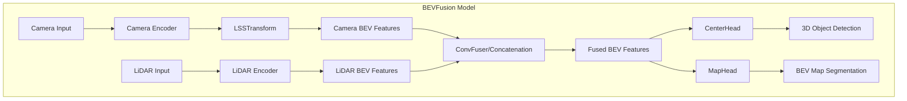
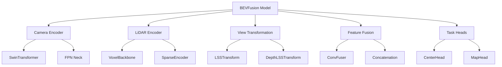
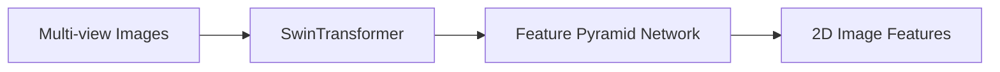
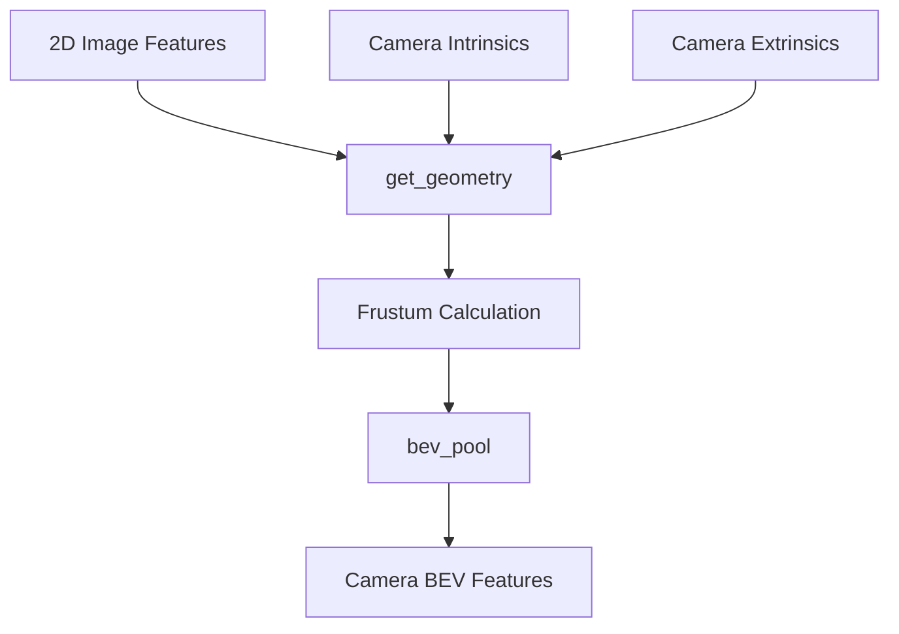
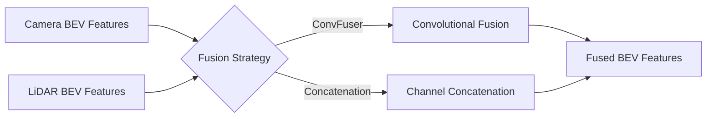
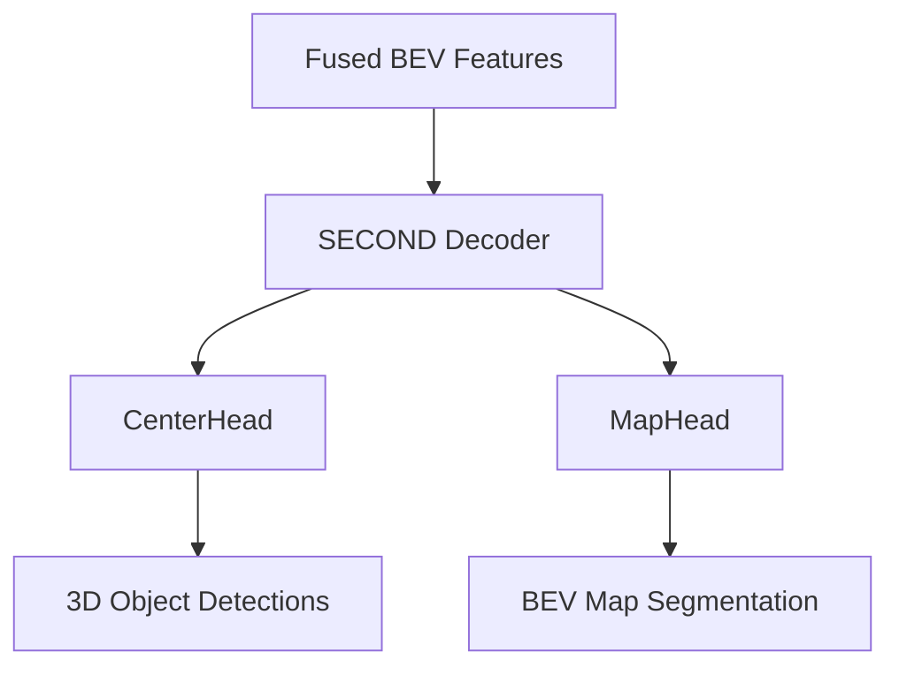

<!-- source: DeepWiki mcp.deepwiki.com · repo mit-han-lab/bevfusion · page 4 Model Components · fetched 2026-10-30 -->

# Model Components

Relevant source files

The following files were used as context for generating this wiki page:

- [README.md](README.md)
- [assets/demo.gif](assets/demo.gif)
- [docker/Dockerfile](docker/Dockerfile)
- [mmdet3d/datasets/pipelines/utils.py](mmdet3d/datasets/pipelines/utils.py)

This page provides an overview of the key components that form the BEVFusion model architecture. BEVFusion integrates data from camera and LiDAR sensors into a unified bird's-eye view (BEV) representation for 3D perception tasks in autonomous driving.

For information about the overall system architecture, see [System Architecture](#2), and for details on data processing prior to model components, see [Data Processing Pipeline](#3).

## Architecture Overview

BEVFusion's model architecture consists of five primary components:

1. **Camera Encoder**: Processes image data and extracts features
2. **LiDAR Encoder**: Processes point cloud data and extracts features
3. **View Transformation**: Transforms camera features to bird's-eye view
4. **Multi-Modal Fusion**: Combines camera and LiDAR features
5. **Task-Specific Heads**: Performs detection and segmentation tasks

Sources: [README.md:8-20]()

## Component Relationships

The following diagram details the relationships between model components and their specific implementations in the codebase:

Sources: [README.md:10-60]()

## Camera Encoder

The Camera Encoder processes multi-view camera inputs to extract feature representations. It consists of two main components:

1. **Backbone**: Typically a SwinTransformer that extracts features from images
2. **Neck**: A Feature Pyramid Network (FPN) that builds a feature hierarchy

The camera encoder output is later transformed into a bird's-eye view representation through the View Transformation component.

Sources: [README.md:30-50]()

## LiDAR Encoder

The LiDAR Encoder processes point cloud data to extract features. It employs efficient sparse convolutional networks to handle the sparse nature of LiDAR data.

The processing pipeline includes:

1. **Voxelization**: Converting point cloud into a regular grid of voxels
2. **Feature Extraction**: Using sparse convolutions to extract features
3. **BEV Projection**: Projecting features to the bird's-eye view

Sources: [README.md:30-50]()

## View Transformation

The View Transformation component converts 2D image features from the camera's perspective to a 3D bird's-eye view representation. This is a critical step for aligning camera features with LiDAR features in a common coordinate space.

BEVFusion implements two types of view transformations:

1. **LSSTransform**: The standard Lift-Splat-Shoot transformation
2. **DepthLSSTransform**: An enhanced version that incorporates depth information

The key operations in this process include:

| Operation | Description |
|-----------|-------------|
| Frustum Calculation | Computes view frustums based on camera intrinsics and extrinsics |
| Geometry Computation | Determines the mapping between image space and BEV space |
| BEV Pooling | Efficiently pools features into the BEV grid using custom CUDA operations |

This component is significantly optimized in BEVFusion, with the BEV pooling operation reducing latency by more than 40x compared to previous methods.

Sources: [README.md:20-52]()

## Multi-Modal Fusion

The Multi-Modal Fusion component combines features from camera and LiDAR modalities into a unified representation. BEVFusion supports two main fusion strategies:

1. **ConvFuser**: Uses convolutional layers to fuse features
2. **Concatenation**: Simple concatenation of features along the channel dimension

Both approaches operate on features already transformed to the bird's-eye view, which preserves both geometric and semantic information from different sensors.

Sources: [README.md:20-52]()

## Detection and Segmentation Heads

The Task-Specific Heads component processes the fused BEV features to perform specific perception tasks. BEVFusion supports two main types of heads:

### Detection Head (CenterHead)

The detection head localizes and classifies 3D objects in the scene. It outputs:
- 3D bounding boxes
- Class probabilities
- Orientation estimates

### Segmentation Head (MapHead)

The segmentation head performs BEV map segmentation, identifying areas such as:
- Drivable areas
- Pedestrian crossings
- Lane markings

Sources: [README.md:30-60]()

## Performance Metrics

BEVFusion achieves state-of-the-art performance on several benchmarks:

### 3D Object Detection (nuScenes validation)

| Model | Modality | mAP | NDS |
|-------|----------|-----|-----|
| BEVFusion | Camera+LiDAR | 68.52 | 71.38 |
| Camera-Only | Camera | 35.56 | 41.21 |
| LiDAR-Only | LiDAR | 64.68 | 69.28 |

### BEV Map Segmentation (nuScenes validation)

| Model | Modality | mIoU |
|-------|----------|------|
| BEVFusion | Camera+LiDAR | 62.95 |
| Camera-Only | Camera | 57.09 |
| LiDAR-Only | LiDAR | 48.56 |

Sources: [README.md:30-60]()

## Implementation Efficiency

BEVFusion is designed with computational efficiency in mind:

- Optimized BEV pooling operations reduce latency by more than 40x
- The architecture maintains real-time inference capabilities
- Optimized deployment solutions can achieve 25 FPS on NVIDIA Jetson Orin platforms

These optimizations make BEVFusion practical for real-world autonomous driving applications where computational resources may be limited and real-time performance is critical.

Sources: [README.md:10-20]()

---

