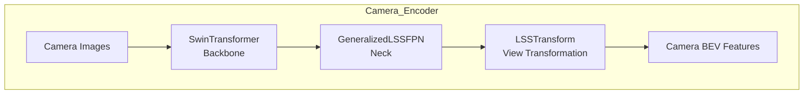
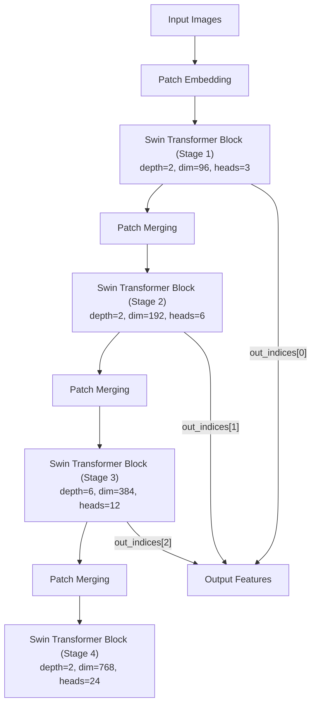
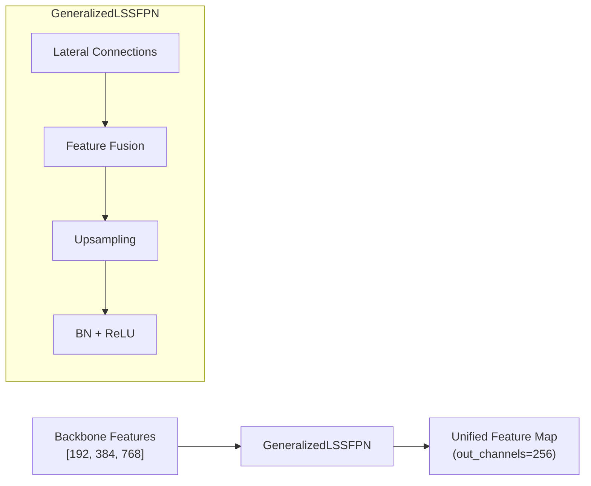
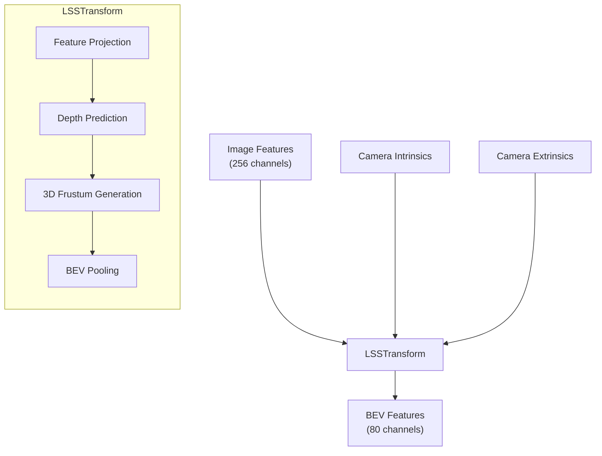
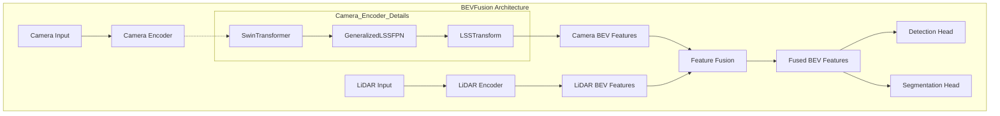
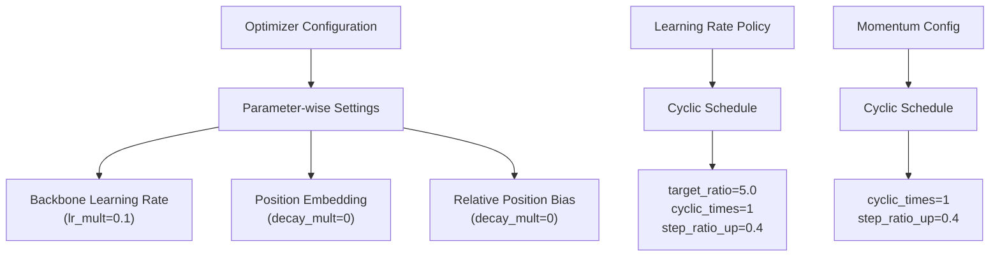

<!-- source: DeepWiki mcp.deepwiki.com · repo mit-han-lab/bevfusion · page 4.1 Camera Encoder · fetched 2026-10-30 -->

# Camera Encoder

Relevant source files

The following files were used as context for generating this wiki page:

- [configs/nuscenes/det/centerhead/lssfpn/camera/256x704/swint/default.yaml](configs/nuscenes/det/centerhead/lssfpn/camera/256x704/swint/default.yaml)
- [configs/nuscenes/det/centerhead/lssfpn/camera/default.yaml](configs/nuscenes/det/centerhead/lssfpn/camera/default.yaml)

## Purpose and Scope

This document details the Camera Encoder component within the BEVFusion framework. The Camera Encoder processes raw camera image inputs and transforms them into bird's-eye view (BEV) feature representations. These BEV features can then be fused with LiDAR BEV features as part of the multi-modal fusion process. For information about LiDAR processing, see [LiDAR Encoder](#4.2), and for details on how these features are combined, see [Multi-Modal Fusion](#4.4).

## Architecture Overview

The Camera Encoder consists of three main sequential components: a backbone network for feature extraction, a neck network for feature refinement, and a view transformation module for converting perspective view features to BEV representation.

Sources: [configs/nuscenes/det/centerhead/lssfpn/camera/256x704/swint/default.yaml:2-46](), [configs/nuscenes/det/centerhead/lssfpn/camera/default.yaml:8-17]()

## Components

### SwinTransformer Backbone

The Camera Encoder uses the Swin Transformer (Shifted Window Transformer) as its backbone network. This hierarchical vision transformer is particularly effective for visual feature extraction.

#### Configuration Parameters

| Parameter | Value | Description |
|-----------|-------|-------------|
| embed_dims | 96 | Initial embedding dimension |
| depths | [2, 2, 6, 2] | Number of transformer blocks in each stage |
| num_heads | [3, 6, 12, 24] | Number of attention heads in each stage |
| window_size | 7 | Size of the attention window |
| mlp_ratio | 4 | Expansion ratio for MLP layers |
| drop_path_rate | 0.2 | Stochastic depth rate |
| out_indices | [1, 2, 3] | Indices of output stages (zero-indexed) |
| init_cfg | Pretrained | Uses pretrained weights |

Sources: [configs/nuscenes/det/centerhead/lssfpn/camera/256x704/swint/default.yaml:4-22]()

### GeneralizedLSSFPN Neck

The neck component is a Generalized Lift-Splat-Shoot Feature Pyramid Network (GeneralizedLSSFPN) that processes and refines the multi-scale features from the backbone.

#### Configuration Parameters

| Parameter | Value | Description |
|-----------|-------|-------------|
| in_channels | [192, 384, 768] | Input channel dimensions from backbone |
| out_channels | 256 | Output channel dimension |
| start_level | 0 | Starting level from input |
| num_outs | 3 | Number of output scales |
| norm_cfg | BN2d | Batch normalization type |
| act_cfg | ReLU, inplace=true | Activation function |
| upsample_cfg | bilinear, align_corners=false | Upsampling method |

Sources: [configs/nuscenes/det/centerhead/lssfpn/camera/256x704/swint/default.yaml:23-37]()

### LSSTransform View Transformation

The LSSTransform module converts the 2D image features into a 3D BEV representation, which is a critical step for fusion with LiDAR features.

#### Configuration Parameters

| Parameter | Value | Description |
|-----------|-------|-------------|
| type | LSSTransform | Lift-Splat-Shoot transformation |
| in_channels | 256 | Input channel dimension |
| out_channels | 80 | Output channel dimension |
| feature_size | [image_height/8, image_width/8] | Feature map size |
| xbound | [-51.2, 51.2, 0.4] | X-axis range and resolution |
| ybound | [-51.2, 51.2, 0.4] | Y-axis range and resolution |
| zbound | [-10.0, 10.0, 20.0] | Z-axis range and resolution |
| dbound | [1.0, 60.0, 0.5] | Depth range and resolution |
| downsample | 2 | Downsample factor for BEV features |

Sources: [configs/nuscenes/det/centerhead/lssfpn/camera/256x704/swint/default.yaml:38-46](), [configs/nuscenes/det/centerhead/lssfpn/camera/default.yaml:10-17]()

## Integration with BEVFusion

The Camera Encoder is a fundamental component in the BEVFusion pipeline, working in parallel with the LiDAR Encoder to produce complementary BEV features that are subsequently fused.

Sources: [configs/nuscenes/det/centerhead/lssfpn/camera/256x704/swint/default.yaml:2-46](), [configs/nuscenes/det/centerhead/lssfpn/camera/default.yaml:8-17]()

## Training Configuration

The Camera Encoder has specific optimization parameters to ensure effective training:

The Camera Encoder backbone uses a lower learning rate multiplier (0.1) compared to other components, which helps stabilize training since it uses pretrained weights.

Sources: [configs/nuscenes/det/centerhead/lssfpn/camera/256x704/swint/default.yaml:62-82]()

## Batch Size Configuration

The default batch size for training with camera-only data is 4 samples per GPU.

Sources: [configs/nuscenes/det/centerhead/lssfpn/camera/256x704/swint/default.yaml:84-85]()

---

