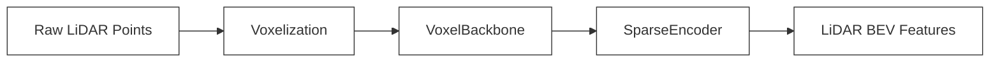
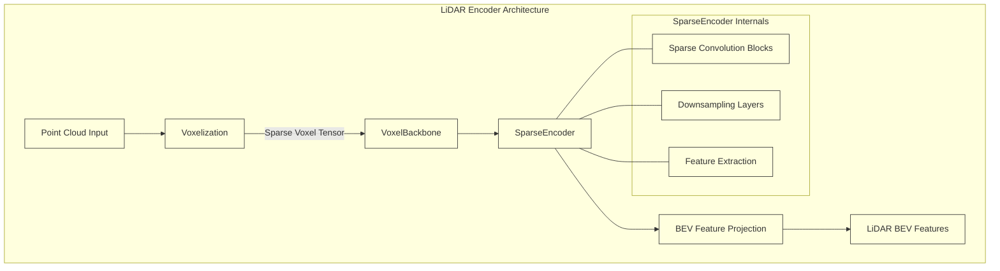
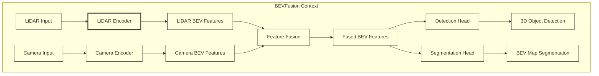

<!-- source: DeepWiki mcp.deepwiki.com · repo mit-han-lab/bevfusion · page 4.2 LiDAR Encoder · fetched 2026-10-30 -->

# LiDAR Encoder

Relevant source files

The following files were used as context for generating this wiki page:

- [configs/nuscenes/det/centerhead/lssfpn/default.yaml](configs/nuscenes/det/centerhead/lssfpn/default.yaml)

The LiDAR Encoder is a critical component of the BEVFusion system responsible for processing 3D point cloud data from LiDAR sensors and transforming it into bird's-eye view (BEV) features. This document explains the architecture, processing workflow, and implementation details of the LiDAR encoding pipeline. For information about processing camera data, see [Camera Encoder](#4.1), and for details on how the outputs of both encoders are combined, see [Multi-Modal Fusion](#4.4).

## Overview

The LiDAR Encoder converts sparse, unstructured 3D point cloud data into structured BEV feature maps that can be effectively processed by subsequent neural network layers. Its primary functions include:

- Converting raw point cloud data into voxel representations
- Processing these voxels through sparse convolutional networks
- Generating BEV feature maps that capture the geometric information of the scene

*Diagram: High-level processing flow of the LiDAR Encoder*

Sources: System architecture diagrams provided in the introduction

## Architecture Components

The LiDAR Encoder consists of several key components that work together to process point cloud data efficiently:

### Voxelization

The first step in the LiDAR encoding process is voxelization, which discretizes the continuous 3D point cloud into a grid of voxels (3D volumes).

Key characteristics:
- Converts irregular point clouds into regular 3D grids
- Reduces computational complexity by grouping points
- Creates a sparse tensor representation where only occupied voxels are processed

### VoxelBackbone

The VoxelBackbone is responsible for initial feature extraction from voxelized point cloud data:

- Processes voxel features through a series of 3D sparse convolutions
- Maintains sparsity of the data to ensure computational efficiency
- Extracts hierarchical features at multiple scales

### SparseEncoder

The SparseEncoder is the core component that efficiently processes the sparse voxel representation:

- Implements sparse convolutions to handle the sparse nature of LiDAR data
- Focuses computation only on occupied voxels, significantly reducing memory and computational requirements
- Builds increasingly abstract feature representations through multiple layers

*Diagram: Detailed architecture of the LiDAR Encoder*

Sources: System architecture diagrams provided in the introduction

## Processing Pipeline

The LiDAR processing pipeline follows a systematic approach to transform raw point cloud data into structured BEV features:

1. **Point Cloud Preprocessing**:
   - Loading point cloud data from files
   - Filtering and sampling points to manage density
   - Applying initial transformations (rotation, translation)

2. **Voxelization Process**:
   - Defining voxel grid dimensions and resolution
   - Assigning points to voxels
   - Computing voxel features (e.g., mean of points within each voxel)

3. **Sparse Convolution Processing**:
   - Converting voxel grid to sparse tensors
   - Applying 3D sparse convolutions
   - Feature aggregation across multiple scales

4. **BEV Projection**:
   - Collapsing the height dimension through operations like max-pooling or concatenation
   - Creating a 2D bird's-eye view feature map

```mermaid
flowchart LR
    subgraph "Point Cloud Processing"
        A1["LoadPointsFromFile"] --> A2["LoadPointsFromMultiSweeps"]
        A2 --> A3["Point Cloud Filtering"]
    end
    
    subgraph "Voxelization"
        B1["Define Voxel Grid"] --> B2["Assign Points to Voxels"]
        B2 --> B3["Compute Voxel Features"]
    end
    
    subgraph "Sparse Processing"
        C1["Sparse Tensor Conversion"] --> C2["3D Sparse Convolutions"]
        C2 --> C3["Multi-scale Feature Extraction"]
    end
    
    subgraph "BEV Conversion"
        D1["Height Dimension Collapse"] --> D2["2D BEV Feature Map"]
    end
    
    A3 --> B1
    B3 --> C1
    C3 --> D1
    
    style A1 fill:none,stroke:#333
    style A2 fill:none,stroke:#333
    style A3 fill:none,stroke:#333
    style B1 fill:none,stroke:#333
    style B2 fill:none,stroke:#333
    style B3 fill:none,stroke:#333
    style C1 fill:none,stroke:#333
    style C2 fill:none,stroke:#333
    style C3 fill:none,stroke:#333
    style D1 fill:none,stroke:#333
    style D2 fill:none,stroke:#333
```

*Diagram: LiDAR data processing pipeline*

Sources: System architecture diagrams provided in the introduction

## Integration with BEVFusion

The LiDAR Encoder plays a critical role in the overall BEVFusion framework:

1. It processes LiDAR data independently from the Camera Encoder
2. Its output (LiDAR BEV features) is combined with Camera BEV features through the fusion mechanism
3. The fused features are used for both 3D object detection and BEV map segmentation

### Feature Dimensions and Compatibility

For successful fusion with camera features, the LiDAR BEV features need to:
- Match the spatial dimensions and resolution of the camera BEV features
- Be compatible in terms of feature channels for effective fusion
- Be aligned in the same coordinate system

Based on the configuration file, the final output channels from the decoder backbone are configured to be compatible with the fusion module:

| Component | Input Channels | Output Channels | Notes |
|-----------|---------------|-----------------|-------|
| Backbone | 336 | [160, 320, 640] | Multi-scale features |
| LSSFPN | [640, 160] | 256 | Feature aggregation |
| Detection Head | 256 | - | For object detection |

Sources: [configs/nuscenes/det/centerhead/lssfpn/default.yaml:11-28]()

## Technical Implementation Considerations

### Sparse Operations

The LiDAR Encoder heavily relies on sparse convolutional operations to efficiently process point cloud data. These operations:
- Avoid unnecessary computation on empty voxels
- Significantly reduce memory usage compared to dense operations
- Enable real-time processing of large point clouds

### Performance Optimizations

Several techniques are employed to optimize the LiDAR Encoder's performance:
- Strategic downsampling to balance detail and computational efficiency
- Hierarchical feature extraction to capture both local and global information
- Efficient implementation of sparse operations using CUDA

### Model Configuration

The decoder configuration (which processes the output of the LiDAR Encoder) uses:
- A GeneralizedResNet backbone with specific block configurations
- An LSSFPN neck to process multi-scale features
- Configurable output channels to interface with detection heads

*Diagram: LiDAR Encoder in the context of the BEVFusion architecture*

Sources: System architecture diagrams provided in the introduction, [configs/nuscenes/det/centerhead/lssfpn/default.yaml:11-28]()

## Conclusion

The LiDAR Encoder is a specialized component designed to efficiently process point cloud data in the BEVFusion framework. Through voxelization and sparse convolution operations, it transforms unstructured 3D points into structured BEV feature maps that can be effectively fused with camera features for 3D perception tasks. The implementation emphasizes computational efficiency and feature quality, enabling real-time performance for autonomous driving applications.

---

