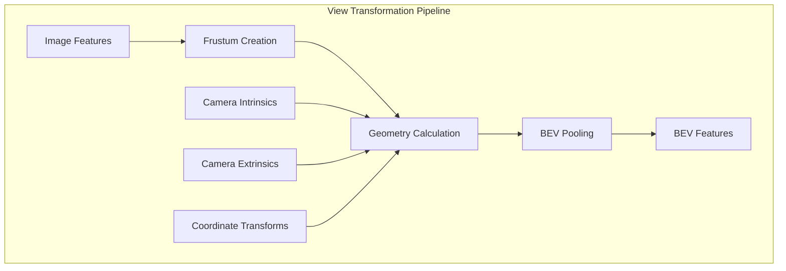
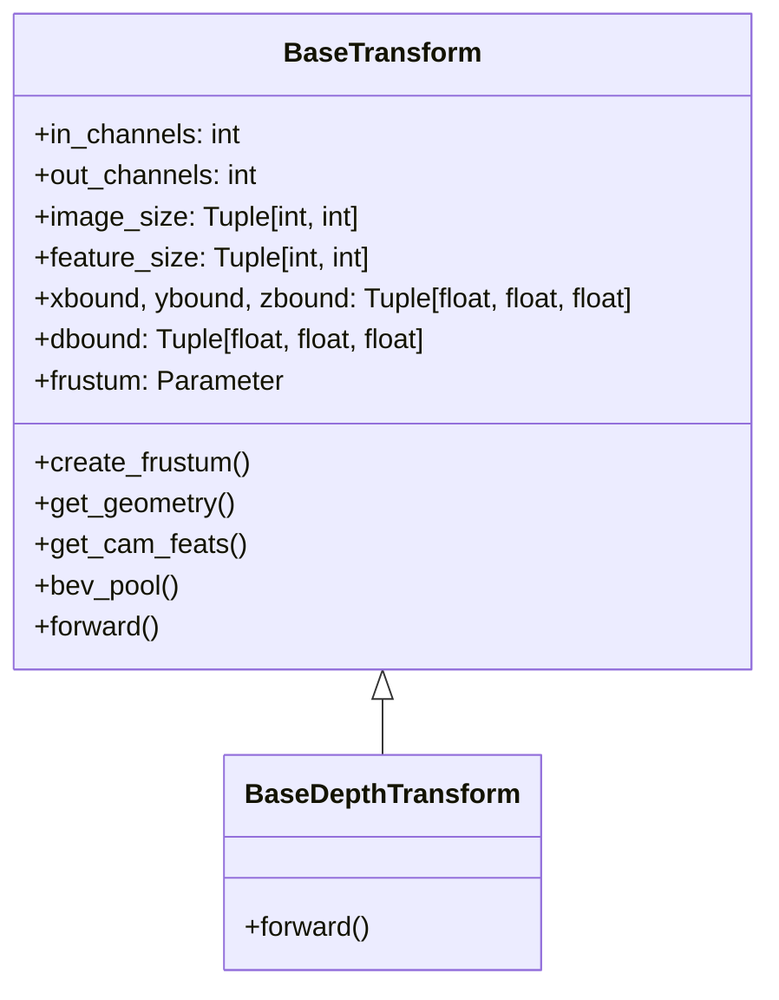
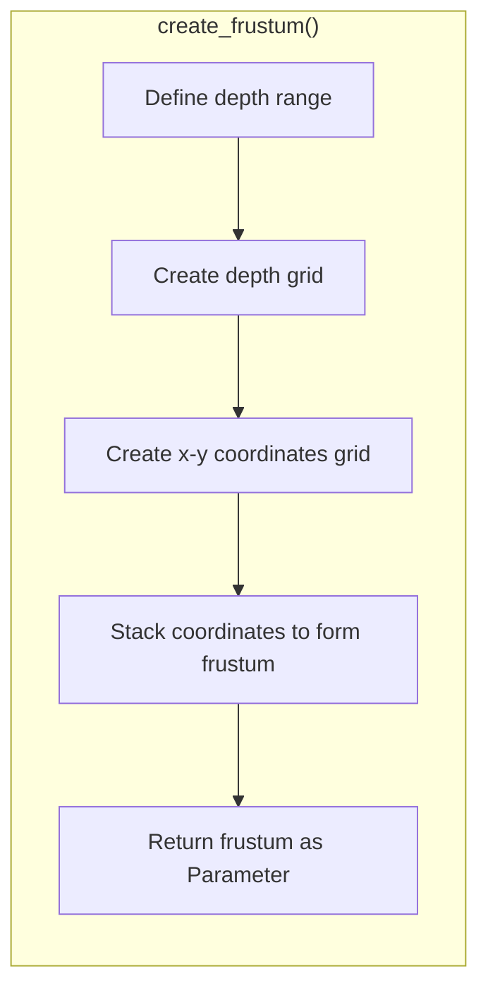
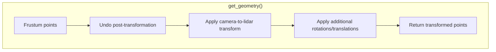
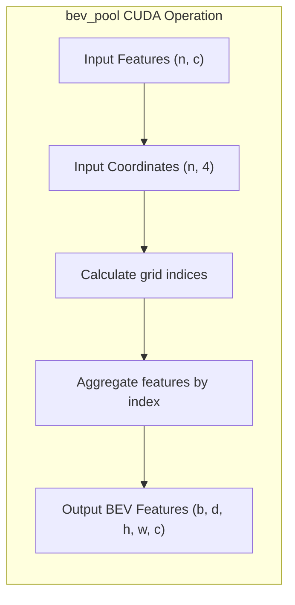
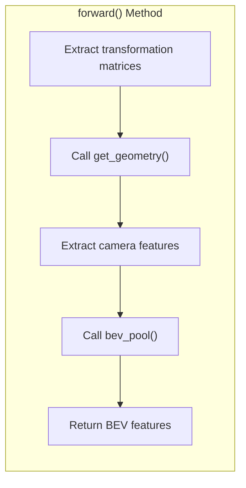
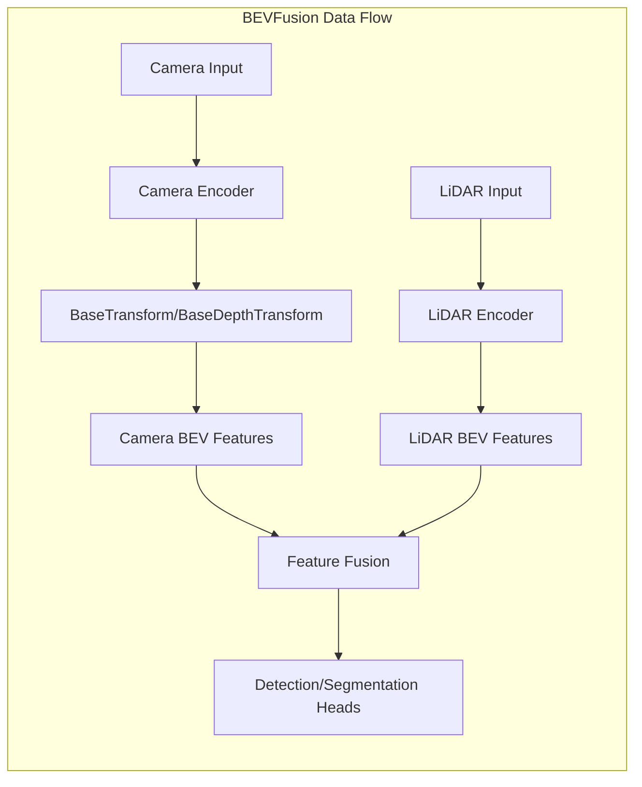
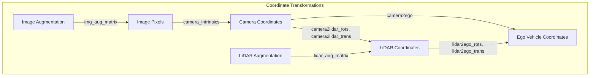

<!-- source: DeepWiki mcp.deepwiki.com · repo mit-han-lab/bevfusion · page 4.3 View Transformation · fetched 2026-10-30 -->

# View Transformation

Relevant source files

The following files were used as context for generating this wiki page:

- [mmdet3d/models/vtransforms/base.py](mmdet3d/models/vtransforms/base.py)
- [mmdet3d/ops/bev_pool/src/bev_pool_cpu.cpp](mmdet3d/ops/bev_pool/src/bev_pool_cpu.cpp)

## Purpose and Scope

The View Transformation component is responsible for converting 2D camera-based features into a bird's-eye view (BEV) representation. This critical process enables the multi-modal fusion of camera and LiDAR data by projecting both sensor modalities into a unified coordinate system. This page describes the architecture, process, and implementation of the view transformation module in BEVFusion.

For information about how the transformed camera features are fused with LiDAR features, see [Multi-Modal Fusion](#4.4).

Sources: [mmdet3d/models/vtransforms/base.py:24-177]()

## Architecture Overview

The view transformation pipeline consists of several key components that work together to transform camera-based features into BEV space.

The foundation of this process is implemented through the `BaseTransform` class, which provides the core functionality for transforming camera features into BEV space.

Sources: [mmdet3d/models/vtransforms/base.py:24-235]()

## Key Components

### BaseTransform Class

The `BaseTransform` class is the fundamental implementation of the view transformation module. It contains:

- Parameter initialization for BEV grid dimensions and depth bounds
- Frustum creation for camera view representation
- Coordinate transformations between camera, LiDAR, and BEV spaces
- BEV pooling operations to aggregate features into the BEV grid

Sources: [mmdet3d/models/vtransforms/base.py:24-235](), [mmdet3d/models/vtransforms/base.py:238-361]()

## The Transformation Process

### 1. Frustum Creation

The frustum is a 3D representation of the camera's field of view at different depths. It serves as the basis for projecting 2D image features into 3D space.

The frustum is created with dimensions corresponding to the feature map size and the depth range specified in the configuration.

Sources: [mmdet3d/models/vtransforms/base.py:65-89]()

### 2. Geometry Calculation

The `get_geometry` method performs the necessary coordinate transformations to convert points from camera view space to BEV space.

This process involves multiple matrix operations to transform the coordinates properly:
1. Undoing post-processing transformations
2. Applying camera-to-LiDAR transformations
3. Applying additional rotations/translations if specified

Sources: [mmdet3d/models/vtransforms/base.py:91-135]()

### 3. BEV Pooling

The BEV pooling operation aggregates image features from different views and depths into a unified BEV grid.

This step is the most computationally intensive part and is accelerated using a custom CUDA implementation.

Sources: [mmdet3d/models/vtransforms/base.py:140-176](), [mmdet3d/ops/bev_pool/src/bev_pool_cpu.cpp:13-47]()

## BEV Pooling CUDA Operation

The actual BEV pooling is implemented using a custom CUDA operation for efficiency. This operation maps the transformed 3D points to the BEV grid cells and aggregates the corresponding features.

The CUDA operation takes the following inputs:
- Feature vectors from image features
- Geometric indices indicating where each feature maps to in the BEV grid
- Interval information for efficient aggregation
- Output dimensions for the BEV grid

Sources: [mmdet3d/ops/bev_pool/src/bev_pool_cpu.cpp:22-47](), [mmdet3d/ops/bev_pool/src/bev_pool_cpu.cpp:60-87]()

## Depth-Based View Transformation

For improved accuracy, BEVFusion also implements a depth-aware view transformation through the `BaseDepthTransform` class. This class enhances the basic transformation by incorporating depth information.

Key aspects of depth-based transformation:
- Can use either LiDAR or radar points for depth information
- Options for depth representation (scalar values or one-hot encoding)
- Optional feature enrichment by adding point features to depth information

Sources: [mmdet3d/models/vtransforms/base.py:238-361]()

## Forward Pass Implementation

The forward pass ties all these components together, implementing the full view transformation process.

The forward method handles:
1. Extracting transformation matrices from inputs
2. Calculating geometry for the transformation
3. Extracting camera features
4. Applying BEV pooling
5. Returning the resulting BEV features

Sources: [mmdet3d/models/vtransforms/base.py:178-234]()

## Integration with BEVFusion

View transformation is a critical component in the BEVFusion pipeline, serving as the bridge between camera-based perception and 3D space.

The view transformation converts camera features into the same coordinate system as LiDAR features, enabling effective multi-modal fusion.

Sources: [mmdet3d/models/vtransforms/base.py:24-361]()

## Coordinate System Handling

The view transformation process involves several coordinate system transformations, which are managed through a series of matrix operations.

These transformations ensure that features from different coordinate systems are properly aligned in the final BEV representation.

Sources: [mmdet3d/models/vtransforms/base.py:91-135](), [mmdet3d/models/vtransforms/base.py:194-215]()

## Technical Considerations

When implementing or modifying the view transformation component, consider:

1. **Memory Efficiency**: The transformation process can be memory-intensive, especially with high-resolution feature maps.
2. **Computational Performance**: The BEV pooling operation is computationally expensive and benefits from GPU acceleration.
3. **Coordinate System Consistency**: Ensure that all coordinate transformations are correctly defined and applied.
4. **Depth Information Quality**: When using depth-based transformation, the quality of depth information significantly affects the results.

Sources: [mmdet3d/models/vtransforms/base.py:140-176](), [mmdet3d/ops/bev_pool/src/bev_pool_cpu.cpp:13-47]()

---

