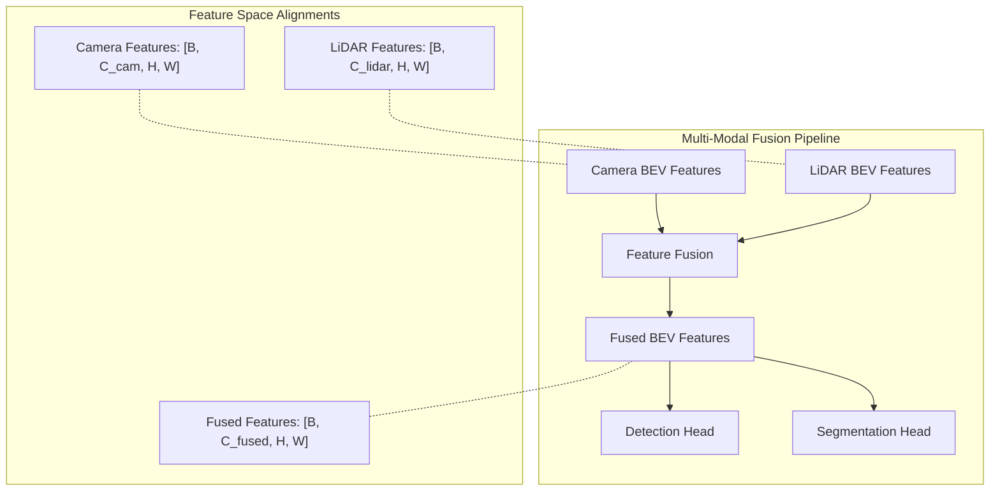
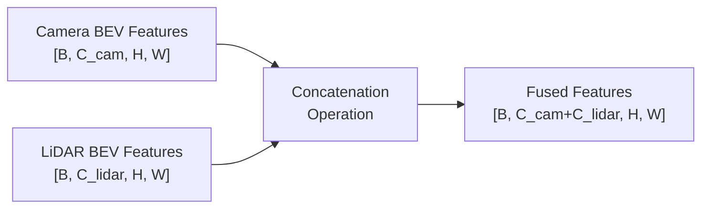
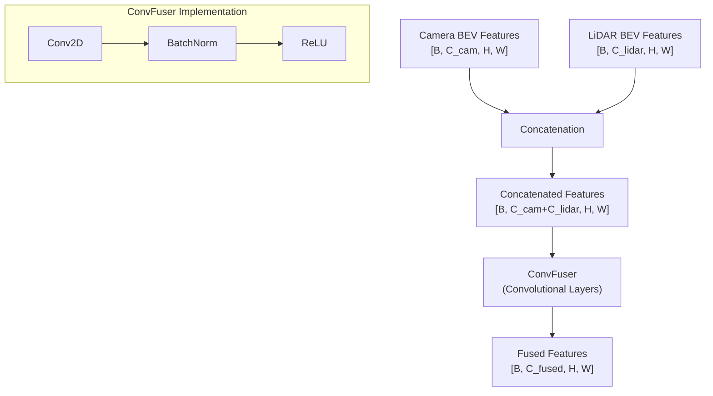
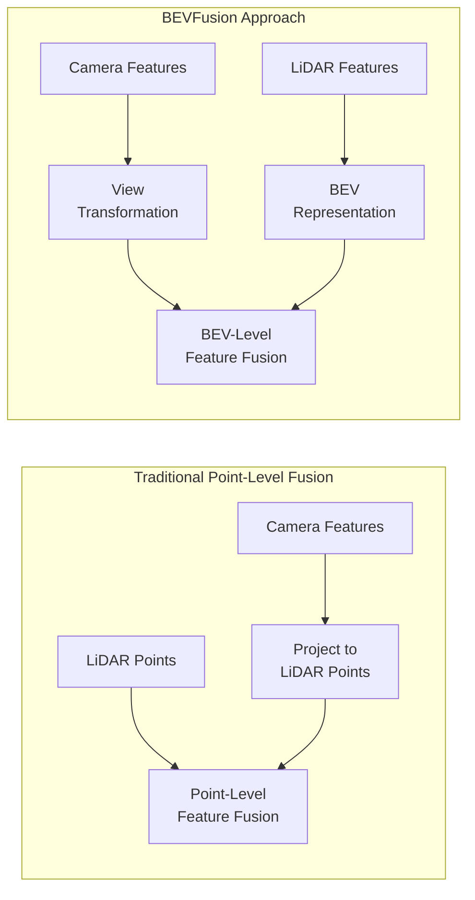
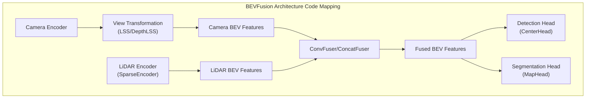
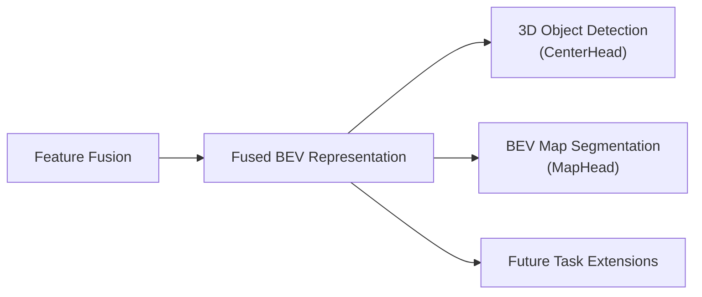

<!-- source: DeepWiki mcp.deepwiki.com · repo mit-han-lab/bevfusion · page 4.4 Multi-Modal Fusion · fetched 2026-10-30 -->

# Multi-Modal Fusion

<details>
<summary>Relevant source files</summary>

The following files were used as context for generating this wiki page:

- [README.md](README.md)
- [assets/demo.gif](assets/demo.gif)
- [docker/Dockerfile](docker/Dockerfile)
- [mmdet3d/datasets/pipelines/utils.py](mmdet3d/datasets/pipelines/utils.py)

</details>


## Purpose and Scope

This document details how BEVFusion combines features from camera and LiDAR sensors into a unified representation. The multi-modal fusion component represents a critical innovation in BEVFusion's architecture, allowing it to leverage the complementary strengths of both sensor types. Unlike traditional point-level fusion approaches, BEVFusion performs fusion in the bird's-eye view (BEV) space, preserving both geometric and semantic information from different modalities.

For information about how individual modalities are processed before fusion, see [Camera Encoder](#4.1), [LiDAR Encoder](#4.2), and [View Transformation](#4.3).

## Fusion Architecture Overview

BEVFusion's multi-modal fusion differs fundamentally from traditional approaches by first transforming features from each modality into a shared BEV representation before fusion, rather than projecting camera features onto LiDAR points.



Sources: README.md

## Fusion Methods

BEVFusion supports two primary fusion methods for combining camera and LiDAR BEV features:

### 1. Concatenation Fusion

The simplest fusion approach is direct feature concatenation along the channel dimension. This preserves all information from both modalities without any information loss.



Sources: README.md

### 2. ConvFuser

The more sophisticated approach uses a ConvFuser module, which applies convolutional layers after concatenation to blend and reduce the feature dimensions.



Sources: README.md

## BEV Representation Advantages

Fusing in the BEV space offers several key advantages over traditional point-level fusion:

1. **Preservation of Information Density**: Camera features retain their dense semantic information rather than being sparsely projected onto LiDAR points
2. **Spatial Alignment**: Both modalities naturally align in the bird's-eye view coordinate system
3. **Computational Efficiency**: Avoiding point-level correspondence reduces computational overhead



Sources: README.md

## Implementation Details

The fusion implementation is modular and configurable through the configuration system. The primary fusion options can be specified in the config files:

### Fusion Configuration

In the configuration files, fusion can be specified as either a simple concatenation or using the ConvFuser module. For example, in the detection task, the fusion method is specified in the model configuration:

```
model:
  encoders:
    camera: {...}
    lidar: {...}
  fuser:
    type: ConvFuser  # or 'ConcatFuser'
    in_channels: [80, 256]  # [camera_channels, lidar_channels]
    out_channels: 256
```

Sources: README.md

## Performance Characteristics

### Computational Efficiency

BEVFusion's approach to multi-modal fusion is designed for computational efficiency, achieving:

| Metric | Value | Comparison to Point-Level Fusion |
|--------|-------|---------------------------------|
| Computation Cost | 1.9× lower | vs. comparable point-level fusion approaches |
| BEV Operation Latency | >40× reduction | with optimized BEV pooling |

Sources: README.md

### Accuracy Improvements

The fusion approach demonstrates significant performance gains over single-modality baselines:

| Task | Metric | Camera-Only | LiDAR-Only | BEVFusion (Improvement) |
|------|--------|-------------|------------|-------------------------|
| 3D Object Detection | mAP | 35.56 | 64.68 | 68.52 (+3.84) |
| 3D Object Detection | NDS | 41.21 | 69.28 | 71.38 (+2.10) |
| BEV Map Segmentation | mIoU | 57.09 | 48.56 | 62.95 (+5.86) |

Sources: README.md

## Code Integration

The fusion component integrates with both detection and segmentation task heads, providing a unified representation that works effectively for multiple perception tasks.



Sources: README.md

## Comparison to Point-Level Fusion Approaches

BEVFusion's design directly addresses limitations of traditional point-level fusion approaches:

| Aspect | Point-Level Fusion | BEVFusion's BEV-Level Fusion |
|--------|-------------------|------------------------------|
| Information Preservation | Loses camera feature density when projecting to sparse points | Preserves dense camera features in BEV space |
| Processing Efficiency | Requires point-to-pixel correspondence computation | Aligns features in a common BEV grid |
| Task Flexibility | Often optimized for specific tasks | Naturally supports multiple perception tasks |
| Feature Resolution | Limited by point cloud density | Configurable BEV grid resolution |

Sources: README.md

## Task-Agnostic Design

A key advantage of BEVFusion's fusion approach is its task-agnostic nature. The same fused representation effectively supports both 3D object detection and BEV map segmentation with minimal architectural modifications.



Sources: README.md

## Summary

BEVFusion's multi-modal fusion approach represents a significant advancement over traditional point-level fusion methods. By transforming features from both modalities into a unified BEV representation before fusion, the system preserves critical information from each sensor while enabling efficient processing. The modular design supports both simple concatenation and more sophisticated convolutional fusion approaches, providing flexibility for different application requirements.

---

