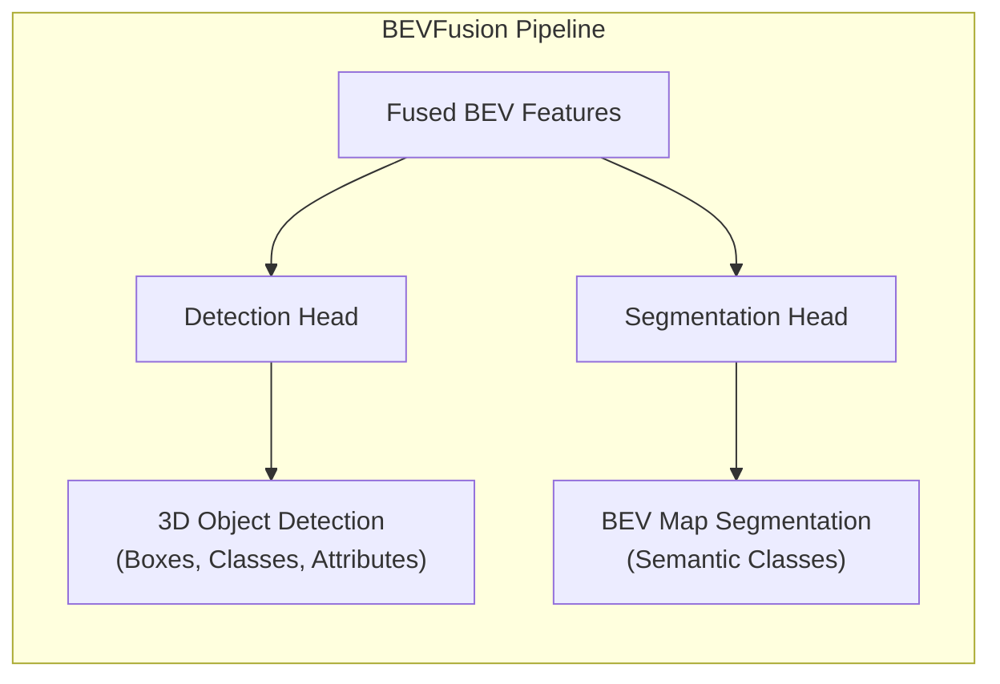
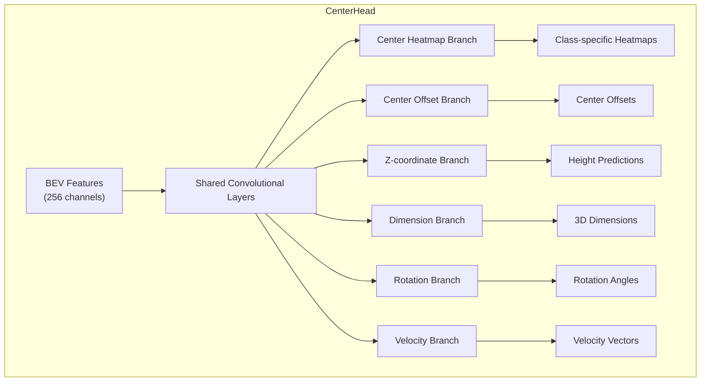
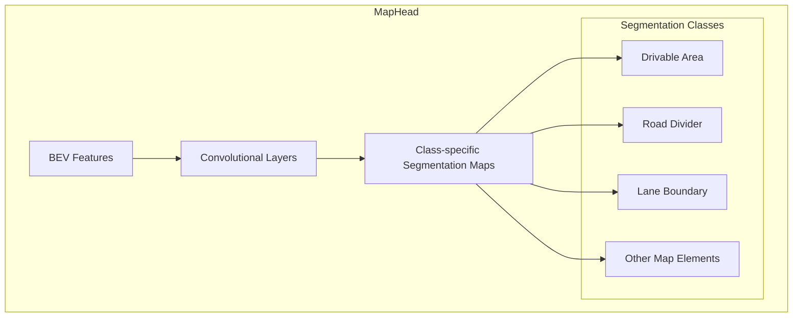
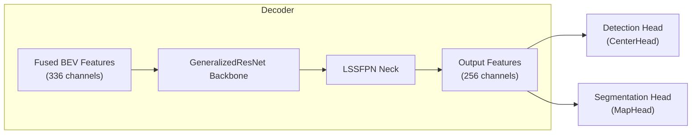

<!-- source: DeepWiki mcp.deepwiki.com · repo mit-han-lab/bevfusion · page 4.5 Detection and Segmentation Heads · fetched 2026-10-30 -->

# Detection and Segmentation Heads

<details>
<summary>Relevant source files</summary>

The following files were used as context for generating this wiki page:

- [configs/nuscenes/det/centerhead/lssfpn/default.yaml](configs/nuscenes/det/centerhead/lssfpn/default.yaml)

</details>


This document details the detection and segmentation heads used in the BEVFusion framework for 3D object detection and bird's-eye view (BEV) map segmentation. These task-specific heads operate on the fused BEV features to produce the final perception outputs. For information about how these features are generated and fused, see [Multi-Modal Fusion](#4.4).

## Overview

Detection and segmentation heads are the final components in the BEVFusion pipeline that transform the fused BEV features into meaningful perception outputs:

1. **Detection Head**: Predicts 3D bounding boxes around objects with classification scores and attributes
2. **Segmentation Head**: Generates semantic segmentation maps in the bird's-eye view



Sources: [configs/nuscenes/det/centerhead/lssfpn/default.yaml:26-28]()

## Detection Head

The primary detection head in BEVFusion is the `CenterHead`, which is designed for center-based 3D object detection. This design approach represents objects as points at their centers and regresses to other object properties.

### Architecture

The `CenterHead` consists of several task-specific branches that handle different prediction aspects:



### Implementation Details

The detection head processes the BEV features (typically 256 channels as specified in the configuration) through several prediction branches:

1. **Center Heatmap Branch**: Produces class-specific heatmaps indicating object center probabilities
2. **Center Offset Branch**: Predicts offsets to refine the center positions
3. **Z-coordinate Branch**: Estimates the height (z-coordinate) of objects
4. **Dimension Branch**: Predicts the 3D dimensions (length, width, height) of objects
5. **Rotation Branch**: Estimates the rotation angles of objects
6. **Velocity Branch**: Predicts velocity vectors for dynamic objects (when applicable)

The head uses a shared convolutional backbone followed by task-specific convolutional layers for each branch. The configuration allows customization of the input channel count and other architectural details.

Sources: [configs/nuscenes/det/centerhead/lssfpn/default.yaml:26-28]()

## Segmentation Head

The `MapHead` handles BEV semantic segmentation, producing pixel-wise classification of the environment in bird's-eye view.

### Architecture



### Implementation Details

The segmentation head takes the fused BEV features and applies a series of convolutional layers to produce class-specific segmentation masks. These masks represent different semantic classes in the bird's-eye view, such as:

1. Drivable area
2. Pedestrian crossing
3. Road boundaries
4. Lane dividers
5. Other map elements

The output is typically a set of probability maps with the same spatial dimensions as the BEV feature representation, but with channels corresponding to the number of semantic classes being segmented.

## Integration with Decoder Architecture

Both heads connect to the BEV features that have been processed by the decoder, which consists of a backbone network and neck component:



The decoder's architecture is specified in the configuration, with:
1. A `GeneralizedResNet` backbone that processes the initial fused BEV features
2. An `LSSFPN` (Large Scale Sparse Feature Pyramid Network) neck that refines and aggregates features at different scales
3. Output features with 256 channels that feed into both the detection and segmentation heads

Sources: [configs/nuscenes/det/centerhead/lssfpn/default.yaml:11-28]()

## Configuration

The heads can be configured through YAML configuration files, which specify:

1. Input channel dimensions
2. Network architecture parameters
3. Loss function weights
4. Other task-specific hyperparameters

Example configuration from the default YAML:

```yaml
model:
  decoder:
    backbone:
      type: GeneralizedResNet
      in_channels: 336
      blocks:
        - [2, 160, 2]
        - [2, 320, 2]
        - [2, 640, 1]
    neck:
      type: LSSFPN
      in_indices: [-1, 0]
      in_channels: [640, 160]
      out_channels: 256
      scale_factor: 2
  heads:
    object:
      in_channels: 256
```

This configuration shows:
- The detection head (`object`) receives 256-channel features
- The decoder uses a `GeneralizedResNet` backbone and `LSSFPN` neck to process the 336-channel fused BEV features
- The `LSSFPN` neck outputs 256 channels that feed into the detection and segmentation heads

Sources: [configs/nuscenes/det/centerhead/lssfpn/default.yaml:11-28]()

## Performance Considerations

The heads are designed to be computationally efficient while maintaining high accuracy:

| Head Type | Input Channels | Output Type | Computational Cost |
|-----------|---------------|-------------|-------------------|
| Detection (CenterHead) | 256 | 3D Bounding Boxes + Attributes | Medium |
| Segmentation (MapHead) | 256 | Semantic Class Maps | Medium-High |

The overall performance of these heads contributes significantly to BEVFusion's state-of-the-art results on benchmarks like nuScenes, while maintaining the capability for real-time inference.

---

