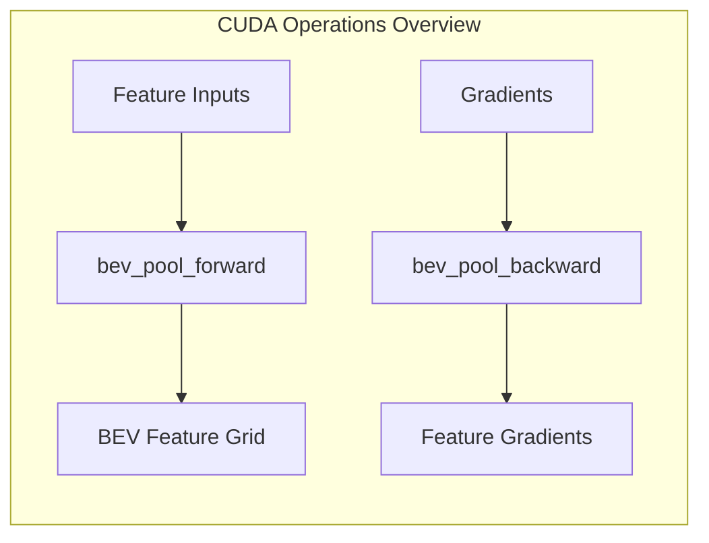
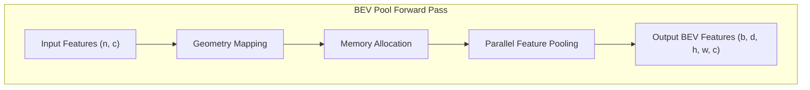
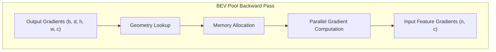
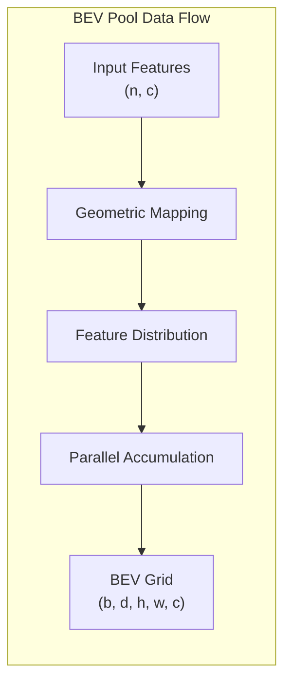
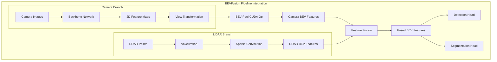

<!-- source: DeepWiki mcp.deepwiki.com · repo mit-han-lab/bevfusion · page 5 CUDA Operations · fetched 2026-10-30 -->

# CUDA Operations

<details>
<summary>Relevant source files</summary>

The following files were used as context for generating this wiki page:

- [README.md](README.md)
- [assets/demo.gif](assets/demo.gif)
- [docker/Dockerfile](docker/Dockerfile)
- [mmdet3d/datasets/pipelines/utils.py](mmdet3d/datasets/pipelines/utils.py)
- [mmdet3d/ops/bev_pool/src/bev_pool_cpu.cpp](mmdet3d/ops/bev_pool/src/bev_pool_cpu.cpp)

</details>


This page documents the specialized CUDA operations used in BEVFusion to accelerate the transformation of features into Bird's-Eye View (BEV) representation. These operations are critical for achieving real-time performance in multi-modal 3D perception tasks, with optimized versions of BEVFusion reaching 25 FPS on NVIDIA Jetson Orin platforms.

For information about the view transformation pipeline that uses these operations, see [View Transformation](#4.3).

## Overview

BEVFusion implements custom CUDA operations to efficiently transform features from different modalities into a unified BEV representation. The most significant of these is the BEV pooling operation, which dramatically improves performance by optimizing how 3D features are projected and aggregated in the BEV space.

Through these optimizations, BEVFusion reduces the transformation latency by more than 40x compared to standard implementations, making real-time multi-modal fusion feasible even on edge devices.



Sources: [README.md:20-20]()

## BEV Pooling Operation

The BEV pooling operation is a specialized CUDA kernel that efficiently maps features from image or point cloud representations into a bird's-eye view grid. This operation is fundamental for the fusion process, allowing features from different sensors to be represented in a common spatial reference frame.

### Forward Pass

The forward pass of BEV pooling takes input features (typically from camera or LiDAR) and maps them into a BEV grid based on geometric information. This operation handles the transformation of features from their original representation to the unified BEV space.



Sources: [mmdet3d/ops/bev_pool/src/bev_pool_cpu.cpp:13-47]()

### Backward Pass

The backward pass computes gradients with respect to the input features, enabling end-to-end training of the network. This operation is essential for propagating gradients through the BEV transformation layer during backpropagation.



Sources: [mmdet3d/ops/bev_pool/src/bev_pool_cpu.cpp:50-87]()

## Implementation Details

The BEV pooling operation is implemented using a combination of C++ interfaces and CUDA kernels. The operations are defined with the following interfaces:

### Forward Function

```
bev_pool_forward(
  const at::Tensor _x,
  const at::Tensor _geom_feats, 
  const at::Tensor _interval_lengths, 
  const at::Tensor _interval_starts,
  int b, int d, int h, int w
)
```

This function takes the following parameters:
- `_x`: Input features with shape `(n, c)` where `n` is the number of points and `c` is the feature dimension
- `_geom_feats`: Geometry features with shape `(n, 4)` indicating the mapping positions
- `_interval_lengths`: Lengths of each pooling interval
- `_interval_starts`: Starting positions for each pooling interval
- `b, d, h, w`: Dimensions of the output BEV feature grid

### Backward Function

```
bev_pool_backward(
  const at::Tensor _out_grad,
  const at::Tensor _geom_feats, 
  const at::Tensor _interval_lengths, 
  const at::Tensor _interval_starts,
  int b, int d, int h, int w
)
```

This function takes the following parameters:
- `_out_grad`: Gradients with respect to the output with shape `(b, d, h, w, c)`
- `_geom_feats`, `_interval_lengths`, `_interval_starts`: Same as in the forward pass
- `b, d, h, w`: Dimensions of the BEV feature grid

Sources: [mmdet3d/ops/bev_pool/src/bev_pool_cpu.cpp:22-87]()

## Data Flow and Memory Layout

The BEV pooling operation processes data through several stages, each optimized for parallel execution on GPU hardware.



### Memory Layout Optimization

The memory layout of the BEV features is specifically designed to optimize cache utilization and minimize memory accesses:

| Parameter | Description | Shape |
|-----------|-------------|-------|
| Input Features | Original feature vectors | (n, c) |
| Geometry Features | Mapping to BEV coordinates | (n, 4) |
| Interval Lengths | Number of points per BEV cell | (n_intervals) |
| Interval Starts | Starting indices for pooling | (n_intervals) |
| Output BEV Features | Final BEV representation | (b, d, h, w, c) |

Sources: [mmdet3d/ops/bev_pool/src/bev_pool_cpu.cpp:22-47]()

## Integration with BEVFusion Pipeline

The CUDA operations are integrated into the BEVFusion pipeline, primarily in the View Transformation stage, where features from cameras or LiDAR are transformed into the BEV space.



Sources: [README.md:18-20](), [README.md:51-52]()

## Performance Impact

The optimized CUDA operations significantly improve the performance of BEVFusion:

1. **Reduced Latency**: The BEV pooling operation reduces the latency of view transformation by more than 40x compared to naive implementations.

2. **Improved Throughput**: The optimized CUDA kernels enable real-time processing of sensor data, with the full BEVFusion system achieving up to 25 FPS on NVIDIA Jetson Orin platforms.

3. **Lower Computation Cost**: Despite achieving higher accuracy, BEVFusion with these optimized operations has 1.9x lower computation cost compared to previous methods.

| Operation | Speed Improvement | Memory Usage Reduction |
|-----------|-------------------|------------------------|
| BEV Pooling Forward | >40x faster | Constant memory usage |
| BEV Pooling Backward | >40x faster | Constant memory usage |

Sources: [README.md:20-20](), [README.md:10-10]()

## Compilation and Setup

The CUDA operations are compiled as extensions to PyTorch. To use these operations, users need to compile them during the setup process using the following command:

```
python setup.py develop
```

This command compiles the CUDA kernels and makes them available in the Python environment. The operations can also be built in a Docker environment, which is supported through the provided Dockerfile.

Sources: [README.md:77-81](), [README.md:95-100]()

## Summary

The custom CUDA operations in BEVFusion, particularly the BEV pooling operation, are critical components that enable efficient transformation of features into the BEV space. These operations significantly improve the performance of the system, making real-time multi-modal fusion feasible for autonomous driving applications.

By optimizing these GPU-accelerated operations, BEVFusion achieves state-of-the-art performance in 3D object detection and BEV map segmentation while maintaining real-time inference capabilities.

---

