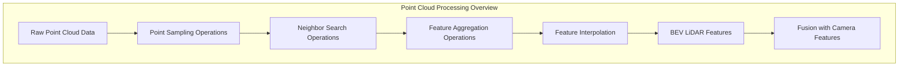
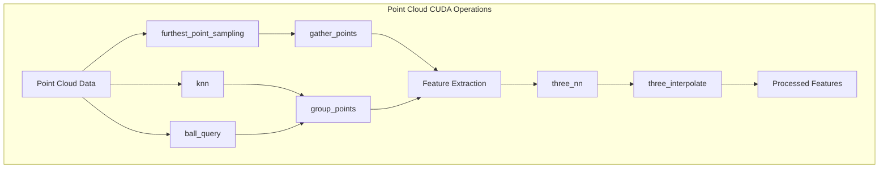
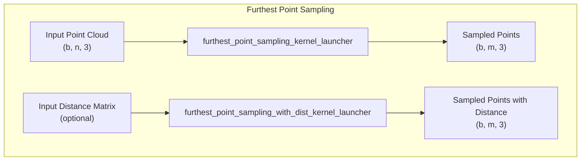
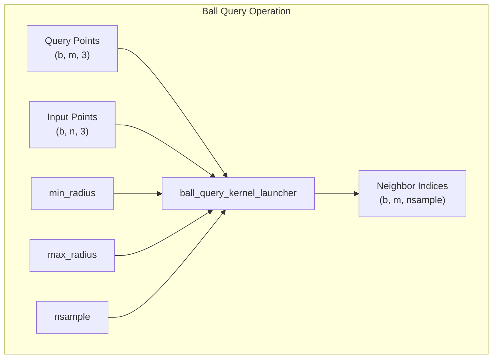
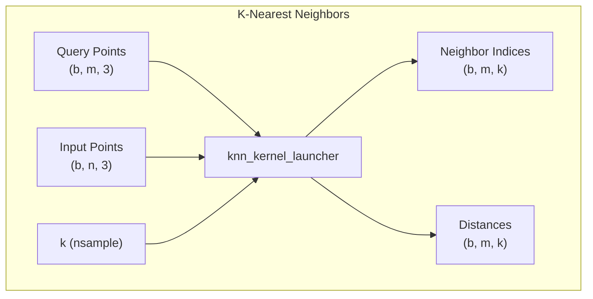
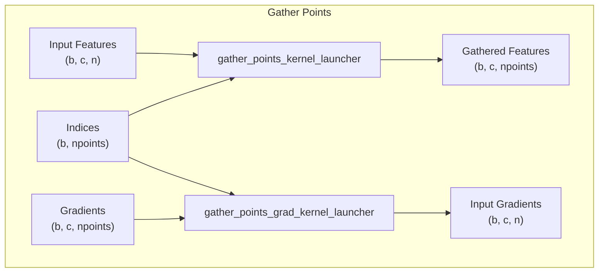
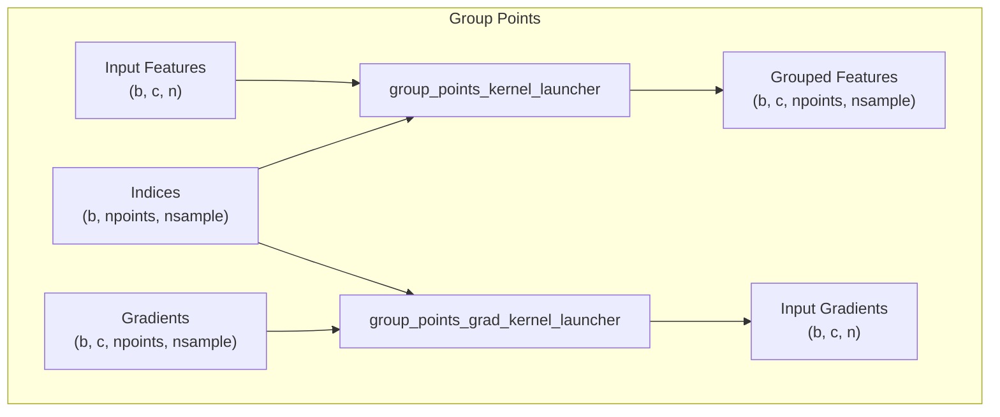
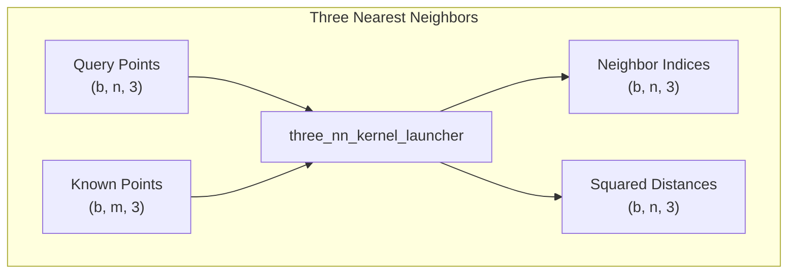
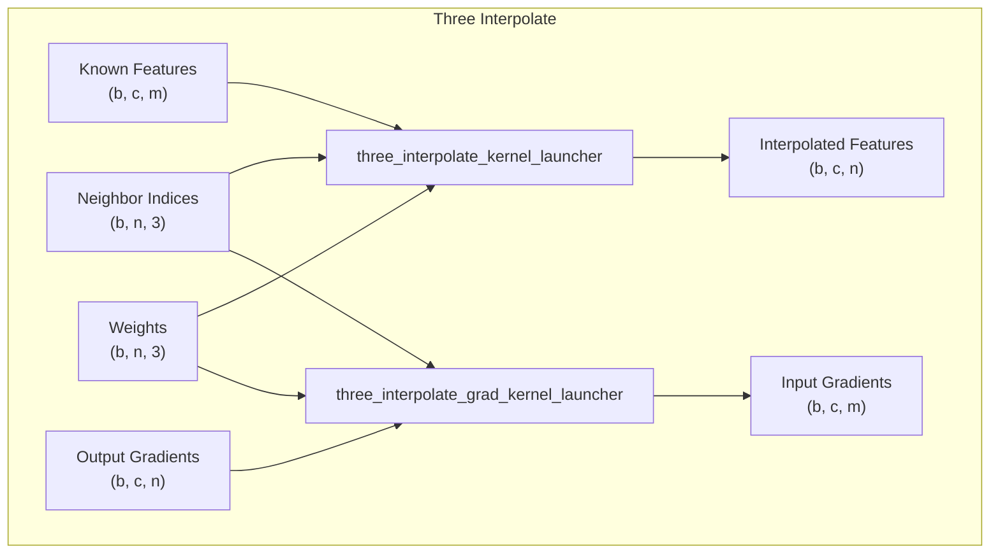
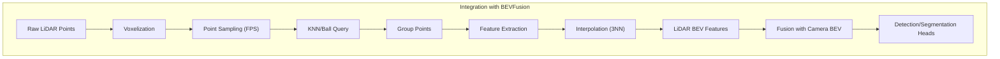

<!-- source: DeepWiki mcp.deepwiki.com · repo mit-han-lab/bevfusion · page 5.1 Point Cloud Processing Operations · fetched 2026-10-30 -->

# Point Cloud Processing Operations

Relevant source files

The following files were used as context for generating this wiki page:

- [mmdet3d/ops/ball_query/src/ball_query_cpu.cpp](mmdet3d/ops/ball_query/src/ball_query_cpu.cpp)
- [mmdet3d/ops/furthest_point_sample/src/furthest_point_sample_cpu.cpp](mmdet3d/ops/furthest_point_sample/src/furthest_point_sample_cpu.cpp)
- [mmdet3d/ops/gather_points/src/gather_points_cpu.cpp](mmdet3d/ops/gather_points/src/gather_points_cpu.cpp)
- [mmdet3d/ops/group_points/src/group_points_cpu.cpp](mmdet3d/ops/group_points/src/group_points_cpu.cpp)
- [mmdet3d/ops/interpolate/src/interpolate.cpp](mmdet3d/ops/interpolate/src/interpolate.cpp)
- [mmdet3d/ops/knn/src/knn_cpu.cpp](mmdet3d/ops/knn/src/knn_cpu.cpp)

## Purpose and Scope

This document describes the specialized CUDA operations used for processing point cloud data in the BEVFusion framework. These operations provide efficient implementations of fundamental point cloud processing algorithms that support LiDAR feature extraction in the system's perception pipeline. For information on sparse convolution operations used in conjunction with these point operations, see [Sparse Convolution Operations](#5.2).

Sources: All provided files

## Core Point Cloud Operations

The BEVFusion framework implements several CUDA-accelerated operations for efficient point cloud processing. These operations are fundamental building blocks for processing 3D point cloud data and are particularly important for the LiDAR encoder branch of the system.

Sources: All provided files

### Sampling Operations

Sampling operations reduce the number of points while maintaining the structural characteristics of the point cloud.

#### Furthest Point Sampling (FPS)

Furthest Point Sampling selects a subset of points where each new point is the furthest from the previously selected points. This ensures good coverage of the entire point cloud with reduced data.

**Implementation Details:**
- Two variants implemented:
  1. Standard FPS using Euclidean distance
  2. FPS with pre-computed distance matrix
- Time complexity reduced through CUDA parallelization

Sources: [mmdet3d/ops/furthest_point_sample/src/furthest_point_sample_cpu.cpp:10-62]()

### Neighbor Search Operations

Neighbor search operations find points in proximity to query points, essential for local feature aggregation.

#### Ball Query

Ball Query finds all points within a specified radius around each query point. This operation is used to identify local neighborhoods for feature aggregation.

**Implementation Details:**
- Parameters include minimum radius, maximum radius, and maximum number of samples
- Returns indices of neighboring points within the specified radii
- Used to identify local regions for feature extraction

Sources: [mmdet3d/ops/ball_query/src/ball_query_cpu.cpp:1-45]()

#### K-Nearest Neighbors (KNN)

KNN finds the k closest points to each query point based on Euclidean distance.

**Implementation Details:**
- Returns both indices and squared distances to the k-nearest neighbors
- Efficient implementation using CUDA heap-based priority queue

Sources: [mmdet3d/ops/knn/src/knn_cpu.cpp:1-44]()

### Feature Aggregation Operations

These operations aggregate features from identified neighborhoods to capture local geometric structures.

#### Gather Points

Gathers points or features from a point cloud based on specified indices.

**Implementation Details:**
- Forward pass: Selects features based on provided indices
- Backward pass: Propagates gradients back to the original points
- Typically used after sampling operations to collect features of sampled points

Sources: [mmdet3d/ops/gather_points/src/gather_points_cpu.cpp:1-57]()

#### Group Points

Groups points or features based on neighborhood indices, typically obtained from ball query or KNN.

**Implementation Details:**
- Aggregates features from neighborhoods defined by indices
- Supports backpropagation through gradient operation
- Essential for capturing local geometric patterns in point clouds

Sources: [mmdet3d/ops/group_points/src/group_points_cpu.cpp:1-60]()

### Feature Interpolation Operations

Interpolation operations transfer features between different point sets, which is crucial for multi-scale feature learning.

#### Three Nearest Neighbors (3NN)

Finds the three nearest neighbors for each query point to support feature interpolation.

**Implementation Details:**
- Returns both indices and squared distances to three nearest neighbors
- Used as input for the three_interpolate operation

Sources: [mmdet3d/ops/interpolate/src/interpolate.cpp:44-54]()

#### Three Interpolate

Performs feature interpolation using inverse distance weighted average of the three nearest neighbors.

**Implementation Details:**
- Forward pass: Interpolates features based on distances to three nearest neighbors
- Backward pass: Propagates gradients back to the original points
- Typically used to propagate features between point sets of different densities

Sources: [mmdet3d/ops/interpolate/src/interpolate.cpp:56-91]()

## Integration with BEVFusion Pipeline

These point cloud processing operations form the foundation of the LiDAR branch in the BEVFusion system. They enable efficient processing of sparse 3D point clouds before fusion with camera features in the bird's-eye view representation.

Sources: All provided files

## Performance Considerations

The CUDA implementations of these point cloud operations provide significant acceleration compared to CPU implementations, which is critical for real-time performance in autonomous driving applications.

| Operation | Time Complexity | Memory Usage | Performance Impact |
|-----------|-----------------|--------------|-------------------|
| FPS | O(n×m) | O(n+m) | Reduces point cloud density while preserving structure |
| Ball Query | O(n×m) | O(m×nsample) | Identifies local neighborhoods efficiently |
| KNN | O(n×m×log(k)) | O(m×k) | More precise neighbor selection than ball query |
| Gather Points | O(n×c) | O(m×c) | Low overhead feature selection |
| Group Points | O(m×nsample×c) | O(m×nsample×c) | Moderate compute for feature aggregation |
| 3NN/Interpolate | O(n×m) | O(n×3) | Efficient feature transfer between point sets |

Sources: All provided files

## Summary

The point cloud processing operations implemented in BEVFusion provide efficient CUDA accelerated algorithms for processing 3D LiDAR data. These operations enable the system to effectively extract features from sparse point clouds, which are then transformed into a bird's-eye view representation for fusion with camera features. The optimized CUDA implementations ensure that these operations can be performed with minimal latency, which is critical for real-time perception in autonomous driving applications.

---

